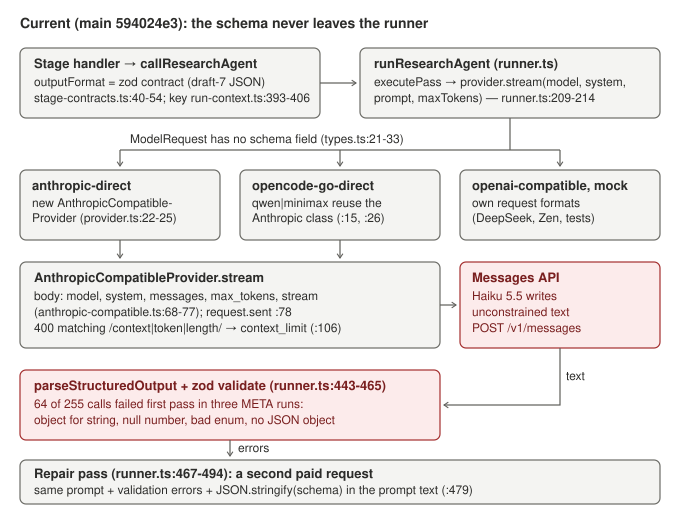
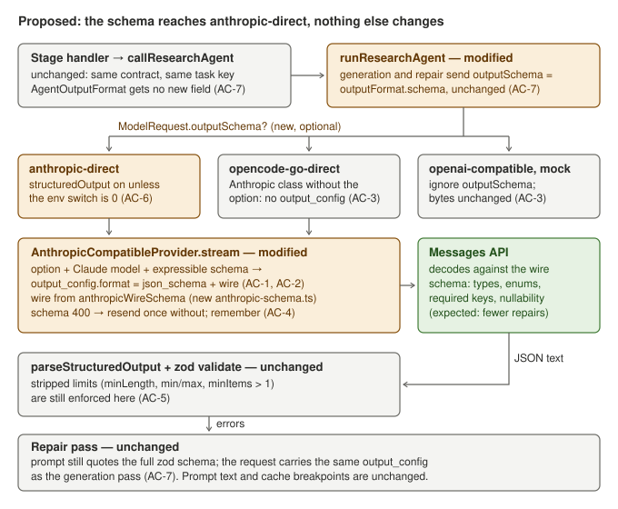
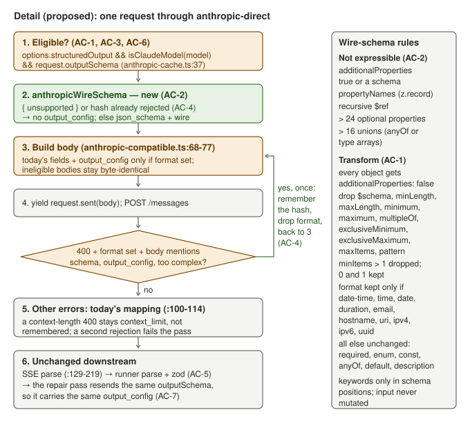

# Anthropic structured output on anthropic-direct

## Problem and behavior

On the Anthropic API path (`RESEARCH_MODEL_PROVIDER=anthropic-direct`, Claude Haiku 5.5),
many model calls fail first-pass validation and need a repair call. Across three META runs,
64 of 255 calls needed a repair. Most first-pass errors are shape errors: "expected string,
received object", "expected number, received null", an invalid enum option, or "No valid
JSON object found".

The cause is in the request. Every contract already has a JSON schema, but it never leaves
the runner:

- `ModelRequest` (`src/lib/agent-harness/types.ts:21-33`) has no schema field.
- `executePass` sends model, system, prompt and limits only (`runner.ts:184-187`, `:209-214`).
- `AnthropicCompatibleProvider.stream` builds `{model, system, messages, max_tokens, stream}`
  (`providers/anthropic-compatible.ts:68-77`), so the model writes unconstrained text.
- The runner parses and validates with zod (`runner.ts:443-465`). On failure, the repair pass
  resends the prompt with the errors and `JSON.stringify(schema)` (`:467-494`, schema at `:479`).

The Anthropic Messages API can constrain decoding to a JSON schema with
`output_config: { format: { type: "json_schema", schema } }`
([structured outputs](https://platform.claude.com/docs/en/build-with-claude/structured-outputs.md),
checked 2026-10-11). Claude Haiku 5.5 supports it. The schema dialect is limited: every
object needs `additionalProperties: false`; numeric and string bounds, `maxItems`, `minItems`
above 1 and recursive schemas are not supported; a request may have at most 24 optional
properties and 16 union-typed schemas; a rejected schema returns 400 (for example "Schema is
too complex for compilation").

Expected behavior: when the provider is `anthropic-direct`, the model is a Claude model and
the task's schema can be expressed in that dialect, the request carries `output_config.format`
with a transformed copy of the schema. Every other request is byte-for-byte unchanged:
OpenCode Go (Go and Zen), the OpenAI-compatible provider (DeepSeek and others) and the mock
never send it. The zod validation and the repair loop stay as they are and still enforce the
constraints the wire schema drops. The user won't keep the Anthropic plan forever, so the
change is isolated to that path and can be switched off with
`RESEARCH_ANTHROPIC_STRUCTURED_OUTPUT=0`.

### Before and after: the team brief contract

`BRIEF_CONTRACT` (`src/lib/research/team.ts:19`) is
`{ approach: string.min(1), checks: string.min(1)[].min(1), information_needed: string.min(1)[] }`.
Its draft-7 schema today:

```json
{"$schema":"http://json-schema.org/draft-07/schema#","type":"object","properties":{"approach":{"type":"string","minLength":1},"checks":{"minItems":1,"type":"array","items":{"type":"string","minLength":1}},"information_needed":{"type":"array","items":{"type":"string","minLength":1}}},"required":["approach","checks","information_needed"]}
```

Request body before (and after, for every ineligible request), abridged:

```json
{
  "model": "claude-haiku-5-5",
  "system": [{ "type": "text", "text": "Run Research OS v3 agent: asset-analyst. …", "cache_control": { "type": "ephemeral" } }],
  "messages": [{ "role": "user", "content": [{ "type": "text", "text": "Task packet:\n{…}", "cache_control": { "type": "ephemeral" } }] }],
  "max_tokens": 32768,
  "stream": true
}
```

After, on anthropic-direct with a Claude model (same fields, plus `output_config`):

```json
{
  "model": "claude-haiku-5-5",
  "system": [ "…unchanged…" ],
  "messages": [ "…unchanged…" ],
  "max_tokens": 32768,
  "output_config": {
    "format": {
      "type": "json_schema",
      "schema": {
        "type": "object",
        "properties": {
          "approach": { "type": "string" },
          "checks": { "minItems": 1, "type": "array", "items": { "type": "string" } },
          "information_needed": { "type": "array", "items": { "type": "string" } }
        },
        "required": ["approach", "checks", "information_needed"],
        "additionalProperties": false
      }
    }
  },
  "stream": true
}
```

The model can no longer return an object for `approach` or omit `checks`. An empty
`approach` is still possible, because `minLength` is dropped; zod rejects it and the
repair pass runs as today.

### Which contracts are expressible today

Computed on `main` 594024e3 with a read-only script that imports the contracts from `src/`
and applies the AC-2 rules (contracts that are not exported were rebuilt from the same zod
definitions). "Optional" and "unions" are whole-schema counts.

| Contract | Used by | Optional | Unions | Result |
| --- | --- | --- | --- | --- |
| `COMPANY_GENESIS_CONTRACT` | company_genesis | 5 | 0 | expressible (uuid formats) |
| `HISTORICAL_DIAGNOSIS_CONTRACT` | historical_diagnosis | 11 | 0 | expressible (uuid) |
| `BUSINESS_PROCESS_CONTRACT` | business_process_analysis | 2 | 0 | expressible (uuid) |
| `MOAT_CONTRACT` | moat_analysis | 1 | 0 | expressible |
| `OPERATING_MODEL_CONTRACT` | operating_model | 3 | 4 | expressible |
| `DECISION_SYNTHESIS_CONTRACT` | decision_synthesis | 7 | 3 | expressible (uuid) |
| `OUTLINE_CONTRACT`, `SECTION_CONTRACT` | report outline and sections (`reporting/runtime.ts:65`, `:89`) | 0, 1 | 0, 2 | expressible |
| `BRIEF_CONTRACT`, `REQUEST_CONTRACT`, `ANSWER_CONTRACT` | team briefs, requests, answers (`team.ts:18-20`) | 0 | 0 | expressible |
| `REVIEW_CONTRACT` | source discovery review (`handlers/source-discovery.ts:21`) | 0 | 0 | expressible |
| `MODULE_OUTPUT` | statement repair module (`repair/agent.ts:7`) | 0 | 0 | expressible |
| `responseContract` | run chat API (`app/api/research-runs/[id]/chat/route.ts:9`) | 0 | 0 | expressible |
| `OPERATING_SCENARIOS_CONTRACT` | operating_scenarios | 3 | 0 | not: `z.record` at `scenarios[].resulting_financial_statements_json` (`forecast/contracts.ts:42`) |
| `VALUATION_CONTRACT` (and `valuationOutputFormat`) | asset_valuation | 6 | 1 | not: `z.record` at `annual_projections[].operating_values` and `balance_sheet_values` (`valuation/contracts.ts:11-13`) |
| `AI_REVIEWER_CONTRACT` | ai_reviewer stage, report review | 0 | 0 | not: `z.record` in `findings[]` and `recommendations[]` (`stage-contracts.ts:84-85`) |
| 18 registry default schemas | agents called without `outputFormat`: source-reader (evidence extraction), metric-normalizer (historical record), backtest-coder, and others | 0-8 | 0-2 | not: `schema()` sets `additionalProperties: true` on the root and `objectValue` objects (`registry.ts:47-50`, `:166-177`) |

So 14 contracts gain structured output and the rest keep today's request. No expressible
contract uses `$ref`, `definitions`, typeless (`{}`) nodes or property-less objects, and every
keyword found in any contract is either kept or stripped by AC-1. For example, the wire
schema of `COMPANY_GENESIS_CONTRACT` drops 46 constraints (6,888 to 6,112 bytes) that zod
keeps enforcing.

## Scope and invariants

Likely files:

- `src/lib/agent-harness/types.ts`: optional `ModelRequest.outputSchema`.
- `src/lib/agent-harness/runner.ts`: `executePass` passes `outputSchema` on generation and repair.
- `src/lib/agent-harness/providers/anthropic-schema.ts` (new): `anthropicWireSchema` and the
  process-wide memory of rejected schemas.
- `src/lib/agent-harness/providers/anthropic-compatible.ts`: `structuredOutput` option,
  `output_config`, the one-time fallback.
- `src/lib/agent-harness/providers/provider.ts`: sets the option for `anthropic-direct` only.
- `.env.example`: `RESEARCH_ANTHROPIC_STRUCTURED_OUTPUT=1` with a comment, next to
  `RESEARCH_ANTHROPIC_CACHE_CONTROL` (`:94-96`).
- `docs/local-agent-harness.md`: the Anthropic API section (`:14-41`) gains the switch and the
  fallback; the Execution controls line at `:88` ("The harness requests plain text, parses
  JSON locally…") must say that anthropic-direct constrains Claude output to the contract
  schema where it can, and that local parsing, validation and repair still apply.
- `docs/system.md:87` (request layout paragraph) and the anthropic-direct bullet in
  `docs/architecture.md:27`: one sentence each. No diagram in `docs/diagrams/` shows request
  fields, so none needs regenerating; the coverage index rows use globs and stay valid.
- `scripts/provider-smoke.ts`: optional `outputSchema` on the smoke request and a line saying
  whether `output_config` was sent, for the paid live check below.

Existing interfaces reused: `AgentOutputFormat.schema` (unchanged), `isClaudeModel`
(`providers/anthropic-cache.ts:37`), `anthropicPromptFields`, `ProviderError` categories, the
`request.sent` event, `getProvider`.

Invariants:

- OpenCode Go, the OpenAI-compatible provider and the mock produce byte-identical requests.
  `OpenCodeGoProvider` reuses `AnthropicCompatibleProvider` for qwen and minimax
  (`providers/opencode-go.ts:15`, `:26`), so the switch is a constructor option that only
  `getProvider("anthropic-direct")` sets, combined with the Claude-model check.
- Prompt text is unchanged. The repair prompt still quotes the full draft-7 schema.
- The repair loop, `maxRepairAttempts`, coercion and zod validation are unchanged.
- `AgentOutputFormat` gets no new field, so `researchTaskKey` (`run-context.ts:333-335`,
  which hashes `output_format` at `:393-406`) and task reuse are unchanged. Contract schema
  objects are never mutated.
- No new npm dependencies. No migration. Model calls still have no tools.
- Model output stays untrusted and is validated as before.

Exclusions: closing the registry schemas or replacing `z.record` with arrays (would make more
contracts expressible, but changes contracts and task keys); strict tool use; refusal
handling; per-pass telemetry of structured output (see open questions); any change to
OpenCode Go, OpenAI-compatible or mock behavior.

## Public contract

Tests rely on these names and shapes:

```ts
// src/lib/agent-harness/types.ts
interface ModelRequest {
  // …existing fields…
  /** JSON schema of the task output. Only anthropic-direct uses it; other providers ignore it. */
  outputSchema?: Record<string, unknown>;
}

// src/lib/agent-harness/providers/anthropic-schema.ts (new module)
export function anthropicWireSchema(schema: Record<string, unknown>):
  { schema: Record<string, unknown> } | { unsupported: string };   // pure; never mutates its input

// src/lib/agent-harness/providers/anthropic-compatible.ts
interface AnthropicProviderOptions {
  // …existing fields…
  structuredOutput?: boolean;   // default false
}
```

- `getProvider("anthropic-direct")` creates the provider with
  `structuredOutput: process.env.RESEARCH_ANTHROPIC_STRUCTURED_OUTPUT !== "0"`.
  `OpenCodeGoProvider` never sets it.
- `runResearchAgent` sends `outputSchema` equal to the effective output format's `schema`
  (the request's `outputFormat`, else the agent's registry `outputFormat`) on every pass,
  when that schema is a plain object.
- The memory of rejected schemas is internal. Its observable behavior is in AC-4.

## Feature map







Causal chain and consumers:

- Schema producers: `artifactContract` (`stage-contracts.ts:40-54`), `outputContract`
  (`reporting/contracts.ts:63-67`), the registry `schema()` helper (`registry.ts:166-177`), and
  the inline contracts listed in the table. All use draft-7 with `io: "input"`, so `.default()`
  fields are optional and objects have no `additionalProperties`.
- Runner: `effectiveOutputFormat` (`runner.ts:377`) → `passParams` (`:411`) → `executePass`
  (`:184-214`) → `provider.stream`. Changed: the request gains `outputSchema`.
- Routing: `getProvider` (`provider.ts:12-37`). Changed: anthropic-direct passes the option.
- Request body: `AnthropicCompatibleProvider.stream` (`anthropic-compatible.ts:66-114`).
  Changed: `output_config`, the fallback, and an early check before the existing error
  mapping, whose `/context|token|length/` test (`:106`) would otherwise read a rejection that
  names `maxLength` as a context limit.
- Telemetry (indirect, unchanged code): `observeWireRequest` (`cache.ts:94-125`) hashes body
  fields outside `DYNAMIC_FIELDS` (`:90-91`) into the stable prefix. `output_config` is not
  dynamic, so structured requests get a different `stablePrefixHash`, and a cache miss between
  two tasks with different schemas is reported as `prefix-changed`. That matches the API:
  changing `output_config.format` invalidates the prompt cache, and structured output injects
  its own system prompt. Generation and repair of one task send the same schema, so the
  repair still reads the task prompt from cache.
- Validation and repair (unchanged): `validateSchema` calls the contract's zod `validate`
  (`validation.ts:77-82`); the repair prompt quotes the original schema (`runner.ts:479`).
- Task reuse (unchanged): `researchTaskKey` hashes `output_format`; the switch is not part of
  the key, and stored outputs are revalidated before reuse.

## Acceptance criteria

- **AC-1 Structured request.** When the provider is anthropic-direct (`structuredOutput` on),
  the model matches `isClaudeModel`, the request has an `outputSchema`, and
  `anthropicWireSchema(outputSchema)` returns `{ schema }`, the body gains
  `output_config: { format: { type: "json_schema", schema } }`. All other body fields are
  unchanged, and the `request.sent` event carries the body that was sent. The wire schema is
  the input with:
  - `additionalProperties: false` on every object (`type: "object"` or `properties` present);
  - `$schema`, `minLength`, `maxLength`, `minimum`, `maximum`, `exclusiveMinimum`,
    `exclusiveMaximum`, `multipleOf`, `maxItems` and `pattern` removed;
  - `minItems` removed when above 1, kept when 0 or 1;
  - `format` kept only for `date-time`, `time`, `date`, `duration`, `email`, `hostname`,
    `uri`, `ipv4`, `ipv6`, `uuid`;
  - everything else unchanged: `type` (including type arrays), `properties`, `required`,
    `items`, `enum`, `const`, `anyOf`, `default`, `description`.

  Keywords are recognized only in schema positions. Property names (a property called
  `pattern`), enum values and `default` values are data and stay as they are. The input
  object is never mutated, and equal inputs give equal outputs.
- **AC-2 Not expressible.** `anthropicWireSchema` returns `{ unsupported: <reason> }`, and the
  request is byte-for-byte today's request, when the schema has any of:
  - an `additionalProperties` that is `true` or a schema (registry `objectValue`, `z.record`);
  - `propertyNames` (`z.record`);
  - a recursive `$ref` (to `#`, or a definition that reaches itself);
  - more than 24 optional properties in total, where an optional property is a key of an
    object's `properties` that is not in that object's `required`;
  - more than 16 union-typed schemas in total, where each schema node with `anyOf` or with
    an array `type` counts once.
- **AC-3 Scope.** For the same request with an `outputSchema`, `OpenCodeGoProvider` (including
  qwen and minimax, which go through `AnthropicCompatibleProvider`), the OpenAI-compatible
  provider and `MockProvider` send exactly the bytes (or produce exactly the events) they do
  without it. An `AnthropicCompatibleProvider` constructed without `structuredOutput`, and
  anthropic-direct with a non-Claude model, send no `output_config`.
- **AC-4 Fallback.** If a request that carried `output_config` gets HTTP 400 and the response
  body matches `/schema|output_config|too complex/i`, the provider resends the same request
  once without `output_config` within the same `stream` call (a second `request.sent` event
  reports it), and the pass continues with that response. The wire schema is remembered for
  the process lifetime, by content, across provider instances: a later request whose wire
  schema is deep-equal sends no `output_config`. Other schemas are unaffected. Such a 400 is
  never mapped to `context_limit`. Any other error, including a context-length 400, keeps
  today's mapping and is not remembered. If the resend also fails, its error is mapped as
  today; there is no second resend. With structured output off, no resend happens.
- **AC-5 Client validation unchanged.** A response that conforms to the wire schema but breaks
  a stripped constraint (empty string under `minLength: 1`, too few items under `minItems: 2`,
  a number above `maximum`) still fails the contract's zod validation and enters the existing
  repair pass. If the repair also fails, the task fails with `schema_validation` as today.
- **AC-6 Switch.** `RESEARCH_ANTHROPIC_STRUCTURED_OUTPUT=0` turns structured output off
  entirely: anthropic-direct requests are byte-for-byte today's. Unset or any other value
  means on. The value is read when `getProvider` creates the provider.
- **AC-7 No collateral changes.** The runner sends the same `outputSchema` (the contract's own
  schema object, unmodified) on the generation and repair passes of a task, so both send the
  same `output_config` (unless AC-4 removed it). `AgentOutputFormat` gets no new field;
  contract schemas, `researchTaskKey` values for the same task and the repair prompt text are
  unchanged. An agent called without an `outputFormat` sends its registry schema, which is
  not expressible, so its request is unchanged.

- **AC-8 Pass telemetry** (requested by the user on 2026-10-11). Every pass in
  `AgentAttempt.passes` (`AgentPassTelemetry`, `types.ts:103-123`) gains
  `structuredOutput: { sent: boolean; fallback: boolean }`, derived in the runner from that
  pass's `request.sent` bodies: `sent` is true when any body carried `output_config`, and
  `fallback` is true when a body with `output_config` was followed by one without (AC-4). Passes
  of providers that never send it record `{ sent: false, fallback: false }`. The field reaches
  `model_call_logs.response_metadata_json.provider_requests[]` unchanged, through the existing
  `provider_requests: attempt.passes` (`run-context.ts:492`), so the effect can be measured per
  agent without A/B runs. Telemetry never fails a request.

## Implementation sequence

1. `types.ts`: add `outputSchema`. Nothing else depends on it yet.
2. `anthropic-schema.ts`: `anthropicWireSchema` (AC-1, AC-2) as a pure function, plus the
   process-wide set of rejected wire-schema hashes (AC-4). The acceptance file
   `wire-schema.test.ts` can pass at this point.
3. `anthropic-compatible.ts`: the `structuredOutput` option; decide the format once per
   `stream` call (option, Claude model, `outputSchema`, expressible, not rejected); add
   `output_config` to the body only when set, so other bodies serialize exactly as today;
   check for a schema rejection before the existing status mapping, then resend once (AC-1,
   AC-3, AC-4).
4. `provider.ts`: set the option for anthropic-direct from the environment (AC-6).
5. `runner.ts`: pass `outputSchema` through `executePass` for generation and repair (AC-5,
   AC-7).
6. `.env.example`, `docs/local-agent-harness.md`, `docs/system.md:87`,
   `docs/architecture.md:27`; extend `scripts/provider-smoke.ts` for the live check.
7. Local checks, then the paid live check after the user approves it.

## Verification

Working directory: repository root. All tests are database-free and stub `globalThis.fetch`;
they never reach a provider. They set and restore the environment they use
(`RESEARCH_MODEL_BASE_URL`, `RESEARCH_MODEL_ALLOWED_HOSTS`, keys,
`RESEARCH_ANTHROPIC_STRUCTURED_OUTPUT`, `RESEARCH_ALL_AGENTS_MODEL`). New exports are loaded
lazily, so a missing module fails each test with an assertion instead of breaking the file.
Each test uses its own schema, because rejected schemas are remembered per process; node's
test runner gives each file its own process.

```bash
npx tsx --test Implementations/anthropic-structured-output/acceptance/*.test.ts
npx tsx --test Implementations/anthropic-structured-output/verification/*.test.ts
npx tsc --noEmit
npm run test:unit
npm run build
npm run test:db   # mock provider; the runner changed, and it also runs this package's tests
```

| Criterion | Acceptance | Verification |
| --- | --- | --- |
| AC-1 | wire-schema.test.ts (brief contract, keyword table), provider.test.ts (body) | wire-schema.test.ts (DECISION_SYNTHESIS, keyword-like names, nested arrays, nullable objects, formats, closed input), provider.test.ts (Claude-only) |
| AC-2 | wire-schema.test.ts (record, registry, `$ref: "#"`, 25 optional, 17 unions), provider.test.ts (byte-identical body) | wire-schema.test.ts (VALUATION, OPERATING_SCENARIOS, AI_REVIEWER, metric-normalizer, recursive zod, 24 vs 25 optional across nested objects with `.default()`, 16 vs 17 mixed unions) |
| AC-3 | provider.test.ts (OpenCode Go qwen and deepseek, OpenAI-compatible, mock) | provider.test.ts (provider built without the option, minimax via OpenCode Go, non-Claude model on anthropic-direct) |
| AC-4 | provider.test.ts ("too complex", remembered across instances, sibling schema) | provider.test.ts ("maxLength" rejection, `request.sent` per body, content match, context-length 400, double rejection, switch off) |
| AC-5 | runner.test.ts (empty string, repair) | runner.test.ts (too few items and out-of-range number, repair still failing) |
| AC-6 | provider.test.ts (`0` off, unset on) | provider.test.ts (unset, `1`, `0`) |
| AC-8 | runner.test.ts (structured pass, fallback pass, scripted provider) | runner.test.ts (generation and repair passes, mock provider) |
| AC-7 | runner.test.ts (scripted provider sees `outputSchema` on both passes; same `output_config`, contract, task key, repair prompt) | runner.test.ts (COMPANY_GENESIS repair through anthropic-direct, registry agent without contract) |

Manual checks, not automated:

- **Paid live check (required by AGENTS.md before merge; needs the user's approval; not run
  by the plan author).** With `RESEARCH_MODEL_PROVIDER=anthropic-direct`,
  `RESEARCH_SMOKE_MODEL=claude-haiku-5-5` and `ANTHROPIC_API_KEY` in `.env.local`, run
  `RUN_PROVIDER_SMOKE=1 npm run test:provider-smoke` after the smoke sends a small
  `outputSchema`. Evidence: HTTP 200, `output_config` present in the `request.sent` body, the
  output parses. Then send each of the 14 expressible contract schemas once with a short
  prompt, to confirm the API compiles them (record any AC-4 fallback and the latency of the
  first request per schema, which includes a one-time compilation). If possible, capture one
  real rejection body (for example a schema that keeps `minimum`; 400s are not billed) and
  confirm it matches the AC-4 pattern.
- Optional, paid: a META run with the switch on and one with `0`, comparing first-pass
  validation failures per agent from `model_call_logs` (`passes[0].validationErrors`).

## Baseline (before implementation)

Run on `main` 594024e3 on 2026-10-11, in the repository checkout, without implementation:

- Acceptance: 3 of 13 pass. The passing tests are the scope and no-change guards (AC-2 body
  for an inexpressible schema, AC-3, AC-6 with `0`); they must keep passing. The other 10 fail
  on their assertions: `output_config` is absent from the body, the first AC-4 request is not
  structured, `outputSchema` is undefined in the runner's requests, or
  "src/lib/agent-harness/providers/anthropic-schema.ts is missing or failed to load".
- Verification: 3 of 20 pass (AC-4/AC-6 no resend when the switch is off; AC-1/AC-3 no
  `output_config` outside the eligible path; AC-7 registry agent unchanged). The other 17 fail
  on assertions of the same kinds ("the first request was structured", "one retry, then
  stop", "the generation pass is structured", the missing module).
- No test failed on an import, syntax or setup error. `npx tsc --noEmit` reports no errors in
  this package (rechecked 2026-10-11 after the sibling packages switched to variable import
  specifiers).
- Satisfiability check: the plan author applied a throwaway prototype of the contract to a
  scratch copy of `src/` outside the repository. There, all 33 tests passed and the existing
  `tests/*.test.ts` suite passed (318 pass, 0 fail, 10 skipped). The prototype is not part of
  this package and was not committed; it only shows the tests are consistent with each other
  and with the existing suite.

## Risks and open questions

- Coverage after the sibling packages: [deterministic-valuation](../deterministic-valuation/implementation.md)
  replaces the valuation model's output with `valuation_assumptions`, which has no `z.record`, so it becomes
  expressible. Its operating-scenario change builds the statement years in code, so dropping
  `resulting_financial_statements_json` from the model-facing scenarios contract would make that
  expressible too. Land this package after fix 1, or re-run the expressibility table when fix 1 merges.
- Coverage: 14 contracts are expressible, but the registry schemas (source-reader batches,
  metric-normalizer) and the valuation, operating-scenarios and reviewer contracts are not.
  How much the repair rate drops depends on which agents produced the 64 repairs. Making more
  contracts expressible means closing registry objects or replacing `z.record` with arrays of
  entries; both change contracts and task keys and are out of scope here.
- The rejection pattern `/schema|output_config|too complex/i` is broad on purpose. A 400 that
  mentions "schema" for another reason on a structured request costs one extra request and
  turns structured output off for that schema until restart, which is today's behavior.
- `format: "uuid"` may be stricter on the API side than `z.guid()`. Packet IDs are database
  UUIDs, so this should not matter; the live check covers contracts with uuid fields.
- Refusals and `stop_reason: "max_tokens"` may not match the schema. Both go through the
  existing repair and output-limit paths.
- Prompt cache: tasks of one agent with different schemas no longer share the cached system
  block, because the API adds a schema-specific system prompt. Within a task the cache is
  unaffected. The live check should report cache reads on a repair pass.
- Open question for the user: should pass telemetry record whether `output_config` was sent
  and whether the fallback fired? Without it, the effect can be measured only by comparing
  runs with the switch on and off.

## Completion evidence

Fill in after implementation. Record who wrote the plan, the tests and the code.

The plan and both test sets were written by the same agent (Claude, 2026-10-11) before any
implementation. The verification set uses different fixtures, boundaries and sequences, but
it is not independently authored. Both sets are in this folder. If a separate worker
implements the plan, move `verification/` out of the worker's checkout first and run it
afterwards against the worker's exact revision.

Implemented by a separate worker agent (Claude, 2026-10-11) on branch
`feat/anthropic-structured-output` from `main` 594024e3, without access to `verification/`.

- Criteria met: AC-1 to AC-8, by the acceptance set and `tests/anthropic-structured-output.test.ts`
  (6 added tests: keyword-like property names and data values, inclusive 24/16 limits, non-recursive
  `definitions`, context-length 400 not remembered and not resent, a `maxLength` rejection resent,
  a double rejection stopping after one resend, no `output_config` without the option, for a
  non-Claude model or for OpenCode Go minimax, telemetry on a failed pass).
- Commands run and results (worktree root, final commit of the implementation):
  - `npx tsx --test Implementations/anthropic-structured-output/acceptance/*.test.ts`: 16 pass, 0 fail.
  - `npx tsc --noEmit`: no errors.
  - `npm run test:unit`: 324 pass, 0 fail, 10 skipped (baseline 318/0/10 plus the 6 added tests).
  - `npm run build`: succeeded.
  - `npm run test:db -- 'tests/*.test.ts' 'Implementations/anthropic-structured-output/acceptance/*.test.ts'`
    against a private database `rr_test_f4`: 367 pass, 0 fail, 0 skipped. `npm run db:migrate`
    applied cleanly; `npm run db:seed` failed on re-run with an `asset_profile_assignments` foreign
    key error because that database was already seeded (the seed's random asset IDs are not
    idempotent; unrelated to this change).
  - Read-only expressibility recheck with a throwaway script (not committed): the result matches
    the table above, including `COMPANY_GENESIS_CONTRACT` 6,888 to 6,112 bytes and a `z.lazy`
    tree reported as `recursive $ref #/definitions/__schema0`.
- Paid live check (approved by, date, cost, result): not run by the worker. Needs the user's
  approval; `RUN_PROVIDER_SMOKE=1 npm run test:provider-smoke` now sends a small `outputSchema`
  and prints `outputConfigSent` (one boolean per request sent).
- Deviations from the plan and the diagrams:
  - The exclusion "per-pass telemetry of structured output" is superseded by AC-8, as requested.
    `structuredOutput` is a required field of `AgentPassTelemetry`, recorded on failed passes too.
  - `anthropic-schema.ts` also exports `rememberRejectedSchema` and `isRejectedSchema` for the
    provider. The memory keys on a SHA-256 of a key-sorted serialization, so deep-equal schemas
    match regardless of key order.
  - An unresolvable `$ref` (not a local pointer, or a missing target) is reported as unsupported.
    AC-2 does not list it; no contract uses `$ref`.
  - Schema positions also cover `oneOf`, `allOf`, `not`, `definitions`/`$defs`, tuple `items`,
    `additionalItems` and `if`/`then`/`else`. Only `anyOf` and array `type` count as unions, as AC-2 says.
  - The provider reads the 400 body once and reuses it for the existing mapping, instead of
    cloning the response.
  - `docs/local-agent-harness.md` also explains the smoke's `outputConfigSent` output.
- Remaining limitations: the paid live check (API compilation of the 14 schemas, a real rejection
  body, cache reads on a repair pass) and the independent `verification/` set are still to run.
  Coverage is limited to the expressible contracts listed above.

### Reviewer evidence: paid live check (2026-10-11, approved by the user)

Run by the plan author against the exact branch commit `5da9e928`, with `RESEARCH_MODEL_PROVIDER=anthropic-direct`
and `claude-haiku-5-5`. The verification set ran first on the same commit: 22 of 22 pass. Type check clean, unit suite 324 pass, 0 fail.

- `RUN_PROVIDER_SMOKE=1 npx tsx scripts/provider-smoke.ts`: HTTP 200, `outputConfigSent: [true]`, valid JSON, 9 output tokens, 2.1 s.
- Each expressible stage and report contract sent once with `maxTokens: 400`:

| Contract | Result |
| --- | --- |
| HISTORICAL_DIAGNOSIS, MOAT, OPERATING_MODEL, OUTLINE, SECTION | accepted (`[true]`); first-use compile latency 3.6 to 26 s |
| COMPANY_GENESIS, BUSINESS_PROCESS, DECISION_SYNTHESIS | rejected with 400 "The compiled grammar is too large, which would cause performance issues. Simplify your tool schemas or reduce the number of strict tools." The AC-4 fallback fired (`[true, false]`) and the pass completed. |

The rejection is about overall size: making every property required, or removing `format: uuid` and `minItems`, still
fails. The three rejected contracts are the ones that return 4 to 8 artifacts in one answer. The pattern `/schema/i`
matches the message ("tool schemas"), so AC-4 handles it. The cost is one unbilled 400 per schema per worker process,
plus first-use compile latency on the accepted schemas. Splitting multi-artifact contracts would be needed to bring
those three under the limit; that is out of scope here.
