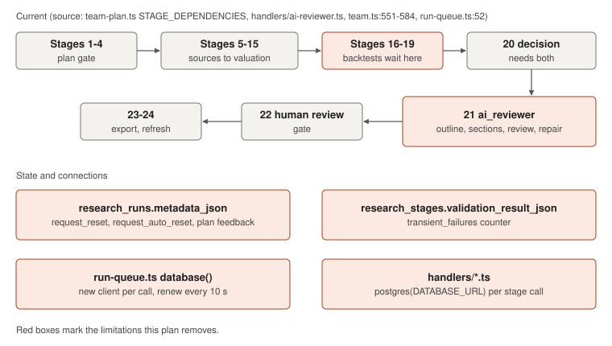
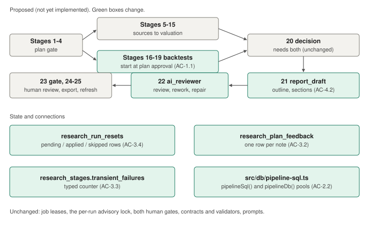
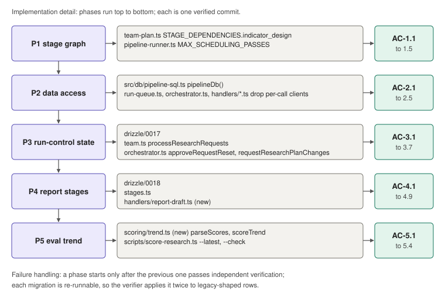

# Architecture 9: raise the pipeline architecture from 7/10 to 9/10

Plan author: Claude (parent session), 2026-11-16. Base commit `18bf019` on `main`.
Mode: TOR-Workflow, TOR-2-Agents (one implementor, one verifier, both Opus 5.5 at medium effort).

## Problem and expected behaviour

A source review graded the research pipeline 7/10. Orchestration, validation and trust boundaries are strong. Five structural weaknesses hold the grade down, and each phase below removes one.

| # | Weakness today | After |
| --- | --- | --- |
| P1 | The stage graph is nearly a chain. The price-only backtest stages (16-19) wait for `asset_valuation`, and a valuation re-run reopens them. The runner's pass limit is a magic `192`. | Backtests start at plan approval and run beside the analysis. A valuation re-run leaves them alone. The limit has a name. |
| P2 | 96 `postgres(` call sites. Handlers and every queue function open and close their own client, including the 10-second lease renewal. | One connection module. Pipeline code shares lazily created pools. |
| P3 | Run-control state hides in untyped JSON: `metadata_json.request_reset`, `request_auto_reset`, `research_plan_feedback`, and `validation_result_json.transient_failures`. | Typed tables and columns with a re-runnable backfill. |
| P4 | Outline, sections, review, rework and repair all run inside one stage, `ai_reviewer` (`fail_run`, one retry). | Two stages: `report_draft` writes the report, `ai_reviewer` reviews and repairs it. 25 stages. |
| P5 | `evals/scores.csv` has one row per case and no way to show a trend or catch a regression. | `eval:score --latest` scores the newest run per case; `--check` reports the trend and fails on a regression. |

Before/after example (P1): a `deep_dive` run whose plan was just approved has `readyStages = ["source_discovery"]` today. After P1 it is `["source_discovery", "indicator_design"]`.

**What this plan cannot do.** A 9 also needs evidence that the reports are good: fresh runs scored per case. Those are paid (`RUN_PAID_RESEARCH=1`) and need the user's approval. P5 builds the free tooling that will show the result; it runs no paid work.

## Scope, exclusions, invariants

In scope: `src/lib/research/**`, `src/lib/workflow/**`, `src/db/**`, `src/workers/**`, `src/app/api/**` (connection use, run GET, review route), `src/app/assets/[id]/run/page.tsx`, `src/components/charts/PipelineProgressChart.tsx`, `scripts/score-research.ts`, `drizzle/`, `tests/`, `docs/`, `AGENTS.md`.

Out of scope: prompts and model request layout (must stay byte-identical; `tests/prompt-layout.test.ts` unchanged), provider code, retrieval heuristics, the UI beyond the two files above, `scripts/` connection handling, paid runs, CI.

Invariants that must hold after every phase:

- Runs execute only through `research_run_jobs` and the per-run advisory lock.
- Both human gates stay explicit. No stage past a gate becomes ready while the gate is waiting.
- Agents propose, contracts and validators decide. No model call gains tool execution.
- Every schema change ships with a Drizzle migration, written re-runnable (`IF NOT EXISTS`, guarded inserts), as `0000`-`0016` are.
- `pipeline_version` stays 3. Existing runs keep working after the migrations.
- Docs: update `docs/system.md`, `docs/architecture.md` (views and coverage index), `docs/security.md` and `AGENTS.md` where a phase changes what they state, and regenerate diagrams with `python3 docs/diagrams/_source/make_diagrams.py docs/diagrams` when a diagram's content changes.

## Feature map

| Component | Responsibility | Source | Touched by |
| --- | --- | --- | --- |
| Stage dependencies | Which stages may start | `src/lib/research/team-plan.ts` `STAGE_DEPENDENCIES`, `readyStages`, `dependentStages` | P1, P4 |
| Stage configs | Order, retries, failure policy | `src/lib/workflow/stages.ts` `STAGE_CONFIGS` | P1, P4 |
| Runner | Dataflow loop, pass limit, transient retry | `src/lib/research/pipeline-runner.ts` | P1, P2, P3 |
| Queue | Enqueue, claim, renew | `src/lib/research/run-queue.ts` `database()` | P2 |
| Connection modules | Pools | `src/db/index.ts`, `src/db/pipeline-sql.ts` | P2 |
| Handlers | One per stage, each opens a client | `src/lib/research/handlers/*.ts` | P2, P4 |
| Request re-run state | Auto and approved re-runs | `src/lib/research/team.ts:551-584`, `src/lib/workflow/orchestrator.ts:557-596` | P3 |
| Plan feedback | Reviewer notes | `orchestrator.ts:638-675`, `handlers/research-plan.ts:125` | P3 |
| Run page | Shows the pending re-run | `src/app/assets/[id]/run/page.tsx:639`, `src/app/api/research-runs/[id]/route.ts` | P3 |
| Report runtime | Outline, sections, review, rework, repair | `src/lib/research/reporting/runtime.ts` `draftAndReviewReport`, `reporting/compose.ts` `composeReviewedReport`, `handlers/ai-reviewer.ts` | P4 |
| Consumers of `ai_reviewer` | Tail stages, resets, gates, mock, read model | `team.ts:65,207,579`, `orchestrator.ts:579`, `review/route.ts:143`, `quality-gates.ts:461`, `validators.ts:29`, `providers/mock.ts:846`, `artifacts/read-model.ts:192`, `lineage/prior-research.ts:17` | P4 |
| Eval scoring | Read-only scoring CLI | `scripts/score-research.ts`, `src/lib/research/scoring/**`, `evals/scores.csv` | P5 |

Observed baseline on `18bf019` (Windows, Node 22): `npm run test:unit` reports 586 pass, 6 fail, 53 skipped. The 6 failures are environmental and must not be counted as regressions: symlink `EPERM` in `backtest artifact paths ... (S6)`, `research store files` (3 subtests) and `research store table shards` (1 subtest), and `Docling parsing runs without blocking the event loop (#24)` (`ENOENT`).

## Diagrams

Current stage graph and state:

Proposed (not yet implemented):

Implementation detail:

## Acceptance criteria

### P1 Stage graph

- **AC-1.1** `STAGE_DEPENDENCIES.indicator_design` is `["research_plan"]`. The rest of the backtest chain is unchanged, and `decision_synthesis` still depends on `asset_valuation` and `backtest_review`.
- **AC-1.2** With stages 1-4 completed and the rest pending, `readyStages` returns `source_discovery` and `indicator_design`. With the plan gate `waiting_for_human`, neither is ready. For `quick_scan` (16-19 skipped) only `source_discovery` is ready.
- **AC-1.3** `dependentStages(["asset_valuation"])` contains none of the four backtest stages and still contains `decision_synthesis`.
- **AC-1.4** `pipeline-runner.ts` exports `MAX_SCHEDULING_PASSES` (a number) and contains no literal `192` or `191`.
- **AC-1.5** The mock pipeline (`npm run test:sofi-v3`) still completes; assertions about stage order may change only where this dependency change requires it.

### P2 Data access

- **AC-2.1** Under `src/`, `postgres(` is called only in `src/db/**` and `src/lib/research/pipeline-runner.ts` (the session-lock connection).
- **AC-2.2** `src/db/pipeline-sql.ts` exports `pipelineSql()` (raw pool) and `pipelineDb()` (a drizzle instance on its own pool, because drizzle changes timestamp parsing). Both are created on first use and let the process exit on its own when idle.
- **AC-2.3** A script that queries through both and never calls `end()` exits by itself within 20 s.
- **AC-2.4** 40 concurrent `claimNextResearchRun` calls open at most 15 new database connections (today: about 40).
- **AC-2.5** No behaviour change: all DB-backed suites pass as on the baseline.

### P3 Typed run-control state

- **AC-3.1** Migration `drizzle/0017_run_control_state.sql` creates:
  - `research_run_resets` (`id`, `research_run_id` FK cascade, `kind` `'auto'|'approval'`, `status` `'pending'|'applied'|'skipped'`, `stages text[]`, `request_ids text[]`, `round int`, `estimated_cost_usd numeric`, `decided_by text`, `decided_at timestamptz`, `created_at`; `id` and `created_at` have defaults), at most one `pending` row per run, enforced by the database;
  - `research_plan_feedback` (`id`, `research_run_id` FK cascade, `notes`, `requested_by`, `requested_at`);
  - `research_stages.transient_failures int not null default 0` and `last_transient_error text`.
- **AC-3.2** `requestResearchPlanChanges` inserts a `research_plan_feedback` row and writes no `research_plan_feedback` key to `metadata_json`. The plan handler reads the rows in `requested_at` order.
- **AC-3.3** A transient stage failure increments `research_stages.transient_failures`; `validation_result_json` carries no `transient_failures` key. Retry limits behave as before.
- **AC-3.4** A re-run above the automatic limit inserts a `pending` `approval` row. `approveRequestReset` reads that row (not `metadata_json`) and sets it `applied` or `skipped` with `decided_by` and `decided_at`. An automatic re-run inserts an `auto`/`applied` row, and "automatic re-run already used" is derived from it. `RequestResetError` messages are unchanged ("The run is not paused on a request reset", "The run has no team requests"), and a refused decision changes no row.
- **AC-3.5** `GET /api/research-runs/:id` returns `request_reset` on the run object: `{ stages, request_ids, estimated_cost_usd }` while a row is pending, else `null`. The run page reads that field.
- **AC-3.6** The migration backfills existing runs from the old JSON keys and can be run twice without duplicating rows. Old keys may stay in `metadata_json`; code no longer reads or writes them.
- **AC-3.7** `src/` contains no `request_auto_reset`, no `metadata_json` access to `request_reset` or `research_plan_feedback`, and no `validation_result_json` access to `transient_failures`.

### P4 Report stages

- **AC-4.1** `STAGE_CONFIGS` has 25 stages: `report_draft` (order 21, `fail_run`, 2 retries, skipped for `backtest_only`), `ai_reviewer` 22, `human_review` 23, `export` 24, `refresh_schedule` 25. `report_draft` depends on `decision_synthesis`; `ai_reviewer` on `report_draft`. `STAGE_HANDLERS.report_draft` exists, `STAGE_OWNERS.report_draft` is `report`, and `REQUEST_TAIL_STAGES` includes it.
- **AC-4.2** `report_draft` does the change log, pre-draft requests, `report_facts`, outline, sections and the first `report_document`. Its model tasks (`report_outline`, `report_section`, pre-draft team requests) are recorded under `report_draft`. No `report_review` artifact exists when it completes.
- **AC-4.3** `ai_reviewer` reads the stored draft, reviews it, and runs rework and repair. When the first review passes it makes no outline or section call. The review artifacts and gate behaviour are unchanged.
- **AC-4.4** A non-transient `ai_reviewer` failure leaves `report_draft` completed with its tasks valid; a resume does not call the outline or first-round section writers again.
- **AC-4.5** A reviewer's revision request (`review` route) and a re-run pause or skip act on the stage that is actually running, so both `report_draft` and `ai_reviewer` are handled.
- **AC-4.6** `tests/sofi-research-e2e.test.ts` asserts AC-4.2 and AC-4.3 task placement after the mock run reaches the final gate.
- **AC-4.7** Migration `drizzle/0018_report_draft_stage.sql`, re-runnable: every run with an `ai_reviewer` row and no `report_draft` row gets `report_draft` at order 21 and its later stages at 22-25. `report_draft` is `completed` when `ai_reviewer` is `completed`, `skipped` when `ai_reviewer` is `skipped`, otherwise `pending`.
- **AC-4.8** Model request bytes are unchanged: `tests/prompt-layout.test.ts` passes unmodified.
- **AC-4.9** Docs and `AGENTS.md` say 25 stages; the stage table, activity, state and sequence views and the UI stage label are updated.

### P5 Eval trend

- **AC-5.1** `src/lib/research/scoring/trend.ts` exports `parseScores(csv)` and `scoreTrend(rows)`. Per case: runs ordered by `run_created_at`, one row per run (the latest `scored_at`); result `{ case, runs, latest_run_id, pass_rate, previous_pass_rate, regressed, reasons }` where `pass_rate` is `checks_passed / checks_applicable` (null when not applicable). `regressed` is true when the latest pass rate is below the previous run's, or `reader_leaks` rose. A case with one run never regresses.
- **AC-5.2** `npm run eval:score -- --check` prints the trend, needs no database, and exits 1 only when a case regressed.
- **AC-5.3** `npm run eval:score -- --latest` scores, for each case with an asset, the newest v3 run that is completed or approved, read-only as today. With no such run it prints a "no run yet" line and exits 0.
- **AC-5.4** `AGENTS.md` and `docs/system.md` describe both flags.

## Phases

| ID | Outcome | Criteria | Edit scope | Depends on |
| --- | --- | --- | --- | --- |
| P1 | Backtests run beside the analysis | AC-1.* | `team-plan.ts`, `stages.ts`, `pipeline-runner.ts`, tests, docs | independent |
| P2 | One connection module | AC-2.* | `src/db/**`, every `src/` file that calls `postgres(` | P1 (same files) |
| P3 | Typed run-control state | AC-3.* | `drizzle/0017`, `src/db/schema/workflow.ts`, `team.ts`, `orchestrator.ts`, `pipeline-runner.ts`, `handlers/research-plan.ts`, run GET route, run page, tests, docs | P2 |
| P4 | `report_draft` + `ai_reviewer` | AC-4.* | `drizzle/0018`, `stages.ts`, `team-plan.ts`, `handlers/**`, `reporting/runtime.ts`, `reporting/compose.ts`, the `ai_reviewer` consumers in the feature map, tests, docs, diagrams | P3 |
| P5 | Eval trend and regression check | AC-5.* | `scoring/trend.ts`, `scripts/score-research.ts`, docs | independent of P2-P4; runs last |

Each phase is one commit on the implementor's branch.

## Verification

Setup in a fresh worktree: `npm ci`. Database tests use a dedicated database; read its URL from the file the brief names and export it as `DATABASE_URL`. Never use the `research_os` database. Run `npm run db:migrate` before DB suites when a phase adds a migration.

| Phase | Acceptance (worker-visible) | Verification (verifier only) |
| --- | --- | --- |
| P1 | `npx tsx --test Implementations/architecture-9/acceptance/p1-stage-graph.test.ts` | `.../verification/p1-stage-graph.test.ts` |
| P2 | `.../acceptance/p2-data-access.test.ts` | `.../verification/p2-data-access.test.ts` |
| P3 | `.../acceptance/p3-run-control.test.ts` | `.../verification/p3-run-control.test.ts` |
| P4 | `.../acceptance/p4-report-stages.test.ts` | `.../verification/p4-report-stages.test.ts` |
| P5 | `.../acceptance/p5-eval-trend.test.ts` | `.../verification/p5-eval-trend.test.ts` |

DB-backed tests in these files skip unless `RUN_DB_INTEGRATION=1`; run them with `RUN_DB_INTEGRATION=1 RESEARCH_MODEL_PROVIDER=mock RESEARCH_ACCEPTANCE_PROVIDER=mock DATABASE_URL=... npx tsx --test --test-concurrency=1 <file>`.

Every phase also runs the repository checks: `npm run lint`, `npx tsc --noEmit`, `npm run test:unit`, `npm run build`, and, because orchestration changes, `npm run test:db` (which includes `tests/sofi-research-e2e.test.ts`).

Baseline: P1-P5 acceptance tests fail on `18bf019` for the intended assertions (missing behaviour), except checks of behaviour that already holds.

## Completion evidence

To be filled per phase: verified SHA, correction rounds, commands run by the verifier and by the plan author, and remaining limits.
