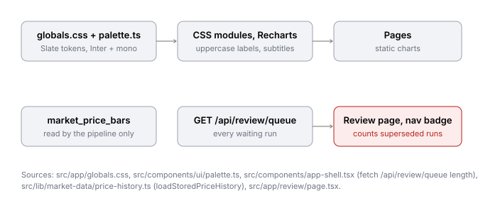
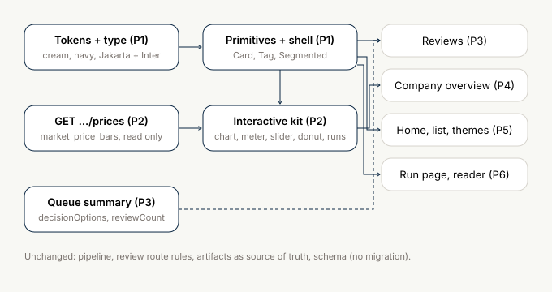
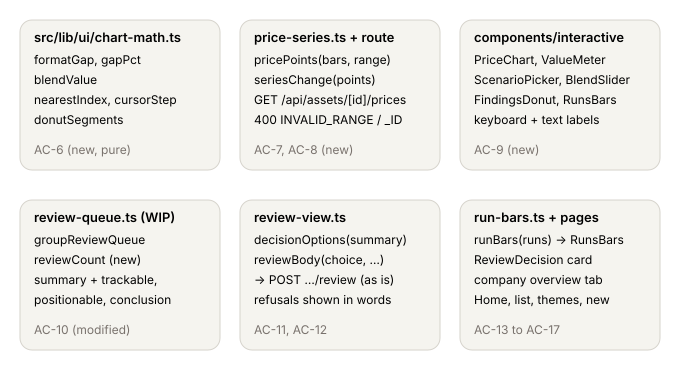

# Consumer remaster: Pragmatic Classic with a consumer-finance layer and interactive charts

Mode: TOR-Workflow with TOR-2-Agents (one implementor, one verifier, Opus 5.5 medium). Base SHA: `94dcb555c41199489789cf05cfd620edde42eabf` (main, PR #151 merged).

Design baseline: `prototype/workshop/pragma-remaster/index.html` (static, interactive mockup approved by the user on 23 Nov 2026 after three rounds: "too colourful", then "consumer finance fonts, clean up subtitles"). Screenshot: `prototype/workshop/pragma-remaster/shot-remaster.png`.

## Problem and expected behaviour

The user rejected the "Slate and navy" look (PR #147) and the redesign mockups that followed. The agreed direction is Pragma's own site look (cream page with a faint diamond grid, navy, the PR logo), remastered as a consumer-finance app:

- **Type**: Plus Jakarta Sans for headings and every big number, Inter for text, tabular figures. No serif, no monospace.
- **Colour**: navy plus warm greys. Red, green and amber only on small numbers and status dots, never as panel fills.
- **Labels**: short sentence-case headings. No uppercase letter-spaced eyebrows, no explanatory subtitles under titles.
- **Shape**: rounded white cards (24px), pill navigation, pill buttons and segmented toggles.
- **Interaction**: charts you can touch: a price chart you scrub, a value meter with a scenario picker, a "your blend" slider, a findings donut, and a runs chart.

**Before** (SoFi, report 18 Nov): slate page, Inter with JetBrains Mono numbers, uppercase tile labels ("VALUE VS PRICE"), subtitles under tile heads ("Ranked by likelihood × severity"), static charts, the review page opens on an 8-tile number strip.

**After**: cream page; SoFi opens on a hero with the logo and "Needs your decision"; a "Price" card shows the real stored closes from `market_price_bars` with 1M/3M/6M/1Y toggles and a scrub cursor that rewrites the big number to the hovered day; a "What it's worth" card shows a navy meter (−38%) with Bear $1.04 / Base $8.80 / Bull $14.92 toggles; "Your blend" moves between cautious and hopeful and never claims to be the report's number; the AI review is a donut of the 16 serious findings by chapter; every run is a bar with its real cost against the budget; the decision is five icon cards.

## Scope

In scope: global tokens and type, the app shell, shared UI primitives, an interactive chart kit, a read-only price-history API, and the pages: Reviews, the company overview, Home, Research list, Themes, Start research, the run page and the report reader (restyle only).

Out of scope: pipeline, prompts, models, database schema (no migration), the review route's rules, cost or lineage logic, resuming runs, a theme results page.

Invariants:

- Both human gates stay explicit; the Reviews page posts to the existing `POST /api/research-runs/[id]/review` and shows its refusals in words. It never bypasses `REPORT_REVIEW_FAILED`, `REVIEW_BLOCKS_POSITION`, `RESEARCH_INCOMPLETE`, `FINDINGS_NOT_ACKNOWLEDGED`, `STALE_REPORT`.
- Typed `research_artifacts` stay the report source of truth; the UI only reads.
- No generated or placeholder data on any real page. Missing data shows a plain empty state.
- Colours come from `src/app/globals.css` tokens or `src/components/ui/palette.ts`; raw hex nowhere else (logo excepted).
- Reader copy never names models or shows run IDs, snake_case or JSON.
- Accessibility: every interactive chart is keyboard operable and has a text equivalent; `prefers-reduced-motion` disables animation.

Docs: no `tools/docs_sync.py` in this repo. `docs/system.md` gains the price-history read API (P2) and the review queue summary fields (P3); `docs/architecture.md` coverage index lists the new route. No other doc trigger applies.

## Feature map

| Layer | Today | Consumers |
| --- | --- | --- |
| Tokens | `src/app/globals.css` (`:root` vars, `@theme`), `src/components/ui/palette.ts` (`C`, `SERIES`) | every CSS module and SVG chart |
| Shell | `src/components/app-shell.tsx` + `.module.css`; review count from `GET /api/review/queue` length | all pages |
| Shared tiles | `src/components/research-ui.module.css` (`tile`, `tileHead`, `muted`, `status`) | all pages |
| Charts | `src/components/charts/*` (Recharts), `src/components/visuals/valuation-visuals.tsx` (ValueRuler, PriceFan, KeyNumbers) | company view, memo, review |
| Prices | `market_price_bars` via `loadStoredPriceHistory` (`src/lib/market-data/price-history.ts`); no read API | valuation pipeline only |
| Reviews | `src/app/review/page.tsx`; `GET /api/review/queue`; uncommitted WIP: `src/lib/review/review-queue.ts`, `review-view.ts`, `src/components/review-findings.tsx`, `src/app/review/review.module.css`, `MemoVerdict`/`MemoReasons` exports in `research-memo.tsx` | Reviews, Home, Research list, nav badge |
| Company | `src/app/assets/[id]/view/page.tsx` overview tab (`AssetHero`, `KeyNumbers`, `ValueRuler`, `PriceFan`, `RiskHeat`); runs from `GET /api/assets/[id]/research-runs` (`actual_cost_usd`, `budget_limit_usd`) | search results, Research list |







## Acceptance criteria

Each criterion names its phase. Tests live in `acceptance/` (visible to the implementor) and `verification/` (verifier only).

### P1 Foundation

- **AC-1 Tokens.** `globals.css` defines exactly: `--page: #F8F8F4`, `--tile: #FFFFFF`, `--soft: #F5F4EF`, `--hover: #F3F2EC`, `--line: #E7E5DF`, `--line-soft: #EEEDE7`, `--line-strong: #D6D3CC`, `--ink: #0D1B2A`, `--ink-2: #44403C`, `--ink-3: #78716C`, `--ink-4: #A8A29E`, `--navy: #0A2642`, `--navy-hover: #071E33`, `--navy-soft: #EEF1F5`, `--navy-2: #B4C0CC`, `--navy-3: #3D5A78`, `--sage: #75937D`, `--positive: #2D7D46`, `--critical: #C9302C`, `--caution: #B8860B` (dots, bars and rules only), `--caution-ink: #7A5300` (caution text: `#B8860B` is about 3.3:1 on white, below AA for small text; no CSS sets `color: var(--caution)`); the status background tokens `--positive-bg`, `--critical-bg`, `--caution-bg` all equal `#F5F4EF` (neutral: colour only on text and dots); `--radius-card: 24px`, `--radius-pill: 999px`. `palette.ts` `C` mirrors them: `ink`, `ink2`, `ink3`, `ink4`, `line`, `soft`, `tile`, `navy`, `navy2`, `navy3`, `positive`, `critical`, `caution` equal the token values. Raw hex appears only in `globals.css`, `palette.ts` and `brand/logo.tsx`.
- **AC-2 Type.** `globals.css` loads Plus Jakarta Sans and Inter; `--font-sans` starts with `"Inter"`, `--font-display` starts with `"Plus Jakarta Sans"`, `--font-mono` starts with `"Inter"`; base `h1, h2, h3` use `var(--font-display)`. No file under `src/app` or `src/components` mentions `JetBrains Mono`, `DM Serif` or `Georgia`.
- **AC-3 Labels.** No CSS or TSX under `src/app` or `src/components` sets `text-transform: uppercase` (or `textTransform: "uppercase"`, or Tailwind `uppercase`). The page background is the cream with the diamond grid (a `linear-gradient(45deg` and `linear-gradient(-45deg` on `body` in `globals.css`).
- **AC-4 Shell.** The shell keeps `nav[aria-label="Main"]`, `aria-current` on the current link, the asset search combobox and the Start research link; nav links, search box and Start research use `var(--radius-pill)`; the logo mark uses navy `#0A2642` and sage `#75937D`.
- **AC-5 Primitives.** `src/components/ui/primitives.tsx` exports `Card`, `Tag`, `Segmented` and `BigNumber`:
  - `Card({ title?, action?, children })` renders a `section`; with `title`, an `h2` with that text.
  - `Tag({ tone, children })` with tone `neutral | waiting | good | bad` renders a `span` with a dot element and the text; the tone is in `data-tone`.
  - `Segmented({ label, options, value, onChange })` renders a `div role="group" aria-label={label}` of `button`s, the selected one `aria-pressed="true"`, the rest `"false"`.
  - `BigNumber({ value, label? })` renders the value in an element with `data-big`.

### P2 Interactive kit and price API

- **AC-6 Chart maths** (`src/lib/ui/chart-math.ts`):
  - `formatGap(r)`: `null` → `"—"`; `|r| < 0.1` → one decimal; otherwise whole percent; negative uses U+2212 `−`, positive `+`, zero `"0%"`. `formatGap(-0.3838)` = `"−38%"`, `formatGap(0.0448)` = `"+4.5%"`, `formatGap(-0.927)` = `"−93%"`.
  - `gapPct(value, price)`: `value / price − 1`; `null` when either is null or `price <= 0`.
  - `blendValue(values, t)`: `0.5·base + 0.5·(1−t)·bear + 0.5·t·bull`, `t` clamped to [0, 1]; `null` if any case is null. SoFi: `t=0` → 4.92, `t=0.5` → 8.39, `t=1` → 11.86 (to the cent).
  - `nearestIndex(x, n, left, right)`: index of the nearest of `n` evenly spaced points between `left` and `right`, clamped to `[0, n−1]`; `n <= 0` → `-1`.
  - `cursorStep(i, key, n)`: `ArrowLeft` −1, `ArrowRight` +1, `Home` 0, `End` n−1, `PageUp`/`PageDown` ∓10 (left/right), clamped; any other key returns `i`.
  - `donutSegments(counts, gap)`: with `share_i = count_i / total`, returns one `{ start, length }` per count in order, `start_i` = sum of the shares before it and `length_i = max(0, share_i − gap)`; all-zero or empty → `[]`.
- **AC-7 Price series** (`src/lib/market-data/price-series.ts`, pure): `RANGES = ["1M","3M","6M","1Y","5Y"]`; `pricePoints(bars, range)` takes stored bars (`{ day, close }`, any order, possibly duplicate days), sorts by day, keeps the last close per day, and returns those with `day` on or after the last day minus 1/3/6/12/60 calendar months (same day of month, clamped to that month's last day: 1M before 2026-03-31 is 2026-02-28); empty input → `[]`. `seriesChange(points)` = last/first − 1, `null` under two points.
- **AC-8 Price API.** `GET /api/assets/[id]/prices?range=` returns `{ currency, range, points: [{ day, close }], last: { day, close } | null }`; default range `6M`; a range outside `RANGES` returns 400 with code `INVALID_RANGE` before touching the database; a non-UUID id returns 400 `INVALID_ID`; an asset with no stored bars returns 200 with `points: []` and `last: null`. An id that names no asset returns 404 `NOT_FOUND` (decided after P2).
- **AC-9 Components** (`src/components/interactive/`, all exported from `src/components/interactive/index.ts`), client components that render on the server:
  - `PriceChart({ points, currency, valueLine? })`: with points, a focusable (`tabIndex=0`) `svg` with `role="img"` and an `aria-label` naming the range's first and last close; a big number showing the last close; a `Segmented` range picker when `ranges`, `range` and `onRange` are given; arrow keys move a cursor with `cursorStep` and the big number shows the cursor's close. Prices in the label are to the cent. With one point: the big number and "Not enough history for a chart", no line. With no points: "No price history yet" and no `polyline`/`path` of prices. Never invents data.
  - `ValueMeter({ price, values, selected })`: shows `formatGap(gapPct(values[selected], price))` and an `aria-label` "Base case $8.80, 38% below the $14.28 price" ("above" when positive, the percentage formatted like `formatGap` without its sign); with no price or no value: "No price to compare".
  - `ScenarioPicker({ values, price, selected, onSelect })`: three buttons Bear/Base/Bull with `aria-pressed`, each showing its value and `formatGap`; a missing value shows "—".
  - `BlendSlider({ values, price, reportWeighted? })`: an `input type="range"` with an `aria-label`; shows `blendValue` at the default `t=0.5` (SoFi: `$8.39`); shows the report's weighted value as "Report $7.70" when given; renders nothing but a short empty state when any case is missing.
  - `FindingsDonut({ groups })`: groups `{ title, serious, counts }`; the centre shows the serious total; each group is a `button` row; with no groups: "No findings".
  - `RunsBars({ runs, budget? })`: runs `{ id, label, outcome, cost, current? }`; each bar is a `button` with `aria-label` "`label`, `outcome`, `$cost`"; a total of all costs; the budget line labelled "$10 cap" when budget=10 and no cap without a budget; with no runs: "No runs yet".

### P3 Reviews

- **AC-10 One per company.** `groupReviewQueue` collapses to one current run per company (older ones get `replaced_by`); the nav badge, Home and the Research list count `currentReviews` only. `reviewCount(queue)` (exported from `src/lib/review/review-queue.ts`) returns the number of items whose `replaced_by` is null or missing, and `0` for a non-array.
- **AC-11 Allowed decisions.** `decisionOptions(summary)` (in `src/lib/review/review-view.ts`) returns `{ position: { allowed, reasons: string[] }, tracking: { allowed }, ackRequired: boolean }`:
  - position allowed iff `review.positionable` and `conclusion_status !== "withheld"`; reasons list, in words, "The AI review didn't pass" when not positionable and "The report withholds a conclusion" when withheld, plus each `review.blocking` message;
  - tracking allowed iff `review.trackable`;
  - `ackRequired` iff `review.open_severe > 0`;
  - `summary == null` or `review == null` → nothing allowed, with reason "No AI review stored for this report".
  `ReviewSummary.review` gains `trackable` and `positionable`; `ReviewSummary` gains `conclusion_status`.
- **AC-12 Decision body.** `reviewBody(choice, { ack, reportHash })` maps `position|tracking|watch|back|reject` to `approved_for_position|approved_for_tracking|watchlist|needs_more_work|reject`, with `acknowledgeFindings: ack` and `reportHash`. An unknown choice throws.
- **AC-13 Decision card.** `ReviewDecision({ options, onSubmit })` (in `src/components/review-decision.tsx`) renders five option buttons; a disallowed option has `aria-disabled="true"` and its reason text; the Record button is `disabled` until a choice is made and, for an approval with `ackRequired`, the acknowledgement is ticked.

### P4 Company overview

- **AC-14 Runs as bars.** `runBars(runs)` (in `src/lib/research/run-bars.ts`) returns `{ runs, total }`, mapping research runs (any order; output oldest first) to `RunsBars` input: label "23 Sep" (or "18 Nov 19:05" when two runs share a day); outcome words: `completed`/`approved` → "Completed"; `failed`, `cancelled` and `needs_more_work` → "Stopped" (corrected after P6: the pipeline sets `needs_more_work` when a run stops on failed stages, the quality gate or the budget; a reviewer's "send back" puts the run in `waiting_for_human`); `waiting_for_human` with `waiting_stage_key` `research_plan` → "Needs plan approval" (never current, never superseded); any other `waiting_for_human` run → "Needs your decision" when it is the newest such run, else "Superseded"; running statuses → "Researching". The runs API `GET /api/assets/[id]/research-runs` adds a read-only `waiting_stage_key` per run (the key of its stage waiting for a human, else null). Cost from `actual_cost_usd` as a number (non-numeric → 0); `current` is true only for the newest final-decision run; total equals the sum.
- **AC-15 Overview composition.** The company overview tab shows, in order: hero (logo, name, ticker, status tag); `PriceChart` fed by `GET /api/assets/[id]/prices` with the base value line; `ValueMeter` + `ScenarioPicker` from the asset snapshot; `BlendSlider` with the snapshot's weighted value; `RunsBars`; "The report says" and "The other side". No uppercase labels or subtitles (AC-3). (Manual and screenshot evidence; component behaviour is covered by AC-9 and AC-14.)

### P5 Home, Research list, Themes, Start research

- **AC-16 Pages.** Home, `/assets`, `/themes` and `/research/new` use `Card`/`Tag`/`BigNumber` from the primitives; their tile heads have no subtitle spans (no `ui.muted` sibling text longer than a count or a link); status tags use the single status vocabulary, with the same run-status mapping as AC-14 (`needs_more_work` reads `Stopped`; an asset whose latest run waits at `research_plan` reads `Needs plan approval` and is not counted as a decision; `listAssetOverviews` gives the latest run a read-only `waiting_stage_key`, added after the P5 review) (`Needs your decision`, `Needs plan approval`, `Researching`, `Decided`, `Completed`, `Stopped`, `Not started`). Static check: the four page files import from `@/components/ui/primitives`.

### P6 Run page and report reader

- **AC-17 Restyle.** The run page, the report reader tabs and the memo use the new tokens and type with no layout or behaviour change; AC-1 to AC-3 hold over the whole tree.

### All phases

- **AC-18 Checks.** `npm run lint`, `npx tsc --noEmit`, `npm run test:unit`, `npm run build` pass, and this task's acceptance tests for the phase and every earlier phase pass.

## Phases

| ID | Outcome | ACs | Edit scope | Depends on |
| --- | --- | --- | --- | --- |
| P1 | Every page renders in the new palette, type and shell | AC-1–5, 18 | `src/app/globals.css`, `src/components/ui/palette.ts`, `src/components/ui/primitives.tsx` (+ `.module.css`), `src/components/app-shell.*`, `src/components/brand/logo.tsx`, `src/components/research-ui.module.css` (shared tiles, buttons, chips: added after the P1 review), CSS/TSX touched only to remove uppercase or mono | — |
| P2 | Interactive chart kit and price API exist and are tested | AC-6–9, 18 | `src/lib/ui/chart-math.ts`, `src/lib/market-data/price-series.ts`, `src/app/api/assets/[id]/prices/route.ts`, `src/components/interactive/*`, `docs/system.md`, `docs/architecture.md` | P1 |
| P3 | Reviews decision page in the remaster | AC-10–13, 18 | WIP files (copy in), `src/app/review/*`, `src/lib/review/*`, `src/components/review-findings.tsx`, `src/app/api/review/queue/route.ts`, nav badge in `app-shell.tsx`, Home and `/assets` queue counts, `docs/system.md` | P2 |
| P4 | Company overview in the remaster with real prices and runs | AC-14–15, 18 | `src/lib/research/run-bars.ts`, `src/app/api/assets/[id]/research-runs/route.ts` (GET adds `waiting_stage_key`), `src/app/assets/[id]/view/page.tsx` (overview tab), `src/components/company/*` | P2 |
| P5 | Home, Research list, Themes, Start research in the remaster | AC-16, 18 | `src/app/page.tsx`, `src/app/home.module.css`, `src/app/assets/page.tsx`, `src/app/assets/assets.module.css`, `src/app/themes/*`, `src/app/research/new/*`, `src/components/asset-cards.*` | P1 (runs after P3 for the queue count) |
| P6 | Run page, report reader and memo restyled | AC-17, 18 | CSS modules of `src/app/assets/[id]/run`, `src/app/assets/[id]/view`, `src/components/memo`, `src/components/research-report*`, `src/components/report`, `src/components/visuals`, `src/components/financials`, `src/components/notebook`, `src/components/workbench`; TSX only to drop subtitles | P1 |

TOR-2 runs them in this order on one branch: P1 → P2 → P3 → P4 → P5 → P6.

## Verification

Working directory: repository root (or the worktree root).

```bash
# acceptance, per phase (cumulative)
npx tsx --test Implementations/consumer-remaster/acceptance/p1-*.test.ts*
npx tsx --test Implementations/consumer-remaster/acceptance/p2-*.test.ts*
npx tsx --test Implementations/consumer-remaster/acceptance/p3-*.test.ts*
npx tsx --test Implementations/consumer-remaster/acceptance/p4-*.test.ts*
npx tsx --test Implementations/consumer-remaster/acceptance/p5-*.test.ts*
npx tsx --test Implementations/consumer-remaster/acceptance/p6-*.test.ts*
# verification (verifier only; copied in from the reviewer-held folder)
npx tsx --test Implementations/consumer-remaster/verification/v*.test.ts*
# required checks
npm run lint && npx tsc --noEmit && npm run test:unit && npm run build
```

Each phase commits only its own acceptance file (plus `support.ts`): `tsconfig` includes `**/*.ts`, so a test that imports a module from a later phase would break `tsc` and the build. Phase N copies in `pN-*` from the reviewer-held package. Verification files are never committed.

Runtime: Node with `tsx`; React server rendering (`react-dom/server`) for component tests; no database (API tests set an unreachable `DATABASE_URL` and only exercise validation). Manual: screenshots of each phase's pages at 1440px and 375px against the baseline mockup.

Baseline (base SHA `94dcb55` plus the uncommitted Reviews WIP, 23 Nov 2026):

- Acceptance: 1 pass, 40 fail. The pass is AC-1's raw-hex rule (already true). Every failure is the intended assertion: old token values, JetBrains Mono present, uppercase labels present, or a module that doesn't exist yet (`primitives`, `chart-math`, `price-series`, `prices/route`, `interactive`, `review-decision`, `run-bars`, `reviewCount`, `decisionOptions`).
- Verification: 3 pass (series start navy, reduced motion kept, logo mark exported), 19 fail for the same reasons.

## Completion evidence

Branch `worktree-agent-aed684a892319cd1d` (implementor worktree), base `94dcb55`, final verified SHA `48c4a79`. 16 commits, 88 files, +2921 / −704. Not merged.

### Phases (verifier results)

| Phase | First candidate | Verified SHA | Correction rounds | What the reviews changed |
| --- | --- | --- | --- | --- |
| P1 | `ecaa7cd` | `b76e022` | 1 | `--caution-ink` added (amber failed AA as text); visible search focus; `--ink-2` on soft fills; `research-ui.module.css` added to scope |
| P2 | `e2a4807` | `025e837` | 1 | real route count in the diagram; one tick for a flat series; scrub announces the close; unknown asset → 404 (plan addition) |
| P3 | `90e545b` | `f0aee0e` | 1 | `?summary=0` light queue path for badge/Home/list; unchecked report versions block approvals in words; named Open links; tickers only for equities |
| P4 | `c631df0` | `4d1b020` | 1 | runs API adds `waiting_stage_key`; plan-approval runs labelled; price card recovers after an error; card headings |
| P5 | `df245b6` | `9318da0` | 1 | `listAssetOverviews` adds `waiting_stage_key`; plan approval has its own stage; labelled filter pills |
| P6 | `1f63fd9` | `48c4a79` | 2 | LF re-normalised; CSS leftovers; plan-author correction: run `needs_more_work` = Stopped (pipeline stop), only `waiting_for_human` waits, a waiting final decision wins the company status; Overview added as the first tab; memo send-back status; `next-env.d.ts` restored |

### Checks on the final SHA

- Verifier: acceptance 46/46, verification 22/22, `npm run lint` 0 errors (117 pre-existing warnings), `npx tsc --noEmit` exit 0, `npm run test:unit` 707 pass / 0 fail / 64 skipped (database- and provider-gated; not counted as passing), `npm run build` exit 0, no CR bytes in any changed file, `next-env.d.ts` identical to base.
- Plan author (orchestrator), same SHA: both sets together 68/68 pass. `git diff 94dcb555..48c4a79` touches no review route, workflow, pipeline-runner or `src/db` file.

### Manual evidence (plan author, branch running against the local `research_os` database)

- Home, Reviews queue, Reviews decision page (SoFi: −38%, Bear $1.04 / Base $8.80 / Bull $14.92, donut of 16 serious, five decision cards with position blocked in words), memo tab and company overview (real stored closes 18 May–17 Nov, $14.28) render in the remaster with no console errors; 375px: no horizontal scroll.
- After the status correction, SoFi reads "Needs your decision" in the hero and the navy runs bar is the 18 Nov 11:05 UTC (19:05 SGT) run.

### Diagrams against the diff

The proposed and detail diagrams hold. Deviations: the queue rules split into `src/lib/review/queue-rules.ts` (pure, client-safe); `src/lib/research/run-status.ts` became the one status helper (runStatusWord, stageOf, companyStatusWord) shared by hero, cards, counts, runs bars and memo; the runs API and asset overviews gained a read-only `waiting_stage_key`.

### Known limits (not verified or out of scope)

- The company overview and Home show the active run's numbers; the active run defaults to the newest run, which for SoFi is the stopped over-budget draft (base $1.13), not the report under review ($8.80). Pre-existing run selection.
- The overview is the first tab but the page still opens on the Memo (default left for the user).
- Run labels in the runs chart are in UTC.
- A run waiting at `human_review` whose latest decision is watchlist or reject reads "Decided" in the memo but "Needs your decision" elsewhere (pre-existing contract, pinned by an existing test).
- Test asset "SoFi test" still shows on Home and the Research list.
- The run page, report, workbench, notebook and chat modules rely mostly on the shared tokens and tile classes; they weren't restyled rule by rule.
