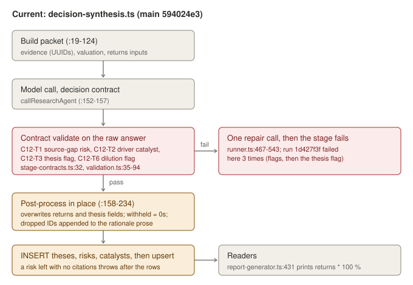
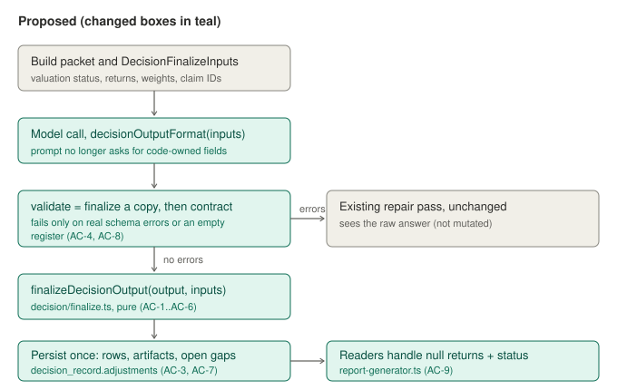
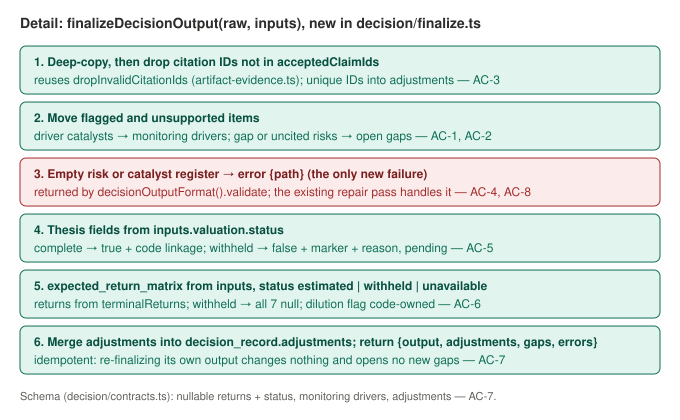

# Deterministic decision synthesis

Part of the "less model variance" programme (see [../deterministic-pipeline.md](../deterministic-pipeline.md)). This is fix 2 and the first to land.

## Problem and behavior

Decision synthesis asks the model for numbers and flags that code already knows or overwrites. It then validates the model's raw answer before code adjusts it. In META run `1d427f3f` (Claude Haiku 5.5, 2026-10-10) this stopped the run three times:

1. The model marked one catalyst `is_business_driver_only: true` and one risk `is_source_gap_only: true`. The validators (`decision/validation.ts:53`, `:76`) rejected the whole answer, and the retries ran out.
2. With the valuation withheld, the prompt told the model to set `valuation_accepted_first` to false while the validator rejected false. PR #41 now accepts false, but only if the model types the exact marker sentence, and the check still runs on the raw answer (`stage-contracts.ts:32`). The handler overwrites both fields a few lines later anyway (`decision-synthesis.ts:189-195`).
3. The model invented evidence ID `89383f80…`. PR #41 drops it, but appends the ID to the decision rationale prose. A risk whose citations are all dropped would also pass the post-drop check, its `risks` row would be inserted, and then the `risk_register` save would throw on `supporting_claim_ids.min(1)`.

A withheld valuation also stores every return as `0` plus a separate flag, and `report-generator.ts:431` prints `return * 100 %` without checking that flag.

Before, using the last failed answer in run `1d427f3f` (shortened):

```
risks:      Capex-driven compression …             is_source_gap_only: false
            Unverified market price and missing discount-rate inputs   is_source_gap_only: true
catalysts:  Reality Labs cost decisions or revenue inflection          is_business_driver_only: true
            (dated catalysts)                                           is_business_driver_only: false
investment_thesis.valuation_accepted_first: false
→ "Structured output validation failed: investment_thesis …; risk_register …; catalyst_register …"
→ run status needs_more_work
```

After: the source-gap risk becomes an open evidence gap (owner `system:decision-synthesis`). The driver catalyst moves to `monitoring_dashboard.drivers`. The other risks and catalysts are kept. Code sets `valuation_accepted_first`, the linkage and every computed return from the valuation stage's result. Dropped citation IDs go to `decision_record.adjustments`. The stage passes, and it fails only if a register ends up empty.

## Scope and invariants

Likely files:

- **New** `src/lib/research/decision/finalize.ts`: the pure finalize step and the model-facing output format.
- `src/lib/research/decision/contracts.ts`:
  - `ExpectedReturnMatrix`: the seven return fields become nullable, plus `status`.
  - `MonitoringDashboard`: optional `drivers`.
  - `DecisionRecord`: optional `adjustments`.
- `src/lib/research/stage-contracts.ts`: keep `DECISION_SYNTHESIS_CONTRACT` as the save-time contract, and extend `monitoring_dashboard` in it the same way.
- `src/lib/research/handlers/decision-synthesis.ts`:
  - build `DecisionFinalizeInputs`;
  - call the model with `decisionOutputFormat(inputs)`;
  - finalize once, then persist (rows, artifacts, `openSourceGap` for each returned gap);
  - remove the in-place post-processing at :158-234 and the prompt rules at :139/:141 that ask for code-owned fields.
- `src/lib/research/handlers/company-genesis.ts:130-163`: after the existing citation-repair pass, drop the remaining unknown IDs and record them in a structured field instead of throwing (AC-10).
- `src/lib/export/report-generator.ts:94-98, 426-433`: print "Withheld" or "Not available" for null returns.
- `src/lib/agent-harness/providers/mock.ts` `v3DecisionResponse`: still valid, so no change is expected. Adjust it only if the e2e suite shows otherwise.
- Docs: `docs/system.md`, in the decision synthesis paragraph.

Existing interfaces to reuse:
- `dropInvalidCitationIds` and `validateArtifactCitationIds` (`sources/artifact-evidence.ts`)
- `WITHHELD_VALUATION_LINKAGE` and `withheldValuationReason`
- `openSourceGap` (`sources/corpus.ts:535`)
- the `checkedContract` clean-then-check pattern (`reporting/runtime.ts:11-18`)
- `createArtifactRepository().upsertArtifact` (save-time validation through `validateArtifactContent`)

Invariants:
- Both human gates are unchanged. The decision always stays `pending` until human review.
- C12-T1, T2, T3, T4, T5 and T6 still reject bad content at save time. `tests/decision-artifacts.test.ts` keeps passing unchanged.
- Model calls stay single-shot JSON without tools. The agent harness (`src/lib/agent-harness/`) is not changed.
- Typed `research_artifacts` remain the report source of truth. Artifacts written by older runs (no `status` on the return matrix) still validate, because `status` defaults to `estimated`.
- No new dependencies. No migration: all new fields live inside `content_json`.

Exclusions:
- Short evidence labels (E1, E2, …). They change the model-facing schema (`z.guid()`) and the mock, so they get a separate follow-up.
- Fixing the valuation itself (fix 1).
- Team-request resets (fix 3).
- Report UI rendering of `drivers`. The generic exhibit renders it; a dedicated view is a follow-up.

## Public contract

`src/lib/research/decision/finalize.ts` exports:

```ts
export interface DecisionFinalizeInputs {
  acceptedClaimIds: string[];
  valuation: { status: "complete" | "withheld"; terminalYear?: number; withheldReason?: string };
  marketPrice: number | null;
  terminalReturns: { bear: number; base: number; bull: number } | null;   // null → no returns can be computed
  probabilities: { probability_bear: number; probability_base: number; probability_bull: number } | null;
  dilutionCovered: boolean;   // reported diluted shares are covered by the terminal projection
}
export interface DecisionAdjustments {
  dropped_citation_ids: string[];                                        // unique
  moved_catalysts: { catalyst_name: string; reason: "business_driver_only" }[];
  moved_risks: { risk_name: string; reason: "source_gap_only" | "no_supporting_evidence" }[];
}
export function finalizeDecisionOutput(raw: unknown, inputs: DecisionFinalizeInputs): {
  output: Record<string, any>;            // a new object; raw is not mutated
  adjustments: DecisionAdjustments;       // also merged into output.decision_record.adjustments
  gaps: { gap_key: string; description: string; severity: "medium"; owner: "system:decision-synthesis" }[];
  errors: { path: string; message: string }[];
};
export function decisionOutputFormat(inputs: DecisionFinalizeInputs): AgentOutputFormat;
// requiredKeys = DECISION_SYNTHESIS_CONTRACT.requiredKeys; schema = the contract schema;
// validate(raw) = finalize a copy, then DECISION_SYNTHESIS_CONTRACT.validate, plus finalize errors.
```

Rules the tests rely on:
- **Order of steps:** drop citations, then move items, then check registers, then set thesis fields, then set returns, then merge adjustments.
- **Moving:** a risk that is a source gap and also cites an invented ID is moved once, with reason `source_gap_only`.
- **Moved drivers:** these keep `name`, `mechanism` (from `event_mechanism`), `model_input_affected` and `evidence`.
- **Thesis when the valuation is complete:**
  - `valuation_accepted_first` is true.
  - With returns, `horizon` = `Through fiscal {T}` and the linkage is the existing sentence ("Fiscal {T} diluted-share price targets imply bear x%, base y%, and bull z% total returns from ${price}; …").
  - Without returns, the model's linkage is kept.
- **Thesis when the valuation is withheld:**
  - `valuation_accepted_first` is false.
  - The linkage is `${WITHHELD_VALUATION_LINKAGE} ${model linkage without the marker || withheldReason}`.
  - The decision is `pending`.
- **The returns matrix:**
  - `status: "estimated"` when `terminalReturns` is present and `dilutionCovered` is true. bear, base and bull come from it, and `probability_weighted_return` is rounded to 6 decimals (null without weights).
  - Return inputs that don't cover the reported diluted shares are not reported: `status: "unavailable"`. The model cannot fix this, so it never becomes a validation error.
  - `dilution_omitted` is always false, because code never reports returns that omit dilution. C12-T6 keeps guarding the save.
  - `status: "withheld"`: all seven returns are null.
  - `status: "unavailable"` (complete, but no `terminalReturns` or dilution not covered): bear, base, bull and the weighted return are null.
  - `no_rerating_return`, `weak_stock_outcome` and `permanent_loss_limit` are model judgments and are kept, except when withheld.
- **Idempotent:** finalizing its own output changes nothing, opens no new gaps and keeps existing adjustments.

## Feature map and diagrams







Affected consumers:
- `reporting/valuation-summary.ts:60,77-80` (null-safe via `num()`)
- `components/report/valuation-summary.tsx:37-43` (null-guarded)
- `handlers/export.ts:192-193, 250-254`
- `export/report-generator.ts:431-433` (changes, AC-9)
- `presentation.mjs:46-47` (null shows "Not disclosed")
- quality gates (`workflow/quality-gates.ts`, valuation-withheld keys; unchanged)
- `memory/graph.ts` citation keys: `dropped_citation_ids` is deliberately outside both citation key sets, so dropped IDs are never linked as evidence.

## Acceptance criteria

| ID | Trigger | Observable outcome | Checked by |
| --- | --- | --- | --- |
| AC-1 | A catalyst with `is_business_driver_only: true` | Removed from `catalyst_register` and appended to `monitoring_dashboard.drivers`, in order; listed in `moved_catalysts` | acceptance/finalize, verification/finalize |
| AC-2 | A risk with `is_source_gap_only: true` | Removed from `risk_register`; one medium gap owned by `system:decision-synthesis` with a unique `gap_key`; listed in `moved_risks` | both |
| AC-3 | Citation IDs outside `acceptedClaimIds` | Removed everywhere; unique list in `adjustments.dropped_citation_ids` and `decision_record.adjustments`; rationale unchanged. A risk left with no citations moves to the gaps (`no_supporting_evidence`) | both |
| AC-4 | A risk or catalyst register left empty | `errors` contains `{path: "risk_register" or "catalyst_register"}`; this is the only new failure | both |
| AC-5 | Any model value for `valuation_accepted_first` or the linkage | Code sets them from the valuation result, as listed under "Rules the tests rely on" | both |
| AC-6 | Return inputs present, withheld, or unavailable | The returns matrix follows the `status` rules above; the raw answer is not mutated | both |
| AC-7 | The finalized output is saved | Every artifact passes `validateArtifactContent`, including withheld nulls; flagged items still fail the save validators; finalizing is idempotent | both |
| AC-8 | Model-facing validation | `decisionOutputFormat(inputs).validate` returns no errors for flagged items, invented IDs, wrong thesis or dilution flags; still reports real schema errors and empty registers; does not mutate its argument | both |
| AC-9 | Export with null returns | The markdown shows "Not available" or "Withheld", never `null%`, `NaN%` or `0%` | acceptance/contracts |
| AC-10 | Company genesis still cites unknown IDs after its citation-repair pass | IDs dropped and recorded in a structured field (`citation_adjustments.dropped_citation_ids` on `company_genesis`); no throw | manual diff review plus `npm run test:sofi-v3` (handler is DB-bound) |
| AC-11 | Prompt | The decision prompt no longer asks the model to set `valuation_accepted_first`, the marker, or return values | manual diff review plus paid live check |

## Implementation sequence

1. Contracts (`decision/contracts.ts`, `stage-contracts.ts`): nullable returns plus `status` with default `estimated`, optional `drivers` and `adjustments`. Run `npm run test:unit`, since existing decision tests must still pass.
2. `decision/finalize.ts` with `finalizeDecisionOutput` and `decisionOutputFormat`. Run both test sets.
3. Handler:
   - build inputs from the packet already loaded (`terminalReturns`, probabilities, `withheldValuationReason`, the dilution comparison now at :164);
   - pass `decisionOutputFormat(inputs)`;
   - finalize, then persist once and call `openSourceGap` per gap;
   - delete the old post-processing and prompt rules.
4. `report-generator.ts` null handling (AC-9). `company-genesis.ts` drop-and-record (AC-10).
5. Docs (`docs/system.md`). Run `npx tsc --noEmit`, `npm run test:unit`, `npm run build`, then `npm run test:sofi-v3` and `npm run test:db` (this changes the pipeline).
6. Paid live check, only with your approval: resume a META run from decision synthesis on Claude Haiku 5.5 and confirm the stage passes and records adjustments. Expected cost is under $0.30; fix 3 isn't in yet, so a team-request loop may add to it.

## Verification

From the repository root:

```bash
npx tsx --test Implementations/decision-synthesis-determinism/acceptance/*.test.ts
npx tsx --test Implementations/decision-synthesis-determinism/verification/*.test.ts
npx tsc --noEmit
npm run test:unit
npm run build
```

The DB suites follow `docs/local-development.md`. `npm run test:sofi-v3` needs PostgreSQL on port 5433. `npm run test:db` takes `DATABASE_URL` from `.env.local`; point it at a test database, not the dev database that holds real runs.

The plan files are not in `npm run test:unit` discovery (`tests/*.test.ts`). Run them with the explicit commands above. `scripts/test-db.cjs` already includes `Implementations/*/acceptance` and `Implementations/*/verification`, and these tests need no DB.

### Baseline (main `594024e3`, 2026-10-11)

| Set | Result | Notes |
| --- | --- | --- |
| `npm run test:unit` | 318 pass, 0 fail, 10 skipped | starting point |
| acceptance (14 tests) | 1 pass, 13 fail | All 13 fail on "src/lib/research/decision/finalize.ts must export finalizeDecisionOutput". The pass is AC-7's check that flagged items still fail save validation, which is existing behavior. |
| verification (12 tests) | 0 pass, 12 fail | All fail on the missing export |

Satisfiability check: a throwaway reference implementation passed both sets (14 and 12 tests) in a scratch worktree of main, and the unit suite still gave 318 pass, 0 fail. It covered `finalize.ts`, the contract changes and the `report-generator.ts` null handling. The reference is not part of this package; the worker writes the implementation.

Fixture check on main: the verification fixture passes `DECISION_SYNTHESIS_CONTRACT` as it stands. The acceptance fixture fails only on C12-T6 (`dilution_omitted: true`). That is deliberate: the dilution flag becomes code-owned, and AC-8 requires the new model-facing format to accept it.

## Completion evidence

The worker reported all results below on branch `feat/deterministic-decision-synthesis` (2026-10-11). None has been checked independently yet. The worker did not see or run `verification/`.

| Command | Result |
| --- | --- |
| `npx tsx --test Implementations/decision-synthesis-determinism/acceptance/*.test.ts` | 14 pass, 0 fail |
| `npx tsc --noEmit` | clean |
| `npm run test:unit` | 324 pass, 0 fail, 10 skipped (baseline 318 + 6 new tests in `tests/decision-finalize.test.ts`) |
| `npm run build` | succeeds |
| `RUN_DB_INTEGRATION=1 RESEARCH_MODEL_PROVIDER=mock RESEARCH_ACCEPTANCE_PROVIDER=mock npx tsx --test tests/sofi-research-e2e.test.ts` (test database `rr_test_f2`, standing in for `npm run test:sofi-v3`, whose script hardcodes port 5433) | 6 pass, 0 fail |
| `npm run test:db -- 'tests/*.test.ts' 'Implementations/decision-synthesis-determinism/acceptance/*.test.ts'` (`rr_test_f2`) | 365 pass, 0 fail |

Per criterion:
- **AC-1 to AC-9:** covered by the acceptance set (all pass). The new unit tests also cover idempotency for both complete and withheld inputs, `unavailable` returns when dilution isn't covered (the model's linkage is kept), the linkage without weights, a source-gap risk with an invented ID moved once, unique gap keys for duplicate names, an older matrix without `status`, and "Withheld" in the export.
- **AC-10:** checked by diff review. The mock e2e suite passes, but the mock never cites unknown IDs, so it doesn't reach this path. Limit: a genesis entry whose citations were all unknown still fails the save-time contract (`evidence_claim_ids.min(1)`), so the stage throws there instead of saving an uncited claim.
- **AC-11:** checked by diff review. The prompt no longer asks for `valuation_accepted_first`, the withheld marker, the returns or `dilution_omitted`. The paid live check (step 6) has not been run; it needs your approval.

Deviations and notes:
- `stage-contracts.ts` needed no edit. `DECISION_SYNTHESIS_CONTRACT` extends `MonitoringDashboard`, so `drivers` carries over; AC-7 and AC-8 confirm this.
- The `ExpectedReturnMatrix` TypeScript type is now `z.input`, so `tests/decision-artifacts.test.ts` compiles unchanged without `status`. No existing test was edited.
- The handler keeps the monitoring KPI current-level fill (deposits, diluted shares) that sat inside :158-234. It runs on the finalized output, before one combined check of finalize errors and the contract, and that check runs before the first write.
- The prompt adds one rule saying code sets the valuation-owned fields and that the model judges `no_rerating_return`, `weak_stock_outcome` and `permanent_loss_limit`.
- Open: `decision_record.adjustments` and `monitoring_dashboard.drivers` are optional fields in the model-facing schema, so a model could pre-fill them and finalize would keep those entries. Gaps from a previous decision-synthesis attempt aren't resolved when a re-run no longer moves that risk.
