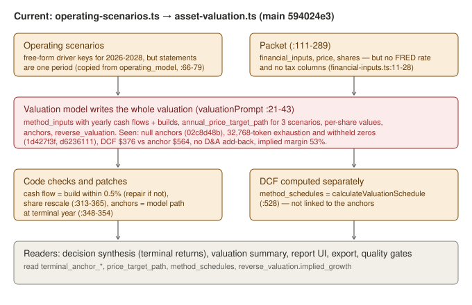
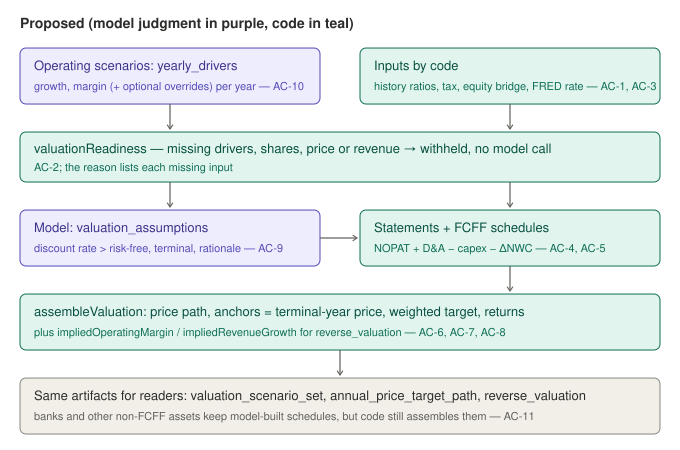
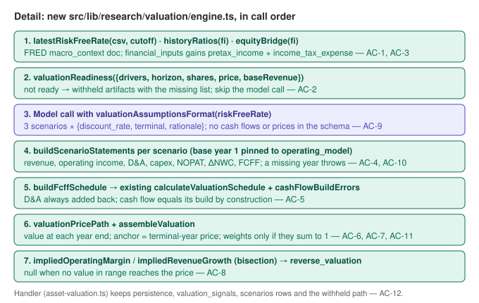

# Deterministic valuation engine

Part of the "less model variance" programme (see [../deterministic-pipeline.md](../deterministic-pipeline.md)). This is fix 1, and it lands after [decision-synthesis-determinism](../decision-synthesis-determinism/implementation.md).

## Problem and behavior

The valuation analyst writes the whole valuation by hand:
- yearly cash flows and how each is built;
- three scenarios' annual price paths, per-share values and terminal anchors;
- the reverse valuation.

Code then checks the arithmetic, rescales share counts, and takes the anchors from the model's price path (`asset-valuation.ts:348-354`). It computes the DCF separately (`:528`), and nothing links the two.

Evidence from the META runs on Claude Haiku 5.5:

| Run | What went wrong |
| --- | --- |
| `02c8d48b` | Null terminal anchors and an empty price path in the first pass; two inactivity timeouts |
| `d6236111` | Withheld, with all anchors 0; the run stopped (before PR #40) |
| `1d427f3f` | One call used the whole 32,768-token output limit. The final valuation was withheld because "operating scenarios cover only FY2026", "no sourced discount rate (FRED DGS10 has no fetched observations)", and "no D&A, working-capital and share-count schedules". |
| `02c8d48b` report | DCF value per share $376 against a terminal anchor of $564; no D&A add-back; reverse valuation implying a 53% margin against 25–34% in every scenario |

Three of the withheld reasons are plumbing, not judgment:

1. **FRED DGS10 is stored for the run** (260 daily rows, latest 5.22% on 2026-10-08) but never reaches the valuation packet.
2. **The operating scenarios do carry 2026–2028 driver assumptions, but under free-form keys.** Their `resulting_financial_statements_json` is a single period copied from the operating model (`operating-scenarios.ts:66-79`). There are no yearly statements to value.
3. **`financial_inputs` has no tax lines**, so NOPAT can't be computed from history.

Before: the model returns about 20–30 KB of JSON with cash flows, builds, paths and per-share values. Code repairs the arithmetic or the run withholds.

After:
- The operating scenarios carry `yearly_drivers`: revenue growth and operating margin per year, with optional capex, D&A, tax and working-capital overrides.
- Code builds the statements and the FCFF schedule.
- The valuation model returns only `valuation_assumptions`: per scenario a discount rate (which must exceed the FRED 10-year rate), a terminal multiple of NOPAT or a perpetuity growth rate, and a rationale.
- Code computes the price path, the anchors (equal to the terminal-year price by construction), the weighted target, the returns and the reverse valuation.
- If drivers, shares, price or base revenue are missing, the stage records "withheld" with the exact list and makes no model call.

## Scope and invariants

Likely files:

- **New** `src/lib/research/valuation/engine.ts`: pure functions, contract below.
- `src/lib/research/valuation/financial-inputs.ts`: add `pretax_income` and `income_tax_expense` columns.
- `src/lib/research/forecast/contracts.ts` and `stage-contracts.ts` (`OPERATING_SCENARIOS_CONTRACT`): add `yearly_drivers` to each scenario; coverage is checked by `validateScenarioDriverCoverage`.
- `src/lib/research/handlers/operating-scenarios.ts`:
  - set the horizon (base fiscal year +1 to +N, `RESEARCH_FORECAST_YEARS`, default 3);
  - ask for `yearly_drivers`;
  - build `resulting_financial_statements_json.years` with `buildScenarioStatements`, with the base case's first year pinned to the accepted operating model.
- `src/lib/research/handlers/asset-valuation.ts`:
  - load the FRED document (`metadata_json->>'series_id' = 'DGS10'`, joined through `research_run_sources`);
  - run readiness;
  - call the model with `valuationAssumptionsFormat`;
  - build schedules and assemble;
  - keep persistence (`valuation_signals`, the `scenarios` rows, the withheld path, share-denominator evidence).
  - The share rescale block at `:313-365` goes away, because shares are an input, never model-written.
- `src/lib/research/stage-contracts.ts` `VALUATION_CONTRACT`: the save-time artifacts stay as they are. The model-facing format becomes `valuationAssumptionsFormat`.
- `src/lib/agent-harness/providers/mock.ts`: `v3OperatingScenariosResponse` gains `yearly_drivers`. `v3ValuationResponse` returns `valuation_assumptions` for FCFF assets and keeps `method_inputs` for the SOFI (bank) path.
- Docs: `docs/system.md` (valuation section) and `docs/architecture.md` (valuation activity view, and the diagram via `docs/diagrams/_source/make_diagrams.py`).

Existing interfaces to reuse:
- `calculateValuationSchedule`, `validateMethodInputs`, `cashFlowBuildErrors` (`valuation/schedules.ts`)
- `valuationFinancialInputs` and `hasDepreciationInputs`
- `withheldValuationReason`
- `validateAnnualPriceTargetPath` (today used only in tests; here it serves as an oracle)
- `validateArtifactContent`
- `recentFredObservations` (`sources/corpus.ts:847`)
- `valuationDatePrice`

Invariants:
- The artifact shapes that readers use (`valuation_scenario_set` including `method_schedules`, `annual_price_target_path`, `reverse_valuation`) stay compatible. So do decision synthesis's `terminal_return_inputs`, the valuation summary, the report UI and export.
- Withheld valuations still finish the stage as withheld (PR #40). Both human gates are unchanged.
- Reported diluted shares stay the minimum per-share denominator.
- No new dependencies; no migration (the new fields live in `content_json`).

Exclusions:
- Rebuilding the operating model as a multi-year engine. The operating model stays single-period, and the scenarios carry the years.
- Dividend forecasts (`dividend_per_share` stays 0 and is listed as a source gap).
- New valuation methods for banks. The FCFE and book methods stay model-built schedules, and only their assembly moves to code (AC-11).

## Public contract

Exported from `src/lib/research/valuation/engine.ts`. Amounts are currency millions and rates are decimals.

```ts
latestRiskFreeRate(csv: string, cutoffDate: string): { rate: number; observation_date: string } | null
  // last numeric value on or before cutoffDate; blank and "." skipped; percent → decimal (5.22 → 0.0522)
historyRatios(fi: ValuationFinancialInputs): {
  da_to_revenue: number | null; capex_to_revenue: number | null;
  tax_rate: number; tax_rate_source: "history" | "statutory_default";   // mean of last ≤3 annual rows; 0.21 when no tax data
  base_year: { fiscal_year: number; revenue: number; operating_income: number | null } | null }
equityBridge(fi): { amount: number; period_end: string; components: Record<string, number>; missing: string[] } | null
  // latest row (annual or quarterly) with any balance item: cash + securities − long-term debt − current debt − leases
buildScenarioStatements({ baseRevenue, baseYear, ratios, drivers, firstYear? }): StatementYear[]
  // StatementYear: { fiscal_year, revenue, operating_income, depreciation_amortization, capital_expenditures,
  //   nopat, change_in_net_working_capital, fcff } (named like the schedule build fields)
  // revenue_t = revenue_{t-1}(1+g); OI = revenue × margin; D&A, capex = revenue × (override ?? ratio);
  // NOPAT = OI(1 − tax); ΔNWC = nwc_to_revenue_change × Δrevenue; FCFF = NOPAT + D&A − capex − ΔNWC.
  // Years must be baseYear+1… contiguous, otherwise it throws naming the missing year.
buildFcffSchedule({ statements, assumptions, bridge, dilutedSharesMillions, currency, sourceNotes }): ValuationMethodInput
  // terminal multiple metric "nopat" uses the last year's NOPAT; every year has a build
valuationPricePath(schedule): { fiscal_year: number; price_target: number }[]
  // value at each year end: (PV at t of later cash flows + PV at t of terminal value + bridge) / shares
assembleValuation({ schedules: {bear, base, bull}, probabilities, marketPrice, currency }):
  { valuation_scenario_set, annual_price_target_path }
  // anchors = terminal-year price; weighted_target only if weights sum to 1 ± 0.001;
  // total_return_target = (price − market)/market; dividend_per_share 0; is_interpolated false
impliedOperatingMargin(input & { marketPrice }): number | null    // uniform margin in [−0.5, 0.95]
impliedRevenueGrowth(input & { marketPrice }): number | null       // uniform growth in [−0.5, 1.5]
valuationReadiness({ drivers, horizon, dilutedSharesMillions, marketPrice, baseRevenue }): { ready: boolean; missing: string[] }
  // each missing item names the scenario and year, diluted shares, price, or base revenue
validateScenarioDriverCoverage(scenarioSet, horizon: number[]): string[]   // one message per scenario with gaps
valuationAssumptionsFormat(riskFreeRate: number | null): AgentOutputFormat
  // requiredKeys ["valuation_assumptions"]; exactly bear, base, bull; discount_rate > riskFreeRate;
  // perpetuity growth < discount_rate; multiple ≥ 0; the schema has no price, anchor, projection or cash-flow fields
```

## Feature map and diagrams







Affected consumers:
- `decision-synthesis.ts:75-98`, which reads `terminal_year`, `current_market_price`, terminal-year `price_target`, `annual_projections[T].balance_sheet_values.shares_outstanding_millions` and `dilution_assumption`. The assembled path must keep `diluted_shares_millions` and `shares_outstanding_millions`.
- `reporting/valuation-summary.ts:60-213`
- `components/report/valuation-summary.tsx`, `research-report.tsx:66`, `presentation.mjs:134-140`
- `app/assets/[id]/view/page.tsx:231, 420-427, 459, 567`
- `handlers/export.ts:168-184, 229-230`
- `workflow/quality-gates.ts` (`scenarios.value_anchor`)

## Acceptance criteria

| ID | Trigger | Observable outcome | Checked by |
| --- | --- | --- | --- |
| AC-1 | FRED CSV and a cutoff | Last numeric value on or before the cutoff, as a decimal; null if none. The packet carries it as the risk-free rate with its date and source ID | both (handler part: manual plus e2e) |
| AC-2 | Missing drivers, shares, price or base revenue | `ready: false` with one entry per missing input. The handler records withheld with that list and makes no model call | both (handler part: manual) |
| AC-3 | Captured filings | `financial_inputs` has `pretax_income` and `income_tax_expense`. `historyRatios` averages the last three or fewer annual rows; tax falls back to 0.21 labelled `statutory_default`. `equityBridge` uses the latest balance row and names missing components | both |
| AC-4 | Drivers per year | Statements follow the formulas above; overrides win; the base case's first year can be pinned; a missing year throws | both |
| AC-5 | Statements plus assumptions | The schedule passes `calculateValuationSchedule` and `cashFlowBuildErrors` returns nothing (D&A added back) | both |
| AC-6 | A schedule | The path's final year = (terminal value + bridge)/shares; rolling back reproduces each earlier year and today's value per share | both |
| AC-7 | Three schedules | Anchors equal the terminal-year prices; weighted target and returns follow the formulas; output passes `validateAnnualPriceTargetPath` and `validateArtifactContent` | both |
| AC-8 | Market price | Implied margin and growth reproduce the price within tolerance; null when out of range | both |
| AC-9 | Model answer | Only assumptions are asked for; a discount rate at or below the risk-free rate, growth at or above the discount rate, or not exactly three scenarios is an error | both |
| AC-10 | Operating scenarios | `yearly_drivers` must cover every horizon year for bear, base and bull; the gaps are listed | both |
| AC-11 | Non-FCFF assets (banks) | Model-built FCFE or book schedules are still accepted, but the path, anchors and returns are assembled by code (the model's price path is ignored) | verification |
| AC-12 | Full pipeline | Persisted artifacts keep their reader-facing shape; `npm run test:sofi-v3` passes; a META run on Haiku produces non-withheld anchors whose DCF and anchors agree | manual plus e2e plus paid check |

## Implementation sequence

1. `financial-inputs.ts` tax columns, then `engine.ts`. Run both test sets until green, and `npm run test:unit`.
2. Operating scenarios:
   - add `yearly_drivers` to the contract and prompt;
   - build the statement years in the handler;
   - update the mock.
   - Run `npm run test:sofi-v3`.
3. Valuation handler: FRED lookup, readiness, the assumptions call, assembly, the reverse valuation; remove the share rescale and the model-written path; keep the withheld persistence path; update the mock.
4. Readers: confirm `decision-synthesis.ts` terminal inputs still resolve (`shares_outstanding_millions` in `annual_projections`). Run `npm run test:db`.
5. Docs: `docs/system.md`, `docs/architecture.md` and its diagram.
6. Paid live check, only with your approval: a fresh META run on Claude Haiku 5.5. Expect about $2–3 for a full run. Fix 3 isn't in yet, so team-request loops may add to that.

## Verification

From the repository root:

```bash
npx tsx --test Implementations/deterministic-valuation/acceptance/*.test.ts
npx tsx --test Implementations/deterministic-valuation/verification/*.test.ts
npx tsc --noEmit
npm run test:unit
npm run build
npm run test:sofi-v3
npm run test:db
```

`npm run test:sofi-v3` needs PostgreSQL on port 5433. `npm run test:db` needs `DATABASE_URL` pointed at a migrated test database, not the dev database. Neither plan test set needs a DB.

### Baseline (main `594024e3`, 2026-10-11)

| Set | Result | Notes |
| --- | --- | --- |
| acceptance (11 tests) | 0 pass, 11 fail | All fail on "src/lib/research/valuation/engine.ts must export latestRiskFreeRate" |
| verification (10 tests) | 0 pass, 10 fail | All fail on the missing export |

Satisfiability check: a throwaway reference `engine.ts`, plus the two `financial-inputs.ts` columns, passed both sets (11 and 10) in a scratch worktree of main. The unit suite stayed at 318 pass, 0 fail with the new columns. The reference is not part of this package.

## Completion evidence

All results below are **worker-reported** (branch `feat/deterministic-valuation-engine`, 2026-10-11). None has been checked independently yet. The worker did not read or run `verification/`.

Commands, run from the worktree root. Database suites used a private migrated test database (`rr_test_f1`) and the mock provider.

| Command | Result |
| --- | --- |
| `npx tsx --test Implementations/deterministic-valuation/acceptance/*.test.ts` | 11 pass, 0 fail |
| `npx tsc --noEmit` | pass |
| `npm run test:unit` | 322 pass, 0 fail, 10 skipped (main: 318, 0, 10; the 4 new tests are in `tests/valuation-engine.test.ts`) |
| `npm run build` | pass |
| `RUN_DB_INTEGRATION=1 RESEARCH_MODEL_PROVIDER=mock RESEARCH_ACCEPTANCE_PROVIDER=mock npx tsx --test tests/sofi-research-e2e.test.ts` (the `test:sofi-v3` script's port-5433 database wasn't running) | 6 pass, 0 fail, with no change to the test |
| `npm run test:db -- 'tests/*.test.ts' 'Implementations/deterministic-valuation/acceptance/*.test.ts'` | 360 pass, 0 fail |
| Manual handler check: a scratch script, not committed. It runs the mock bank pipeline, switches the run to `operating_company`, then calls `assetValuationHandler` twice: first with no statements, then with added filings, a price snapshot and a FRED document | pass (details below) |

By criterion:

| ID | Evidence |
| --- | --- |
| AC-1 | Acceptance AC-1. Unit: rows marked `.`, CRLF lines and a full ISO cutoff. Manual: with DGS10 rows 2025-12-29 4.10, 2025-12-30 4.05, 2025-12-31 `.` and 2026-01-02 9.99 and a 2026-01-01 cutoff, `risk_free_rate` was `{rate: 0.0405, observation_date: "2025-12-30", series_id: "DGS10", source_document_id}`. The model packet carried the same value |
| AC-2 | Acceptance AC-2. Manual: without statements, shares or price, the stage saved withheld artifacts with "Valuation inputs are missing: diluted shares; market price; base-year revenue." No new `asset_valuation` task was created |
| AC-3 | Acceptance AC-3. Unit: the 21% `statutory_default` fallback, and a bridge from the latest balance row that names its missing items |
| AC-4 to AC-6 | Acceptance |
| AC-7 | Acceptance. Manual: each anchor equals its terminal-year path price and (terminal value + bridge) / shares |
| AC-8 | Acceptance. Unit: null when no margin in range reaches the price |
| AC-9 | Acceptance. Unit: duplicate scenarios are rejected. Manual: the stored request's output format has no price, projection or anchor field. The mock's discount rates are the risk-free rate plus a premium |
| AC-10 | Acceptance. The handler adds `validateScenarioDriverCoverage` to the contract check, so a gap goes through repair. SOFI e2e: scenarios carry drivers for 2026–2028 |
| AC-11 | Unit: bank FCFE schedules are assembled by code, and mismatched years are rejected. SOFI e2e: the mock returns only FCFE schedules, and the 2026–2030 path is assembled by code. The verification set wasn't run by the worker |
| AC-12 | SOFI e2e and `test:db` pass. Decision synthesis's `shares_outstanding_millions` resolves (2500 in the manual check). The paid META run on Haiku wasn't run; it needs approval |

Decisions not fixed by the plan:
- **Bank path.** A run takes the bank path when its archetypes include `bank` or its profile is `financials`. The model-facing format there is `valuation_scenario_set` (`valuation_status`, `method_inputs`, `omitted_methods`, `withheld_reason`) plus `reverse_valuation`. The path comes from the first method in schema order (fcff, fcfe, dividend, earnings_exit, book_exit, tangible_book_exit) that has all three scenarios. Any share count below the reported diluted count is raised to it. The bank reverse valuation stays model-written.
- **Withheld triggers.** A non-positive code-built anchor is recorded as withheld instead of failing the stage.
- **Shares.** Diluted shares are the SEC reported count, otherwise the latest captured `diluted_shares`.
- **Reverse valuation.** `implied_growth` and `implied_margin` are nullable: null when no value in range reaches the price. The export prints that case.
- **Operating-model pin.** The pin converts the operating model's unit (1, 1e3 or 1e6) when revenue then falls within 0.5–2× base revenue. Otherwise there is no pin, and a source gap is recorded.
- **Report reader.** `valuation-summary.ts` now checks each anchor against the schedule's end-of-horizon value instead of today's value per share. `tests/report-ui.test.ts` changed: its fixture already agrees, and the disagreement case now moves the base anchor to 600.
- **Extra engine exports.** `forecastHorizon`, `operatingModelFirstYear` and the types.

Remaining limits:
- The paid META run on Haiku for AC-12 is still open.
- The mock pipeline for an operating company stops at `historical_record` ("Primary financial statements are incomplete"), before any stage this change touches; this wasn't rechecked on main. The FCFF handler path is therefore covered by the manual check, not by a committed DB test.
- Persisted amounts and prices aren't rounded.
