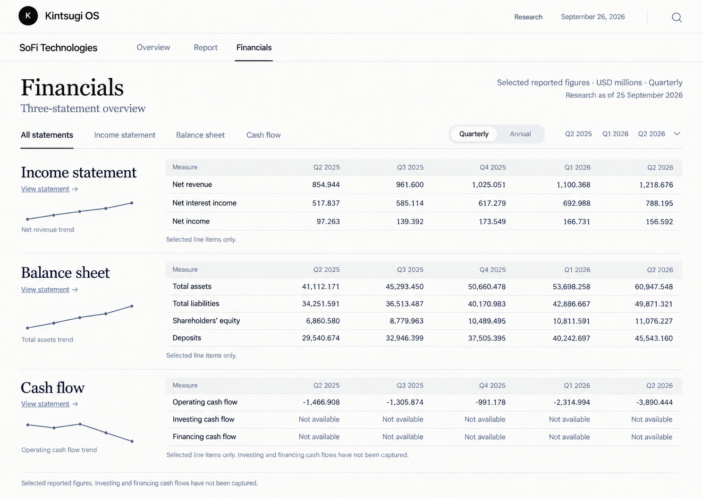
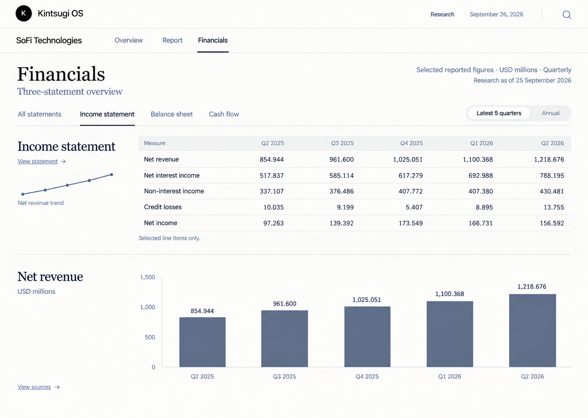
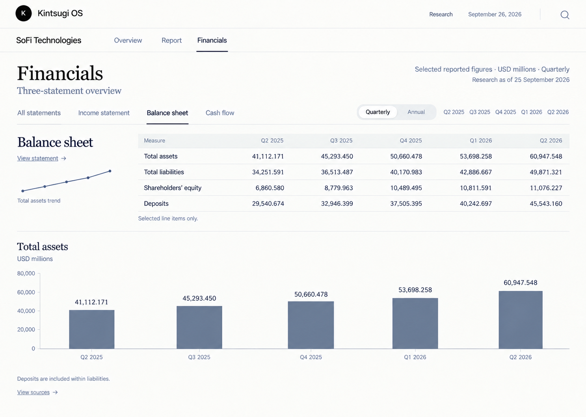
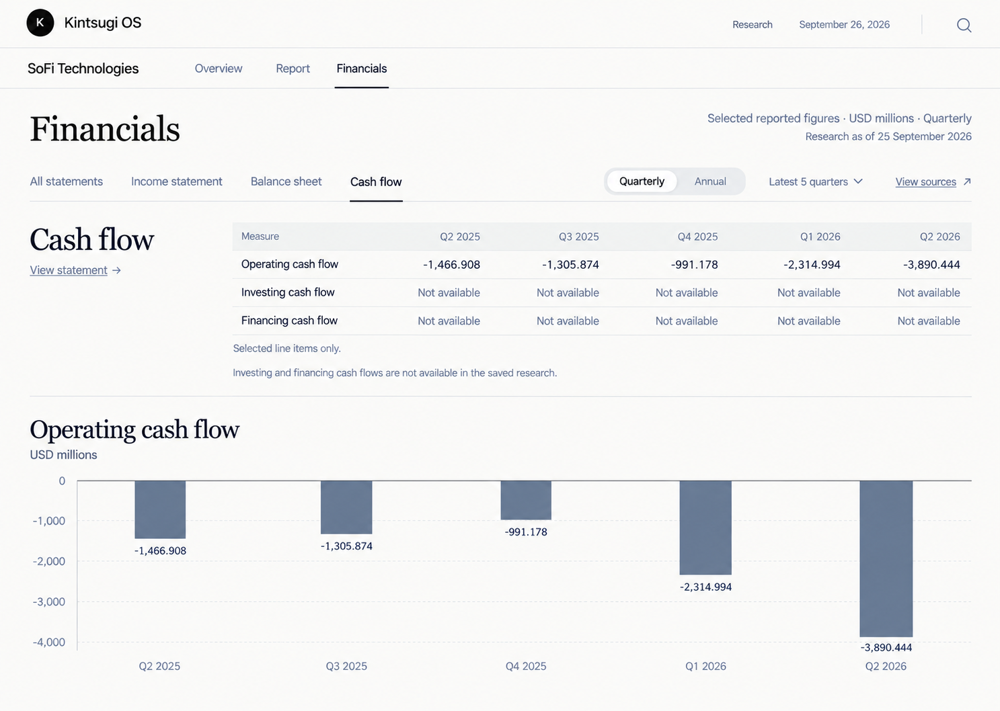

# Financials as a main asset view

Status: implemented and reviewed on 27 September 2026. Targeted tests, type checking, desktop/mobile visual review and browser interactions passed. Native 200% browser zoom remains unverified because the in-app browser ignored its zoom shortcut. See [review.md](review.md) for evidence and limits.
Prepared 26 September 2026 using TOR-Implementation. The user selected the third image from the most recent workshop, the three-statement overview. This package includes that exact image and three companion tab mockups.

## Problem and intended behavior

Today, financial observations are buried in Report > Financial history > Supporting evidence. The asset view has a separate generic Metrics screen, but no three-statement Financials view. A reader looking for loan loss reserve must search a mixed financial-history table.

After implementation, Overview, Report and Financials are visible peer destinations. Financials opens an All statements overview with income, balance sheet and cash-flow summaries on one page. Each summary links to its complete available statement tab. Loan loss reserve is directly accessible under Balance sheet. No chapter navigation appears within Financials.

Use the current saved research. This is presentation work, not a research rerun or a promise of complete audited statements. The saved SoFi data has operating cash flow but lacks investing and financing cash flows.

## Visual references

The selected overview governs structure and styling. The companion images explain the detail views. Images are layout references, never financial data sources. The typed report artifacts and the rules below take precedence over generated text, plotted geometry and decorative details.

### Selected All statements view



### Income statement detail



### Balance sheet detail



### Cash flow detail



### Required corrections to the images

- The overview's period selector names three quarters but its tables show five. Use a separate frequency control and a period-window control such as Latest 5 quarters; table headings, charts and selection must agree.
- The overview cash-flow sparkline is inaccurate. Actual operating cash flow improves from Q2 to Q4 2025, then declines in Q1 and Q2 2026. Plot the observations, never trace a mockup path.
- The income mockup incorrectly prints Q2 2026 credit losses as 13.575. The saved value is **13.755 USD millions**.
- The detail views must not keep the subtitle Three-statement overview or a View statement link pointing to the currently open tab. Use the selected statement subtitle and a Back to all statements link if needed.
- The balance-sheet mockup is abbreviated. Its detail table must also expose loan loss reserve, loans held for sale and loans held for investment, net, plus all other classified observations. Do not reduce coverage to fit one screenshot.
- Annual must be disabled with an accessible reason when annual observations are absent. Latest 5 quarters is not a frequency choice. The income image conflates these controls; keep them separate.
- Match the existing application shell. Do not add a decorative current-date label or duplicate the Kintsugi header merely because the images contain them.

Theme: warm white `#fbfbf9`, charcoal `#181818`, slate `#515d70`, secondary text `#626b78`, rules `#e1e4e6`. Reuse existing tokens where equivalent. Georgia section headings, current sans-serif UI, tabular right-aligned numbers, readable 14–16px data text. Separate sections with whitespace and thin rules. No card grid, shadows, confidence badges, paragraph counts or raw identifiers.

At 1440px, overview sections have a roughly 280px title/sparkline column and a flexible table column. Align period columns across all three tables. At 390px, stack the title above its table, keep labels readable, and contain horizontal table scrolling without page overflow. Use sticky first columns only if they do not obscure values. All rows remain reachable by normal vertical scrolling.

## Repository evidence and scope

Working directory: `C:/Users/sense/OneDrive/Documents/GitHub/Investing-Research-Pipeline`.

- `src/app/assets/[id]/view/page.tsx`: loads the selected run, `/api/research-runs/:id/report`, its `report_document`, artifacts and read models. `openSection` currently only persists `view=report`. An early return renders `ResearchReport` without the asset view toolbar. Integrate peer navigation across that early-return boundary.
- `src/app/api/research-runs/[id]/report/route.ts` calls `getResearchRunReport` in `src/lib/research/artifacts/read-model.ts`. Typed artifacts are the source of truth. Reuse the already loaded run response; do not join arbitrary asset-wide metrics into another run.
- `src/lib/research/reporting/report.ts`: `ReportDocument.artifacts`, evidence and hashes. `tables.ts` resolves referenced artifact paths. Historical table references identify `observations`; coverage cells and `ttm_series` are different data and must not be mistaken for quarterly observations.
- `src/lib/research/history/contracts.ts`: observations contain metric, frequency, basis, currency, segment, geography, dates and source references. `historical_record` holds observations and TTM separately.
- `src/lib/research/reporting/presentation.mjs`: reuse `historyMatrix`, `label` and numeric formatting. They retain currency/basis/segment distinctions and exact values. Prefer one small classifier here to a second financial data layer.
- `src/components/research-report.tsx` and its CSS: retain report prose, reading/analysis modes and citations. Add a route to Financials; financial statements must no longer depend on opening a report chapter. Preserve stored section IDs and old chapter deep links; a short prose chapter and link to Financials may remain, but do not delete stored research.
- Likely new UI: one `src/components/financial-statements.tsx` with a colocated CSS module. Reuse installed Recharts or existing SVG chart code. No new dependencies or generic dashboard framework.

The workspace contains substantial unrelated changes and an unfinished PR preparation. Do not reset, stage, commit or include unrelated files. This package neither creates a PR nor resolves the pending PR scope question.

Exclusions: research prompts, paid providers, new extraction, database migrations, changes to approval gates, stored report hashes, exports, model decisions and merging. Do not hardcode SoFi figures in production or ship generated images as the functional UI.

## Navigation and data contract

Use the existing asset route with `view=financials`, `statement=all|income|balance|cashflow`, `frequency=quarterly|annual`, and optional `end=YYYY-QN` or `end=YYYY` for the period-window endpoint. Default to all statements, quarterly, latest five available periods. Preserve `run` and unrelated query parameters. Invalid statement/frequency/end values fall back safely. Use Next navigation or an equivalent approach that supports browser Back/Forward and reload. The main Report link retains `view=report`. Old report links remain usable.

All statement tables use the same chronological period window. Earlier and later controls move through available periods, with disabled bounds. Annual shows only stored annual observations, never sums quarterly balances or relabels TTM. If the selected frequency has no observations, show a clear empty state and the available frequency choice.

Add the following small, testable presentation entry point, used by the UI, in the existing `presentation.mjs` module:

```ts
financialStatements(observations, periodicity = 'quarterly')
// => { income: Observation[], balance: Observation[],
//      cashflow: Observation[], other: Observation[],
//      missingCashFlows: string[] }
```

This function partitions only observations matching the requested periodicity, preserving input order, every original field, duplicate observations and source references without mutation. It does not format, aggregate or manufacture numbers. Pass grouped observations to existing presentation helpers for display.

Classification rules:

| Group | Known metric keys |
| --- | --- |
| income | net_revenue, contract_revenue, net_income, net_interest_income, non_interest_income, noninterest_income_gaap, credit_losses, deposit_interest_expense |
| balance | total_assets, total_liabilities, stockholders_equity, deposits, total_deposits, loan_loss_reserve, loans_held_for_sale, loans_held_for_investment_net |
| cashflow | operating_cash_flow, investing_cash_flow, financing_cash_flow |

For unfamiliar keys, recognize `metadata_json.metric_category` of `income_statement`, `balance_sheet`, or `cash_flow`. Generic `financial` is not a statement classification. Known keys take precedence; all remaining rows go to `other`. Preserve aliases as distinct observations, rather than silently merging potentially different definitions. Other figures must remain accessible under a modest Other reported metrics disclosure or the existing Metrics destination.

`missingCashFlows` lists operating_cash_flow, investing_cash_flow, financing_cash_flow in that order when the selected frequency has no finite numeric observation for that key. Zero is available. This is a whole-series availability indication, not a substitute for missing-period cells. The UI displays absent cash-flow categories as Not available and per-period missing values as Not disclosed or Not available, consistently explained. A partial series must retain gaps. No fabricated FCF, net change in cash or reconciliation.

The overview summarizes net revenue/net interest income/net income; assets/liabilities/equity/deposits; and the three cash-flow categories when applicable. Details expose every classified row. Keep currency, reporting basis, segment and geography distinctions visible. USD millions is permitted only for the relevant USD amounts; other currencies and units keep their own labels. Duplicate/conflicting observations must remain distinguishable, never become a guessed chart point. Charts use an unambiguous consolidated series or show a reason they cannot be drawn. Source actions resolve existing source/evidence references; absent provenance says unavailable, never links a guessed source.

## Acceptance criteria

| ID | Trigger and required outcome | Evidence |
| --- | --- | --- |
| AC-1 | Open an asset or report: visible Overview / Report / Financials peer navigation. Financials has all four statement tabs, no chapter rail, and a direct URL. Changing tabs, reload and Back/Forward preserve the chosen run and view. Invalid query values recover safely. | Manual browser sequence below |
| AC-2 | Load selected-run history: group all observations losslessly using the documented classifier. Overview is abbreviated; detail tabs and Other reported metrics retain all data. Metadata categories and known aliases work. | Both test sets; browser table comparison |
| AC-3 | Render zero, negative, null, missing, duplicate and mixed-basis observations: exact amounts/provenance survive, missing is not zero, SQL labels are humanized, and absent cash-flow categories are explicit. | Both test sets; source and chart checks |
| AC-4 | Change frequency or window: headings, tables and charts agree; annual/TTM are not synthesized or mixed. Empty data has a truthful state and disabled unavailable controls. | Both test sets for frequency/empty data; manual window/reload checks |
| AC-5 | Compare the UI to all four references at desktop and mobile sizes: preserve the selected layout and theme with the documented corrections. Tables are readable, keyboard accessible and contained; charts use real values with accessible numeric alternatives. | Required visual review and screenshots |
| AC-6 | Open sources and switch runs: every value belongs to the selected run, existing source detail behavior works, unavailable provenance is explicit. Viewing Financials makes no writes to research artifacts, approval or export state. Existing report reader and deep links still work. | Manual browser/network checks and existing reader regression tests |

## Implementation sequence

1. Inspect this package and the affected code. Record starting status. Preserve unrelated edits. Implement the small classifier and run acceptance tests.
2. Build All statements and the three detail views from the selected report artifacts. Share one period window, existing formatting and source lookup. Use actual observations for charts and empty states.
3. Integrate peer navigation and URL state across the report early return and overview. Retain secondary tools and report content. Verify reload, Back/Forward and selected-run changes.
4. Match the four images with the corrections above. Review at 1440x1024 and 390x844, keyboard-only and 200% zoom. Fix clipped labels, wide-page overflow and chart gaps.
5. Run the commands below, record results and screenshots, and have the plan author review the exact candidate diff against all criteria. Do not mark complete on tests alone.

## Test package and verification

The plan author wrote both suites before application implementation. Acceptance tests are worker-visible. Verification tests use separately designed boundary inputs; they are not a copy of the SoFi fixture tests. They are currently in the same repository, so **they are not hidden or isolated**. Before delegating to another worker, retain an authoritative package in a reviewer-controlled location and exclude `verification/` from its writable checkout. No worker has been started. Do not weaken or skip assertions to get a pass.

`fixtures/sofi-observations.json` contains 306 saved observation records copied from the saved report's `775bd945-a2a6-4f98-9c37-80b08f3d8370:observations`. Metadata was reduced to metric_category; numeric, period, unit, basis and provenance fields are retained. This is a deterministic test fixture, not a production data source. Original run: `d2ea550f-7068-4706-9a62-abc89b4ceb9f`; report hash `61ac57651a58c24ba3214a5d4f2a87e0d56444350899a1893ce5885869d71b3e`.

Run from the repository root with installed Node dependencies. The new tests need no database, server, credentials or paid provider.

```powershell
npx tsx --test Implementations/financials-main-view/acceptance/*.test.ts
npx tsx --test Implementations/financials-main-view/verification/*.test.ts
npx tsc --noEmit
npx tsx --test Implementations/report-visual-reader/acceptance/*.test.ts Implementations/report-visual-reader/verification/*.test.ts
```

The default unit-test glob does not discover this package. Run the explicit commands. The reviewer reruns both suites against the actual candidate source. Broader pipeline tests are unnecessary unless implementation changes backend behavior, which is outside this task.

### Required browser checks

Use the existing local server and stored report, or documented equivalent deterministic fixtures. Starting asset: `/assets/92303fee-a489-4453-8b36-d6bd94ac0a54/view?run=d2ea550f-7068-4706-9a62-abc89b4ceb9f&view=financials`.

1. From Overview, open Financials, each statement tab, and each View statement link. Return to Report, open an existing chapter deep link and return to Financials. Confirm no chapter rail in Financials.
2. On Balance sheet select earlier periods, reload, go Back and Forward. Check run parameter, active tab and period headings. Test invalid query values. Annual unavailable must explain why; annual-only/empty fixtures must not show quarterly data falsely.
3. Check Q2 2026 loan loss reserve 56.459 million, exact 56,459,000 USD; net revenue 1,218.676 million; operating cash flow negative 3,890.444 million. Check zero, null and mixed-currency fixtures. Compare chart signs and values with table cells.
4. Open an available source by keyboard and dismiss it, restoring focus. With absent source data show an explicit unavailable state. Change run and confirm no previous-run figures remain. Inspect network activity for unintended writes.
5. Capture all four tabs at 1440x1024 and 390x844. Visually inspect readable labels, long tables, horizontal scroll containment, focus visibility and 200% zoom. Verify keyboard tab controls follow appropriate link or tab semantics. Provide numeric chart alternatives and accessible names.
6. Record every result in `review.md`, with screenshot paths and any untested state. Include the candidate revision or diff identity. Automated classification checks do not establish UI correctness.

## Baseline and completion evidence

On 26 September 2026 the author ran both suites together before application edits: **7 tests, 1 passed, 6 expected failures, 0 skipped**. The passing test verifies the existing formatter's handling of zero, null and exact amounts. All six new-behavior tests failed at the intended assertion: `financialStatements` is not implemented. The existing module imported successfully; this was not a setup or dependency failure. Baseline tests stop at that assertion, so downstream assertions still need validation against the implementation. Full output is in `baseline.log`.

At plan preparation, the four local PNG references were visually inspected and application implementation was outstanding. The original test suites and fixture remain unchanged. The implementation and its completed checks are recorded in [review.md](review.md).
