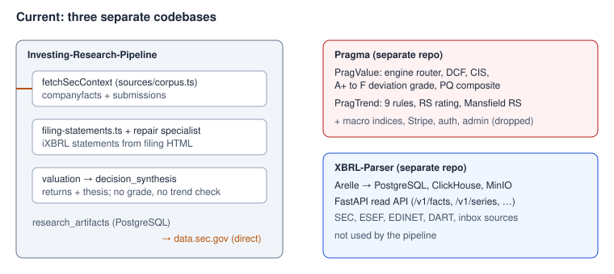
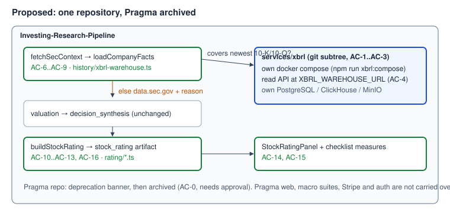
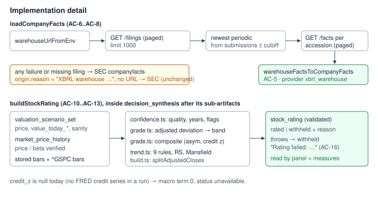

# Pragma deprecation, XBRL warehouse integration and the stock-rating port

Plan, acceptance tests, verification tests and code were all written by one agent (TOR-1-Agent).
The verification tests are a second, separately designed test set. They are not independent or hidden.

## Problem and expected behavior

Three codebases overlap:

- **Pragma** (`ToRRIIDeR97/Pragma`, plus its free-data copy `pragma-lite`) is a Next.js and FastAPI
  platform. Two of its products rate stocks:
  - PragValue (`pragma-web/api/app/services/pulsevalue.py`): a confidence-scaled deviation grade
    from A+ to F, and a combined grade that adds bull/bear asymmetry and a macro credit term.
  - PragTrend (`services/pragtrend.py`): 9 technical trend conditions plus Mansfield relative strength.
  - The rest of Pragma (macro indices, regime, screener, articles, Stripe, auth, admin) is not carried over.
- **XBRL-Parser** (`sec-xbrl-warehouse/`): a Python service. Arelle parses filings, ClickHouse and
  PostgreSQL store them, and a FastAPI read API serves point-in-time facts. It lives in its own repo.
- **This pipeline** downloads SEC companyfacts directly (`fetchSecContext` in
  `src/lib/research/sources/corpus.ts`). It produces returns and a thesis but no grade and no technical check.

Before: a run's `decision_synthesis` writes thesis, registers and a return matrix. A META run has no
stock grade. Companyfacts always comes from `data.sec.gov`.

After:
- The same run also stores a code-built `stock_rating` artifact, for example: valuation grade `B+`
  ("Slight discount"), combined grade `A-`, confidence 81, trend `7/9 conditions met`, Mansfield RS +3.1.
  The valuation summary shows it, and two checklist measures read it.
- With `XBRL_WAREHOUSE_URL=http://127.0.0.1:8080` set and the warehouse holding the issuer's newest
  periodic filing, the run's companyfacts come from the warehouse in the same shape. Otherwise the run
  uses SEC, as before, and records why.
- The warehouse source code lives in this repo under `services/xbrl/`, with its history.

## Scope

| Part | Files | Notes |
| --- | --- | --- |
| P0 Pragma deprecation | Pragma repo README (in a scratch clone) | Push and archive only with the user's explicit approval |
| P1 Warehouse import | `services/xbrl/**` (git subtree), `eslint.config.mjs`, `package.json` (`xbrl:compose`), `.gitignore` | No warehouse code changes |
| P2 Warehouse facts | `src/lib/research/history/xbrl-warehouse.ts` (new), `src/lib/research/sources/corpus.ts` | Read-only API; fallback to SEC |
| P3 Rating port | `src/lib/research/rating/{grade,confidence,trend,build}.ts` (new) | Pure functions |
| P4 Wiring | `handlers/decision-synthesis.ts`, `artifacts/contracts.ts`, `checklist/measures.ts`, `api/checklists.ts`, `components/report/stock-rating.tsx`, `components/report/valuation-summary.tsx` | |
| P5 Docs | `docs/system.md`, `docs/architecture.md`, `docs/security.md`, `docs/operations.md`, `AGENTS.md`, `docs/diagrams/_source/make_diagrams.py` | |

Exclusions:
- The filing-statement extractor and the repair specialist are **not** retired. Their replacement needs
  parity runs against a running warehouse with loaded filings. Docker isn't running on this machine, and
  the warehouse currently holds only AAPL.
- The pipeline's other SEC calls still go straight to SEC: submissions, filing documents, peers, themes
  and monitor-check. Only companyfacts moves to the warehouse.
- No enqueue/write endpoint is added to the warehouse. Its `api` identity is read-only by design
  (warehouse SECURITY.md). Operators load issuers with `filing discover --cik`.
- No change to valuation discount rates. Pragma's Credit Impact Scalar adjusted DCF discount rates. Here
  the valuation engine keeps its CAPM inputs, and the credit z-score is only an input to the combined grade.
- No credit data source is added. The pipeline has no FRED credit-spread series today, so `credit_z` is
  `null` and the macro term contributes 0, recorded as unavailable.
- Pragma's pattern detection (VCP, pocket pivot) and Weinstein stage analysis are not ported.

Invariants kept:
- Agents propose, code decides. The model never writes `stock_rating`.
- Fetched pages, filings and warehouse output are untrusted data.
- Stage order and dependencies are unchanged (no new stage). The rating is written inside
  `decision_synthesis` after its existing artifacts.
- No schema change: `research_artifacts.artifact_type` is free text, so no migration is needed.

## Feature map

| Component / symbol | Responsibility | In | Out | Source |
| --- | --- | --- | --- | --- |
| `fetchSecContext` | Issuer context: companyfacts, submissions, filing selection | `RunContext` | `secContext` JSON (stored as the `primary_source_context` document) | `src/lib/research/sources/corpus.ts:738` |
| companyfacts consumers | Latest facts, quarterly series, currency, taxonomy, diluted-share claim | `secContext.companyFacts` | observations, claims | `corpus.ts:205-370`, `history/sec-companyfacts.ts` |
| `validateEndpointUrl({local:true})` | Loopback/private URL check | env URL | `URL` | `src/lib/net.ts:156` |
| Warehouse API | `/v1/companies/{cik}/filings`, `/v1/facts?cik&accession` (limit ≤ 10 000, offset ≤ 10 000) | HTTP | JSON | `XBRL-Parser/.../api/routers/{companies,facts}.py` |
| `decision_synthesis` handler | Thesis, registers, returns; writes sub-artifacts | valuation artifacts, history | `research_artifacts` rows | `src/lib/research/handlers/decision-synthesis.ts:330` |
| `loadStoredPriceHistory` / `loadBenchmarkPriceHistory` | Stored daily bars by cutoff (stock, ^GSPC) | DB | bars, splits | `src/lib/market-data/price-history.ts:375,419` |
| `valuation_scenario_set` | `value_today_{bear,base,bull}`, `current_market_price`, `valuation_status`, `sanity.flags` | valuation stage | artifact | `valuation/engine.ts:303`, `valuation/v2.ts:611` |
| `market_price_history` | `valuation_price.verified`, `beta.verified` | historical record | artifact | `history/market-history.ts` |
| Checklist measures | Code-read figures for checklist items | artifacts | `MeasureResult` | `checklist/measures.ts`, `api/checklists.ts:126` |
| `ValuationSummaryView` | Report valuation panel | artifacts | UI | `components/report/valuation-summary.tsx` |

Observed facts: the warehouse has no write API for the pipeline. Its fact rows carry namespace, qname,
unit numerator/denominator, period kind/start/end/instant, accession, form, filed date, fiscal
year/period, dimensions and duplicate ordinal: enough to rebuild companyfacts rows. It does not compute
SEC's `frame` field. The pipeline's quarter detection falls back to the 80–100-day duration rule, so
losing `frame` changes nothing for duration facts.

Unresolved: the warehouse accession format. Accessions are compared with dashes removed.

## Diagrams







## Public contract (what both test sets rely on)

`src/lib/research/history/xbrl-warehouse.ts`
- `warehouseUrlFromEnv(env = process.env): URL | null`. Reads `XBRL_WAREHOUSE_URL`. Unset or blank
  gives null. Otherwise the URL must pass `validateEndpointUrl(..., { local: true })`: http(s),
  loopback or private host, no credentials, no query. Anything else throws an error naming
  `XBRL_WAREHOUSE_URL`.
- `warehouseFactsToCompanyFacts(rows, { cik, entityName })` returns `{ cik: number, entityName,
  facts: { [taxonomy]: { [concept]: { units: { [unit]: SecFactRow[] } } } } }`.
  - Keeps only facts in standard taxonomies: `us-gaap`, `dei`, `ifrs-full`, `srt`. The prefix comes
    from the qname; a namespace containing `fasb.org/us-gaap`, `xbrl.sec.gov/dei`, `xbrl.ifrs.org` or
    `fasb.org/srt` also maps.
  - Keeps only non-dimensional facts (empty `dimensions_json` and `dimension_hash`). Drops nil facts,
    facts without a finite numeric value, and rows with `duplicate_ordinal > 0`.
  - Unit: the numerator measures without their prefix (`iso4217:USD` → `USD`, `xbrli:shares` →
    `shares`), joined with `/` to the denominator when one exists (`USD/shares`).
  - Period: a duration fact gives `start` and `end`; an instant gives `end` only.
  - Row fields: `val`, `accn`, `fy`, `fp`, `form`, `filed` (YYYY-MM-DD), and `start`/`end`.
  - One row per (taxonomy, concept, unit, start, end, accession). Rows within a unit are sorted by
    `end`, then `filed`, then `accn`.
- `loadCompanyFacts({ cik, submissions, cutoffDate, userAgent, env?, fetchImpl? })` returns
  `{ companyFacts, origin: { provider: "xbrl_warehouse" | "sec_companyfacts", url, reason?, accessions? } }`.
  - No warehouse URL: fetches `https://data.sec.gov/api/xbrl/companyfacts/CIK<cik>.json` with the
    User-Agent. A non-OK response throws `SEC companyfacts failed: <status>` (unchanged behavior).
  - With a URL: lists the warehouse filings for `Number(cik)`, paging through
    `/v1/companies/<cik>/filings` until a short page. The newest 10-K, 10-Q, 20-F or 40-F (amendments
    included) in `submissions.filings.recent` filed on or before `cutoffDate` must be among them.
  - It then reads `/v1/facts?cik=<cik>&accession=<accn>&limit=10000&offset=<n>` for every loaded
    filing filed on or before the cutoff, paging until a short page.
  - The warehouse is used only when all of that succeeds, with `origin.accessions` = the number of
    filings read.
  - Any failure falls back to SEC with `origin.reason` starting `XBRL warehouse`: unreachable, non-OK,
    bad JSON, no filings, or the newest periodic filing missing.
- `fetchSecContext` uses `loadCompanyFacts`. `secContext.source` reads "XBRL warehouse facts and SEC
  submissions API" when the warehouse supplied the facts, and `secContext.companyFactsOrigin` records
  the origin.

`src/lib/research/rating/grade.ts`
- `GRADE_BANDS`: `[{ grade, below, label }]` in order A+, A, A-, B+, B, B-, C+, C, C-, D, F.
  - Cutoffs: −0.40, −0.25, −0.15, −0.08, −0.03, 0.03, 0.08, 0.15, 0.25, 0.40; F has `below: null`.
  - Labels: Deep discount, Significant discount, Moderate discount, Slight discount, Marginal discount,
    Fair value, Marginal premium, Moderate premium, Elevated premium, Significant premium, Deep premium.
- `gradeForDeviation(d)`: the first band whose cutoff is strictly above `d`, else F.
- `adjustedDeviation(price, baseValue, confidence)`: `(price / baseValue − 1) × sqrt(confidence / 100)`,
  or 0 when price or baseValue is 0.
- `compositeDeviation({ adjustedDeviation, price, bear, bull, creditZ })`. The Pragma formula:
  - `0.55·adj + 0.25·asym + 0.20·macro`.
  - `asym`: `r = clamp(bullRet / |bearRet|, 0, 5)`, or 1 when the bear return is 0. Then
    `asym = −min((r−1)·0.20, 0.30)` when r ≥ 1, else `min((1−r)·0.30, 0.30)`.
  - `macro = −clamp(creditZ, −2, 2)·0.10`, or 0 when `creditZ` is null.

`src/lib/research/rating/confidence.ts`
- `dataQualityFrom({ priceVerified, betaVerified })`: High when both are true, Low when neither, else Medium.
- `ratingConfidence({ dataQuality, yearsCaptured, flagCount })`: a 0–100 integer.
  - Base: High 85, Medium 65, Low 40.
  - +8 for 5+ years captured, +3 for 3+.
  - −3 per flag, at most −10. Clamped to 0–100.

`src/lib/research/rating/trend.ts`
- `trendRules(stock, benchmark)`. `stock` and `benchmark` are `{ day, close }[]`, ascending and
  split-adjusted; `benchmark` may be null. Returns
  `{ rules, passed, evaluated, score_label, rs_rating, mansfield }`.
- The 9 rule keys, in order: `price_above_150d_sma`, `price_above_200d_sma`, `sma_150_above_200`,
  `sma_200_trending_up`, `sma_50_above_150_200`, `price_above_50d_sma`, `above_52w_low_30pct`,
  `within_25pct_52w_high`, `rs_rating`.
- Each rule has status `pass`, `fail` or `unavailable`, with a reason when unavailable.
- Bars needed: SMA rules need their window (50/150/200 bars); the 52-week rules need 252;
  `sma_200_trending_up` needs 241 and passes when `sma200[n−1] > sma200[n−22]` and
  `sma200[n−21] > sma200[n−42]`. This is the effective check of Pragma's loop.
- `rs_rating`: Pragma's weighted 63/126/189/252-day relative return vs the benchmark, mapped
  `50 + rel·140`, clamped 1–99, rounded to one decimal. The rule passes above 70. With no benchmark or
  fewer than 252 bars of either series, the rule is unavailable and `rs_rating` is null.
- `mansfield`: `(ratio / SMA52(ratio) − 1)·100` on week-last closes of both series, joined by week.
  Signal: > 5 strong outperformer, > 0 outperforming, > −5 underperforming, else weak. Null with
  fewer than 52 shared weeks.
- `passed` and `evaluated` count pass and pass+fail. `score_label` = `"<passed>/<evaluated> conditions met"`.
- Deviations from Pragma, by design:
  - Rules with too little data are `unavailable` and leave the denominator, instead of counting as failures.
  - RS uses the S&P 500 only, because the pipeline stores no sector ETF series.
  - Mansfield uses 52 weeks rather than 52 daily bars, which is the standard definition.

`src/lib/research/rating/build.ts`
- `splitAdjustedCloses(bars, splits)`: `{ day, close }[]`, every close restated on the latest bar's
  split basis.
- `buildStockRating({ valuation, priceHistory, stockCloses, benchmarkCloses, yearsCaptured, creditZ? })`
  returns the `stock_rating` content:
  `{ artifact_type: "stock_rating", status: "rated" | "withheld", withheld_reason?, price,
  value_today: { bear, base, bull }, raw_deviation, adjusted_deviation, data_quality, confidence,
  valuation_grade, valuation_label, composite_deviation, composite_grade, composite_label,
  macro: { credit_z, status, reason? }, trend, method: string[] }`.
  - Withheld when the valuation is missing, `valuation_status` is `withheld`, or the price or base value
    today is not positive. Then every grade, deviation and confidence field is null, and the trend is
    still computed.
  - Deviations and confidence are rounded to 4 decimals.

Wiring
- `decision_synthesis` upserts `stock_rating` (status `validated`, scope `<slug>-stock-rating`) after
  its sub-artifacts. If building the rating throws, it stores a withheld rating with
  `withheld_reason` starting `Rating failed:` and does not fail the stage.
- `artifactTypes.stock_rating` exists.
- Checklist measures:
  - `trend_score_pct`: passed ÷ evaluated × 100. Gives a reason when nothing was evaluated or no rating exists.
  - `valuation_deviation_pct`: adjusted deviation × 100. Gives a reason when withheld.
  - Both read the newest `stock_rating`. The checklist route loads `stock_rating` artifacts.
- `StockRatingPanel({ artifacts })` renders nothing without a `stock_rating`.
  - Rated: shows the valuation grade and its label, the combined grade, confidence and the trend score label.
  - Withheld: shows the withheld reason and the trend score.
  - `ValuationSummaryView` renders it.

## Acceptance criteria

| ID | Part | Criterion | Acceptance | Verification |
| --- | --- | --- | --- | --- |
| AC-0 | P0 | Pragma README carries a deprecation banner pointing to this repo; repo archived after approval | manual | manual |
| AC-1 | P1 | `services/xbrl/sec-xbrl-warehouse/pyproject.toml` and `src/sec_xbrl_warehouse/api/app.py` exist; upstream commit "Pin the public IFRS 2019 and 2020 taxonomy packages for ESEF" is in `git log -- services/xbrl` | p1 | v1 |
| AC-2 | P1 | No `.DS_Store` or `.env` is tracked under `services/xbrl`; `services/xbrl/sec-xbrl-warehouse/.env` is ignored | p1 | v1 |
| AC-3 | P1 | `npm run xbrl:compose` targets the warehouse compose file and project directory; ESLint ignores `services/**` | p1 | v1 |
| AC-4 | P2 | URL from env: unset → null; loopback http → URL; public host, credentials or query → throws naming `XBRL_WAREHOUSE_URL` | p2 | v2 |
| AC-5 | P2 | Fact rows map to companyfacts shape per the contract (taxonomy, unit, period, dedupe, filters, order) | p2 | v2 |
| AC-6 | P2 | No URL → SEC companyfacts fetched with User-Agent; non-OK throws as before | p2 | v2 |
| AC-7 | P2 | Warehouse covering the newest periodic filing → provider `xbrl_warehouse`, no SEC companyfacts call, paging followed | p2 | v2 |
| AC-8 | P2 | Missing newest filing, no filings, HTTP error or network error → SEC fallback with `XBRL warehouse…` reason | p2 | v2 |
| AC-9 | P2 | Existing consumers (`latestSecInstantFact`, `dominantCurrency`, `secQuarterly…`) read adapter output | p2 | v2 |
| AC-10 | P3 | Grade bands, adjusted deviation and composite deviation follow the formulas and cutoffs | p3 | v3 |
| AC-11 | P3 | Confidence and data-quality rules | p3 | v3 |
| AC-12 | P3 | Trend rules: pass/fail on constructed series, unavailable with short history, RS and Mansfield | p3 | v3 |
| AC-13 | P3 | `buildStockRating` rated and withheld outputs; split adjustment | p4 | v4 |
| AC-14 | P4 | Checklist measures `trend_score_pct` and `valuation_deviation_pct` | p4 | v4 |
| AC-15 | P4 | `StockRatingPanel` rated, withheld and absent states | p4 | v4 |
| AC-16 | P4 | `decision_synthesis` writes `stock_rating`; `artifactTypes.stock_rating` exists | p4 (source check) | `npm run test:db` / `test:sofi-v3` when a test DB is available |
| AC-17 | P5 | Docs describe the warehouse, the companyfacts origin and the rating; required checks pass | manual review | `npm run lint`, `npx tsc --noEmit`, `npm run test:unit`, `npm run build` |

## Implementation sequence

1. P0: prepare the README banner commit in a scratch clone of Pragma; hold the push and archive for approval.
2. P1: `git subtree add --prefix=services/xbrl <XBRL-Parser> main`, remove `.DS_Store`, ignore rules, `xbrl:compose`.
3. P2: `xbrl-warehouse.ts`, then use it in `fetchSecContext`. Depends on nothing in P1 (the HTTP contract only).
4. P3: rating modules.
5. P4: wiring. Depends on P3.
6. P5: docs and diagrams. Depends on P1–P4.

## Verification

From the repository root:

```bash
npx tsx --test Implementations/pragma-xbrl-merge/acceptance/*.test.ts Implementations/pragma-xbrl-merge/acceptance/*.test.tsx
npx tsx --test Implementations/pragma-xbrl-merge/verification/*.test.ts Implementations/pragma-xbrl-merge/verification/*.test.tsx
npm run lint && npx tsc --noEmit && npm run test:unit && npm run build
```

Warehouse (from `services/xbrl/sec-xbrl-warehouse`, Python 3.12): `python -m compileall -q src tests scripts`.
The full warehouse gates (ruff, mypy, pytest) need its virtualenv. This change makes no warehouse code
edits, so they are run only if that environment exists.

Baseline: before implementation, every acceptance and verification test fails because the modules,
paths and scripts don't exist (import/ENOENT failures are expected for new modules).

## Completion evidence

Filled in after implementation.
