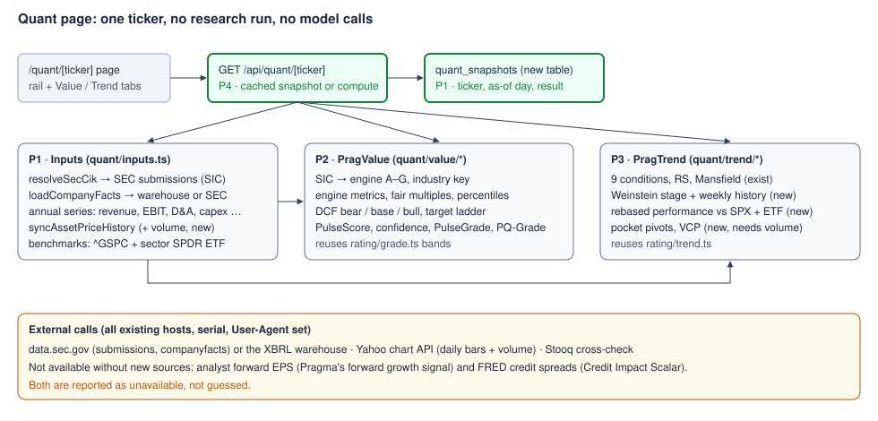

# Quant page: PragValue and PragTrend for any ticker

Status: plan approved 2026-11-24 with the default decisions (D1 Quant, D2 reference assets, D3 sector ETFs synced, D4 daily snapshot plus refresh). No code yet. The design is layout Q2 on the workshop canvas
(https://claude.ai/artifact/7215xUXUesBErNdfzhCj5F, page "Quant page"): a summary rail, with Value and Trend tabs.

## Goal

A page per ticker, separate from Research, that shows Pragma's quantitative read in seconds. It's built
by code only, with no research run and no model calls. It works for any US-listed stock, researched or not.

Before: valuation numbers exist only for stocks with a completed research run. After: typing AAPL opens
`/quant/AAPL`, which shows the following.

- **Rail:** price and a three-month sparkline, PulseGrade, PQ-Grade, the PulseScore gauge, trend score, stage,
  confidence, research status and Deep research (Watch arrives with the separate Watching plan).
- **Value tab:** a five-years-back, five-years-forward price and value chart (bear/base/bull toggle), the DCF value
  build (waterfall), a 10-year band of the engine's multiple, and a scenario table (growth, operating leverage,
  discount rate, exit multiple, 2030 target, return).
- **Trend tab:** price with its 50/150/200-day averages and volume with pocket pivots, performance rebased to 100
  against the S&P 500 and the sector ETF, the Weinstein stage over 52 weeks, the nine conditions, and VCP pullbacks.

## What exists and what doesn't

| Need | Today | Gap |
| --- | --- | --- |
| Issuer and CIK | `resolveSecCik` (`sources/corpus.ts`) | none |
| Sector for engine routing | SEC submissions carry `sic` and `sicDescription` | Pragma routes on Yahoo sector/industry strings; needs a SIC → engine + industry-key table |
| Annual fundamentals (5 years) | `loadCompanyFacts` (warehouse or SEC), `sec-companyfacts.ts` readers | a fundamentals extractor for the ~20 fields PulseValue reads (below) |
| Daily prices | `syncAssetPriceHistory`, `market_price_bars` (has a `volume` column) | the sync doesn't write volume and the loader doesn't read it; an asset row is required |
| Benchmark | ^GSPC sync | the 11 sector SPDR ETFs, for rebased performance and Pragma's segment RS |
| Nine conditions, RS, Mansfield | `src/lib/research/rating/trend.ts` | none |
| Grade bands, confidence | `src/lib/research/rating/{grade,confidence}.ts` | none |
| PragValue engines A–G, DCF, PulseScore | Pragma `pulsevalue.py` (3,123 lines, Python, yfinance) | full port |
| Weinstein stage, pocket pivots, VCP | Pragma `pragtrend.py:compute_stage`, `pattern_detector.py` (339 lines) | port |
| Charts | recharts, hand-drawn SVG kit (`components/interactive`, `components/visuals`) | five new chart components |
| Credit Impact Scalar | Pragma's PragCredit z-score (FRED) | not collected; scalar fixed at 1.0 and shown as unavailable |
| Forward EPS growth signal | yfinance analyst data | no source; the signal is left out and recorded |

PulseValue's inputs map to SEC concepts as follows. `quant/fundamentals.ts` owns this table and tests it.

| yfinance field | SEC/XBRL source |
| --- | --- |
| Total Revenue | `Revenues`, `RevenueFromContractWithCustomerExcludingAssessedTax`, `SalesRevenueNet` (as `METRICS` in `sec-companyfacts.ts`) |
| EBIT, Operating Income | `OperatingIncomeLoss` |
| EBITDA | EBIT + `DepreciationDepletionAndAmortization` (or `DepreciationAndAmortization`) |
| Net Income | `NetIncomeLoss` |
| Operating Cash Flow, Capital Expenditure | `NetCashProvidedByUsedInOperatingActivities`, `PaymentsToAcquirePropertyPlantAndEquipment` |
| Research And Development | `ResearchAndDevelopmentExpense` |
| Total Debt, Cash | `LongTermDebt` + `LongTermDebtCurrent` (+ `ShortTermBorrowings`), `CashAndCashEquivalentsAtCarryingValue` (+ marketable securities) |
| Tangible Book Value | `StockholdersEquity` − `Goodwill` − `IntangibleAssetsNetExcludingGoodwill` |
| Interest Expense | `InterestExpense` |
| sharesOutstanding | `dei:EntityCommonStockSharesOutstanding`, else diluted weighted average |
| FFO / AFFO (REITs, engine D) | net income + real-estate D&A − gains on sale (`GainLossOnSaleOfRealEstate…`); AFFO less maintenance capex where reported |
| currentPrice, marketCap | stored daily close × shares |
| beta | `regressionBeta` (`valuation/cost-of-capital.ts`) |

## Scope

In scope:
- PragValue engines A, B, B2, C, D, E, F, G with their fair-multiple tables.
- DCF scenarios, PulseScore, confidence, PulseGrade, PQ-Grade, and the target ladder.
- PragTrend extras: stage and stage history, rebased performance, pocket pivots and VCP.
- Price volume capture, sector ETF benchmarks, a cached snapshot table, the API, the page, nav entry and links.

Out of scope here:
- Screen, Watching, market regime and the ⌘K search. These are separate plans.
- Peer-based industry growth: Pragma pulls S&P 500 peers from Wikipedia and yfinance. Here the company's own revenue
  CAGR is used and the difference is recorded.
- Non-SEC issuers (ESEF and others) until the warehouse holds them.
- Any change to research runs, the `stock_rating` artifact or the research valuation.

Invariants:
- No model calls.
- Fetched data is untrusted.
- SEC traffic stays serial with the configured User-Agent.
- Every schema change ships a Drizzle migration.
- Tickers looked up only for Quant must not appear in the Research list (see decision D2).

## Parts

| ID | Outcome | Files | Depends on |
| --- | --- | --- | --- |
| P1 | `loadQuantInputs(ticker)` returns issuer, SIC, five annual years of the fields above, daily bars with volume, and benchmark bars, or a typed reason it can't | `src/lib/quant/inputs.ts`, `src/lib/quant/fundamentals.ts`, `src/lib/market-data/price-history.ts` (volume), `providers/yahoo.ts`, sector-ETF sync, `src/db/schema/quant.ts`, a `drizzle/00xx_quant_snapshots.sql` migration | none |
| P2 | `computePragValue(inputs)` gives engine, metrics, scenarios, targets, PulseScore, confidence, grades and chart series, matching Pragma on the same inputs | `src/lib/quant/value/{route,multiples,engines,dcf,score}.ts` | P1 types |
| P3 | `computePragTrend(inputs)` gives the conditions (existing), stage and weekly stage history, rebased series, pocket pivots and VCP | `src/lib/quant/trend/{stage,patterns,rebased}.ts`, reusing `rating/trend.ts` | P1 types |
| P4 | `GET /api/quant/[ticker]` returns a snapshot, cached per ticker and trading day; `?refresh=1` recomputes | `src/app/api/quant/[ticker]/route.ts`, `src/lib/api/quant.ts` | P1–P3 |
| P5 | `/quant/[ticker]` renders the Q2 rail and tabs, with loading, error and partial states | `src/app/quant/[ticker]/page.tsx`, `src/components/quant/**`, `app-shell.tsx` nav, links from asset pages | P4 |
| P6 | Docs and diagrams updated; checks pass | `docs/system.md`, `docs/architecture.md`, `docs/security.md`, `AGENTS.md` | P1–P5 |

## Acceptance criteria (tests are written before code, as in earlier plans)

- **AC-1 (P1).** Fundamentals mapping.
  - For a stored AAPL companyfacts fixture, `fundamentals.ts` returns five fiscal years of revenue, EBIT, D&A,
    capex, OCF, cash, debt, tangible book and shares, with the concept used for each.
  - A missing concept is `null` with a reason, never 0.
- **AC-2 (P1).** Volume.
  - The Yahoo sync stores `volume`, and `loadStoredPriceHistory` returns it.
  - Bars stored before this change read as `null` volume.
- **AC-3 (P1).** SIC routing table.
  - Banks (6020–6029) route to C, REITs (6798) to D, utilities (4911–4991) to E, oil, gas and mining (1000–1499,
    2911) to F, and pharma and biotech (2834–2836) to B2 when pre-revenue or loss-making.
  - Brokers and asset managers (6211, 6282) route to B or G as in Pragma. Everything else goes to A, or to B when EBIT is negative.
- **AC-4 (P2).** Parity with Pragma.
  - On fixtures built from the same statement numbers, engines A–G, the DCF targets, PulseScore and confidence
    match the Python results within 0.5%.
  - Fixtures are generated once by running Pragma's functions offline with crafted DataFrames. The script lives in
    `Implementations/quant-page/fixtures/`.
- **AC-5 (P2).** Grades: PulseGrade and PQ-Grade use `rating/grade.ts` bands, and the asymmetry term uses bear and bull targets.
- **AC-6 (P2).** Unavailable inputs.
  - No credit series: the Credit Impact Scalar is 1.0 with `cis.status: "unavailable"`.
  - No forward EPS: the growth blend uses its own CAGR and records `forward_signal: "unavailable"`.
- **AC-7 (P3).** Stage. On constructed series, stage 2 (rising 30-week average, price above), 4 (falling, below) and
  1 or 3 classify as in Pragma's `compute_stage`, and weeks-in-stage counts back correctly.
- **AC-8 (P3).** Patterns.
  - As in Pragma's `detect_pocket_pivot`: a pocket pivot is an up close whose volume beats the highest down-day
    volume of the prior 10 sessions. It searches the last 90 sessions and keeps the last 10 pivots.
  - VCP reports each successive pullback depth and whether price is above the 30-week average, as in `detect_vcp`
    (26-week lookback).
  - Both are `unavailable` without volume.
- **AC-9 (P4).** API.
  - A second request on the same trading day returns the cached snapshot without network calls.
  - An unknown ticker gives 404. An ETF or fund gives 422 "PragValue values individual equities".
  - A non-SEC issuer gives a snapshot with the Value tab unavailable and the Trend tab computed.
- **AC-10 (P5).** Page.
  - The rail and both tabs render from a fixture snapshot, and the tab state is kept in `?tab=`.
  - Every chart has a text alternative.
  - Partial snapshots show the reason in place of the missing section.
  - Colours come from the tokens only; the existing raw-hex test applies.
- **AC-11 (P5).** Separation.
  - `/quant/[ticker]` makes no model call and writes no `research_artifacts`.
  - A researched stock shows a link to its Research page, and the Research page links back.
- **AC-12 (P6).** `npm run lint`, `npx tsc --noEmit`, `npm run test:unit` and `npm run build` pass; docs describe the page, the table and the new benchmark series.

## Decisions (approved 2026-11-24: all defaults)

- **D1 · Nav name.** Quant, Lens or Pragma. Default: **Quant**.
- **D2 · Looked-up tickers.** Prices hang off an asset row. Default: create the asset with `status: 'reference'`, as
  the ^GSPC benchmark already does, so it stays out of the Research list until researched.
- **D3 · Sector ETFs.** Sync the 11 SPDR ETFs alongside ^GSPC. That's 11 more Yahoo series a day. Default: yes.
- **D4 · Freshness.** One snapshot per ticker per trading day, plus a manual refresh. Default: yes.

## Risks

- **SIC is coarser than Yahoo's industry names.** Some fair multiples (Pragma's table is keyed by Yahoo industry)
  will fall back to the sector default. The mapping table lists every SIC range it covers, and the page shows which
  multiple was used.
- **Parity.** Pragma's DCF has many branches (operating leverage, market-share exits, growth reversion). The fixture
  script pins its results so the port can't drift unnoticed.
- **Yahoo is unofficial.** It's already the app's price source; Stooq stays the cross-check.

## Verification

- Commands: `npx tsx --test Implementations/quant-page/acceptance/*.test.ts*` and the four required checks.
- Manual: open `/quant/AAPL`, `/quant/JPM` (engine C), `/quant/O` (engine D) and `/quant/SPY` (refused) against the dev server.

## Changes from the plan (recorded during the build)

- **Rail.** There's no Watch button: Watching is a separate, unbuilt plan, so a button here would do nothing. The rail links to Deep research, or Open research for a researched stock.
- **AC-2 (volume).** The market-data service already wrote `volume`; only the loader dropped it. The change is a loader and type change (`storedBarFromRow`), not a sync change.
- **AC-4 (parity).** Golden results come from running Pragma's own `pulsevalue.py` on eight fixtures, one per engine, with yfinance stubbed (`fixtures/pragma_parity.py`).
  - Engine B's ramped DCF isn't ported. In Pragma it never runs: its guard compares against "EV/Revenue", which no metric label matches, and its call passes keyword arguments the function doesn't accept.
  - A Pragma quirk is kept for parity. `min("High", "Medium")` compares strings, so "R&D unavailable" never downgrades data quality.
- **AC-7/AC-8.** Beyond the constructed series, stage, pocket pivots and VCP are also checked against Pragma's `pragtrend.py` and `pattern_detector.py` on the same eight histories, with deterministic volume.
- **AC-8 wording.** Corrected during planning: Pragma's pocket pivot has no 50-day condition.
- **AC-9 (cache key).** The key is the UTC calendar day of the request, not the exchange trading day. A snapshot made on a weekend is reused until the next UTC day.
- **AC-11 (separation).** "No model calls" is checked by a source scan of the Quant modules (no agent-harness imports, no research-artifact writes).
- **Fixture harness encoding.** On Windows, Python's `read_text()` defaults to cp1252, which mangled "Software—Application" and gave a false mismatch. The script now reads and writes UTF-8.

## Completion evidence

The plan, the tests and the code have one author (a single agent). The parity goldens come from Pragma's own Python, not from the port.

| Check | Command (repository root) | Result |
| --- | --- | --- |
| Acceptance | `npx tsx --test tests/quant-page.test.ts` (all five acceptance files) | 37 pass, 0 fail |
| Value parity | `p2-value.test.ts`: eight engines against `pulsevalue.py` (0.5% tolerance) | 8 of 8 match |
| Trend parity | `p3-trend.test.ts`: stage, pivots and VCP against `pragtrend.py` and `pattern_detector.py` | 8 of 8 match |
| Lint | `npm run lint` | 0 errors, 117 warnings (unchanged from main) |
| Types | `npx tsc --noEmit` | pass |
| Unit | `npm run test:unit` | 785 pass, 0 fail, 64 skipped |
| Build | `npm run build` | pass; `/quant`, `/quant/[ticker]`, `/api/quant/[ticker]` listed |
| Existing UI rules | `Implementations/consumer-remaster/acceptance/*` | pass, after removing uppercase table headers |
| Live | `/quant/AAPL` on the dev server, after `db:migrate` | Value and Trend tabs render from real SEC and Yahoo data (engine A, six-metric DCF, 9 of 9 conditions, stage 2); no console errors after the dev server rebuilt the shell |

Not verified:
- Live engines C, D and the refused-ETF path (`/quant/JPM`, `/quant/O`, `/quant/SPY`) weren't opened in the browser. They're covered by fixtures and by the 422 path in `p4-api.test.ts`.
- `npm run test:db` wasn't run.
- Parity is measured on synthetic fixtures. Real-ticker differences from Pragma also come from SEC data replacing yfinance.
