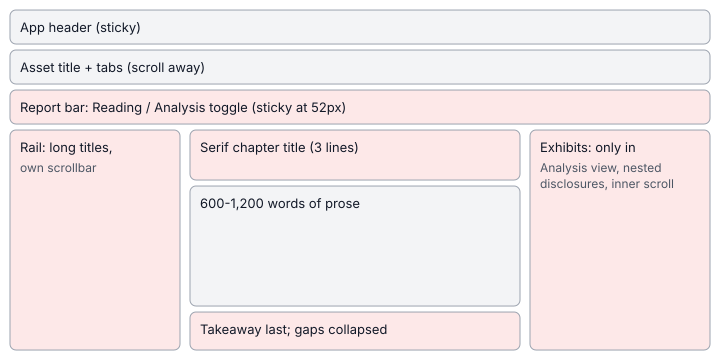
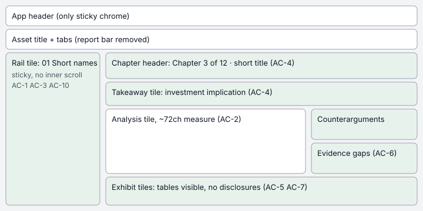
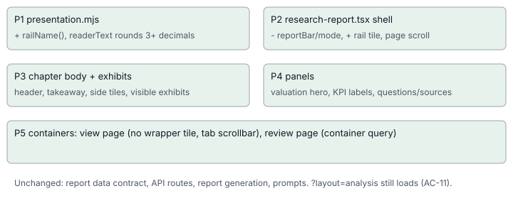

# Report remaster

Base: `2efcfde` on `claude/pragma-research-ui`, plus the uncommitted report retheme (16 files; patch kept outside the repo as `base-uncommitted-retheme.patch` in the scratchpad frozen copy).

One agent (TOR-1) wrote this plan, both test sets and the code. The verification set was designed separately from the acceptance set, but it is not independent or hidden.

## Problem

The research report (`ResearchReport`, shown in the asset view's Report tab and on the review page) still reads as a long-form article inside the new tile app. Audit at 1440x900 on SoFi run `89c71c21` (12 chapters, 600-1,170 words each, 68 sources, 17 research questions), screenshots in `evidence/before/`:

1. Data hidden. Reading view, the default, shows no exhibits. Analysis view shows them as disclosures inside disclosures, in a pinned panel with its own scroll; expanding a record leaves a blank gap (`04`, `05`).
2. Four layers of chrome: app header, asset title and tabs, a report bar (Reading/Analysis toggle, Research summary link) pinned at 52px, and a rail with its own scrollbar. The asset title scrolls away while the report bar stays (`01`, `02`).
3. Rail shows full sentence titles ("Executive Judgment: Scaled Digital Bank, but Credit, Funding, and Capital Proof Remain Incomplete"), five lines each. `chapterNames` only knows the section ids of one older run.
4. Blog article structure: 3-line serif title, then prose on a ~600px measure with the right 40% empty; the investment implication (the takeaway) comes last; evidence gaps are collapsed (`02`, `03`).
5. Inconsistent pieces: valuation chapter opens with a 96px hero in its own card style (`06`); KPI group headings show raw keys such as `Regulatory_compliance` (`08`); prose carries unrounded values such as `$12.29933`.
6. Asset tabs row shows a stray vertical scrollbar (`01`).

Before/after example: the Segment economics chapter today shows a title and 888 words of prose; its six exhibits (segments, customer groups, process nodes, drivers, diagnoses) appear only after switching to Analysis view and opening two levels of disclosures. After: a chapter header, a takeaway tile, the analysis beside counterarguments and evidence gaps, then each exhibit as a visible tile with its table.

## Scope

Files: `src/lib/research/reporting/presentation.mjs`, `src/components/research-report.tsx`, `src/components/research-report.module.css`, `src/components/report/report-panels.module.css`, `src/components/report/kpi-health-table.tsx`, `src/app/assets/[id]/view/page.tsx` and `page.module.css`, `src/app/review/page.tsx`.

Invariants: the report data contract (`contracts.ts`, `report.ts`), API routes, report generation and prompts are untouched. Citations still open the source dialog. Deep links `#report-<id>` keep working. `public/report-layouts` (static viewer) keeps its own two-layout demo.

Exclusions: rewriting model prose; new charts; the Financials and KPI tabs (already tiles).





## Acceptance criteria

| ID | Trigger | Observable outcome | Checked by |
| --- | --- | --- | --- |
| AC-1 | Any report | Rail entries are numbered short names, at most 40 characters, no colon; curated names still win for known ids. `railName(section)` exported from `presentation.mjs`. | acceptance helpers, verification helpers + V1 |
| AC-2 | Reader text with a number of absolute value >= 1 and 3+ decimals | Rounded half up to 2 decimals, separators and sign kept; percentages with <=2 decimals, years, values below 1 and dotted versions unchanged. | acceptance helpers, verification helpers |
| AC-3 | Report at 1440x900 | No report-level layout bar; no element inside the report scrolls vertically by itself (rail included); only the app header is sticky chrome. | acceptance DOM, V1 |
| AC-4 | Open any chapter | Header shows "Chapter n of N" and the short title (<=40 chars); the takeaway (implication) appears before the analysis paragraphs. | acceptance DOM |
| AC-5 | Chapter with exhibits | Exhibits render as visible tiles with tables on load, not inside `<details>`; a chapter without exhibits shows no empty exhibit block. | acceptance DOM, V4 |
| AC-6 | Any chapter | Counterarguments and evidence gaps are visible without clicks. | acceptance DOM, V4 |
| AC-7 | Any chapter | Report blocks are 6.01 tiles (white, 1px #e5e7eb, radius 8); headings and labels have no snake_case; valuation hero <= 40px. | acceptance DOM, V2 |
| AC-8 | Review page at 1024 wide | The report in the narrow column has no horizontal overflow and the rail sits above the content. | V3 |
| AC-9 | Asset view | Tabs row has no vertical scrollbar. | acceptance DOM |
| AC-10 | Navigation | Previous/next changes heading and hash; deep link to the last chapter opens it; Sources and Research questions are reachable from the rail; questions show status dots. | V1, V2 |
| AC-11 | Old link with `?layout=analysis` | The chapter loads without error. | V2 |

Data hooks used by the DOM checks (part of the contract): `article[data-report]`, `[data-rail]`, `[data-chapter-eyebrow]`, `[data-takeaway]`, `[data-analysis]`, `[data-counterarguments]`, `[data-gaps]`, `[data-exhibit]`, `[data-tile]`, `[data-source]`, `[data-question] [data-status]`.

## Parts

| Part | Outcome | Criteria | Files | Depends on |
| --- | --- | --- | --- | --- |
| P1 | Short rail names and tidy numbers | AC-1, AC-2 | `presentation.mjs` | none |
| P2 | One chrome: report bar and mode removed, rail tile without inner scroll, page scroll only | AC-3, AC-10, AC-11 | `research-report.tsx`, `research-report.module.css` | P1 |
| P3 | Chapter structure: header, takeaway, analysis with side tiles, exhibits as visible tiles | AC-4, AC-5, AC-6, AC-7 | `research-report.tsx`, `research-report.module.css` | P2 |
| P4 | Panels consistent: valuation hero size, KPI group labels, questions and sources as tiles | AC-7, AC-10 | `report-panels.module.css`, `kpi-health-table.tsx`, `research-report.tsx` | P3 |
| P5 | Containers: asset view renders the report without a wrapper tile, tab scrollbar fixed; review column narrow layout | AC-8, AC-9 | view `page.tsx`/`page.module.css`, `review/page.tsx` | P3 |

## Verification

From the repository root:

```bash
npx tsx --test Implementations/report-remaster/acceptance/report-helpers.test.ts
npx tsx --test Implementations/report-remaster/verification/report-helpers.verify.test.ts
```

DOM checks: run `acceptance/report-dom.check.js` and the V1-V4 blocks of `verification/report-dom.verify.js` in the Browser pane on the pages named in each file, with the dev server (`research-os` in `.claude/launch.json`) on the migrated local database. Project checks: `npm run lint`, `npx tsc --noEmit`, `npm run test:unit`, `npm run build`.

Manual evidence: before/after screenshots at 1440x900 in `evidence/`.

Baseline results (before any product edit):

- Acceptance helpers: 1 pass, 4 fail (AC-1 x3 on `railName is exported`; AC-2 rounding). The "leave alone" AC-2 case passes, as it should.
- Verification helpers: 1 pass, 6 fail, same reasons.
- Acceptance DOM on Segment economics: AC-3 fail (layout bar present; rail `aside.contents` scrolls), AC-4 fail (no eyebrow; first h2 is the rail's company name), AC-5 fail (0 exhibits visible), AC-6 fail, AC-7 fail (0 tiles), AC-9 fail (tabs scrollHeight 38 > clientHeight 37).

## Completion evidence

State: uncommitted on `claude/pragma-research-ui` (base `2efcfde` plus the retheme checkpoint). One agent wrote the plan, both test sets and the code; the verification set is separately designed, not independent.

| Part | Status |
| --- | --- |
| P1 helpers | Done |
| P2 one chrome | Done |
| P3 chapter structure and exhibits | Done |
| P4 panels | Done |
| P5 containers | Done after one correction round (AC-8) |

| Criterion | Result | Evidence |
| --- | --- | --- |
| AC-1 | Pass | acceptance helpers 5/5, verification helpers 7/7; V1 rail names (12 entries, none over 40 chars or with a colon) |
| AC-2 | Pass | helper tests; chapter 1 prose now reads "$12.30" (was "$12.29933") |
| AC-3 | Pass | acceptance DOM: no layout bar, no inner scroller; V1 rail does not scroll at 1440x900 |
| AC-4 | Pass | acceptance DOM: "Chapter 3 of 12 · Business", h2 "Segment Economics", takeaway before analysis |
| AC-5 | Pass | acceptance DOM: 7 exhibits, 2 visible tables, none in details; V4 chapter without exhibits shows no exhibit block |
| AC-6 | Pass | acceptance DOM: counterarguments visible, 8 gap items; V4 |
| AC-7 | Pass | acceptance DOM: 13 tiles all 1px #e5e7eb radius 8 white, no snake_case; V2 hero 36px |
| AC-8 | Pass (round 2) | V3 first failed: 15 chapter-strip links overflowed the 641px report (horizontal scroll strip). Fixed by wrapping the strip; rerun: overflow 0, rail above content |
| AC-9 | Pass | tabs scrollHeight 38 = clientHeight 38 (negative margin replaced by an inset rule) |
| AC-10 | Pass | V1 previous chapter changes heading and hash; V2 68 sources, 17 question status dots |
| AC-11 | Pass | V2 `?layout=analysis#report-valuation` loads |

Commands run from the repo root: both helper test commands above (pass); `npx tsc --noEmit` (clean apart from the git-ignored local `storage/report-visual-reader/reader-before.tsx`); `npm run lint` (0 errors, 115 existing warnings); `npm run test:unit` (598 pass, 6 fail; the same 6 fail on clean `main`: backtest storage paths, research store files and shards, Docling); `npm run build` (compiles; type check stops on the same ignored `storage/` file).

Test changes after the freeze: none (`diff -r` against the frozen copy is empty).

Deviations from the proposal, all inside the contract: `railName` also cuts long list titles at the first comma; reader text drops bracketed source ids (they rendered as "[[reference]]"); record cards show six fields with "Show all N fields"; record tables open with 10 rows and clamp long cells to three lines (full text on hover); in a narrow report the chapter strip wraps instead of scrolling. The Reading/Analysis switch is gone; old `?layout=analysis` links still load.

Evidence: `evidence/before/01-09` and `evidence/after/01-09` (1440x900 except the review column at 1024x768). `after/08` shows the narrow column before the AC-8 fix; `after/09` after it.

Phone width (375x812) spot check: no horizontal overflow outside table scroll regions.

Not verified: reports from other runs with visuals (`sectionVisuals` returned none for this run); keyboard-only navigation beyond focus outlines.

## Design panel rounds (after the first completion)

The user rejected the first result and asked for a panel of three Opus 5.5 (medium) reviewers to score each iteration until all three give at least 9/10. Brief: `PANEL-BRIEF.md`. Lenses: visual design, buy-side analyst usability, UX and polish. Screenshots per round in `evidence/round-1` to `evidence/round-4` (1440x900, review column at 1024x768).

| Round | Visual | Analyst | UX | Main changes made after the round |
| --- | --- | --- | --- | --- |
| 1 | 6.5 | 6 | 6.5 | Verdict strip on every chapter; bold lead-ins; citations collapsed after 3; gaps capped at 4; exhibit index; comparison matrices for 2-4 record sets; tables 7 columns x 10 rows with compact numbers and acronyms; KPI pills and fills removed; "16M" unit fix (a stray control character in the first attempt was found and removed); narrow chapter picker |
| 2 | 8 | 7.5 | 8 | One status vocabulary; no duplicate valuation hero; row units from the historical record ($1.2B vs $154M); insufficient-history rows last; stale/one-reading KPIs never "Healthy"; matrix shared fields first with single-record note; questions summary filter; 1-decimal returns; findings link in the review form |
| 3 | 8.5 | 8.5 | 8.5 | Flat "Valuation detail" tile; first-clause lead-ins; full-width definition rules with 80ch text; scenario matrices start with weight, value per share, return, worth today; duplicate FCFE schedule hidden in Valuation; stale KPI value moved to status; segment model in $; Stability tooltip |
| 4 | 9 | 9 | 9 | Target met. Fixed one defect they found: the clause splitter skipped a colon inside the first 30 characters |
| 5 | 9.5 | 9.5 | 9.5 | User asked for 10. Done after round 4: number rows right-aligned and coloured; one year header in Valuation detail; empty KPI quarter columns hidden and duplicate KPI series merged; trends as-of line; segment margin, share and Total; segment-name casing; Horizon as a caption; questions answer and next evidence side by side |
| 6 | 9.5 | 10 | 9.5 | Done after round 5: chips replaced by plain lists; matrix headers without trailing stops; ROI/APY acronyms; number rows left-aligned; side lead-ins capped at 60; KPI "Also reported as"; count nouns; Stability at 2 decimals; reported zeros marked with a dagger (source has real 0 readings); thresholds semibold; in-chapter position in the rail |
| 7 | 9.5 | 10 | 9.5 | Done after round 6: lead-ins never cut mid-clause (word-count fallback removed); prose tables wrap within the tile; KPI cells purely numeric with the noun in the label; one-line alias; active rail sub-item bold |
| 8 | 10 | 10 | 10 | Done after round 7: prose decided per visible column and no ellipsis on body text; " key" stripped from labels; 2027E; the rail marks the KPI health / Valuation detail lead panel |

Contract change after the freeze (no test file edited): V2's AC-7 assertion that a valuation hero exists and is at most 40px no longer applies, because round 2 removed the hero from the report to stop it repeating the verdict strip (the strip values are 18px). All other acceptance and verification checks pass on the final tree: acceptance DOM AC-3/4/5/6/7/9, V1 AC-1/3/10, V2 AC-10/11, V3 AC-8, V4 AC-5/6, helpers 12/12.

After round 8 all three reviewers scored 10/10. Left as optional by the panel: sort Operating assumptions by process node; "Cross sell" group header casing and a noun for "Cross-sell depth 24M" (run data). Regression guard added: `tests/report-presentation.test.ts` (labels, 2027E, rail names, compact numbers, KPI million units); the lead-in and KPI-noun rules live in components and are covered by the DOM checks only.

Final checks on the final tree: acceptance DOM AC-3/4/5/6/7/9 pass, V3 AC-8 passes, helpers 12/12, new test 5/5, tsc clean (except the git-ignored storage/ file), lint 0 errors, unit tests 603 pass / the same 6 failures as main.
