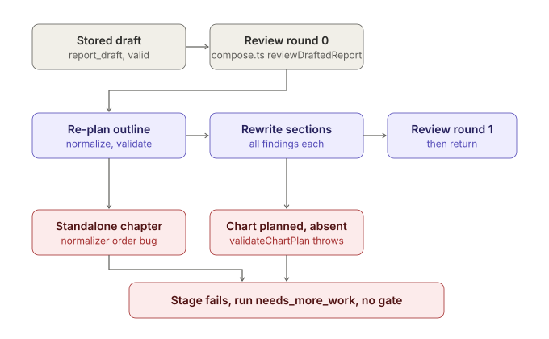
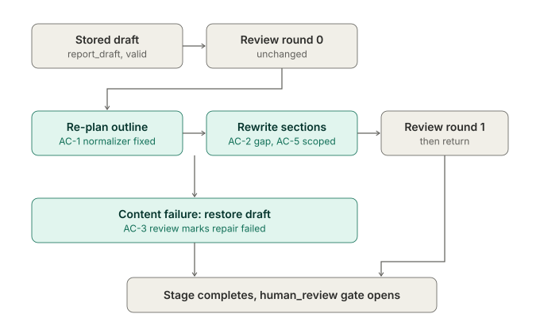
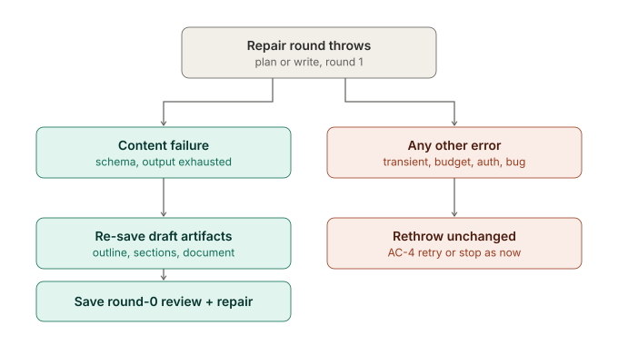

# Report review resilience

Status: **implemented on `claude/report-review-resilience`** (uncommitted). M-1, the paid live check, is not yet run. Baseline: `main` at `203cc02`.

## Problem

The SoFi run `3c3fc4ce` on Haiku 5.5 (2026-11-18) finished every analysis stage and wrote a valid report draft, then never reached the human-review gate. The `ai_reviewer` stage failed three times in its repair round, and each failure stopped the run.

| Attempt | What failed in the repair round | Run result |
|---|---|---|
| 1 | The re-planned outline had a standalone chapter: "GAAP earnings quality after the tax release, goodwill impairment and adjusted-definition change". | `needs_more_work`, $5.95 spent |
| 2 | The stage spent past its $5 cap; three report writers used their whole output allowance before answering. | `failed`, $8.15 spent |
| 3 | A rewritten section planned a net-interest-margin chart but drew no visual and gave no gap. | `needs_more_work`, $9.21 spent |

Three causes, all in code rather than in the model's analysis:

1. **A valid draft is thrown away.** `reviewDraftedReport` (`src/lib/research/reporting/compose.ts`) lets any error from the repair round escape. The stage fails, and the stored draft never reaches a person.
2. **A mechanical rule costs a model retry, and one rule is broken by code.**
   - `normalizeOutlineStructure` (`contracts.ts`) adds a company key to history-only sections. It does that *before* it removes `valuation` from extra sections, so a section covering `[history, valuation]` ends up covering `[history]`, the exact shape `validateProductOutline` rejects. This was reproduced against `203cc02`, and it explains attempt 1.
   - A planned chart with no visual (`validateChartPlan`) is sent back to the model, when code could record a gap.
3. **Repair packets are large.**
   - Every section rewrite gets every finding for the whole report. In the review stage, section writers averaged 167K input tokens, against 120K in the draft stage, and cost $4.10 of the stage's $6.10.
   - 82 of the run's 131 calls were over 100K tokens, where Haiku charges 5× for input.

### Before and after, for attempt 3

- **Before:** the `ai_reviewer` repair rewrites `capital` without its planned chart, and `validateChartPlan` throws on each attempt. The error becomes "Agent attempts exhausted", the stage fails, and the run is `needs_more_work`. No one sees the report.
- **After:** code adds the gap "The planned chart is not shown because it could not be built from the stored data." and the section validates.
  - **If the rewrite fails for another content reason:** the review keeps the draft, saves the round-0 review with `repair: { status: "failed", error }`, and completes. The run stops at `human_review` with the reviewer's findings still open.

## Scope

**Files likely to change**

- `src/lib/research/reporting/contracts.ts`:
  - fix `normalizeOutlineStructure` (AC-1);
  - add `fillChartPlanGap` (AC-2).
- `src/lib/research/reporting/runtime.ts`: section writes run `fillChartPlanGap` in their clean step before `validateChartPlan`, so the stored section carries the gap (AC-2).
- `src/lib/research/reporting/compose.ts`:
  - classify repair-round errors and restore the draft (AC-3, AC-4);
  - scope each body section's feedback (AC-5).
- `docs/system.md`: the report review and repair paragraphs (around the "Rework after the review" and "Repair" bullets). `docs/architecture.md` (2 mentions) needs review for the `ai_reviewer` failure path. No docs-sync tool exists in this repo.

**Existing interfaces to reuse**

- `ResearchAgentRunError.responseMetadata.error_type` (`src/lib/agent-harness/errors.ts`) is what classifies a failure.
- `isTransientAgentError` (`pipeline-runner.ts`) shows the cause-chain walk to copy.
- The `CompositionActions` `save` and `retain` actions are how the draft gets restored.

**Exclusions**

- No prompt text changes.
- No change to the reviewer's verdict logic (`depth.ts`).
- No change to stage budgets or `stages.ts`.
- No change to the first review or the draft stage's own failure handling.
- Giving a rewriter its previous section text, so it edits rather than rewrites, is a prompt change. It is left for a later task.

**Invariants**

- Both human gates stay explicit.
- A content-failure fallback must never upgrade the verdict. The saved review keeps the round-0 `effective_verdict` and findings, so the reviewer at `human_review` sees `needs_more_work`.
- Transient provider errors, authentication and quota stops, budget stops (`ModelBudgetExhausted`, `budget_exhausted`) and code errors still fail the stage exactly as today. The runner's retry and transient logic depends on that.
- A round-1 *review* error, after a successful repair, is out of scope and still propagates. The existing test in `tests/report-draft-split.test.ts` covers it.
- `typed research_artifacts` stay the source of truth. After a fallback, the current outline, sections and document rows are the draft's.

## Feature map

```text
pipeline-runner (stage ai_reviewer)
  └─ handlers/ai-reviewer.ts execute → reviewReport (runtime.ts:398)
       └─ loadCurrentDraft → draftDocument (compose.ts)
       └─ reviewDraftedReport (compose.ts:143)
            ├─ actions.review            (runtime.ts:300, research-reviewer)
            ├─ actions.rework            (team requests, may pause the run)
            ├─ actions.plan(feedback)    (runtime.ts:260) → usableOutline → normalizeOutlineStructure → validateProductOutline   [AC-1]
            ├─ write(plan, feedback)     (runtime.ts:286) → validateChartPlan                                                  [AC-2, AC-5]
            └─ throw  →  stage fails → failRun / needs_more_work                                                            [AC-3, AC-4]
  consumers: human_review gate, report view (/assets/[id]/view), eval:score, export
```

## Diagrams







## Acceptance criteria

| ID | Trigger | Observable outcome | Checked by |
|---|---|---|---|
| AC-1 | `normalizeOutlineStructure` gets an outline where a section covers history and/or evidence plus `valuation`, and another section is the valuation chapter. | <ul><li>No section's non-empty coverage is only history/evidence.</li><li>The section keeps a company key and the coverage map links it.</li><li>`valuation` is listed only on the valuation chapter.</li><li>`validateProductOutline` passes.</li><li>Normalising twice changes nothing, and the input isn't mutated.</li><li>An outline it can't fix (valuation only in the summary) is still rejected.</li></ul> | acceptance, verification |
| AC-2 | `fillChartPlanGap(plan, section)` (new export of `contracts.ts`) with a non-blank `chart_plan`, no quantitative visual and no gap mentioning a chart. | <ul><li>It returns a copy with one added reader-facing gap containing the word "chart".</li><li>The gap names no stored-data identifiers (no snake_case, no "artifact").</li><li>Existing gaps are kept, and `validateChartPlan` passes on the result.</li><li>Otherwise the section is returned unchanged, and running it again adds nothing.</li><li>Report section writes apply it before `validateChartPlan`, so the stored section carries the gap.</li></ul> | acceptance, verification (unit); the runtime wiring is checked by code review and manual check M-1 |
| AC-3 | In the repair round, `actions.plan` or a section/conclusion `write` throws an error whose cause chain holds a `ResearchAgentRunError` with `error_type` `schema_validation`, `output_exhausted` or `response_limit`. | <ul><li>`reviewDraftedReport` resolves with the draft's document and the round-0 review, extended with `repair: { status: "failed", error: <message> }`.</li><li>No second review runs.</li><li>After all in-flight sibling writes settle, the current outline, every section and the document equal the draft's.</li><li>The latest saved `report_review` has `report_hash` = the draft's hash, `repair.status = "failed"` and the round-0 findings.</li><li>Running the review again starts from the same draft.</li></ul> | acceptance, verification |
| AC-4 | The same place throws anything else: a transient `ResearchAgentRunError` (`server_error`, `rate_limit`…), `authentication`, `quota_exceeded`, `budget_exhausted`, `ModelBudgetExhausted`, or a plain/code error. Wrapped through `cause` too. | The same error object is rethrown, and the stage fails as today. | acceptance, verification |
| AC-5 | A repair round, through the writing path or the research re-plan path. | <ul><li>Each body section `write` receives only findings whose `section_id` is its id, plus findings with no `section_id`, plus team answers naming it.</li><li>Conclusion writes receive the full feedback.</li><li>The set of sections rewritten is unchanged.</li></ul> | acceptance, verification |
| AC-6 | Regression. | <ul><li>`tests/report-draft-split.test.ts`, `report-outline`, `report-charts`, `depth-review` and `report-substance` pass unchanged.</li><li>`npm run test:unit` adds no failures beyond the 6 that fail on `main`.</li><li>`npm run lint` has 0 errors.</li><li>`npx tsc --noEmit` adds no errors beyond the pre-existing one in git-ignored `storage/report-visual-reader/reader-before.tsx`.</li></ul> | commands |
| M-1 (manual, paid) | AC-5 changes what each section writer is sent, which is a model-request change. AGENTS.md requires a small paid live test that the user approves. | <ul><li>A Haiku 5.5 SoFi run (or resume of `3c3fc4ce`'s review with a fresh cap) reaches `human_review`.</li><li>Repair-round section calls average under the draft stage's 120K input tokens.</li><li>The review stage costs less than the $6.10 baseline.</li><li>A planned chart that could not be drawn shows as a gap.</li></ul> | manual, needs approval |

## Parts

| Part | Outcome | Criteria | Files | Depends on |
|---|---|---|---|---|
| P1 | The outline normaliser fixes the history/valuation interaction. | AC-1 | `contracts.ts` | — |
| P2 | Planned-but-missing charts become gaps in code. | AC-2 | `contracts.ts`, `runtime.ts` | — |
| P3 | Repair-round content failures restore the draft and complete the review; other errors propagate. | AC-3, AC-4 | `compose.ts` (may import `agent-harness/errors.ts`; must not import database code) | — |
| P4 | Body section rewrites get scoped feedback. | AC-5 | `compose.ts` | P3 (same function) |
| P5 | Docs and regression. | AC-6 | `docs/system.md`, `docs/architecture.md` | P1–P4 |

**Implementation notes**

- **P3, parallel writes:** body rewrites run in parallel (`mapWithConcurrency`). Before restoring the draft, wait for every in-flight write to settle; otherwise a slower sibling saves its rewrite over the restored section. `V-AC3` tests this ordering.
- **P1:** remove valuation from extra sections first, then add the company key. Or re-run the history rule after the valuation rule. Either is fine as long as AC-1 holds.

## Verification

Run everything from the repo root, `C:\Users\sense\OneDrive\Documents\GitHub\Investing-Research-Pipeline`. No database or provider is needed, except for M-1.

```bash
npx tsx --test Implementations/report-review-resilience/acceptance/*.test.ts
npx tsx --test Implementations/report-review-resilience/verification/*.test.ts
npx tsx --test tests/report-draft-split.test.ts tests/report-outline.test.ts tests/report-charts.test.ts tests/depth-review.test.ts tests/report-substance.test.ts
npm run lint
npx tsc --noEmit
npm run test:unit
```

`npm run test:unit` only discovers `tests/*.test.ts`, so it does not run the two task sets. Run them with the commands above.

### Baseline, recorded 2026-11-18 on `203cc02`

**Acceptance: 2 pass, 5 fail.**
- AC-4 passes already, which is the intended behaviour today.
- AC-1 fails on the "standalone chapter" error.
- AC-2 fails because `fillChartPlanGap` is undefined.
- AC-3 fails twice, on the rethrown `Agent attempts exhausted` error.
- AC-5 fails because body section `a` also received `Thin b.`.

**Verification: 2 pass, 7 fail.**
- Passing:
  - `V-AC1`, the outline that can't be fixed is still rejected;
  - `V-AC4`.
- Failing:
  - `V-AC1` normalisation, on the standalone error;
  - both `V-AC2` tests, because `fill(...) is not a function`;
  - all three `V-AC3` tests, on the rethrown error;
  - `V-AC5`, because a section received another section's finding.

**Existing report suites (5 files): 26/26 pass.**

Every failure above is on its intended assertion. None came from imports or setup.

## Completion evidence

Recorded 2026-11-18 on branch `claude/report-review-resilience`, working tree on base `203cc02`.

### Parts

| Part | Status | Change |
|---|---|---|
| P1 | done | `normalizeOutlineStructure` now runs the history rule after the valuation rule. |
| P2 | done | Added `fillChartPlanGap` and `CHART_PLAN_GAP` in `contracts.ts`, with `validateChartPlan` sharing `chartPlanMet`. Section writes in `runtime.ts` apply `withChartGap` in the clean step and to the returned output. |
| P3 | done | Added `isRepairContentFailure`. The repair round in `reviewDraftedReport` sits in a `try`; content failures go to `keepDraft`, and everything else is rethrown. |
| P4 | done | Added `feedbackFor` for body rewrites in both the writing path and the research path. Conclusions keep the full feedback. |
| P5 | done | Updated three passages in `docs/system.md`: chapter rules, chart plan, and repair plus the new "Failed repair" bullet. `docs/architecture.md` was reviewed and needs no change, since the stage stays `fail_run` for all other errors. |

### Commands run on the final tree

| Command | Result |
|---|---|
| `npx tsx --test Implementations/report-review-resilience/acceptance/*.test.ts` | 7/7 pass (2 at baseline) |
| `npx tsx --test Implementations/report-review-resilience/verification/*.test.ts` | 9/9 pass (2 at baseline) |
| `npx tsx --test` on the 5 existing report suites | 26/26 pass |
| `npm run lint` | 0 errors, 116 warnings, all pre-existing |
| `npx tsc --noEmit` | passes (see the follow-up round below). A new TS18048 in `validateChartPlan`, from losing narrowing, was found and fixed. |
| `npm run test:unit` | 663 tests: 606 pass, 0 fail, 57 skipped (see the follow-up round below). |
| `npm run build` | passes (see the follow-up round below). |

### Follow-up round (same day)

Three items left open after the first round are now fixed:

- **`tsc` and build failed on a git-ignored file.** `tsconfig.json` now excludes `storage` (git-ignored run output, which held a stray `reader-before.tsx`) and `.claude/worktrees`. `npx tsc --noEmit` and `npm run build` pass.
- **Six environment-only unit failures.**
  - Five tests create symlinks, which Windows allows only with Developer Mode or admin rights. They now skip, with a reason, when a probe in `tests/helpers/platform.ts` can't create one.
  - The Docling event-loop test uses a `#!/bin/sh` stand-in for `python3`, so it now skips on Windows.
  - These are skips, not fixes. The tests still run on Linux, macOS, and Windows with symlinks enabled.
- **`runtime.ts` wiring was checked only by reading.**
  - The section writer's steps are now `sectionWriteSteps` (exported), and `write` uses it.
  - The new `tests/report-section-chart-gap.test.ts` (3 tests) checks that validation passes with the gap, that the stored section carries it, that it runs after the reference check, and that it hides no other validation error.

### Test integrity

- The test files are byte-identical to the frozen copy taken before implementation. That copy is in the session scratchpad, with `BASE_SHA` = `203cc02`.
- No test in this task package was changed after the plan. The follow-up round only added skip conditions to three existing repo test files, for environment reasons, and added one new test file.

### Reviewer checks beyond the tests

- **Extra `repair` key:** `persistReviewArtifacts` stores only `AI_REVIEWER_CONTRACT.requiredKeys`, so the extra `repair` key on the review doesn't create artifacts.
- **Verdict not upgraded:**
  - Nothing between `ai_reviewer` and `human_review` reads the verdict.
  - The completion quality gate (`quality-gates.ts` `addAiReviewCoverage`) still reads the round-0 `ai_review` task's verdict, so a kept draft with `needs_more_work` still ends the run as `needs_more_work` at completion.
  - The verdict is never upgraded.

### Not verified

- **Chart gap in a live report:** run `9cd97f72` drew or skipped every planned chart itself, so the `CHART_PLAN_GAP` path was not triggered live. It is covered by unit tests only.

### M-1: paid live run (approved by the user, 2026-11-18)

Run `9cd97f72` was SoFi with every agent on `claude-haiku-5-5` (Anthropic API), medium effort, a $10 run cap and a $5 review-stage cap. At the user's choice, the team-request rerun gate was skipped.

| | Run `3c3fc4ce` (before) | Run `9cd97f72` (after) |
|---|---|---|
| Reached `human_review` | no (`needs_more_work` after 3 resumes) | yes |
| `ai_reviewer` cost | $6.10 (57 calls) | $1.87 (22 calls) |
| Section-writer input, first attempt in review | about 167K average | 94–125K |
| Run cost at `human_review` | $9.21 (stopped earlier) | $4.86 |
| Eval score | checks 5/11, traits 8/12, trace 84%, 46 reader leaks | checks 6/14, traits 9/12, trace 86%, 30 reader leaks |

- **AC-3 and AC-4 live:** the repair rewrite of the forecasts chapter failed validation twice ("Every scenario needs revenue_usd_millions values").
  - `keepDraft` stored the round-0 review with `repair.status = failed`, and the stage completed.
  - The verdict stayed `needs_more_work`: the model said `conditional_pass`, and code confirmed a high finding on terminal value.
- **A separate bug found on the way:**
  - The first `ai_reviewer` attempt failed the C14-T6 prompt guard in `agent-harness/runner.ts`.
  - The guard scanned the whole prompt, including the drafted report, and the report said the monitoring set "cannot yet confirm the thesis".
  - The guard now checks only the instructions (the prompt built with an empty packet). `tests/agent-roles.test.ts` covers both directions.

One author wrote the plan, both test sets and the code. The verification set is not independent.

One author (Claude, 2026-11-18) wrote this plan, the acceptance set and the verification set. The verification set uses different cases but is not independent or hidden.
