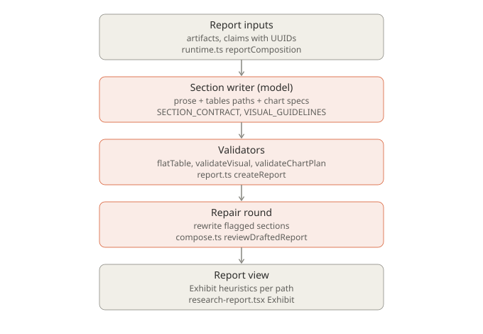
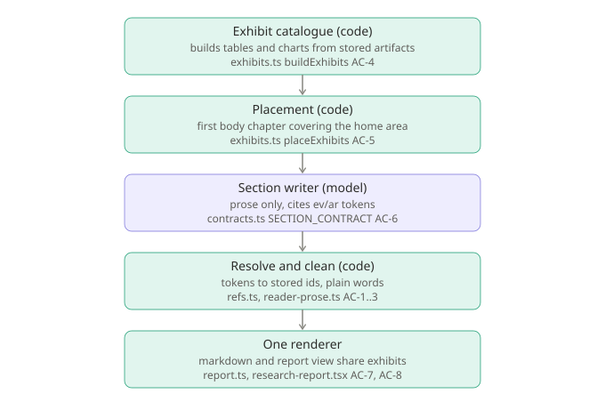
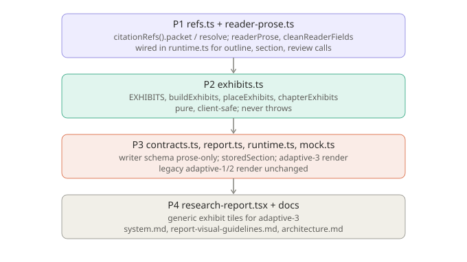

# Report templates: code-built exhibits and prose-only writers

Base: branch `claude/report-review-resilience` at `620ec73`. Mode: TOR-2-Agents (one implementor, one verifier, Opus 5.5 medium).

## Problem

The report writer is a model that returns prose **and** layout: table requests (`tables: [{artifact_id, path}]`), chart specs (`visuals` naming artifact paths, metric keys, segments and units), a `chart_plan` it must honour, and citations as UUIDs. Every pointer can break, so code validates, rejects and repairs:

- Live run `ai_reviewer` failed on `section_plan.chart_plan plans a chart ("Net interest margin trend (ratio)…")`; others failed on "Every scenario needs revenue_usd_millions values" (scenario chart specs) and on outline structure.
- The commonest report-stage errors (13 of about 40 logged) are "used its whole output limit" or "cut off at the output limit": the section JSON, with tables, visuals and their schema, is large.
- Report stages are about 80% of model spend over the last 40 days ($19.6 of $24.1): `ai_reviewer` alone made 123 calls.
- Every scored run in `evals/scores.csv` has 30-62 `reader_leaks`: snake_case field names, record IDs and pipeline words copied from the packet, which carries UUIDs and raw artifact keys.
- The report view (`src/components/research-report.tsx`, `Exhibit`) guesses how to draw whatever path the model chose (unit injection, segment totals, scenario lead rows).

### Before / after

Before, a section answer:

```json
{"paragraphs":[{"text":"The operating_margin median is 35% (see 6f1c2a10-…).","evidence_ids":["6f1c2a10-…"]}],
 "tables":[{"title":"Quarterly","artifact_id":"1111…","path":"segments.quarterly.rows"}],
 "visuals":[{"kind":"ratio","artifact_id":"…","path":"observations","numerator":{…},"denominator":{…}}]}
```

It fails on a bad path or an unbuildable chart, triggers a repair, and if it passes, prints `operating_margin` and an ID to the reader.

After, the writer returns prose with tokens; code builds and places the exhibits:

```json
{"paragraphs":[{"text":"The operating margin median is 35%.","evidence_ids":["ev1"]}]}
```

Code stores `evidence_ids: ["6f1c2a10-…"]` and `exhibits: ["quarterly_results", "operating_margin_trend"]` on the section, and the renderer draws them from `financial_analytics` with reader labels and formatted cells.

## Diagrams

Current (problem regions in coral):



Proposed (proposed, not yet built):



Implementation detail by phase:



## Feature map (current)

| Component | Responsibility | Source |
| --- | --- | --- |
| Report composition | Builds outline/section/review packets (artifacts and claims with UUIDs), calls models, validates, saves | `src/lib/research/reporting/runtime.ts` `reportComposition`, `reportSectionCall`, `sectionWriteSteps`, `keepUsableReferences` |
| Contracts | `Outline`, `Section` (with `tables`, `visuals`, `chart_plan`), `SECTION_CONTRACT`, `validateChartPlan`, `fillChartPlanGap`, `STANDARD_VERSION` | `src/lib/research/reporting/contracts.ts` |
| Table and chart builders | `flatTable`, `resolveTable`; `buildVisual`, `historySeries`, `validateVisual`, `VISUAL_GUIDELINES` | `tables.ts`, `visuals.ts` |
| Document | `createReport` validates refs, renders Markdown, hashes it; legacy standard keeps old table renderer | `report.ts` |
| Draft, review, repair | `composeDraft`, `reviewDraftedReport`, substance findings force a writing repair | `compose.ts`, `substance.ts` |
| Report view | Chapter tiles, `Exhibit` heuristics, `sectionVisuals`, `ValuationDashboard`, `KPIDashboard` | `src/components/research-report.tsx`, `src/components/report-visual.tsx` |
| Mock provider | Synthetic outline/section answers for the e2e test | `src/lib/agent-harness/providers/mock.ts` (`report_section`) |
| Stored data the exhibits read | `financial_analytics` columnar tables; `operating_scenario_set.scenarios[].yearly_drivers`; `valuation_scenario_set` (`method_inputs`, `valuation_matrix`, `sensitivity_grid`, `stress_cases`, withheld fields) | `history/analytics.ts` (`columnKind`), `valuation/v2.ts`, `valuation/contracts.ts` (`withheldValuationReason`) |

Consumers of stored sections that must keep working: `depth.ts`/`deriveReview`, `substance.ts`, `scripts/score-research.ts` (figure tracing reads `evidence_ids`/`artifact_ids` as stored UUIDs), export (`src/lib/export/report-generator.ts` reads `report_document.markdown`), approval (`assertReportApproval` content hash), `scripts/report-packet-size.ts` (calls `reportSectionCall`).

## Scope

In: report packets and answers (outline, section, conclusion, review calls in `runtime.ts`); the section/outline contracts; `createReport` rendering for the new standard; the report view's chapter exhibits; the mock provider's report answers; docs.

Out: analysis-stage packets and team-request packets (they keep UUIDs); depth checks and verdict logic; the valuation engine; new exhibit kinds beyond the launch set (peer benchmark, monitoring KPIs stay as they are: `KPIDashboard` and `ValuationDashboard` tiles are unchanged); paid runs.

Invariants:
- Stored `report_section` rows keep `evidence_ids` and `artifact_ids` as stored UUIDs. Tokens exist only inside model requests and raw answers.
- Reports stored under `asset-framework-2.1-adaptive-1` and `-adaptive-2` render byte-identically (their content hash verifies).
- Agents propose, code decides; no model call is added. A citation outside the report inputs is dropped into the review's `dropped_citations`, never shown.
- Every exhibit number comes from stored artifacts, computed by code.

## Interfaces (public contract the tests use)

`src/lib/research/reporting/refs.ts`
- `citationRefs(artifacts: {id}[], evidence: {id}[]): CitationRefs`
  - `packet<T>(value): T` returns a deep copy in which every UUID-shaped substring is replaced: evidence ids by `ev<n>` (1-based, evidence order), artifact ids by `ar<n>` (artifact order), any other UUID by `id<n>` (numbered by first appearance within this refs object, one token per id). Tokens are stable across packets built from one refs object. The input is not mutated.
  - `resolve<T>(value, dropped?: Set<string>): T` returns a copy in which every array under a key `evidence_ids` keeps only evidence (an `ev` token, any case, or a known evidence UUID) and every array under `artifact_ids` keeps only artifacts (`ar` token or known artifact UUID), mapped to stored UUIDs, order kept, duplicates removed. Anything else is removed and its raw value added to `dropped`. Any depth.
  - `token(id): string | undefined`.

`src/lib/research/reporting/reader-prose.ts`
- `readerProse(text): string`:
  1. removes reference tokens: `ev<n>`, `ar<n>`, `id<n>` in lower case anywhere, and in any case when inside brackets or parentheses; removes UUIDs (and a directly preceding "see"); removes brackets or parentheses left empty or holding only separators;
  2. turns snake_case identifiers (`[a-z0-9]+(_[a-z0-9]+)+`) into space-separated words, upper-casing at least TTM, YoY, FCF, ROIC, ROE, NOPAT, SBC, EV, EBIT, EBITDA, EPS, GAAP, USD, DSO, DPO, DIO, CCC, NWC, CAPM, WACC, D&A (`da`);
  3. collapses repeated spaces and removes whitespace before `, . ; :`;
  4. leaves everything else unchanged (numbers, %, $, `10-K`, `FY2024`, `S&P 500`, `EV/EBIT`, `A1`, bare upper-case `EV12`). Idempotent.
- `cleanReaderFields<T>(value: T): T` applies `readerProse` to the reader-facing fields of `{section}` (title, paragraph text, counterevidence, implication, gaps, visual title/caption, lane notes, node labels), `{outline}` (section titles, question question/answer/follow_up, coverage rationale) and a conclusion answer's top-level `coverage[].rationale`. Ids, coverage keys, kinds and citation arrays are untouched.

`src/lib/research/reporting/exhibits.ts` (client-safe: no Node imports; may import `visuals.ts`, `valuation/contracts.ts`, `history/analytics.ts` exports that are pure)
- `EXHIBITS`: ordered launch catalogue `{ key, title, home, fallback }`:

  | key | kind | home | fallback | source |
  | --- | --- | --- | --- | --- |
  | `quarterly_results` | table | history | business | `financial_analytics.quarterly`: period, revenue, revenue YoY, operating income, gross, operating and FCF margin; last 8 quarters |
  | `history_statistics` | table | history | business | `financial_analytics.statistics`: metric, median, min, max, latest, percentile; values by the metric's kind |
  | `operating_margin_trend` | chart (lines, %) | history | business | `financial_analytics.quarterly` operating margin (gross margin optional); needs 2+ values |
  | `segment_economics` | table | business | history | `financial_analytics.segments.annual` |
  | `cash_conversion` | table | business | history, management | `financial_analytics.cash_conversion.quarterly`, last 8 |
  | `capital_allocation` | table | management | business | `financial_analytics.capital_allocation.quarterly`, last 8 |
  | `scenario_drivers` | table | forecasts | valuation | `operating_scenario_set.scenarios[].yearly_drivers`: one row per year, bear/base/bull revenue growth and operating margin |
  | `scenario_values` | chart (bars) | valuation | — | `buildVisual` `scenarios` / `value_per_share` on `valuation_scenario_set` |
  | `valuation_bridge` | chart (waterfall) | valuation | — | `buildVisual` `valuation_bridge`, base case |
  | `valuation_matrix` | table | valuation | — | `valuation_scenario_set.valuation_matrix` |
  | `sensitivity_grid` | table | valuation | downside | `valuation_scenario_set.sensitivity_grid`, discount rate rows × terminal growth columns |
  | `stress_cases` | table | downside | valuation | `valuation_scenario_set.stress_cases` |

- `buildExhibits(artifacts, { cutoff? }): (BuiltExhibit | UnavailableExhibit)[]` in catalogue order; never throws. Uses the newest artifact of each type.
  - `BuiltExhibit = { key, title, caption, home, kind: "table", table, notes } | { key, title, caption, home, kind: "chart", chart: BuiltVisual, table, notes }` where `table = { columns: {key, label, numeric}[], rows: string[][] }` holds formatted cells. A chart's `table` is its data, one row per point.
  - `UnavailableExhibit = { key, title, home, unavailable: string }`: missing artifact, malformed content, too few points, or a withheld valuation (`withheldValuationReason`, whose text is the reason; applies to `scenario_values`, `valuation_bridge`, `valuation_matrix`, `sensitivity_grid`, `stress_cases`).
  - Formatting: column labels are reader words (no `_`, acronyms upper case); ratios as percent with one decimal (`39.0%`); currency millions grouped with at most one decimal (`39,000`, `1,234.6`) and the caption names `<currency> millions` from the artifact's currency; per-share values with two decimals (`105.20`) and the caption names the price currency; days as whole numbers; multiples as `12.3x`; negatives keep a minus sign; null or missing as `—`.
  - Deterministic: same input, same JSON.
- `isAvailable(e): e is BuiltExhibit`.
- `placeExhibits(sections: {id, coverage}[], exhibits): Record<sectionId, key[]>`: a key for every section id; sections whose coverage includes `conclusion` get none; each available exhibit goes to the first other section covering its `home`, else the first covering a `fallback` key in order, else nowhere; each exhibit at most once; unavailable exhibits never.
- `chapterExhibits(document: ReportDocument, sectionId): BuiltExhibit[]`: for a document of the new standard, the built exhibits named by that section's `exhibits`, in order, skipping unknown or unavailable keys; `[]` for an unknown section or a document of an earlier standard.

`src/lib/research/reporting/contracts.ts`
- `STANDARD_VERSION = "asset-framework-2.1-adaptive-3"`.
- `SECTION_CONTRACT` (writer): schema asks for the plan fields, paragraphs (min 1), counterevidence, implication, gaps and optional qualitative `visuals` (`process`, `organization` only). Its schema mentions no `tables`, `chart_plan` or quantitative kind. `validate` accepts, without error, an answer that also carries `tables`, `chart_plan`, `exhibits` or quantitative visuals (they are ignored).
- `OUTLINE_CONTRACT`: schema has no `chart_plan`.
- Stored `Section` stays a superset that parses every earlier stored section (legacy `tables`, all visual kinds, `chart_plan`) and adds optional `exhibits: string[]`.
- `storedSection(written, exhibitKeys): ReportSection`: drops `tables` (stored as `[]`), `chart_plan` and every visual that is not a valid `process` or `organization` visual; sets `exhibits`.

`createReport` (`report.ts`): for `adaptive-3`, renders each section's `exhibits` from `buildExhibits(input.artifacts, { cutoff })` as a `### <title>` block with the caption, a Markdown table of the formatted cells and the notes; skips unknown or unavailable keys; the content hash covers the rendered exhibits. `adaptive-1` keeps `tableMarkdown`, `adaptive-2` keeps `flatTableMarkdown` with model tables and visuals, byte for byte.

Runtime (`runtime.ts`): one `citationRefs` per composition; every outline, section, conclusion and review packet goes through `refs.packet`; every answer goes through `refs.resolve` (dropped ids join the review's `dropped_citations`) and `cleanReaderFields` before `keepUsableReferences`, validation and storage. The outline packet gets `exhibit_catalogue` (key, title, home, available) and a rule that code places these exhibits, so the outline plans no charts or tables. A section packet gets `section_exhibits` (the built exhibits placed in it, compact) and a rule to discuss them by title without repeating every number. `reportSectionCall` takes the section's exhibits as a trailing optional parameter. The stored section is `storedSection(answer, placement[section.id])`. `validateChartPlan` and `fillChartPlanGap` are no longer called for new writes. `VISUAL_GUIDELINES` sent to writers and the reviewer cover only `process` and `organization`; the reviewer is told exhibits are code-built from stored data.

## Acceptance criteria

- **AC-1** Report model packets carry no UUID. Evidence is `ev<n>`, artifacts `ar<n>`, other ids `id<n>`; tokens are stable within a composition; inputs are not mutated.
- **AC-2** Answers' `evidence_ids`/`artifact_ids` map back to stored UUIDs at any depth; unknown or wrong-type tokens are dropped and recorded in `dropped_citations`; stored sections never hold tokens.
- **AC-3** Before validation and storage, reader-facing text loses reference tokens, UUIDs and snake_case identifiers (turned into words), per `readerProse`; ordinary financial text is unchanged; the substance check then reports no `field name` or `record ID` leak for those fields.
- **AC-4** `buildExhibits` builds the launch catalogue from stored artifacts with reader labels and formatted cells, never throws, marks missing, malformed, short or withheld inputs unavailable with a reason, and is deterministic.
- **AC-5** `placeExhibits` puts each available exhibit in the first non-conclusion chapter covering its home area (else its fallbacks), once.
- **AC-6** The writer and outline schemas ask for no tables, chart plans or chart specs; an answer that still sends them is accepted and code strips them (`storedSection`); qualitative visuals stay; a section without prose is still rejected.
- **AC-7** New reports (`adaptive-3`) render placed exhibits from stored data in Markdown (charts as data tables), skip unknown/unavailable keys without throwing, keep reference checks, and hash the rendered exhibits; `adaptive-1`/`adaptive-2` documents render byte-identically (baseline hashes in the acceptance test).
- **AC-8** The report view draws an `adaptive-3` chapter's exhibits from `chapterExhibits` with one generic table/chart tile; earlier documents keep the current `Exhibit`/`sectionVisuals` path.
- **AC-9** The mock provider's report answers follow the new contract (prose with packet tokens, no tables), and the mock pipeline e2e (`npm run test:sofi-v3`) passes against a test database; report-task `input_json` rows written by that run contain no UUID in report packets.
- **AC-10** Docs describe the new flow: `docs/system.md` (report paragraphs: outline rules, section writer, chart plan, tables, citations), `docs/report-visual-guidelines.md`, the report views of `docs/architecture.md`; diagrams regenerated if their source changes.

Test coverage: AC-1..AC-8 automated in both sets (`acceptance/` visible, `verification/` held by the plan author). AC-9 by the e2e suite plus a SQL check. AC-10 by review.

## Phases

| Phase | Outcome | ACs | Edit scope | Depends on | Tests |
| --- | --- | --- | --- | --- | --- |
| **P1** | Report packets carry tokens; answers resolve to stored ids and arrive cleaned | AC-1, AC-2, AC-3 | new `reporting/refs.ts`, `reporting/reader-prose.ts`; `reporting/runtime.ts` (wiring only); tests | — | `acceptance/p1-*.test.ts` |
| **P2** | Code builds and places the launch exhibits | AC-4, AC-5 | new `reporting/exhibits.ts` (may export pure helpers from `history/analytics.ts`, e.g. `columnKind`, already exported) | independent | `acceptance/p2-exhibits.test.ts` |
| **P3** | Writers return prose only; new reports render code-built exhibits; legacy reports unchanged; mock pipeline passes | AC-6, AC-7, AC-9 | `reporting/contracts.ts`, `reporting/report.ts`, `reporting/runtime.ts`, `reporting/visuals.ts` (guidelines text only), `agent-harness/providers/mock.ts`, `scripts/report-packet-size.ts` if its call changes; existing tests listed below | P1, P2 | `acceptance/p3-contract-render.test.ts`, e2e |
| **P4** | The report view draws code-built exhibits; docs match | AC-8, AC-10 | new `src/components/report/exhibit-tile.tsx`, `src/components/research-report.tsx`, `reporting/exhibits.ts` (`chapterExhibits`), docs, `docs/diagrams/_source/make_diagrams.py` if a report view is drawn there | P3 | `acceptance/p4-chapter-exhibits.test.ts`, build |

Existing tests that assert behaviour this plan removes may be changed in P3, and only these, each change explained in the commit: `tests/report-section-chart-gap.test.ts` (chart plan gap for new writes), the `validateChartPlan` part of `tests/report-charts.test.ts`, chart-plan rules in `tests/report-outline.test.ts`, and any test that asserts `STANDARD_VERSION === adaptive-2` or that a section writer's `tables` render for a new document. Legacy behaviour they cover must keep a test.

## Verification

Working directory: repository root (the implementor's or verifier's worktree). Node and `npx tsx` as in `package.json`.

```bash
npx tsx --test Implementations/report-templates/acceptance/*.test.ts
npx tsx --test Implementations/report-templates/verification/*.test.ts   # verifier only
npm run lint
npx tsc --noEmit
npm run test:unit
npm run build                                                             # P3 and P4
node Implementations/report-templates/scratch/with-test-db.cjs npm run db:migrate
node Implementations/report-templates/scratch/with-test-db.cjs npm run test:sofi-v3   # P3 and P4
```

`with-test-db.cjs` points `DATABASE_URL` at the local test database `research_os_arch_test` (PostgreSQL 18 on port 5433), built from `WINDOWS_DATABASE_ADMIN_URL` in the main checkout's `.env`, without printing it. No worker may be polling it. AC-9 SQL check after the e2e run (read-only):

```sql
SELECT count(*) FROM research_tasks t JOIN research_stages s ON s.id = t.stage_id
WHERE s.stage_key IN ('report_draft','ai_reviewer') AND t.created_at > now() - interval '30 minutes'
  AND t.input_json::text ~ '[0-9a-f]{8}-[0-9a-f]{4}-[0-9a-f]{4}-[0-9a-f]{4}-[0-9a-f]{12}';  -- expect 0
```

Baseline (`620ec73`, recorded 2026-11-21):
- Acceptance: P1, P2, P4 files fail to import their new modules; P3 fails AC-6 and the first two AC-7 tests on assertions (`storedSection` is missing); the legacy-hash test passes.
- Verification: both files fail to import their new modules.
- `npm run test:unit`: 669 tests, 612 pass, 0 fail, 57 skipped (database suites).
- `npm run test:sofi-v3` on `research_os_arch_test` (migrated, not re-seeded: `db:seed` fails there on stale rows, and the suite does not need it): 8 of 8 pass.

Manual: after P4, open a report of each standard in the app and confirm the chapter tiles (screenshot), if a stored adaptive-3 report exists in a reachable database.

## Completion evidence

_To be filled after the last phase: verifier results apart from implementor reports, per phase SHA, commands run, limits._
