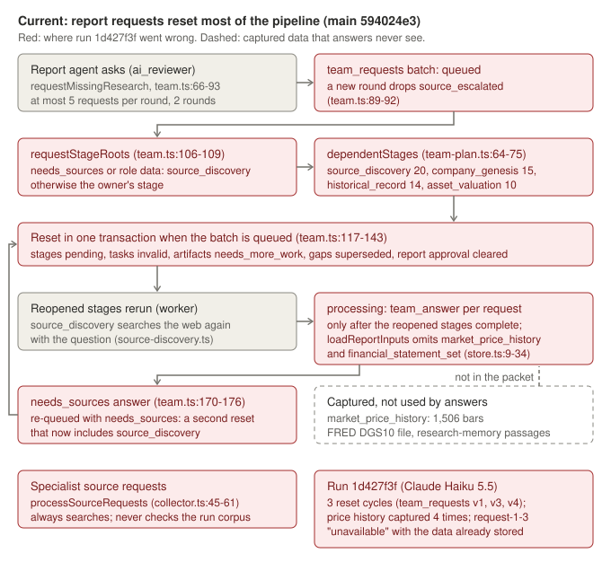
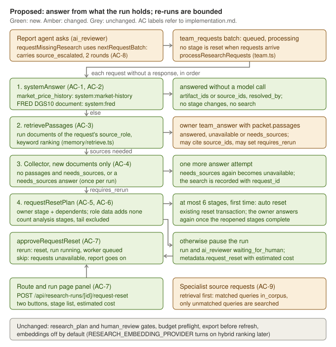
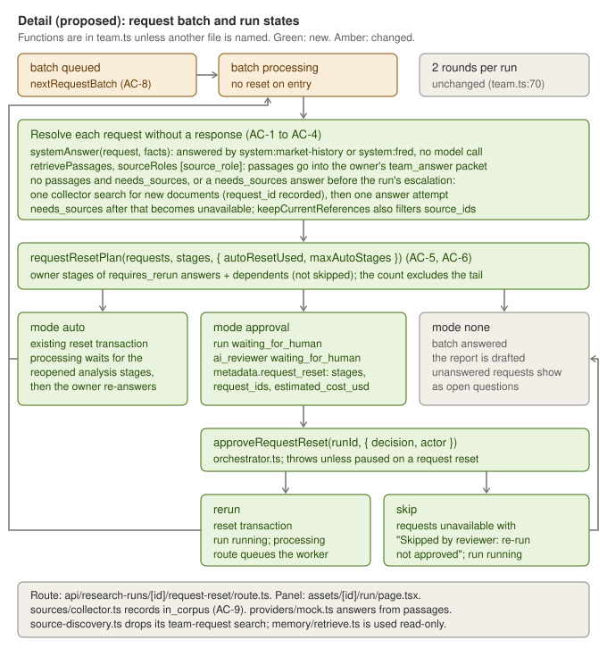

# Research request routing

## Problem and behavior

In META run `1d427f3f-449b-4bea-a8d0-d3db9098fe7d` (2026-10-10, Claude Haiku 5.5 on the Anthropic
API, $2.08 over 141 model calls), the report agent's team requests reset most of the pipeline
three times, and still came back "unavailable" for data the run had already stored.

Evidence (read-only queries of the local database and `main` 594024e3):

- `team_requests` has five versions: v1 queued (round 1), v2 answered, v3 queued (round 2),
  v4 re-queued after a `needs_sources` escalation, v5 answered. Each queued version reset stages in
  `processResearchRequests` (`src/lib/research/team.ts:117-143`). `market_price_history` was captured
  four times (versions 1 to 4), once per `historical_record` rerun.
- `requestStageRoots` (`team.ts:106-109`) maps `needs_sources || role === "data"` to `source_discovery`.
  `dependentStages` (`team-plan.ts:64-75`) then reopens 20 stages. Other roots reopen 15
  (`company_genesis`), 14 (`historical_record`) or 10 (`asset_valuation`) stages.
- Answers are written only after the reopened stages finish, from `loadReportInputs`
  (`reporting/store.ts:9-34`), which excludes `market_price_history` and `financial_statement_set`.
  The FRED series is a source document, and research-memory passages are not in the packet either.
- `requestMissingResearch` saves the next round without `source_escalated` (`team.ts:89-92`), so a
  second round can escalate again.
- Specialist source requests (`sources/collector.ts:45-61`) always search the web; a query is
  `unavailable` when no new document was stored, even if the run already holds the document.

**Before.** Request `request-1-3` (role `data`, source role `market_data`, `needs_sources: true`)
asked for "a dated, verified META price history through 2026-10-09 … together with a dated FRED
DGS10 risk-free rate series". It reopened `source_discovery` and 19 further stages. After the
rerun, the collector agent answered `unavailable`: "The corpus contains no verified META price
history through 2026-10-09, no fetched FRED DGS10 observations". The run held a validated
`market_price_history` artifact (1,506 bars, 2020-10-12 to 2026-10-09, Stooq cross-check 0 of 27
period-end closes verified) and FRED document `ce99caa6` (latest value 5.22 on 2026-10-08).

**After.** `request-1-3` is answered at once by `system:market-history`, for example: "Stored daily
prices for META: 1,506 bars from 2020-10-12 to 2026-10-09 (yahoo). Stooq cross-check: 0 of 27
period-end closes verified, 27 unverified." It cites the artifact, makes no model call and changes no
stage. A question about the 10-year Treasury is answered by `system:fred` from the stored series.
`request-1-2` (Q1 2026 capex, derived from year-to-date figures) is answered by `metric-normalizer`
from the 10-Q passages in research memory, again without a reset. Stages reopen only when an owner's
answer sets `requires_rerun`: a valuation re-run (6 analysis stages) runs automatically once; a
financials re-run (10) pauses the run with the stage list and an estimated cost until a reviewer
chooses re-run or skip.

## Scope and invariants

Likely files:

- `src/lib/research/team.ts`: answer shape, system answers, routing, reset planning, next round,
  `processResearchRequests`, prompt rules for `team_answer` and `team_requests`.
- `src/lib/research/team-plan.ts`: tail-stage constant if useful; `dependentStages` unchanged.
- `src/lib/research/sources/source-requests.ts` (`in_corpus` status, `queryTermCoverage`) and
  `sources/collector.ts` (corpus check with the coverage filter, request-driven search).
- `src/lib/research/handlers/source-discovery.ts`: remove the team-request search (lines 68-84), since
  requests never reopen discovery.
- `src/lib/research/memory/retrieve.ts`, `memory/embeddings.ts`, `reporting/store.ts`: read-only use.
  `loadReportInputs` keeps its exclusions; the system facts are loaded separately.
- `src/lib/workflow/orchestrator.ts`: `approveRequestReset`.
- New `src/app/api/research-runs/[id]/request-reset/route.ts`; panel in
  `src/app/assets/[id]/run/page.tsx` (beside the gate UI at :535 and :725).
- `src/lib/agent-harness/providers/mock.ts`: `team_answer` cites passages (see sequence step 5).
- `.env.example` (`RESEARCH_MAX_AUTO_RESET_STAGES`), `docs/system.md` (lines 75-77),
  `docs/architecture.md` (lines 122 and 155, state and sequence views, coverage index),
  `docs/security.md` (line 38: the new route starts paid work), and
  `docs/diagrams/_source/make_diagrams.py` for `state-machines.svg` and `sequence-research-run.svg`.

Existing interfaces to reuse: `retrievePassages`, `getEmbeddingProvider`, `runDocuments`
(memory), `runSearches` and `extractEvidenceForSources` (collector), `callResearchAgent`,
`saveReportArtifact`, `dependentStages`, `TEAM_ROLES`, `keepCurrentReferences`,
`enqueueResearchRun`, and the reset transaction in `team.ts:118-142` (extract it so the automatic
reset and the approved re-run share it).

Embeddings stay off. Retrieval passes `embeddings: getEmbeddingProvider()`, as
`sources/corpus.ts:173` does; it returns null while `RESEARCH_EMBEDDING_PROVIDER` is unset, so ranking
is keyword (Postgres `websearch_to_tsquery`). Setting that variable later turns on hybrid ranking with
no code change.

Invariants:

- Both human gates (`research_plan`, `human_review`) are unchanged. A request-reset decision cannot
  complete or bypass either gate, and the existing reset still refuses to run unless the run is
  `running`.
- Budget preflight and `model_call_logs` accounting are unchanged. No new npm dependency, migration
  or table: the batch stays in `team_requests`, the pause in `research_runs.metadata_json`.
- Questions about SEC filings are answered from the run's stored filings through research memory,
  never by a new EDGAR lookup.
- Typed `research_artifacts` remain the report source of truth; export still precedes refresh.
- The mock provider, `npm run test:unit` and `npm run test:sofi-v3` keep passing (with the test
  updates listed below).

Exclusions: vector search; changes to `retrievePassages` or its ranking; adding
`financial_statement_set` to the answer packet; beta or equity-risk-premium sources; changing the
two-round limit or the five-request cap; new tables.

## Public contract

Tests use only these entry points.

```ts
// src/lib/research/team.ts
export type TeamAnswer = {
  status: "answered" | "unavailable" | "needs_sources";
  answer: string;
  evidence_ids: string[];
  artifact_ids: string[];
  source_ids?: string[];       // documents linked to the run
  resolved_by?: string;        // "system:market-history" | "system:fred" for system answers
  requires_rerun?: boolean;    // the owner asks for its stage and dependents to rerun
};
export type TeamRequest = Request & { id: string; response?: TeamAnswer };
export interface RequestBatch { round: number; state: "queued" | "processing" | "answered";
  source_escalated?: boolean; requests: TeamRequest[] }

export interface SystemFacts {
  marketHistory?: { id: string; content: Record<string, any> } | null; // latest validated market_price_history
  fred?: { sourceId: string; csv: string } | null;                       // the run's FRED DGS10 document
}
export function systemAnswer(request: TeamRequest, facts: SystemFacts): TeamAnswer | null;
export function keepCurrentReferences(answer: TeamAnswer,
  inputs: { evidence: { id: string }[]; artifacts: { id: string }[]; sources?: { id: string }[] }): TeamAnswer;
export function requestStageRoots(requests: TeamRequest[]): string[];

export interface RequestResetPlan { mode: "none" | "auto" | "approval"; stages: string[];
  analysis_stages: string[]; request_ids: string[] }
export function requestResetPlan(requests: TeamRequest[], stages: { stage_key: string; status: string }[],
  opts: { autoResetUsed: boolean; maxAutoStages?: number }): RequestResetPlan;
export function nextRequestBatch(previous: RequestBatch | null, proposed: Request[]): RequestBatch | null;

// unchanged signatures
export async function processResearchRequests(sql: Sql, ctx: ResearchRunContext): Promise<boolean>;
export async function requestMissingResearch(sql: Sql, ctx: ResearchRunContext, findings?: Record<string, any>[]): Promise<void>;

// src/lib/workflow/orchestrator.ts
export async function approveRequestReset(runId: string,
  input: { decision: "rerun" | "skip"; actor: string }): Promise<{ decision: "rerun" | "skip"; stages: string[]; request_ids: string[] }>;

// src/app/api/research-runs/[id]/request-reset/route.ts
export async function POST(request: NextRequest, ctx: { params: Promise<{ id: string }> }): Promise<Response>;
// body { decision: "rerun" | "skip", actor?: string }
// 200 { decision, stages, request_ids, jobId, job } after enqueueResearchRun
// 400 for an unknown decision, 422 when the run is not paused on a request reset; in both cases nothing changes or is queued

// src/lib/research/sources/source-requests.ts
export type StageSourceRequest = SourceSearch & { id: string;
  status?: "fetched" | "unavailable" | "in_corpus"; documents?: FetchedDocument[] };
export function queryTermCoverage(query: string, text: string): number;   // 0..1, see AC-9
// processSourceRequests(sql, ctx) in sources/collector.ts keeps its signature
```

`team_answer` packets keep their current keys (`asset`, report inputs, `request`, `role`,
`output_contract`, `source_search_attempted`) and add `passages`: the retrieved passages, each with
at least `passage_id`, `source_id`, `title`, `section_path` and `text`. `source_search_attempted` is
true for the attempt after a collector search, and whenever the run has already escalated.

Tests script the model by patching `MockProvider.prototype.stream` with
`RESEARCH_MODEL_PROVIDER=mock`, as `tests/sofi-research-e2e.test.ts` does, and stub `globalThis.fetch`
for web discovery. No new test option is needed on the public functions.

## Feature map

| Part | Where | Role in this change |
|---|---|---|
| Entry points | `pipeline-runner.ts:48-49` (each scheduling pass), `reporting/runtime.ts:49,79,114` (`requestMissingResearch`) | Unchanged call sites |
| Request state | `research_artifacts` `team_requests` (one validated version per run) | Batch, responses, `source_escalated`, re-run bookkeeping |
| Pause state | `research_runs.status`, `metadata_json.request_reset`, `research_stages` (`ai_reviewer`) | New pause, read by the run page and `approveRequestReset` |
| System facts | `history/market-history.ts:18-54` (artifact), `sources/corpus.ts:845-878` (FRED document, CSV `observation_date,DGS10`, percent values, blanks on holidays) | Read-only inputs to AC-1 and AC-2 |
| Research memory | `memory/retrieve.ts:174` `retrievePassages`, `runDocuments` (roles from metadata, assignments, source type) | Passages for AC-3, corpus check for AC-9 |
| Collector | `sources/collector.ts:12-31` `runSearches`, `handlers/evidence-extraction.ts:66` `extractEvidenceForSources` | Request-driven search for AC-4, corpus check for AC-9 |
| Reset | `team.ts:118-142` transaction; `GAP_OWNER_STAGES` supersession | Reused by AC-6 auto and AC-7 rerun |
| Consumers | `includeUnansweredQuestions` (`team.ts:179-185`), report outline, run page, `mock.ts:994` | Unanswered and skipped requests still become open questions |
| Indirect | `callResearchAgent` replays a completed task with the same packet hash; budget preflight per call | A re-answer after a rerun gets a new packet only because inputs changed |
| Tests that encode the old routing | `tests/research-team.test.ts:70-71`; `tests/sofi-research-e2e.test.ts:510-576, 578-643`; `Implementations/live-run-repair/{acceptance,verification}/orchestration.test.ts` AC-5 | Must be updated (step 7) |

## Diagrams

Current behavior, with the failure points from run `1d427f3f`:



Proposed behavior at the same level, with AC labels:



Implementation detail of the batch and run states:



## Acceptance criteria

Each criterion applies to a request without a response in the current batch. Criteria are checked in
this order: AC-1, AC-2, then AC-3 with AC-4.

- **AC-1 System answer for market data.** When the request's `source_role` is `market_data`, or its
  role is `data` and the question mentions a price or market capitalization ("price", "market cap",
  any case), and the run has a validated `market_price_history` artifact (the latest version) with
  `bars_available > 0`, the response is `{ status: "answered", artifact_ids: [that artifact id],
  evidence_ids: [], resolved_by: "system:market-history" }`. The answer text states
  `bars_available` (a thousands separator is allowed), `last_trading_day` as stored (YYYY-MM-DD), the
  cross-check's verified and unverified period counts, and the word "unverified" when any period or
  the valuation price is unverified. No model call, collector search or stage change happens. AC-1 is
  checked before AC-2, so `request-1-3`, which also names DGS10, is answered from market history. An
  artifact with no stored bars does not answer the request.
- **AC-2 System answer for FRED.** When AC-1 does not apply, and the question mentions DGS10, the
  10-year Treasury, a Treasury yield, the risk-free rate or the discount rate (any case), whatever the
  request's `source_role`, and the run has a FRED DGS10 document (`source_type` `macro_context`, metadata `source`
  `fred` and `series_id` `DGS10`, linked to this run) with at least one non-blank value, the response
  is `answered` with `source_ids: [document id]`, `resolved_by: "system:fred"` and a text giving the
  latest non-blank value as stored and its date. Trailing blank rows (holidays) are skipped. No model
  call is made. A `macro_dataset` question without those terms (inflation, GDP, a currency) gets no
  system answer and goes to AC-3. Answers gain optional `source_ids`, `resolved_by` and `requires_rerun`. An `answered`
  response must cite at least one evidence id, artifact id or source id; `keepCurrentReferences` drops
  source ids that are not documents of the run, as it drops stale evidence ids.
- **AC-3 Research-memory answers without resets.** Any other request is answered by its owner
  (`TEAM_ROLES[role].agent`, task type `team_answer`). Before the call, `retrievePassages` runs over the
  run's documents with `need = { key: request id, query: question, sourceRoles: [request.source_role] }`,
  and the passages are added to the packet as `passages`. Passages from other source roles or other
  runs are never included. Arriving requests reset no stage, task or artifact. A failed answer call
  leaves the stages unchanged, and the request is answered on a later pass.
- **AC-4 Sources needed.** When retrieval returns no passages (gap `no_documents_for_role` or
  `no_matching_passages`) and the request has `needs_sources`, or when the owner's answer is
  `needs_sources` and the run has not escalated yet, the collector runs one search for that request
  (its source role, a query of at most 300 characters naming the asset and the request), stores and
  links new documents, and extracts evidence only from documents new to the run. The search is
  recorded in `source_retrieval_attempts` with `attempt_metadata_json.request_id`. Retrieval then
  runs again and the owner gets exactly one answer attempt with `source_search_attempted: true`. A
  `needs_sources` answer after that becomes `unavailable`, and so does a `needs_sources` answer once
  the run has escalated. An answer-triggered search sets `source_escalated` on the batch. No stage is
  reset.
- **AC-5 Routing.** `requestStageRoots` returns `TEAM_ROLES[role].stage` only for requests whose
  response sets `requires_rerun: true`. Role `data` contributes no root, `needs_sources` contributes
  none, and `source_discovery` is never returned. The source-discovery handler no longer searches for
  team requests.
- **AC-6 Explicit, bounded re-runs.** An owner's answer may set `requires_rerun: true`. Once every
  request in the batch has a response, `requestResetPlan` gives `stages` = the owner stages and their
  `dependentStages`, without stages whose status is `skipped`; `analysis_stages` = `stages` without the
  tail (`ai_reviewer`, `human_review`, `export`, `refresh_schedule`); and `request_ids` = the requests
  that asked for the re-run. `mode` is `none` without such requests; `auto` when
  `analysis_stages.length` is at most `maxAutoStages` (default `RESEARCH_MAX_AUTO_RESET_STAGES`, else
  6) and the run has not had an automatic reset; otherwise `approval`. Only automatic resets count:
  a re-run a reviewer approved (AC-7) does not use up the run's one automatic reset.
  - `auto`: the existing reset transaction runs for `stages` (stages pending, tasks invalid, artifacts
    `needs_more_work`, owned gaps superseded, report approval cleared), the batch moves to
    `processing`, and the run records that its automatic reset is used (the record survives later
    rounds and restarts). The re-run requests are answered again by their owner only after the reopened
    analysis stages complete; requests already answered are not asked again.
  - `approval`: no stage is reset. The run becomes `waiting_for_human`, the `ai_reviewer` stage
    `waiting_for_human`, and `metadata_json.request_reset = { stages, request_ids, estimated_cost_usd }`,
    where the estimate is the sum of `model_call_logs.cost_usd` for this run whose stage is in `stages`.
- **AC-7 Approval.** `approveRequestReset(runId, { decision, actor })` acts only when the run is
  `waiting_for_human` with `metadata_json.request_reset`; otherwise, and for an unknown decision, it
  throws and changes nothing. `rerun` performs the reset transaction for the recorded stages, removes
  `request_reset`, sets the run `running` and the batch `processing`. `skip` marks the recorded
  requests `unavailable` with an answer containing "Skipped by reviewer: re-run not approved", sets the
  batch `answered`, removes `request_reset`, returns `ai_reviewer` to `running` and the run to
  `running`, so the report continues with those requests as open questions. Both record the decision
  and actor in run metadata. An approved re-run is not an automatic reset, so a later small re-run in
  the same run can still be automatic. `POST /api/research-runs/[id]/request-reset` calls it and then
  `enqueueResearchRun`; it returns 400 for an unknown decision and 422 when the run is not paused on a
  request reset, and in both cases changes and queues nothing. The run page shows a panel while `request_reset` is present: the stage list,
  the estimated cost, and two buttons (re-run, skip).
- **AC-8 Bounded rounds.** `nextRequestBatch(previous, proposed)` returns null when `previous.round`
  is 2 or more, or when every proposed question repeats an earlier one (case and surrounding spaces
  ignored, including repeats within the proposal). Otherwise it returns round `previous.round + 1` (1
  without a previous batch), state `queued`, `source_escalated` carried from `previous`, the previous
  requests with their responses, and the new requests with ids `request-<round>-<n>`.
  `requestMissingResearch` saves that batch. Any other per-run flag kept on the batch is carried the
  same way.
- **AC-9 Source requests already in the corpus.** Before searching, `processSourceRequests` runs
  `retrievePassages` (unchanged) for each queued search (`query`, `sourceRoles: [search.source_role]`).
  Because keyword retrieval matches any query term, a deterministic filter follows. A search is
  `in_corpus` only when a returned passage (a) comes from a document whose role equals the search's
  `source_role` and (b) has `queryTermCoverage(query, passage.text) >= 0.6`. It is then recorded with
  status `in_corpus` and `documents` = the distinct documents that qualify, and is not searched. Every
  other search runs as today (`fetched` or `unavailable`).
  - `queryTermCoverage(query, text)` (pure, in `sources/source-requests.ts`). Lower-case both strings
    and split them into tokens: maximal runs of letters and digits, keeping inner hyphens, so "10-K"
    is `10-k` and "Form 20-F." gives `form` and `20-f`. The query's significant terms are its distinct
    tokens of at least three characters that are not stop words; this includes four-digit years
    (`2025`) and form names (`10-k`, `10-q`, `20-f`, `8-k`). Coverage is the share of those terms that
    occur among the text's tokens (exact match, no stemming), and 0 when the query has no significant
    term.
  - Stop words: the, and, for, from, with, into, onto, its, their, our, this, that, these, those, are,
    was, were, has, have, had, not, but, all, any, per, via, about, over, under, than, then, also.
  - The sofi-v3 query "Upstart Holdings 2025 annual report 10-K" against the mock corpus's only
    `peer_company_primary` document ("Mock peer issuer annual report disclosure for acceptance
    testing") shares `annual` and `report`: 2 of 6 terms (0.33). It stays a search and ends
    `unavailable`, so the sofi-v3 test needs no change for AC-9.

Decided while writing the tests (agreed with the coordinator or choices the text left open): the
market-history check runs before FRED; the FRED answer depends on the question's terms, not the source
role; artifacts without bars and FRED files without values give no system answer; skipped stages are
not counted; one answer attempt follows a search even when it found nothing; the estimate covers all
reset stages, tail included; approved re-runs do not count as the automatic reset; the AC-9 filter
above.

## Implementation sequence

1. Pure pieces in `team.ts`: `TeamAnswer`, `systemAnswer`, `keepCurrentReferences` with sources,
   `requestStageRoots`, `requestResetPlan`, `nextRequestBatch` (AC-1, AC-2, AC-5, AC-6, AC-8). Update
   `tests/research-team.test.ts:70-71`, which asserts the old `source_discovery` routing.
2. `processResearchRequests`: queued moves to processing without a reset (keeping this transition
   keeps the sofi-v3 "interrupted answer leaves the batch processing" assertion valid); load the
   system facts; retrieval and `passages`; the request-driven collector search; then
   `requestResetPlan`. Persist the reset stages with the batch so the processing state waits for them;
   recomputing roots from cleared responses would wait for nothing (AC-3, AC-4, AC-6). Depends on 1.
3. Shared reset transaction, `approveRequestReset`, the route and the run-page panel (AC-6, AC-7).
   Depends on 2.
4. `queryTermCoverage` and the `in_corpus` status in `source-requests.ts`; the retrieval check and
   filter in `collector.ts` (AC-9). Independent.
5. Prompts and mock. Add `team_answer` rules for `passages`, `source_ids`, `requires_rerun` (set only
   when the owner's own artifact must be recomputed) and `needs_sources`; replace the `team_requests`
   rule "the dependent analyses will rerun". Mock `team_answer`: cite `passages[0].source_id` when no
   evidence or artifact is available, return `unavailable` when nothing can be cited, never set
   `requires_rerun`. These are model-request changes: AGENTS.md requires a small paid live provider
   test, approved by the user, before merge.
6. Remove the team-request search from `handlers/source-discovery.ts` (AC-5).
7. Update tests that encode the old behavior, each with a note tied to an AC:
   - `tests/sofi-research-e2e.test.ts` "four specialist plans … escalate": should pass if step 2 keeps
     the queued-to-processing transition and AC-4 records `request_id`; check it.
   - `tests/sofi-research-e2e.test.ts` "specialist's document request": no change expected. Its peer
     query covers 2 of 6 terms of the mock peer document, below the AC-9 threshold; confirm it still
     ends `unavailable` with a search attempt.
   - `Implementations/live-run-repair/{acceptance,verification}/orchestration.test.ts` AC-5: requests
     no longer supersede gaps on arrival. Drive the reset with a `requires_rerun` answer and an approved
     re-run instead. A data request can no longer supersede `system:source-reader` gaps, because
     `source_discovery` is never reopened.
8. Docs and generated diagrams (see Scope); `.env.example` gains
   `RESEARCH_MAX_AUTO_RESET_STAGES=6`.

## Verification

Working directory: repository root. Test files:

- `acceptance/routing.test.ts` (pure), `acceptance/requests.test.ts` (database),
  `acceptance/source-requests.test.ts` (one pure test, one database test).
- `verification/boundaries.test.ts` (pure), `verification/sequences.test.ts` (database),
  `verification/corpus.test.ts` (two pure tests, three database tests).

Database tests skip unless `RUN_DB_INTEGRATION=1`. Run them against a separate, migrated test
database, not the development database: that one holds real runs and a live worker polls it. The
fixtures read only `DATABASE_URL` from `.env.local` when it is unset, pin `RESEARCH_MODEL_PROVIDER=mock`,
unset the embedding, OCR and auto-reset variables, stub `fetch` for discovery, and remove their runs,
documents and stored files. No test queues a job: the route tests cover only the 400 and 422 paths,
and the 200 path is checked through `approveRequestReset` directly. Run database files one at a time.

The exact commands used for the baseline (the test database `research_os_test` has the same
credentials as `.env.local` and all ten migrations applied):

```bash
npx tsc --noEmit 2>&1 | grep Implementations/research-request-routing   # expect no output
npx tsx --test --test-reporter=spec Implementations/research-request-routing/acceptance/*.test.ts
npx tsx --test --test-reporter=spec Implementations/research-request-routing/verification/*.test.ts
URL=$(grep "^DATABASE_URL=" .env.local | cut -d= -f2- | tr -d "'\""); TEST_DB="${URL%/research_os}/research_os_test"
for f in Implementations/research-request-routing/acceptance/*.test.ts Implementations/research-request-routing/verification/*.test.ts; do
  RUN_DB_INTEGRATION=1 DATABASE_URL="$TEST_DB" npx tsx --test --test-concurrency=1 --test-reporter=spec "$f"; done
```

Required checks after implementation:

```bash
npx tsc --noEmit && npm run test:unit && npm run build
npm run test:sofi-v3
npm run test:db   # includes Implementations/*/acceptance and verification; uses DATABASE_URL from .env.local
```

`npm run test:db` takes `DATABASE_URL` from `.env.local`, the development database. These tests create
and delete their own fixture runs there and queue no jobs, but prefer the test-database loop above.

| Criterion | Acceptance | Verification |
|---|---|---|
| AC-1 | routing.test.ts; requests.test.ts (DB) | boundaries.test.ts; sequences.test.ts (DB, latest version) |
| AC-2 | routing.test.ts; requests.test.ts (DB) | boundaries.test.ts (holiday blank, no values, inflation, discount rate, Treasury yield); sequences.test.ts (DB: other run's FRED, inflation goes to the owner) |
| AC-3 | requests.test.ts (DB) | sequences.test.ts (DB: empty corpus, role scope, interrupted answer) |
| AC-4 | requests.test.ts (DB: found, nothing found) | sequences.test.ts (DB: empty corpus) |
| AC-5 | routing.test.ts | boundaries.test.ts (every role, mixed batch) |
| AC-6 | routing.test.ts; requests.test.ts (DB: pause, auto) | boundaries.test.ts (inclusive cap, env, skipped, union); sequences.test.ts (DB: second re-run pauses; approved re-run does not count) |
| AC-7 | requests.test.ts (DB: rerun, skip, route 400) | sequences.test.ts (DB: skip then resume, twice, plan gate, route 422, approved re-run does not count) |
| AC-8 | routing.test.ts | boundaries.test.ts; sequences.test.ts (DB: round 2 after escalation) |
| AC-9 | source-requests.test.ts (coverage; DB: in_corpus, other role, generic-term peer) | corpus.test.ts (coverage boundaries; DB: generic-term peer, other role, empty corpus) |

Manual checks, not automated:

- `POST /api/research-runs/[id]/request-reset` with a valid decision on a paused run returns 200 and
  queues a job. Do this against the local dev server with a scratch run, not in an automated test.
- Run page: with a paused run, the panel lists the stages and estimated cost; each button calls the
  route and the page refreshes. Check in the Browser pane against the local dev server.
- Replay the 1d427f3f requests in a scratch run with the mock provider: request-1-3 answered by
  `system:market-history`, no stage reset.
- A small paid live run (step 5) only with the user's approval.

### Baseline (2026-10-11, `main` 594024e3 plus unrelated uncommitted files)

Database runs used `research_os_test` with the commands above. The development database was not used
for tests. No paid model call or network fetch was made.

- `npx tsc --noEmit`: no errors in `Implementations/research-request-routing`, `src`, `tests` or
  `scripts`. Errors remain under the untracked `Temp Download/`, unrelated.
- `acceptance/routing.test.ts`: 0 of 10 pass. Seven fail with "export systemAnswer / requestResetPlan /
  nextRequestBatch is missing"; `keepCurrentReferences` keeps a foreign source id; `requestStageRoots`
  returns `source_discovery` for an unanswered data request.
- `acceptance/requests.test.ts` (DB): 0 of 9 pass. AC-1/AC-2, AC-3 and both AC-4 tests fail on "no
  stage is reset" (the 1d427f3f request reopens all 20 stages from `source_discovery`). The AC-6 pause
  test fails on run status `running`; the AC-6 automatic test fails because the owner was never asked
  before the reset; the AC-7 tests fail on the missing `approveRequestReset` export and the missing
  route module.
- `acceptance/source-requests.test.ts`: 0 of 2 pass (missing `queryTermCoverage`; DB: status
  `unavailable`, expected `in_corpus`).
- `verification/boundaries.test.ts`: 0 of 11 pass (missing exports, `source_discovery` routing).
- `verification/sequences.test.ts` (DB): 0 of 12 pass, each on its own assertion (stage resets, no
  system answer, missing export or route, batch left `processing`).
- `verification/corpus.test.ts`: 3 of 5 pass. The two coverage tests fail on the missing export. The
  three database tests pass: they guard behavior AC-9 must keep (a generic-term peer document, another
  role's document and an empty corpus all still go to the collector).
- Without `RUN_DB_INTEGRATION`, the database tests skip (10 acceptance, 15 verification).
- The tests left no runs, documents, jobs or stored files behind (checked in `research_os_test` and
  `storage/sources`).

## Decisions and open question

Decided with the coordinator (2026-10-11):

- AC-2: the FRED answer depends on the question's terms (DGS10, 10-year Treasury, Treasury yield,
  risk-free rate, discount rate), whatever the source role. Inflation and other macro questions go to
  AC-3.
- AC-9: retrieval stays unchanged; the coverage filter above prevents matches on generic terms. The
  sofi-v3 peer query stays `unavailable`.
- AC-6/AC-7: approved re-runs do not count as the automatic reset.
- Tests never queue a job; the 200 route path is a manual check.

Still open: `request-1-3` also asks for a beta source. AC-1 marks it answered from market history
alone, so the report agent has to ask again for anything the system answer leaves out.

## Completion evidence

To be filled after implementation: who wrote the plan, the tests and the code; commands actually run
and their results; criteria met; remaining limitations.

The plan and both test sets were written by the same agent before any implementation. The
verification set uses different fixtures, boundaries and sequences, but it is not independently
authored. Both sets live in this folder; if a separate worker implements the plan, move
`verification/` out of its checkout first and run it afterwards against the worker's exact revision.
