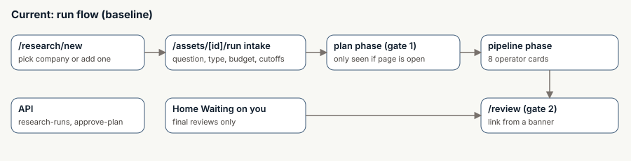
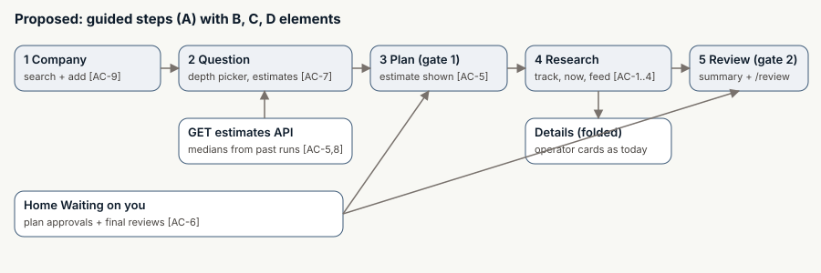
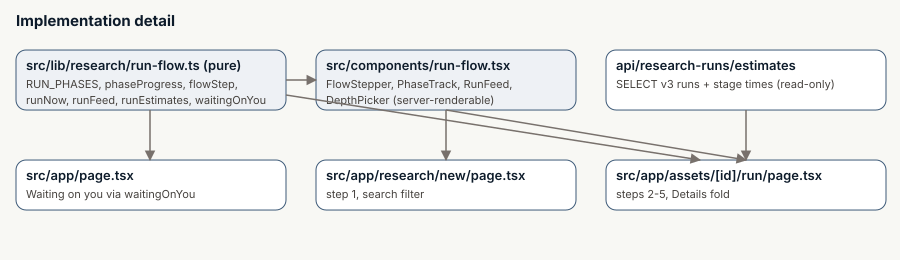

# Guided run flow (workshop variant A, with B, C and D elements)

Workshop: `prototype/workshop/run-flow/index.html`. The user chose variant A (guided steps) as the baseline and allowed
elements from the others. Taken from them: plan approvals in Home's "Waiting on you" (B), the five-phase track (D), a
plain-words "what's happening" feed (B and C), and the operator panels folded behind Details (D).

## Problem

Starting and following a run is split and opaque:

- `/research/new` lists every company with no search, then sends you to `/assets/[id]/run?new=1` for the question.
- The question form has a run-type dropdown, a blank budget box and two raw date-time cutoffs, and no estimate.
- A run waiting for plan approval shows up nowhere except its own page; Home's "Waiting on you" lists only final reviews.
- The running view is eight operator cards (stage list, tasks, model calls, activity, backtests). The story is missing.

Before: SoFi waits at the plan gate; Home says "Nothing is waiting on you." After: Home lists "SoFi · Needs plan
approval" linking to the run, and the run page opens at step 3 of a five-step stepper.

## Facts that shape the design (observed in code and the dev database)

- Run types differ little: `quick_scan` skips the four backtest stages (`skipForRunTypes`) and extracts fewer facts;
  `deep_dive` and `full_initiation_report` extract deeper (`evidenceTargets`) and refresh after 90 days;
  `thesis_investigation` runs every stage at standard depth. The UI must not invent tiers of time or cost.
- Past runs (local DB, 2026-11-27): only `full_initiation_report` has history, $0.52 to $4.86, about 1 to 5 hours from
  plan approval to report review. So estimates come from past runs of the same type, and say so when there are none.

## Scope

Files:

| Part | Files |
| --- | --- |
| P1 | `src/lib/research/run-flow.ts` (new, pure) |
| P2 | `src/components/run-flow.tsx`, `src/components/run-flow.module.css` (new) |
| P3 | `src/app/api/research-runs/estimates/route.ts` (new, read-only) |
| P4 | `src/app/research/new/page.tsx`, `src/app/research/new/new.module.css` |
| P5 | `src/app/assets/[id]/run/page.tsx`, `src/app/assets/[id]/run/page.module.css` |
| P6 | `src/app/page.tsx` |
| P7 | `docs/system.md` (owner of `src/lib/research/*.ts`), `prototype/workshop/run-flow/index.html` |

Exclusions: the final decision stays on `/review` (step 5 summarises and links there); no schema, queue, worker or
pipeline change; no new run types; no notifications beyond Home.

Invariants: both gates stay explicit (approve-plan and the `/review` decision need a click); cancel stays; the page never
starts or approves anything by itself; fetched data is displayed as text, never as HTML.

## Diagrams







## Parts

| ID | Outcome | Criteria | Depends on |
| --- | --- | --- | --- |
| P1 | Pure flow model: phases, step, now sentence, feed, estimates, waiting list | AC-1 to AC-6 | none |
| P2 | Server-renderable stepper, phase track, feed and depth picker | AC-7 | P1 |
| P3 | `GET /api/research-runs/estimates` | AC-8 | P1 |
| P4 | `/research/new` is step 1 with a company search | AC-9 | P2 |
| P5 | Run page: steps 2 to 5, operator panels behind Details | AC-9, AC-10 | P2, P3 |
| P6 | Home's Waiting on you lists plan approvals too | AC-6, AC-9 | P1 |
| P7 | Docs synced; workshop kept | docs check | P1 to P6 |

## Acceptance criteria

- **AC-1 Phases.** `RUN_PHASES` has five phases in order Frame, Gather, Understand, Value, Decide. Together they list
  every key of `STAGE_CONFIGS` exactly once, in stage order. Frame contains `research_plan` and is marked as holding the
  plan gate; Decide contains `human_review` and holds the review gate.
- **AC-2 Phase progress.** `phaseProgress(stages)` returns the five phases with `total` (stages of that phase present
  in the run), `done` (completed or skipped) and a `state`: `failed` if any stage failed; else `waiting` if one waits
  for a human; else `active` if one is running or queued, or if some but not all are done; `done` when all present
  stages are done and total > 0; else `pending`. Unknown stage keys are ignored.
- **AC-3 Flow step.** `flowStep({ hasRun, status, stages })` returns `{ index, key }` with keys
  company(0), question(1), plan(2), research(3), review(4): no run → question; `research_plan` not completed → plan;
  `human_review` waiting, or run status completed/approved → review; otherwise research (including stopped runs).
- **AC-4 Plain words.** `runNow(stages)` returns one sentence for the running (else queued) stage, or null. `runFeed`
  returns items newest first: a "now" item per running stage and a past-tense item per completed stage, with its time.
  Text never contains an underscore or a raw stage key. No stages → empty list.
- **AC-5 Estimates.** `runEstimates(rows)` groups by `run_type` and returns `runs`, `medianCostUsd` and
  `medianMinutes`. Minutes are machine time: (plan started − created) + (report review completed − plan completed);
  the wait at the plan gate is excluded. Rows without a report-review completion or with negative time are left out.
  Median of an even count is the mean of the middle two. `formatEstimate(undefined)` says "No past runs of this type
  yet"; otherwise it names the run count, cost (2 decimals) and time (minutes under an hour, else hours and minutes).
- **AC-6 Waiting on you.** `waitingOnYou(queue, assets)` lists final reviews (from the review queue, linking to
  `/review?run=`) first, then plan approvals: assets whose latest run is `waiting_for_human` at `research_plan`, linking
  to `/assets/<id>/run?run=<run id>`. A run appears once.
- **AC-7 Components.** `FlowStepper` renders five steps, marks the current one with `aria-current="step"` and earlier
  ones as done. `PhaseTrack` renders each phase's label and "done of total" and marks gates. `RunFeed` renders items and,
  with none, a sentence. `DepthPicker` renders a radio per run type (quick scan, thesis investigation, deep dive,
  initiation report) with its factual description and its estimate text, and checks the selected one.
- **AC-8 Estimates API.** `GET /api/research-runs/estimates` is read-only (no insert, update or delete), limits to
  pipeline version 3, and returns `runEstimates` output as JSON.
- **AC-9 Pages.** `/research/new` shows `FlowStepper` at step 0 and filters companies by a search field. The run page
  shows `FlowStepper` at every phase, uses `DepthPicker` and folds budget and cutoffs into an Advanced disclosure,
  renders `PhaseTrack` and `RunFeed` while researching, and puts model calls, tasks, activity and backtests inside a
  Details disclosure. Home's Waiting on you renders from `waitingOnYou`.
- **AC-10 Gates kept.** The run page still calls `approve-plan`, `request-plan-changes`, `request-reset` and `cancel`
  only from click handlers, still links step 5 to `/review?run=`, and never calls `run-system-pipeline` except from
  the start form's submit.

Which set checks what: AC-1 to AC-8 are unit and render tests in both sets; AC-9 and AC-10 are source checks in both
sets plus manual screenshots in the browser.

## Verification

From the repository root:

```bash
npx tsx --test Implementations/run-flow-guided/acceptance/*.test.ts*
npx tsx --test Implementations/run-flow-guided/verification/*.test.ts*
npm run lint && npx tsc --noEmit && npm run test:unit && npm run build && python tools/docs_sync.py check
```

Manual: run the app (`research-os` launch config), open `/research/new`, a run at each step that exists locally, and
Home; capture screenshots. Do not start a run (it would spend provider money).

Baseline (before any product edit): both sets fail on missing modules (`run-flow.ts`, `run-flow.tsx`, the route) and
on the page source checks. Recorded below.

## Completion evidence

Base SHA `be86f15`, branch `run-flow-guided`, uncommitted working tree (no commit permission yet). One agent wrote the
plan, both test sets and the code; the verification set is a separately designed set of edge cases, not hidden or
independently authored.

Baseline (before product edits): acceptance 1 pass / 6 fail (AC-10 already held; the rest failed on the missing
`run-flow.ts`, `run-flow.tsx`, route and page wiring); verification 0 / 2 files (missing modules).

After implementation (all parts P1 to P7):

| Check | Result |
| --- | --- |
| `npx tsx --test Implementations/run-flow-guided/acceptance/*.test.ts*` | 16 pass, 0 fail |
| `npx tsx --test Implementations/run-flow-guided/verification/*.test.ts*` | 18 pass, 0 fail |
| Test files vs the frozen copy (scratchpad `frozen/`) | identical; no test changed after the freeze |
| `npm run lint` | 0 errors, 118 warnings; the 4 on touched files existed before (same rules, shifted lines) |
| `npx tsc --noEmit` | clean |
| `npm run test:unit` | 963 tests, 899 pass, 0 fail, 64 skipped |
| `npm run build` | exit 0; `/api/research-runs/estimates` built as a dynamic route |
| `python tools/docs_sync.py check` | in sync; `docs/system.md` read, updated (Guided run flow, Home's Waiting on you) and stamped; `docs/architecture.md` route table regenerated |

Manual, in the app against the local database (`research-os`, no run started, no provider calls):

- `GET /api/research-runs/estimates` returned `full_initiation_report`: 6 runs, median $2.05, 307 min; no other type has
  history, so those cards say "No past runs of this type yet".
- `/research/new`: stepper at Company; search "sof" shows 1 of 3; "sofzz" shows the no-match sentence.
- `/assets/<Bitcoin>/run?new=1`: step 2 with the question, four run-type cards with facts and estimates, Advanced folded
  ("No cost cap · sources and prices up to now").
- `/assets/<SoFi>/run` (run `e7adabe1`, waiting at the final review): step 5, "Ready for your review" linking to
  `/review?run=`, 22 of 25 stages, phase track, plain-words feed, Details opening onto the old operator cards.
- Home: "1 thing is waiting on you", SoFi listed with Needs your decision.
- Phone width (375 px): no horizontal overflow; console: no errors.

Not verified live: the plan step (no local run waits at `research_plan`), a running run, the re-run ask, and a Home
plan-approval row. Those paths are covered by the unit and source tests only.

Review panel round 1 (R1 10, R2 9, R3 9.5), fixed:

- R2, AC-9: closing a fold nested inside Details (Tasks, Warnings) collapsed Details, because React passes a nested
  `toggle` event up to the outer `onToggle`. The handler now ignores toggles whose target isn't the Details element.
- R3, AC-10: the frozen AC-10 test could not fail for an effect calling a gate (its regex stopped at the first `)`).
  The frozen files are unchanged; `acceptance/p4-panel-fixes.test.ts` was added after the freeze. It checks that each
  gate, cancel and start call sits only in its handler, that no effect mentions those handlers, and that they are reached
  only from clicks, the start form's submit or each other. It also covers the Details fix and the search filter
  (R3 note). This strengthens coverage of AC-9 and AC-10; no assertion was weakened.
- R3 note: `diagrams/proposed.svg` labelled the plan's estimate AC-10; corrected to AC-5.

Review panel round 2: R1 10, R2 10, R3 10 on the same uncommitted tree (base `be86f15`). Reviewers ran Opus 5.5 at
medium effort, read-only on the shared checkout (no commit to isolate). R3 confirmed the new test fails on mutations
(a gate called from an effect, a direct fetch outside its handler, the search filter removed).

Deviation from the drawn design: the feed shows the newest 8 items with a "Show all" toggle (SoFi's run has 22, which
made the page long). Step 4's cancel stays in the page header, where it was, rather than moving into the progress card.
