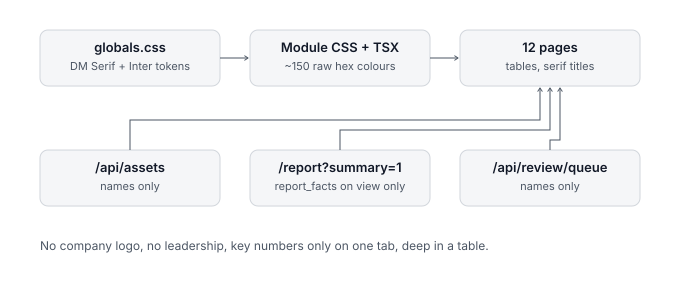
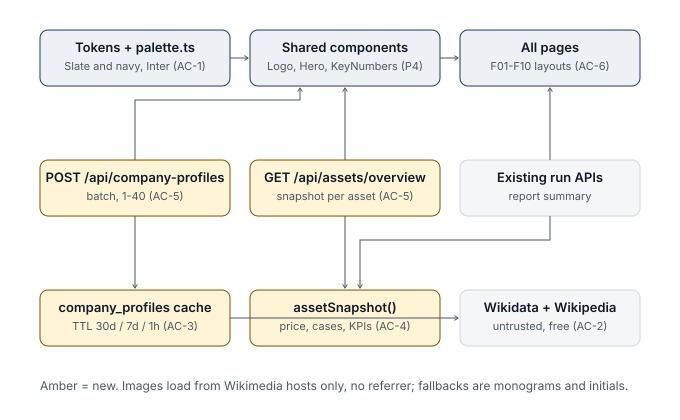
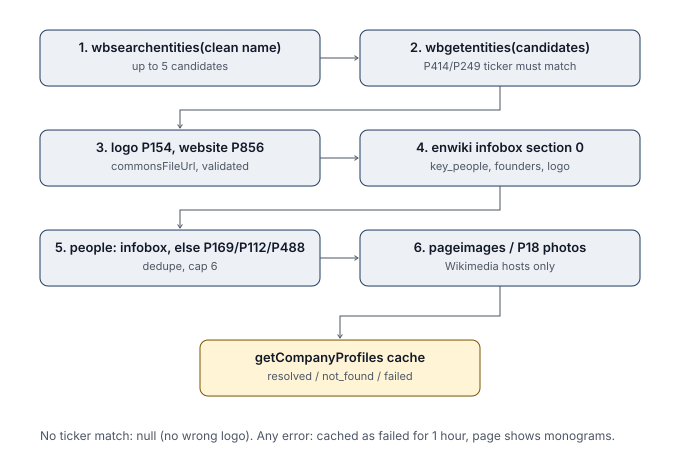

# UI remaster: Slate and navy, key numbers first, company logos and leadership photos

Branch `claude/ui-remaster`, stacked on `claude/theme-research` (PR #146), so every page in the stack (notebook, workbench, filings, checklist, themes) is remastered. Base SHA: recorded in "Freeze" below.

## Problem and expected behaviour

The user found the current layout messy. Seven workshop rounds settled the direction (design canvas https://claude.ai/artifact/CcbyEVBvVMf2yy1TbdVSDh, round 7, F01–F10):

- **Layout**: W03's friendly card layout, with W06's visuals (value ruler, price fan, KPI gauges, risk heat).
- **Palette**: "Slate and navy". The surfaces are neutral slate; navy is the only accent. Green, red and amber appear only to signal status.
- **Type**: Inter throughout. No serif display face.
- **Density**: the real valuation numbers come first (price, base, bull, bear, gap to price, key KPIs), not presentation slides.

The user added two requirements:

- Every page shows the logo of the company being researched.
- The founders and C-suite appear with photos.

**Before**: the SoFi research page opens on a serif title, a tab strip and a long thesis paragraph. The price, the base value and the gap only appear as a table further down. No page shows a logo or a person. The home and Research pages are plain tables.

**After**: the SoFi page opens with a hero:

- SoFi's logo, then "SoFi Technologies · SOFI · Equity", then the run status.

Under the hero sits a key-numbers strip:

- Price $14.28 (unverified).
- Base $1.13, −92% vs price.
- Bull $6.74, −53%.
- Bear −$1.79.
- Weighted $1.38.
- CET1 16.9% (good).
- …

Below the strip, the page shows:

- a value ruler;
- the thesis pillars;
- a price-target table and fan;
- KPI gauges;
- a risk heat list;
- a Leadership tile with photos: Anthony Noto (CEO, photo), Chris Lapointe (CFO, initials) and Mike Cagney (Co-founder, photo).

The home page becomes a "Today" feed of asset cards with logos and value rulers. The Research list becomes a watchlist with stage counts, logos and value numbers.

## Scope

**Files**

- `src/app/**`: every page, namely home, assets, asset details, view (all 12 tabs), run, review (list and detail), research/new, login, themes and themes/[id].
- `src/components/**`: the module CSS, the shell, the report, financials, notebook, workbench, checklist, chat and charts.
- `src/app/globals.css`.
- New:
  - `src/lib/company-profiles/*`
  - `src/lib/research/asset-snapshot.ts`
  - `src/lib/research/asset-overview.ts`
  - `src/components/company/*`
  - `src/components/visuals/*`
  - `src/components/ui/palette.ts`
- API:
  - `src/app/api/company-profiles/route.ts` (POST batch lookup)
  - `src/app/api/assets/[id]/profile/route.ts` (GET)
  - `src/app/api/assets/overview/route.ts` (GET)
- Schema:
  - `src/db/schema/company-profiles.ts`
  - `drizzle/0024_company_profiles.sql` and its journal entry
- Docs:
  - `docs/system.md`
  - `docs/security.md`
  - `docs/architecture.md`
  - `docs/operations.md`
  - the diagram source, if the component or deployment views change

**Interfaces reused**:

- `GET /api/research-runs/:id/report?summary=1`, whose summary still carries the small artifacts: `report_facts`, `monitoring_dashboard`, `annual_price_target_path` and `valuation_scenario_set`.
- `valuationSummary`, `/api/review/queue`, `/api/assets`, and the `ui` classes in `research-ui.module.css`.

**Exclusions**:

- No change to the pipeline, the stages, the prompts, the report contracts or the review gates.
- No new npm dependency.
- No paid model calls.
- Logos and photos come only from Wikidata, Wikipedia and Wikimedia Commons, which are free and need no key.

**Invariants**:

- Both human gates stay explicit, and the review form's fields, validation and submit behaviour are unchanged.
- Fetched Wikidata and Wikipedia data is untrusted. It is rendered as text, and image URLs are rebuilt or allow-listed (`upload.wikimedia.org`, `thumb.wikimedia.org`, `commons.wikimedia.org`, https only).
- Pages must render fully with logos and photos unavailable: offline, `COMPANY_PROFILES=off`, or not found. Fallbacks are a monogram and initials.
- No personal data of the operator goes to Wikimedia. Images load with `referrerPolicy="no-referrer"`. Server requests send a generic `User-Agent` with no contact details.
- Every schema change ships with a Drizzle migration.

## Feature map (baseline, observed)

| Component | Responsibility | In → out | Source |
| --- | --- | --- | --- |
| Root layout + `AppShell` | top bar, nav, asset search | `/api/assets`, `/api/review/queue` → every page | `src/app/layout.tsx`, `src/components/app-shell.tsx` |
| Design tokens | colours, fonts (Inter + DM Serif Display + JetBrains Mono) | `:root` vars → all module CSS | `src/app/globals.css` |
| Shared page system | page, tile, grid, table, buttons, status dots | `ui.*` classes → all pages | `src/components/research-ui.module.css` |
| Home | review queue table + asset table | `/api/assets`, `/api/review/queue` | `src/app/page.tsx` |
| Research list | filterable asset table | `/api/assets` | `src/app/assets/page.tsx`, `src/components/asset-table.tsx` |
| Asset view | 12 tabs; overview shows thesis, status, target table, risks | `/api/assets/:id`, `/research-runs`, `/research-runs/:id`, `/report?summary=1` | `src/app/assets/[id]/view/page.tsx` |
| Asset details | details, charts, runs, backtests | 6 asset APIs | `src/app/assets/[id]/page.tsx` |
| Run page | intake, plan gate, progress | run APIs | `src/app/assets/[id]/run/page.tsx` |
| Review | queue table; detail with report + decision form | `/api/review/queue`, `/report`, `POST /review` | `src/app/review/page.tsx` |
| Themes | list; detail with shortlist, candidates, scorecard | `/api/themes*` | `src/app/themes/**` |
| Key numbers source | price, per-share values by case, weighted value | `report_facts` (computed in code), `valuation_scenario_set`, `annual_price_target_path`, `monitoring_dashboard` | `src/lib/research/reporting/valuation-summary.ts`, run artifacts |
| Logos / people | none | — | — |

Observed facts:

- 85 raw `#6b7280` and roughly 60 other raw hex colours are spread across the module CSS and the TSX, so a token change alone does not reach every page.
- The view page's summary report includes `report_facts` with SoFi's real values (price 14.28; base 1.13, bull 6.74 and bear −1.79 per share; weighted 1.38).
- Wikidata has SoFi's logo (`SoFi logo.svg`, P154) but no CEO or founders. The English Wikipedia infobox lists key people (Anthony Noto CEO, Chris Lapointe CFO) and the founders. Wikipedia's pageimages return photos for Noto and Cagney.

Baseline screenshots (before) were taken on the running preview (port 3110) at `/` and `/assets/<sofi>/view`.





## Acceptance criteria

- **AC-1 Palette and type tokens.**
  - `globals.css` defines the Slate and navy tokens:

    | Token | Value |
    | --- | --- |
    | `--page` | `#F5F6F8` |
    | `--tile` | `#FFFFFF` |
    | `--line` | `#E2E5EA` |
    | `--ink` | `#111827` |
    | `--ink-2` | `#4B5563` |
    | `--navy` | `#1E3A5F` |
    | `--navy-soft` | `#EDF0F4` |
    | `--navy-2` | `#B9C7D9` |
    | `--positive` / `--positive-bg` | `#166534` / `#E6F4EA` |
    | `--critical` / `--critical-bg` | `#B42318` / `#FDECEC` |
    | `--caution` / `--caution-bg` | `#7A5300` / `#FFF4D6` |

  - Inter is the only text face; JetBrains Mono remains for ids.
  - No file under `src/app` or `src/components` references `DM Serif Display`, `--font-display` or the legacy colours `#0d1b2a`, `#75937d`, `#2e5fa3`, `#1b2838` or `#1a2a3a`.
  - Outside `globals.css`, `src/components/ui/palette.ts` and `src/components/brand/logo.tsx`, no `.css`, `.ts` or `.tsx` file under `src/app` or `src/components` contains a raw hex colour. Every colour is a `var(--…)` token or comes from `palette.ts`.
- **AC-2 Company profile resolution.** `resolveCompanyProfile(subject, fetchJson)` uses only injected fetches to Wikidata and Wikipedia.
  - It picks the Wikidata entity whose listing ticker (P414 / P249) matches `subject.ticker`, ignoring case and treating `.` as `-`. When a ticker is given and no candidate matches, it returns `null`.
  - It returns:
    - `logo_url`: from P154, else the infobox `logo`, as `https://commons.wikimedia.org/wiki/Special:FilePath/<file>?width=256` (a leading `File:` is dropped). Photo URLs lose their query string.
    - `website`: the P856 URL when it is http or https, else null.
    - `people`: infobox `key_people` first, with the roles in parentheses ("CEO", "CFO"). Then `founders` or `founder`, as "Co-founder" when there are several and "Founder" when there is one. Then, only when the infobox has no people, Wikidata's P169 CEO, P112 founders and P488 chair.
  - People are de-duplicated by name and capped at 6.
  - A person linked to a Wikipedia article gets `page_url` and, when Wikipedia has one, a `photo_url` from pageimages. Unlinked people have `photo_url: null`.
  - Wiki markup (templates, refs, links, HTML) is stripped from names and roles.
  - Unsafe file names (those containing `/`, `\`, `..`, control characters, or a non-image extension) and photo URLs that are not https or not on the Wikimedia hosts are dropped.
- **AC-3 Profile cache.** `getCompanyProfiles(subjects, deps)` behaves as follows:
  - It de-duplicates subjects by `profileKey`: `ticker:<TICKER>` when a ticker is known, else `name:<cleaned lower-case name>`. `cleanCompanyName` drops legal suffixes and "(Test)".
  - Fresh cache rows are returned without resolving: resolved rows for 30 days, not-found rows for 7 days, failed rows for 1 hour.
  - Missing or stale keys are resolved, with at most 4 at a time, and written back as `resolved`, `not_found` or `failed` (with the error). A failed resolution returns `null` for that key and never throws.
  - With `COMPANY_PROFILES=off` (`enabled: false`) the resolver is never called and only cached resolved rows are returned.
- **AC-4 Asset snapshot.** `assetSnapshot(artifacts)` returns:
  - `currency`.
  - `price`, from `report_facts.market_price`, else `valuation_scenario_set.current_market_price`.
  - `price_verified`, true only when `current_market_price_source.verified === true`.
  - `values.{bear,base,bull}`, from the `report_facts.cases` `pv_per_share` column found by name, else `valuation_scenario_set.value_today_<case>`.
  - `weighted`, from `report_facts.weighted.pv_per_share`.
  - `gap.<case>`, computed as value ÷ price − 1, or null when either is missing.
  - `targets`, the per-year bear, base and bull values from `annual_price_target_path`, sorted by year.
  - `kpis`, at most 6 numeric `monitoring_dashboard` items with `label`, `value`, `display` and `tone`. The tone is `good` when the value is on or past the bull threshold in the bull direction, `bad` when it is on or past the bear threshold, and `neutral` otherwise or when the thresholds are missing.

  It returns `null` when no valuation-bearing artifact is present. When `report_facts.valuation_status` is present and not `complete`, the values, weighted value and gaps are null, but the price, targets and KPIs remain.
- **AC-5 APIs.**
  - `POST /api/company-profiles` takes `{ subjects: [{ asset_id } | { name, ticker?, kind? }] }`, with 1–40 subjects. It returns `{ profiles: { [key]: CompanyProfile | null }, keys: string[] }`, with `keys[i]` naming subject i. A malformed body or more than 40 subjects returns 400.
  - `GET /api/assets/:id/profile` returns the asset's profile or `null`, and 404 for an unknown asset.
  - `GET /api/assets/overview` lists the non-reference assets. Each entry has:
    - `ticker`;
    - `latest_run` (id, status, run_type, created_at), or null;
    - `snapshot`, computed from the newest run that has `report_facts`, or null;
    - `snapshot_run`.
- **AC-6 Every page remastered** (manual, screenshots). Each page uses the new tokens, Inter, 12–16px radii and the round-7 layout:
  - **Home (F01)**: a greeting and date, a featured asset with its logo, value ruler and key numbers, research cards with logos, and the reviews waiting.
  - **Research (F10)**: stage counts, filter, asset cards with logo, stage, values and ruler.
  - **Asset view**:
    - On every tab: a hero with logo, name, ticker, kind, sector and status, plus the key-numbers strip.
    - On the overview: the value ruler, thesis pillars, the price-target table with a fan chart, KPI gauges, risk heat, and Leadership with photos and initials fallbacks plus a Wikipedia credit.
  - **Asset details**: the hero, plus Leadership.
  - **Run**: the hero with logo.
  - **Review**: list rows with logos; the detail view has the hero, key numbers, and the unchanged decision form.
  - **New research**: restyled, with a logo preview when a ticker or name is passed.
  - **Login**: restyled.
  - **Themes**: the list restyled; the detail view shows logos on the shortlist and candidates.
  - **Shell**: restyled top bar with logos in search results.
  - **Other panels**: the chat, notebook drawer, workbench and checklist panels restyled through tokens.
  - **Fallbacks**: with profiles unavailable, every logo spot shows a monogram and every person shows initials, with no broken image.
- **AC-7 Checks.** `npm run lint`, `npx tsc --noEmit`, `npm run test:unit` and `npm run build` pass, and both of this task's test sets pass.
- **AC-8 Docs.**
  - `docs/system.md` describes company profiles: the sources, the cache table and the TTLs.
  - `docs/security.md` covers the new outbound hosts, untrusted wiki data, the image host allow-list and no-referrer.
  - `docs/operations.md` covers `COMPANY_PROFILES=off`.
  - `docs/architecture.md` covers the component, deployment and coverage index, plus the regenerated diagrams.

| Criterion | Acceptance | Verification | Manual |
| --- | --- | --- | --- |
| AC-1 | `acceptance/ac1-tokens.test.ts` | `verification/v1-tokens.test.ts` | screenshots |
| AC-2 | `acceptance/ac2-ac3-profiles.test.ts` | `verification/v2-profiles.test.ts` | live SoFi/Apple lookup |
| AC-3 | `acceptance/ac2-ac3-profiles.test.ts` | `verification/v3-cache.test.ts` | — |
| AC-4 | `acceptance/ac4-snapshot.test.ts` | `verification/v4-snapshot.test.ts` | SoFi page shows 14.28 / 1.13 |
| AC-5 | `acceptance/ac5-api.test.ts` (validation, no DB) | — | live calls on the preview |
| AC-6 | — | — | before/after screenshots of every page |
| AC-7 | standard commands | — | — |
| AC-8 | — | — | doc review |

## Parts

| Part | Outcome | Criteria | Files | Depends on |
| --- | --- | --- | --- | --- |
| P1 | Slate and navy tokens, Inter, no raw hex outside palette | AC-1 | `globals.css`, all module CSS, TSX inline colours, `palette.ts`, brand mark | — |
| P2 | Company profiles: resolver, cache table and migration, two APIs | AC-2, AC-3, AC-5 | `src/lib/company-profiles/*`, schema, `drizzle/0024`, API routes | — |
| P3 | Asset snapshot and the overview API | AC-4, AC-5 | `asset-snapshot.ts`, `asset-overview.ts`, `api/assets/overview` | — |
| P4 | Shared components: `CompanyLogo`, `Leadership`, `AssetHero`, `KeyNumbers`, `ValueRuler`, `PriceFan`, `KpiGauges`, `RiskHeat` | AC-6 | `src/components/company/*`, `src/components/visuals/*` | P1, P2, P3 |
| P5 | Home (F01), Research (F10), shell | AC-6 | `src/app/page.tsx`, `src/app/assets/page.tsx`, `app-shell*` | P4 |
| P6 | Asset view (all tabs), asset details, run page | AC-6 | `src/app/assets/[id]/**` | P4 |
| P7 | Review, new research, login, themes | AC-6 | `src/app/review`, `research/new`, `login`, `themes/**` | P4 |
| P8 | Docs and diagrams | AC-8 | `docs/*` | P2 |

## Verification

From the worktree root:

```bash
npx tsx --test Implementations/ui-remaster/acceptance/*.test.ts
npx tsx --test Implementations/ui-remaster/verification/*.test.ts
npm run lint && npx tsc --noEmit && npm run test:unit && npm run build
```

For the manual checks, open each page on the running dev server (preview `pragma-preview`, port 3110) and screenshot it. Do the same with `COMPANY_PROFILES=off` for the fallbacks.

## Freeze

The package is frozen before any product edit. The reference copy lives at `<scratchpad>/ui-remaster-frozen/`.

- Base SHA: `f356f2c` (tip of `claude/theme-research`).
- Baseline run: AC-1 fails on its assertions, with 13 files using the serif face or legacy colours, many files with raw hex, and the tokens absent. AC-2 to AC-5 and V fail on imports, because the modules do not exist yet.
- One fix after writing, before freezing: a heredoc dropped a backslash in `ac1-tokens.test.ts`'s path normaliser. It was a syntax fix, not an assertion change.
- Commits: none without the user's say-so. Each part leaves a checkpoint diff in the scratchpad.

## Completion evidence

One agent wrote the plan, both test sets and the code (TOR-1). The verification tests were designed separately from the acceptance tests, but they are not independent or hidden.

**State.** The work is on branch `claude/ui-remaster`, based on `f356f2c`. Nothing is committed: the user has not asked for commits. Checkpoint diffs per part are in the scratchpad `checkpoints/`. The final diff covers 59 tracked files (+1533 / −531) plus new files.

| Part | Status |
| --- | --- |
| P1 tokens | done |
| P2 profiles + cache + APIs (+ AC-3b) | done |
| P3 snapshot + overview API | done |
| P4 shared components | done |
| P5 home, Research, shell | done |
| P6 asset view (all 12 tabs), asset details, run | done |
| P7 review, new research, login, themes | done |
| P8 docs and diagrams | done |

**Commands run** (worktree root, final tree):

| Check | Result |
| --- | --- |
| `npx tsx --test Implementations/ui-remaster/acceptance/*.test.ts Implementations/ui-remaster/verification/*.test.ts` | 20 pass, 0 fail |
| `npx tsc --noEmit` | exit 0 |
| `npm run lint` | 0 errors, 121 warnings. The new pages add 2 `set-state-in-effect` warnings, the same load-on-mount pattern as the existing pages |
| `npm run test:unit` | 656 pass, 0 fail, 63 skipped (database suites) |
| `next build` | exit 0 on a copy of the final tree, so the running dev server's `.next` was left alone. The first attempt failed type-checking because the copy lacked `Implementations/` fixtures. The second stopped after a successful build with Next.js's "SecurityFatalError" upgrade notice, which said to retry. The retry exited 0 (compiled, TypeScript passed, 18/18 static pages) |
| `npm run test:db` (test database `research_os_arch_test`) | see below |

**Test changes after the freeze.**
- One fix to `ac1-tokens.test.ts` (a heredoc dropped a backslash). The intent is unchanged; see above.
- One added file, `ac3b-polite-lookups.test.ts` (AC-3b).
- `diff -r` against the frozen copy shows no other change.

**Live evidence** (preview on port 3110, database copy `research_os_nb_preview`, migration 0024 applied):
- **AC-2 and AC-3.** Real lookups resolved:
  - SoFi: the logo `SoFi logo.svg`, and leadership Anthony Noto (CEO, photo), Chris Lapointe (CFO, initials), and Mike Cagney (Co-founder, photo), Dan Macklin, James Finnigan and Ian Brady (all Co-founder).
  - Apple, Bitcoin, HUBB, PWR, ITRI and POWL resolved.
  - PLPC, AMSC, MYRG and the test asset are `not_found`, so they show a monogram.
  - The first attempt hit Wikimedia's rate limit, which led to AC-3b.
- **AC-4 and AC-5.**
  - `GET /api/assets/overview` gives SoFi price 14.28, case values −1.79 / 1.13 / 6.74, weighted 1.38, 5 target years and KPIs (1.30bn shares good, CET1 16.9% good).
  - `GET /api/assets/:id/profile` returns 200 for SoFi and 404 for an unknown id and for a non-uuid.
  - `POST /api/company-profiles` returns 400 for malformed or oversized bodies (automated).
- **AC-6.** Screenshots of every page in the new style:
  - home (featured valuation, compact leadership, cards with logos, queue);
  - Research (stage river, cards, list toggle);
  - asset view tabs: overview (ruler, pillars, fan and table, gauges, risk heat, leadership), Report, Financials, KPIs (with gauges), Notebook, Valuation, Workbench, Evidence, Sources and Run history;
  - asset details (hero, leadership);
  - run page (hero);
  - review list (logos) and detail (hero, key numbers, risk heat, unchanged decision form);
  - new research (step chips, logos, prefilled theme logo);
  - login;
  - themes list (logo stacks) and detail (shortlist and candidate logos);
  - shell search (logos);
  - the Ask AI dialog;
  - phone width (390px, no horizontal scroll).

  Fallbacks:
  - the not-found test asset shows its "ST" monogram and "No leadership listed on Wikipedia for this company";
  - assets that are still pending show monograms.

  `COMPANY_PROFILES=off` is covered by the AC-3 test, not by a restarted server.
- **AC-8.** The following were updated:
  - `docs/system.md`, new section "Interface: design system, key numbers and company profiles";
  - `docs/security.md`, the Z3 row and a new untrusted-input row;
  - `docs/operations.md`, new section "Company profiles";
  - `docs/architecture.md`, the coverage index;
  - the component, deployment and trust-boundary diagrams, regenerated from `make_diagrams.py`;
  - `.env.example`.

**Deviations from the drawn proposal.** The proposal diagram shows a synchronous lookup. The built system answers within 2.5 s and finishes lookups in the background, with a process-wide Wikimedia rate limiter (AC-3b). The implementation diagram's "cached as failed" now excludes rate-limit refusals.

**Open.**
- The browser loads Wikimedia images directly, so Wikimedia sees the operator's IP (documented in security.md).
- Without `WIKIMEDIA_CONTACT`, new companies take about 30 s each to get logos.
- The Next.js security notice from `next build` is for the user to act on.

## Test changes after the freeze

- AC-1, in `acceptance/ac1-tokens.test.ts`, line 20: `\s` became `\s` inside the template literal. The heredoc that wrote the file collapsed `\` to `\`, leaving the regex `--page:s*#F5F6F8;`, which no CSS can match. The assertion's intent (the token is defined with that value) is unchanged. This is the same defect as the pre-freeze path fix, and the frozen copy was updated to match.
- **AC-3b (added in P2, after the freeze; additive, so no frozen assertion changed).** The first live lookup ran into Wikimedia's 2026 API rate limits (https://www.mediawiki.org/wiki/Wikimedia_APIs/Rate_limits):
  - A User-Agent without contact details is "unidentified" and gets 10 requests a minute.
  - Clients should keep to 3 or fewer concurrent requests and respect Retry-After.
  - Node's global `fetch` is refused (429) even below that limit. undici's `request` with the same headers is accepted.

  The contract gained three points:
  - `getCompanyProfilesWithin(subjects, deps, deadlineMs)` answers by the deadline with the known profiles and a `pending` key list. The lookups finish in the background and are written to the cache row by row.
  - `deps.transient(error)` errors (`RateLimitedError`) write nothing and keep any stale profile.
  - The live fetcher sends one request at a time, spaced 6.5 s apart (or 0.4 s when `WIKIMEDIA_CONTACT` is set, which goes into the User-Agent and is never filled with the user's details by us). A 429 or 503 pauses lookups for Retry-After, at least 60 s.

  Consequently, `POST /api/company-profiles` also returns `pending: string[]`. These are tested in `acceptance/ac3b-polite-lookups.test.ts`.
