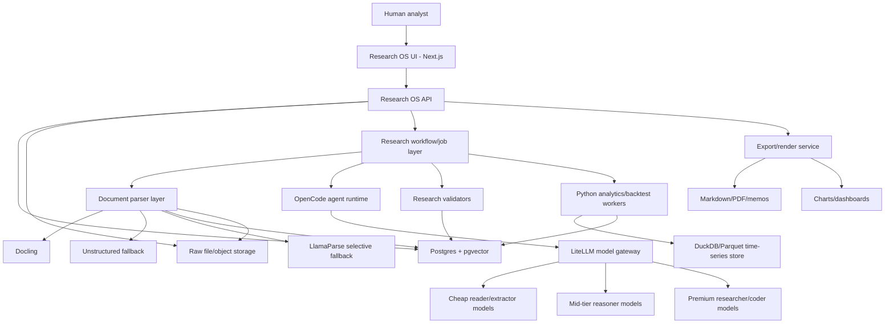

# Research OS Architecture

Date: 2026-07-03
Status: Proposed working architecture

> **Current-state documentation:** this is the original July 2026 target-state proposal. For the system as built, see
> [docs/system.md](docs/system.md), [docs/architecture.md](docs/architecture.md) (master UML views) and
> [docs/security.md](docs/security.md).
Scope: Investment research application, research data model, AI agent orchestration, source ingestion, valuation workflows, and export strategy

## 1. Product Definition

Research OS is a private investment research operating system. Its job is to turn source material into evidence, evidence into structured research, structured research into asset-specific valuation/thesis/backtest outputs, and those outputs into reviewable investment decisions.

The system is not a trading bot, stock screener, or generic AI chat app. It is an analyst workspace and research production system.

Core product statement:

```text
Raw files are evidence.
Database records are truth.
Agents produce proposals.
Validators decide what is accepted.
Markdown, PDF, charts, and dashboards are renderings.
```

## 2. Current Repository Context

The current repository already contains:

- A Next.js research viewer in `app/`.
- Research folders under `research/`.
- Markdown research templates.
- Valuation playbooks.
- Source intelligence templates.
- Python scripts for valuation, indicators, data loading, and backtesting.
- A `research_queue.md` operating queue.

The existing structure is useful, but Markdown folders should not remain the system of record. Markdown is too weak for structured financial research because it is difficult to query, validate, version, deduplicate, link to source evidence, and enforce asset-specific rules.

The future architecture should preserve the current folder system as an import/export compatibility layer while moving the authoritative state into a database.

## 3. Architectural Principles

### 3.1 Deterministic Core, Probabilistic Workers

The application should be deterministic where correctness matters:

- Workflow state.
- Asset classification.
- Valuation method eligibility.
- Source provenance.
- Completion criteria.
- Data validation.
- Cost budgets.
- Job retries.
- Human approval gates.

AI agents are allowed to read, extract, propose, synthesize, and code, but they should not be the authority on whether a research run is complete or valid.

### 3.2 Database First

The database is the source of truth.

Markdown, PDF, static charts, dashboard views, and exported memos should be generated from database records and raw evidence. They are not authoritative state.

### 3.3 Evidence First

No generated thesis, valuation signal, risk, or recommendation should exist without a traceable evidence chain.

Required chain:

```text
conclusion -> claim -> source document -> document chunk/page/table -> extraction method -> confidence
```

### 3.4 Asset Profiles Drive Research

The application must not use one generic equity research schema for every asset.

Different assets need different structured modules:

- Bitcoin does not get a DCF.
- Spot commodities do not get operating company DCFs.
- Banks do not default to EV/EBITDA.
- REITs need NAV, AFFO, cap rates, debt maturity, and occupancy.
- Holding companies need NAV, SOTP, look-through exposure, and discount analysis.

Asset-specific research profiles must define required modules, optional modules, forbidden methods, required valuation lenses, and completion criteria.

### 3.5 Cost Is A Product Feature

The app is being designed specifically to avoid using expensive models for every step.

Cheap models should handle extraction, section classification, table labeling, and first-pass summaries. Premium models should be reserved for hard judgment, valuation reasoning, code generation, final synthesis, and review.

### 3.6 Human Review Remains First Class

The system can produce research, but final investment conclusions require human review. The app should make it easy to approve, reject, edit, and annotate AI-generated work.

## 4. High-Level System Architecture



## 5. Core Components

### 5.1 Research OS UI

Recommended technology:

- Next.js
- React
- TypeScript
- Existing app in `app/` as the starting point

Responsibilities:

- Research library.
- Asset workspace.
- Evidence browser.
- Source document browser.
- Valuation dashboard.
- Thesis and risk review.
- Backtest results.
- Agent run monitor.
- Human review notes.
- Export controls.

The UI should not directly parse Markdown as the primary data source in the future. It should query API/database-backed records.

### 5.2 Research OS API

Recommended implementation:

- Continue using Next.js route handlers for lightweight UI-facing routes.
- Add a Python FastAPI service or worker interface for research-heavy jobs if needed.

Responsibilities:

- CRUD for assets, research runs, review decisions, notes, and exports.
- Trigger research runs and refresh jobs.
- Read workflow state.
- Expose query endpoints for evidence, metrics, claims, valuation signals, and backtests.
- Provide stable contracts to the UI.
- Call OpenCode server/SDK for bounded agent execution.
- Call document parser services.
- Call Python analytics/backtest workers.

### 5.3 Database

Recommended technology:

- PostgreSQL as primary database.
- pgvector for embeddings and semantic retrieval.
- Postgres full-text search for keyword retrieval.
- Hybrid search using vector similarity plus full-text and metadata filters.

Why:

- Investment research needs structured querying, not just semantic search.
- Search must filter by source type, asset, ticker, period, filing date, document type, confidence, and research run.
- Postgres supports relational data, JSONB asset modules, full-text search, and vector search in one system.

### 5.4 Raw File/Object Storage

Responsibilities:

- Preserve immutable raw source files.
- Store PDFs, filings, investor presentations, transcripts, HTML captures, images, charts, and generated files.
- Use content hashes for deduplication.
- Store parse outputs separately from raw inputs.

Initial implementation can use the local filesystem. Later this can move to S3-compatible storage.

### 5.5 Document Parser Layer

Recommended first parser:

- Docling

Fallbacks:

- Unstructured for alternative partitioning/table extraction paths.
- LlamaParse only for hard scanned/table-heavy documents where open-source parsing is insufficient.

Responsibilities:

- Convert raw source files into structured document representations.
- Extract text, tables, document hierarchy, page references, and provenance.
- Preserve parse confidence and parser version.
- Store raw text chunks, tables, metadata, and parse artifacts.

AI models may help label sections or repair messy tables, but deterministic parsers should be used first.

### 5.6 OpenCode Agent Runtime

Decision:

OpenCode should be integrated as the agent execution backend, not used as the sole domain backend.

OpenCode is suitable because it provides:

- Headless server.
- SDK.
- Agents and subagents.
- Model overrides.
- Structured JSON output.
- Permissions.
- Custom tools.
- MCP support.
- Repo-aware coding capabilities.

OpenCode should execute bounded agent tasks. Research OS should still own domain state, database records, workflow progress, validators, and completion criteria.

Example architecture:

```text
Research OS workflow creates task
  -> calls OpenCode server/SDK
  -> selects agent and model tier
  -> requests structured output
  -> receives proposed result
  -> validates result
  -> writes accepted records to Postgres
```

Recommended OpenCode agent types:

- `source-reader`
- `evidence-extractor`
- `table-normalizer`
- `asset-classifier`
- `valuation-coder`
- `financial-modeling-agent`
- `backtest-coder`
- `research-reviewer`
- `export-writer`

OpenCode should be run with explicit permissions. Bash/edit/file access should be restricted by agent role.

### 5.7 Model Gateway

Recommended technology:

- LiteLLM proxy/gateway

Responsibilities:

- Route model calls across providers.
- Track spend by research run, stage, agent, and user/project.
- Enforce budgets.
- Provide fallback providers/models.
- Support cheap/mid/premium model tiers.
- Avoid hardcoding provider-specific APIs throughout the app.

Model tiers:

```text
cheap_reader:
  - source chunk summaries
  - section classification
  - table labeling
  - metadata extraction
  - rough claim extraction

mid_reasoner:
  - evidence clustering
  - contradiction detection
  - source quality scoring
  - metric mapping
  - asset classification checks

premium_researcher:
  - thesis judgment
  - DCF/NAV/SOTP/scenario reasoning
  - code generation
  - final review
  - abnormality analysis
```

Every premium call should have an escalation reason.

### 5.8 Python Analytics And Backtest Workers

Recommended technology:

- Python
- pandas
- numpy
- yfinance and other data clients
- DuckDB and/or Parquet for large time-series and matrix outputs

Responsibilities:

- Market data ingestion.
- Fundamental data processing.
- Indicator generation.
- Valuation model execution.
- Backtest execution.
- Chart generation.
- Export of structured results to Postgres and large time-series artifacts to Parquet/DuckDB.

Python remains the right environment for financial modeling and time-series work.

### 5.9 Export/Rendering Layer

Exports should be generated from database records and source links.

Supported exports:

- Markdown research memo.
- PDF review packet.
- Static chart bundle.
- CSV/Parquet data package.
- App dashboard views.

Markdown is no longer truth. It is a rendering target.

## 6. System Of Record

### 6.1 Source Of Truth Rules

| Data type | System of record |
| --- | --- |
| Raw filings/PDFs/transcripts | Raw file/object storage |
| Parsed text/chunks/tables | Postgres plus file artifacts |
| Evidence claims | Postgres |
| Metric observations | Postgres or Parquet/DuckDB for large time series, indexed in Postgres |
| Valuation signals | Postgres |
| Backtest summary results | Postgres |
| Backtest large outputs | Parquet/DuckDB with Postgres metadata |
| Human notes and review state | Postgres |
| Markdown/PDF memos | Generated exports |

### 6.2 Immutable Raw Evidence

Raw source files should never be overwritten.

Each raw source file should have:

- Content hash.
- Source URL or local origin.
- Retrieval timestamp.
- Publication date if known.
- Filing/report period if known.
- Source type.
- Asset/entity association.
- Storage path.
- Ingestion status.

### 6.3 Parsed Data Can Be Versioned

Parsed data may be regenerated with better tools, but old parse versions should remain explainable.

Each parse output should have:

- Parser name.
- Parser version.
- Parse configuration.
- Parse timestamp.
- Source document hash.
- Parse confidence.
- Error/warning log.

## 7. Domain Data Model

This is the proposed core model. Exact schema can be refined later.

### 7.1 Asset And Identity

`Asset`

- `id`
- `canonical_name`
- `asset_type`
- `primary_research_profile_id`
- `country`
- `currency`
- `sector`
- `industry`
- `created_at`
- `updated_at`

`Ticker`

- `id`
- `asset_id`
- `symbol`
- `exchange`
- `currency`
- `listing_type`
- `active_from`
- `active_to`
- `is_primary`
- `notes`

Reason:

Ticker is not the same as asset. Companies can have multiple share classes, listings, ADRs, ticker changes, and delistings.

### 7.2 Research Workflow

`ResearchRun`

- `id`
- `asset_id`
- `run_type`
- `status`
- `started_at`
- `completed_at`
- `requested_by`
- `research_question`
- `profile_version`
- `budget_limit_usd`
- `actual_cost_usd`
- `source_cutoff_at`
- `market_data_cutoff_at`
- `notes`

`ResearchStage`

- `id`
- `research_run_id`
- `stage_name`
- `status`
- `started_at`
- `completed_at`
- `completion_criteria_json`
- `validation_result_json`
- `failure_reason`

`ResearchTask`

- `id`
- `research_run_id`
- `stage_id`
- `task_type`
- `agent_name`
- `status`
- `input_json`
- `output_json`
- `validation_status`
- `retry_count`
- `cost_usd`
- `created_at`
- `completed_at`

### 7.3 Source And Evidence

`SourceDocument`

- `id`
- `asset_id`
- `research_run_id`
- `source_type`
- `title`
- `publisher`
- `url`
- `retrieved_at`
- `published_at`
- `period_start`
- `period_end`
- `file_hash`
- `storage_path`
- `language`
- `confidence`

`DocumentParse`

- `id`
- `source_document_id`
- `parser_name`
- `parser_version`
- `parse_config_json`
- `created_at`
- `status`
- `warnings_json`

`DocumentChunk`

- `id`
- `source_document_id`
- `document_parse_id`
- `chunk_index`
- `section_title`
- `page_start`
- `page_end`
- `text`
- `token_count`
- `embedding`
- `metadata_json`

`ExtractedTable`

- `id`
- `source_document_id`
- `document_parse_id`
- `page_start`
- `page_end`
- `table_title`
- `table_json`
- `table_csv_path`
- `confidence`
- `metadata_json`

`EvidenceClaim`

- `id`
- `asset_id`
- `research_run_id`
- `claim_text`
- `claim_type`
- `fact_estimate_assumption_opinion`
- `source_document_id`
- `document_chunk_id`
- `extracted_table_id`
- `period_start`
- `period_end`
- `confidence`
- `generated_by`
- `review_status`
- `metadata_json`

Key rule:

No claim should be accepted without source linkage or an explicit reason for why it is unsourced.

### 7.4 Metrics And Valuation

`MetricObservation`

- `id`
- `asset_id`
- `research_run_id`
- `metric_name`
- `metric_category`
- `period_start`
- `period_end`
- `as_of_date`
- `value`
- `unit`
- `currency`
- `source_document_id`
- `evidence_claim_id`
- `confidence`
- `metadata_json`

`ValuationSignal`

- `id`
- `asset_id`
- `research_run_id`
- `research_profile_id`
- `lens_family`
- `indicator_name`
- `current_value`
- `comparison_range`
- `percentile`
- `z_score`
- `cheaper_when`
- `signal`
- `cheapness_score`
- `confidence`
- `source_document_id`
- `evidence_claim_id`
- `metadata_json`

`Scenario`

- `id`
- `asset_id`
- `research_run_id`
- `scenario_name`
- `scenario_type`
- `value_anchor`
- `probability`
- `time_horizon`
- `assumptions_json`
- `supporting_claim_ids`
- `confidence`

### 7.5 Thesis, Risks, And Review

`Thesis`

- `id`
- `asset_id`
- `research_run_id`
- `one_sentence_thesis`
- `why_now`
- `market_missing`
- `supporting_claim_ids`
- `status`
- `created_by`
- `reviewed_by`

`ThesisDriver`

- `id`
- `thesis_id`
- `driver_name`
- `driver_type`
- `evidence_claim_ids`
- `value_impact`
- `confidence`

`Risk`

- `id`
- `asset_id`
- `research_run_id`
- `risk_name`
- `risk_type`
- `severity`
- `probability`
- `evidence_claim_ids`
- `mitigants_json`
- `what_would_confirm`

`ReviewDecision`

- `id`
- `asset_id`
- `research_run_id`
- `status`
- `conviction`
- `priority`
- `watchlist_reason`
- `position_sizing_note`
- `what_would_change_mind`
- `open_questions`
- `reviewed_by`
- `reviewed_at`

### 7.6 Backtests

`BacktestRun`

- `id`
- `asset_id`
- `research_run_id`
- `strategy_name`
- `strategy_definition_json`
- `data_cutoff_at`
- `code_version`
- `status`
- `summary_metrics_json`
- `output_path`
- `created_at`

Large backtest outputs should be stored in Parquet/DuckDB and indexed in Postgres.

### 7.7 Model And Agent Logs

`ModelCallLog`

- `id`
- `research_run_id`
- `stage_id`
- `task_id`
- `agent_name`
- `model_provider`
- `model_name`
- `model_tier`
- `prompt_version`
- `input_tokens`
- `output_tokens`
- `cost_usd`
- `latency_ms`
- `status`
- `error_message`
- `created_at`
- `metadata_json`

`AgentTrace`

- `id`
- `research_run_id`
- `task_id`
- `agent_name`
- `tool_name`
- `tool_input_json`
- `tool_output_json`
- `status`
- `created_at`

## 8. Asset Research Profiles

Research profiles define asset-specific required outputs, allowed methods, forbidden methods, valuation lenses, and completion criteria.

### 8.1 Common Profile Fields

`AssetResearchProfile`

- `id`
- `name`
- `version`
- `asset_types`
- `required_modules_json`
- `optional_modules_json`
- `forbidden_methods_json`
- `required_valuation_lenses_json`
- `required_scenario_drivers_json`
- `completion_criteria_json`
- `validator_config_json`

### 8.2 Universal Structured Objects

These apply across asset types:

- Asset profile.
- Source document.
- Evidence claim.
- Metric observation.
- Valuation signal.
- Thesis driver.
- Risk.
- Catalyst.
- Scenario.
- Backtest result.
- Research task state.
- Review decision.

### 8.3 Operating Company Profile

Required modules:

- Business segments.
- Revenue drivers.
- Unit economics where relevant.
- Margins.
- ROIC.
- Free cash flow.
- Capex.
- Working capital.
- Net debt.
- Share count.
- Driver-based DCF when applicable.
- Exit multiple DCF.
- Reverse DCF.

Forbidden/default warnings:

- Do not use generic revenue growth if volume, price, mix, units, stores, customers, or utilization can be modeled.
- Do not call a company cheap only because one multiple is low.

### 8.4 Financials Profile

Required modules:

- Tangible book value.
- P/B and P/TBV.
- ROE versus cost of equity.
- ROA.
- Net interest margin.
- Credit losses.
- NPA ratio.
- CET1 or capital surplus.
- Deposit/funding mix.
- Book value growth.
- Buyback capacity.

Forbidden/default warnings:

- Do not use EV/EBITDA for banks.
- Do not treat all debt as ordinary net debt.

### 8.5 REIT / Infrastructure Profile

Required modules:

- NAV.
- Price/NAV.
- Implied cap rate.
- Cap-rate spread.
- FFO/AFFO.
- Dividend coverage.
- Occupancy/utilization.
- Same-property NOI or equivalent operating growth.
- Debt maturity wall.
- Refinancing sensitivity.
- Rate sensitivity.

### 8.6 Holding Company / SOTP Profile

Required modules:

- Listed holdings.
- Private holdings.
- Cash.
- Debt.
- Tax leakage.
- Gross asset value.
- Net asset value.
- NAV discount.
- Look-through multiples.
- Buyback accretion.
- Capital allocation track record.

### 8.7 Bitcoin Profile

Required modules:

- MVRV / realized value.
- Realized price.
- Drawdown from cycle high.
- Network value / transaction value where useful.
- Hash rate.
- Security budget.
- ETF/fund flows.
- Stablecoin or liquidity cycle.
- BTC dominance.
- BTC/gold or BTC/risk asset relative value.
- Regulatory regime.

Forbidden methods:

- No DCF for Bitcoin.

Scenario drivers:

- Adoption.
- Liquidity cycle.
- Institutional flows.
- Regulation.
- Cycle position.
- Store-of-value competition.
- Network security.

### 8.8 Ethereum / Fee-Generating Protocol Profile

Required modules:

- Market cap / fees.
- Staking yield.
- Issuance/burn.
- Active users.
- Transaction activity.
- Developer activity.
- TVL quality.
- L2 value leakage.
- Protocol revenue capture.
- ETH/BTC relative value.
- Regulatory/staking risk.

Warning:

- Still not a normal DCF unless token holders have a credible claim on distributable economics.

### 8.9 Energy Commodity Profile

Required modules:

- Real price percentile.
- Inventories.
- Days of supply.
- Futures curve.
- Roll yield.
- Marginal cost.
- Spare capacity.
- OPEC/producer discipline.
- Rig count or supply response.
- Demand growth.
- Geopolitical supply risk.

Forbidden methods:

- No equity-style DCF for the commodity itself.
- DCF applies to producers, not spot commodity prices.

### 8.10 Industrial Commodity Profile

Required modules:

- Real price percentile.
- Inventory days.
- Exchange inventories.
- Capacity utilization.
- Price versus marginal cost.
- China/regional demand impulse.
- PMI or industrial production linkage.
- Producer spreads.
- Capacity additions.
- Input economics.
- Trade policy.

### 8.11 Agriculture Commodity Profile

Required modules:

- Stock-to-use.
- Weather/yield deviation.
- Acreage.
- Inventory range.
- Export flows.
- Substitute spreads.
- Biofuel economics.
- Fertilizer/input costs.
- Futures curve.
- Seasonality.
- Exporter FX.
- Policy restrictions.

### 8.12 Precious Metals Profile

Required modules:

- Gold/M2 or broad money.
- Gold/world GDP.
- Real rates.
- USD trend.
- Central-bank purchases.
- ETF holdings.
- Futures positioning.
- Drawdown.
- Real gold price percentile.
- Gold/silver ratio.
- AISC spread for miners where relevant.

Forbidden methods:

- No DCF for spot gold or silver.
- Miners can use operating company/mining valuation lenses.

### 8.13 ETF / Index / Fund Profile

Required modules:

- Aggregate P/E.
- CAPE where relevant.
- Price/book.
- Earnings yield versus bonds.
- Dividend yield.
- Buyback yield.
- Sector concentration.
- Top-10 concentration.
- Fund flows.
- Expense ratio.
- Tracking error.
- NAV discount/premium for closed-end funds.

### 8.14 Private / Special Situation Profile

Required modules:

- Last transaction value.
- Carrying value.
- Liquidation value.
- Collateral coverage.
- Debt/asset value.
- Funding gap.
- Dilution risk.
- Catalyst date.
- Probability-weighted value.
- Annualized expected return.
- Deal spread/break spread where relevant.
- Legal/regulatory outcome.

## 9. Research Workflow

The research workflow should be a finite state machine, not an open-ended chat loop.

Proposed stages:

```text
1. Intake
2. Asset identity and research profile selection
3. Source discovery
4. Source ingestion
5. Document parsing
6. Evidence extraction
7. Metric normalization
8. Business/asset/industry analysis
9. Asset-specific valuation
10. Thesis and risk synthesis
11. Indicator design
12. Backtest design and execution
13. Reviewer checks
14. Human review
15. Export/render
16. Refresh schedule
```

Each stage should define:

- Entry criteria.
- Required outputs.
- Allowed model tiers.
- Agent roles.
- Max retries.
- Max cost.
- Completion criteria.
- Validation rules.
- Failure state.
- Human approval requirement, if any.

### 9.1 Completion Is Validator-Driven

A stage is complete only when required outputs pass validation.

Example: Source discovery complete requires:

- Source inventory.
- At least one high-quality primary source when available.
- Failed source attempts logged.
- Source quality scores.
- Known gaps.
- Refresh schedule.

Example: Bitcoin valuation complete requires:

- Crypto profile selected.
- DCF marked not applicable with reason.
- Required crypto/network/liquidity valuation signals attempted.
- Fewer than target signals only allowed with explicit data limitation.
- Scenario drivers tied to adoption, liquidity, regulation, cycle, and security.

### 9.2 Staging Before Commit

AI outputs should not write directly into final tables.

Flow:

```text
agent output -> staging record -> schema validation -> source validation -> accepted/rejected -> final table
```

This protects the research database from malformed, unsourced, or asset-inappropriate outputs.

## 10. OpenCode Integration Design

### 10.1 Role Of OpenCode

OpenCode is the agent runtime. Research OS is the domain workflow and database system.

OpenCode should handle:

- Agent sessions.
- Tool execution.
- Repo-aware coding.
- Subagents.
- Structured JSON outputs.
- File-aware analysis.
- Controlled code generation.

Research OS should handle:

- Research run state.
- Asset profile selection.
- Source/evidence data model.
- Stage validation.
- Cost/call attribution.
- Review decisions.
- Database writes.
- Export generation.

### 10.2 OpenCode Call Pattern

```text
ResearchTask created in Postgres
  -> Research OS API calls OpenCode server/SDK
  -> agent selected by task type
  -> model tier selected through config/LiteLLM
  -> structured output schema supplied
  -> OpenCode returns result
  -> Research OS validates schema and evidence links
  -> accepted result is committed
  -> task/stage state is updated
```

### 10.3 Suggested OpenCode Agents

`source-reader`

- Purpose: Read parsed document chunks and extract candidate evidence.
- Permissions: read only, no bash, no edit.
- Model tier: cheap or mid.
- Output: structured `EvidenceClaim[]`.

`table-normalizer`

- Purpose: Turn extracted tables into normalized rows/metrics.
- Permissions: read only, no bash, no edit.
- Model tier: cheap or mid.
- Output: metric candidates, table mapping, confidence.

`asset-classifier`

- Purpose: Select or challenge asset research profile.
- Permissions: read only.
- Model tier: mid.
- Output: profile recommendation and rejected profiles.

`valuation-coder`

- Purpose: Write or modify valuation model code.
- Permissions: scoped read/edit/bash in sandbox.
- Model tier: premium.
- Output: code changes plus test/validation result.

`backtest-coder`

- Purpose: Write or modify backtest/indicator code.
- Permissions: scoped read/edit/bash in sandbox.
- Model tier: premium.
- Output: code changes plus run summary.

`research-reviewer`

- Purpose: Check completeness, contradictions, source gaps, and category errors.
- Permissions: read only.
- Model tier: premium only when needed.
- Output: review findings and pass/fail.

### 10.4 OpenCode Permissions

Default posture:

- Reader/extractor agents: no edit, no bash.
- Coder agents: edit and bash only inside a constrained workspace.
- Reviewer agents: read only.
- Dangerous actions: require approval or blocked.

Agents should never have broad access to secrets, personal files, brokerage credentials, browser tokens, or unrelated directories.

## 11. Model Routing And Cost Controls

### 11.1 LiteLLM As Gateway

LiteLLM should sit between agent/runtime code and model providers.

Responsibilities:

- Unified model interface.
- Provider fallback.
- Budget tracking.
- Spend tracking.
- Model tier routing.
- Request tagging by run/stage/agent.

### 11.2 Budget Dimensions

Track budgets by:

- Research run.
- Research stage.
- Agent.
- Model tier.
- User/project.
- Calendar period.

Required fields:

```text
research_run_id
stage_name
agent_name
model_tier
model_name
input_tokens
output_tokens
cost_usd
latency_ms
escalation_reason
```

### 11.3 Premium Escalation Policy

Premium model use should require a reason:

- Final thesis synthesis.
- Valuation judgment.
- Code generation.
- Contradiction review.
- High-impact uncertainty.
- Failed lower-tier attempts.

## 12. Retrieval And Research Memory

The system should use hybrid retrieval:

- Full-text search for exact terms, tickers, table labels, source titles, and filings.
- Vector search for semantic similarity.
- Metadata filters for source type, asset, period, publication date, confidence, and stage.

Retrieval should support questions such as:

```text
Find official 2025 revenue segment disclosures for Ferrari.
Find all claims about margin pressure sourced from filings only.
Find tables related to debt maturity.
Find CATL battery capacity commentary from annual reports.
Show all Bitcoin valuation signals with high confidence.
```

## 13. Point-In-Time And Financial Data Rules

The system must avoid look-ahead bias.

Every observation should track:

- Period covered.
- Publication date.
- Retrieval date.
- Effective/as-of date.
- Market data cutoff.
- Whether data was revised later.

Backtests and valuation snapshots must only use information available as of the modeled date.

## 14. Versioning Rules

Version all important moving parts:

- Source document hash.
- Parser version.
- Parse config.
- Prompt version.
- Model version.
- Research profile version.
- Valuation schema version.
- Backtest code version.
- Data provider/version.
- Export template version.

Reason:

Old research must remain explainable even when prompts, models, parsers, or asset profiles improve.

## 15. Facts, Estimates, Assumptions, And Opinions

All claims should be labeled as one of:

- Fact.
- Estimate.
- Assumption.
- Opinion.

Examples:

```text
Fact: FY2025 revenue was X.
Estimate: normalized operating margin could be Y.
Assumption: terminal growth is Z.
Opinion: management quality is improving.
```

This distinction is mandatory because investment research becomes unreliable when these categories are mixed.

## 16. Human Review Data

Human notes should be first-class structured data.

Recommended review fields:

- Status.
- Conviction.
- Priority.
- Watchlist reason.
- Position sizing note.
- What would change my mind.
- Open questions.
- Last reviewed at.
- Reviewed by.
- Follow-up date.

Human review should be linked to the research run and asset profile version.

## 17. Security And Sandbox

### 17.1 Agent Sandbox

Agents that can run code should execute in a constrained workspace.

Requirements:

- No access to unrelated filesystem paths.
- No access to secrets by default.
- No broad environment variable exposure.
- Network access scoped where possible.
- Bash commands logged.
- File writes logged.
- Human approval for risky commands.

### 17.2 Secrets

Secrets should never be available to reader agents.

Examples:

- Brokerage credentials.
- Personal cloud credentials.
- Browser tokens.
- API keys unrelated to the task.
- Full system environment.

### 17.3 Prompt Injection

Source documents may contain hostile text. Agents must treat document contents as untrusted data, not instructions.

Mitigations:

- Separate system/developer instructions from source content.
- Use structured extraction schemas.
- Limit tool access for source-reading agents.
- Validate outputs against source references.

## 18. Observability

Every research run should be traceable.

Log:

- Stage transitions.
- Agent calls.
- Model calls.
- Tool calls.
- Parser calls.
- Validation results.
- Retries.
- Costs.
- Latency.
- File reads/writes.
- Human review actions.

Recommended tools:

- Langfuse or similar for LLM traces and prompt/cost tracking.
- Postgres `ModelCallLog` and `AgentTrace` for durable local audit.
- Structured application logs with correlation IDs.

## 19. API Surface Sketch

Initial API resources:

```text
GET    /api/assets
POST   /api/assets
GET    /api/assets/:id
GET    /api/assets/:id/research-runs
POST   /api/assets/:id/research-runs

GET    /api/research-runs/:id
GET    /api/research-runs/:id/stages
POST   /api/research-runs/:id/tasks
POST   /api/research-runs/:id/refresh

GET    /api/research-runs/:id/sources
POST   /api/research-runs/:id/sources/ingest
GET    /api/sources/:id

GET    /api/research-runs/:id/evidence
PATCH  /api/evidence/:id/review

GET    /api/research-runs/:id/metrics
GET    /api/research-runs/:id/valuation-signals
GET    /api/research-runs/:id/scenarios

GET    /api/research-runs/:id/thesis
PATCH  /api/thesis/:id
GET    /api/research-runs/:id/risks

GET    /api/research-runs/:id/backtests
GET    /api/backtests/:id/artifacts

GET    /api/research-runs/:id/model-calls
GET    /api/research-runs/:id/agent-traces

POST   /api/research-runs/:id/export
```

## 20. Migration Strategy From Current Repository

### Phase 1: Import Existing Research

- Keep current folders.
- Create import scripts for existing research folders.
- Parse Markdown and CSVs into provisional database records.
- Mark imported claims as lower confidence unless source-linked.
- Preserve file paths as source artifacts.

### Phase 2: Database-Backed App Read Model

- Change Next.js app to read summaries from Postgres.
- Keep Markdown rendering as compatibility fallback.
- Add asset, research run, source, evidence, and valuation-signal views.

### Phase 3: New Research Runs Use Database First

- New research runs write to Postgres.
- Markdown files generated only at export time.
- Research queue becomes database-backed.

### Phase 4: Agent Pipeline Integration

- Start OpenCode server integration.
- Add one agent at a time.
- First prototype: `source-reader` returns strict `EvidenceClaim[]`.
- Then add `table-normalizer`.
- Then add `valuation-coder` and `backtest-coder`.

### Phase 5: Full Research Workflow

- Implement stage validators.
- Implement cost budgets.
- Implement asset profile enforcement.
- Implement human review gates.
- Generate final Markdown/PDF memos from database state.

## 21. Architecture Decisions So Far

### ADR-001: Database Is Source Of Truth

Status: Proposed

Decision:

Use Postgres-backed structured records as the system of record. Markdown/PDF are generated outputs.

Rationale:

- Research data must be queryable, validated, versioned, and source-linked.
- Markdown cannot reliably enforce asset-specific schemas.
- The app needs durable state for research runs, stages, evidence, metrics, and review decisions.

Trade-offs:

- More upfront schema work.
- Existing Markdown folders require migration/import.

Mitigation:

- Keep Markdown export compatibility.
- Import existing folders gradually.

### ADR-002: OpenCode As Agent Runtime, Not Domain Backend

Status: Proposed

Decision:

Integrate with OpenCode server/SDK for agent execution, structured output, repo-aware coding, and tool use. Keep Research OS responsible for domain workflow, database, and validation.

Rationale:

- OpenCode is open source and has useful agent/runtime capabilities.
- Research OS has investment-specific state that does not belong only in an agent session.
- Domain validation must survive changes in agent prompts/models.

Trade-offs:

- Requires integration layer between Research OS and OpenCode.
- Some orchestration functionality may overlap.

Mitigation:

- Start with one bounded OpenCode agent prototype.
- Expand only after structured output, permissions, retries, and traces are proven.

### ADR-003: Asset Profiles Enforce Valuation Logic

Status: Proposed

Decision:

Represent asset-specific research logic as versioned `AssetResearchProfile` records.

Rationale:

- Bitcoin, commodities, banks, REITs, ETFs, holding companies, and operating companies require different valuation matrices.
- The app must prevent category mistakes, such as DCF for Bitcoin.

Trade-offs:

- More schema and validator complexity.

Mitigation:

- Start with a small number of profiles and expand.
- Use JSONB profile config before over-normalizing.

### ADR-004: LiteLLM For Model Gateway

Status: Proposed

Decision:

Use LiteLLM as the model gateway for provider abstraction, budgets, spend tracking, and model tier routing.

Rationale:

- The project explicitly needs cheap reader models and premium researcher models.
- Model providers and model names will change.
- Cost visibility is a product requirement.

Trade-offs:

- Adds one more infrastructure component.

Mitigation:

- Keep direct provider calls possible behind an adapter if LiteLLM is not available.

### ADR-005: Docling First For Document Parsing

Status: Proposed

Decision:

Use Docling as the first parser for PDFs, office documents, HTML, and table-aware document conversion. Use Unstructured as fallback. Use LlamaParse selectively for hard documents.

Rationale:

- Deterministic parsing should happen before LLM interpretation.
- Docling provides structured document representation and provenance-oriented parsing.
- LlamaParse may be useful but should not be the default cost path.

Trade-offs:

- Parser quality will vary across filings and scanned documents.

Mitigation:

- Store parser version/config.
- Preserve raw source files.
- Allow reparse with better tooling later.

### ADR-006: Hybrid Search Instead Of Vector-Only Search

Status: Proposed

Decision:

Use Postgres full-text search plus pgvector and metadata filters.

Rationale:

- Finance queries often need exact source names, tickers, periods, line items, and table labels.
- Semantic search alone can miss exact matches.

Trade-offs:

- Ranking logic is more complex.

Mitigation:

- Start simple with separate keyword/vector results and merge later.

## 22. Risks And Mitigations

| Risk | Impact | Mitigation |
| --- | --- | --- |
| Agents produce plausible but unsupported claims | Bad research | Enforce source-linked evidence and staging validation |
| Expensive model costs grow unexpectedly | Budget blowout | LiteLLM budgets, model call logs, stage caps |
| Wrong asset valuation method is applied | Invalid conclusions | Asset profiles and forbidden method validators |
| OpenCode permissions too broad | Security risk | Role-based permissions and sandboxed workspaces |
| Markdown migration is messy | Data quality issues | Import as provisional records with confidence flags |
| Parser errors corrupt tables | Bad metrics | Raw file preservation, parser versioning, table confidence |
| Backtests use future data | False strategy quality | Point-in-time fields and market data cutoff enforcement |
| Data revisions hide old assumptions | Irreproducible research | Store versions and as-of timestamps |

## 23. Consolidated Engineering Handoff

This section consolidates the decisions made after the first architecture draft. It also folds the database design from `database_design.md` into this file so an engineer can treat `architecture.md` as the authoritative implementation handoff.

The core agreed design is:

```text
Research OS is a research application, not a chatbot.
The database is the source of truth.
Raw files are immutable evidence.
Markdown, PDF, dashboards, and memos are generated/exported views.
Agents are controlled workers that propose structured outputs.
Validators and human review decide what becomes accepted research.
Asset profiles decide what methods are valid for each asset.
The workflow must be finite, validator-driven, and able to finish.
```

### 23.1 Decisions Agreed So Far

Product:

- Build an actual research app for structured and unstructured investment research.
- Optimize for deep research across different companies, industries, sectors, and asset classes.
- Do not force all assets into one valuation framework.
- Use asset profiles so Bitcoin, commodities, financials, REITs, operating companies, funds, and special situations each get appropriate research methods.

Source of truth:

- Postgres is the canonical source of truth for structured research, workflow state, evidence, metrics, valuation signals, reviews, agent tasks, and cost logs.
- Raw source files are stored separately as immutable evidence with hashes.
- Markdown files are not the canonical data layer.
- Markdown, PDF, memo, dashboard, CSV, and report outputs are generated artifacts from database records and source files.

AI architecture:

- The AI system should use a deterministic orchestrator plus specialist agents.
- Cheap or mid-tier models should do reading, extraction, parsing, formatting, chunk summarization, and simple classification.
- Premium models should be reserved for complex reasoning, code generation, valuation judgment, contradiction review, final thesis synthesis, and difficult visual interpretation.
- OpenCode should be used as an agent execution/runtime layer, not as the domain backend.
- LiteLLM should be used as the model gateway for routing, budgets, spend tracking, fallbacks, and model/provider abstraction.

Workflow:

- Research runs should be finite-state workflows, not open-ended chat sessions.
- A stage is complete only when required outputs pass validation, or when missing outputs are explicitly recorded as acceptable source gaps.
- Research run types and asset profiles together define what "done" means.
- The system should support quick scans, deep dives, valuation refreshes, source updates, thesis-specific investigations, backtest-only runs, and full initiation reports.

Human review:

- Human review is the approval layer where AI output becomes accepted research.
- The user should not have to review every extracted sentence.
- The user should review important claims, valuation assumptions, profile choices, source gaps, final thesis packets, and decisions.
- Review actions should include accept, reject, edit, mark as assumption, request more evidence, and escalate to a smarter model.

Research UI:

- The asset research page should be simple and centered around two primary actions:
  - Run Research.
  - View Research.
- Run Research should open a focused ChatGPT-like intake screen with no sidebar, just the conversation area, text input, and attachment/link controls.
- The AI should understand the user's research intent first, then propose a structured research run plan before launching the pipeline.
- View Research should be an archive similar to a research-focused Google Drive: folders, uncategorized artifacts, card view, list view, sorting, filtering, and search.
- View Research should include a side chatbot that can interact with the selected folder/artifact/research run.

MVP:

- Build one complete vertical slice instead of the whole universe.
- Prove one operating company workflow where DCF/reverse DCF is appropriate.
- Prove one non-DCF workflow, ideally Bitcoin or a commodity, where DCF is explicitly rejected and asset-specific cheapness signals are required.

## 24. Final Product UX Design

### 24.1 Asset Research Page

The asset research page should not begin as a tab-heavy dashboard. It should start as a clear decision point:

```text
[ Run Research ]    [ View Research ]
```

This gives the user a simple mental model:

- Run Research means start, continue, or update an AI-led research process.
- View Research means browse saved outputs, artifacts, source packs, notes, valuation dashboards, and prior runs.

The page can still show small context around the two buttons:

- Asset name.
- Primary ticker/listing where applicable.
- Asset profile.
- Last research date.
- Current status.
- Latest review decision.
- Open source gaps.

But the primary interaction should remain the two large actions.

### 24.2 Run Research UX

Run Research opens a focused AI intake surface.

Required UI elements:

- Main conversation area.
- Text input.
- File attachment button.
- Link/source attachment control.
- Optional ticker/asset context control.
- Optional run type selector if the user wants manual control.
- No left sidebar.

The screen should feel like a research command center, not a generic chat product. The AI's first job is to understand the research instruction.

Example user prompts:

```text
Research Ferrari as a long-term compounder.
Update my Bitcoin valuation using the latest on-chain and ETF flow data.
Read these annual reports and extract the margin story.
Build a DCF for this company and compare it with reverse DCF expectations.
Research palm oil and tell me whether the commodity looks cheap using stock-to-use and supply/demand data.
```

The AI should then produce a proposed research plan before starting expensive work:

```text
Asset: Ferrari
Run type: Deep dive
Detected profile: Operating company
Likely stages:
  1. Source discovery
  2. Source ingestion/parsing
  3. Evidence extraction
  4. Metric normalization
  5. Business/industry analysis
  6. DCF/reverse DCF valuation
  7. Thesis/risk synthesis
  8. Review packet
Estimated model cost: ...
Estimated time: ...
Start research?
```

If the user's request is ambiguous, the AI should ask a small number of clarifying questions. It should not ask for unnecessary form fields before being useful.

After the user approves the plan, the Run Research page should transform into a live pipeline view:

```text
Conversation panel
Pipeline progress
Running stage
Agent tasks
Sources found
Open warnings
Cost used
Artifacts created
```

The chat should remain available during the run so the user can redirect or add sources.

### 24.3 View Research UX

View Research is the archive and working library for all research results.

It should support:

- User-created folders.
- Uncategorized active artifacts.
- Card view.
- List view.
- Search.
- Filters by asset, date, run type, profile, status, review decision, artifact type, priority, and conviction.
- Sort by date, asset, status, priority, last reviewed, and cost.

Artifact types:

```text
Research run
Memo
Valuation dashboard
Source pack
Evidence table
Metric dashboard
Backtest report
Thesis note
Risk review
Exported PDF
Exported Markdown
Dataset
Chart/image artifact
```

Folders should be a user-facing organization layer, not the canonical data model. An artifact can belong to a folder, but its real identity is in the database.

### 24.4 Side Chatbot In View Research

The side chatbot should be contextual, similar in spirit to a Google Drive assistant for research.

It should understand the current selection:

- Current folder.
- Current artifact.
- Current asset.
- Current research run.
- Selected source document.
- Selected evidence claim.
- Selected valuation signal.

Example requests:

```text
Summarize this research run.
Find evidence for this claim.
Show source gaps in this folder.
Compare these two reports.
Explain why the valuation changed.
Which claims are based on assumptions rather than facts?
Show me all accepted Bitcoin valuation signals.
Find all filings that mention margin pressure.
```

The chatbot should use retrieval over accepted database records and source-linked evidence. If it relies on unreviewed or staged output, it must say so.

## 25. Final Workflow Design

### 25.1 Run Types

Research workflows are controlled by both run type and asset profile.

Initial run types:

```text
quick_scan
deep_dive
valuation_refresh
source_update
thesis_investigation
backtest_only
full_initiation_report
```

`quick_scan`

- Purpose: Fast triage.
- Should produce: source summary, basic evidence, first-pass valuation signals, source gaps, and recommendation on whether to continue.
- Should not require: full DCF, 50 backtests, long memo, full industry deep dive.

`deep_dive`

- Purpose: Full asset-level research.
- Should produce: source pack, evidence table, metric history, asset-specific valuation, scenarios, thesis, risks, review packet, and exportable memo.

`valuation_refresh`

- Purpose: Update valuation using new prices, filings, quarterly data, on-chain data, inventory data, or market data.
- Should reuse accepted historical evidence where possible.

`source_update`

- Purpose: Ingest and parse new filings, presentations, transcripts, PDFs, reports, screenshots, or datasets.
- Should avoid unnecessary premium reasoning unless contradictions or important changes are found.

`thesis_investigation`

- Purpose: Answer a narrow question.
- Example: "Is Ferrari's margin expansion sustainable?" or "Is Bitcoin cheap on MVRV and liquidity?"

`backtest_only`

- Purpose: Generate/test indicators or strategy variants.
- Should require point-in-time inputs and benchmark comparisons.

`full_initiation_report`

- Purpose: Highest-depth research packet.
- Should include everything required by the asset profile plus final thesis, risks, scenarios, valuation, indicators, backtests where applicable, review, and export.

### 25.2 Standard Stage Flow

Base stages:

```text
1. Intake
2. Asset identity and profile selection
3. Research plan
4. Source discovery
5. Source ingestion and parsing
6. Evidence extraction
7. Metric normalization
8. Asset-specific analysis
9. Asset-specific valuation
10. Thesis, risks, catalysts, scenarios
11. Indicator/backtest design
12. Backtest execution
13. AI reviewer check
14. Human review
15. Export/memo/dashboard
16. Refresh schedule
```

Stages may be skipped when the run type does not require them. A skipped stage must be explicitly marked skipped with a reason, not silently omitted.

### 25.3 Completion Rules

A run is complete only when one of these is true:

```text
completed
  Required stages passed validation.
  Required artifacts exist.
  Open source gaps are either resolved or accepted.
  Human review decision exists when required.

needs_more_work
  The run produced useful partial output but required validators failed.
  Gaps and failed stages are visible to the user.

failed
  The run could not produce a valid output because of source, parser, model, code, budget, or validation failure.

cancelled
  The user or system stopped the run intentionally.
```

The system must avoid the failure mode where research never finishes. It should finish, fail, or wait for human review with explicit reasons.

## 26. Final Agent Orchestration Design

### 26.1 Orchestration Pattern

Use this pattern:

```text
Research OS orchestrator = deterministic state machine
Specialist agents = bounded workers
LiteLLM = model/cost router
OpenCode = execution/runtime layer
Postgres staging = output quarantine
Validators + human review = acceptance gate
```

The orchestrator is not a genius agent. It should behave like a research project manager:

- Read the current research run state.
- Select the next stage.
- Create bounded tasks.
- Select an agent and model tier.
- Pass a task packet with only relevant context.
- Require structured output.
- Validate output.
- Promote accepted records or record failure.
- Decide whether to continue, retry, escalate, pause for human review, or fail.

### 26.2 Agent Permission Levels

Default permission levels:

```text
read_only
  Can read assigned task packet and assigned source chunks.
  Cannot write final records.
  Cannot run shell commands.
  Cannot edit files.

stage_write
  Can write structured outputs into agent_output_staging.
  Cannot write final accepted records.
  Cannot edit repository files.

artifact_write
  Can write generated artifacts to scoped output paths.
  Cannot touch unrelated files.

code_worker
  Can read/edit/run code only inside a scoped sandbox.
  Can run tests/backtests with bounded time and cost.

admin_orchestrator
  Can create tasks, update workflow state, and promote validated outputs.
  Should be deterministic application logic, not an LLM.
```

Reader/extractor agents should never have broad bash or file-edit access.

### 26.3 Agent Roster

Initial agents:

`intake-planner`

- Purpose: Understand user intent and propose a research run plan.
- Model tier: mid by default, premium for ambiguous or high-stakes requests.
- Output: `ResearchPlan`.

`asset-classifier`

- Purpose: Select or challenge the asset profile.
- Model tier: cheap/mid.
- Output: selected profile, rejected profiles, confidence, required modules.

`source-discovery-agent`

- Purpose: Find or inventory relevant sources.
- Model tier: cheap/mid.
- Output: `SourceCandidate[]`, failed attempts, source gaps.

`source-reader`

- Purpose: Read parsed document chunks and extract source-linked candidate claims.
- Model tier: cheap/mid.
- Output: `EvidenceClaim[]`.

`table-normalizer`

- Purpose: Convert extracted tables into normalized metric candidates.
- Model tier: cheap/mid; vision escalation for visual tables.
- Output: `MetricObservation[]`, table mapping, confidence.

`metric-normalizer`

- Purpose: Standardize units, currencies, periods, and metric definitions.
- Model tier: cheap/mid.
- Output: normalized observations and unresolved ambiguities.

`asset-analyst`

- Purpose: Analyze business, industry, protocol, commodity, fund, or special situation context.
- Model tier: mid, premium for final synthesis.
- Output: structured analysis sections, drivers, gaps.

`valuation-analyst`

- Purpose: Produce asset-profile-appropriate valuation signals and scenarios.
- Model tier: mid/premium depending on complexity.
- Output: `ValuationSignal[]`, `Scenario[]`, assumptions, not-applicable methods.

`valuation-coder`

- Purpose: Write or modify DCF, reverse DCF, SOTP, scenario, or other model code.
- Model tier: premium.
- Permissions: code worker.
- Output: code artifact, run result, validation summary.

`backtest-coder`

- Purpose: Build and run indicator/backtest code.
- Model tier: premium.
- Permissions: code worker.
- Output: strategy variants, backtest summaries, artifact paths.

`research-reviewer`

- Purpose: Find contradictions, unsupported claims, missing modules, category errors, and valuation-method mistakes.
- Model tier: premium when needed.
- Output: review findings, pass/fail, escalation recommendations.

`export-writer`

- Purpose: Generate memos, Markdown, PDF-ready content, dashboard summaries, and handoff reports from accepted records.
- Model tier: mid/premium based on output quality needs.
- Output: export artifact.

### 26.4 Vision And Multimodal Agents

Specialist vision agents are required because investment research often includes important information in charts, scans, slide decks, screenshots, and image-heavy PDFs.

Vision should be an escalation path, not the default path. The system should avoid sending entire PDFs to expensive vision models by default.

Vision routing:

```text
Parser/cheap model detects page type
  -> text page: cheap text reader
  -> clean table: parser/table normalizer
  -> chart/scan/low OCR confidence: selected page/crop to vision agent
  -> vision output enters staging
  -> validator checks source location/confidence
```

Vision agents:

`document-vision-agent`

- Reads image-heavy PDFs, scans, pages, and slides.
- Detects charts, tables, captions, footnotes, layout, and visual sections.
- Output: visual regions and extraction tasks.

`chart-interpreter-agent`

- Explains what a chart is showing.
- Extracts approximate values only when visible and appropriate.
- Flags uncertainty instead of fabricating precision.
- Output: chart interpretation, trend, visible labels, confidence.

`table-vision-agent`

- Handles tables that normal parsers fail to extract.
- Returns structured rows/columns plus page/source location.
- Output: table extraction candidate with confidence.

`visual-evidence-agent`

- Converts visual findings into candidate evidence claims.
- Must include page number, crop/bounding-box reference, and confidence.
- Output: source-linked evidence candidates.

`ui-output-qa-vision-agent`

- Later-stage agent that checks generated dashboards/charts/memos visually.
- Catches broken charts, overlapping UI, unreadable tables, or missing visual artifacts.
- Output: visual QA findings.

Hard rule:

```text
Vision agents cannot create final financial facts without confidence and source location.
They can propose claims, but final acceptance requires validation and review when material.
```

Example acceptable vision claim:

```text
The chart appears to show backlog increasing from 2021 to 2025.
Source: investor presentation page 14, chart region.
Confidence: medium.
Exact values: not extracted because the chart does not label every bar.
```

### 26.5 Escalation Rules

Escalate from cheap/mid to premium model when:

- Source extraction confidence is low and the claim is material.
- Sources contradict each other.
- A table or chart cannot be parsed deterministically.
- The asset profile is ambiguous.
- A valuation method decision is required.
- Code generation or debugging is required.
- A final thesis/review packet is being synthesized.
- A lower-tier model fails validation after configured retries.

Do not escalate when:

- The task is simple OCR/text extraction.
- The task is deterministic parsing.
- The task can be handled by cached data or existing accepted evidence.
- The output is low-stakes and can remain pending review.

### 26.6 Anti-Loop Controls

Every agent task must have:

```text
max_iterations
max_tokens
timeout_seconds
retry_limit
cost_limit_usd
allowed_tools
allowed_sources
expected_output_schema
failure_state
```

Agents should fail loudly with structured errors. Silent partial failure is unacceptable.

### 26.7 Agent Task Packet

Agents should not receive arbitrary giant chat history. They should receive a compact task packet:

```text
task_id
research_run_id
stage_key
asset summary
selected research profile
run type
task objective
allowed tools
relevant source chunks/tables/images
accepted prior facts
known source gaps
required output schema
budget and timeout
validation rules
```

This controls cost and reduces confusion.

## 27. Integrated Database Design

This section integrates the separate `database_design.md` draft into the architecture. Engineers should treat this section as the implementation-level database handoff.

### 27.1 Database Goals

The database must support:

1. Research across operating companies, financials, REITs, holding companies, Bitcoin, crypto protocols, commodities, ETFs, indexes, funds, private assets, and special situations.
2. Structured outcomes: facts, metrics, valuation signals, scenarios, risks, thesis drivers, backtest results, and review decisions.
3. Unstructured outcomes: analyst notes, extracted document text, source passages, tables, annotations, memos, and generated exports.
4. Agentic research runs that can finish reliably through explicit stages, completion criteria, validators, retry rules, and failure states.
5. Cheap-model reading and extraction, with premium-model escalation only when needed.
6. Evidence traceability from every claim, metric, valuation signal, and conclusion back to source documents or explicit unsourced assumptions.
7. Point-in-time correctness for valuation and backtesting.
8. Versioning of sources, parser outputs, prompts, models, research profiles, valuation schemas, code, and exports.

### 27.2 Logical Schemas

Recommended logical schemas:

```text
core       identity, assets, instruments, classifications
profile    asset research profiles and module schemas
workflow   research runs, stages, tasks, validators
corpus     sources, parses, chunks, extracted tables, source locations
evidence   claims, evidence links, annotations
metrics    metric definitions and observations
valuation  valuation methods, signals, scenarios, assumptions, model runs
thesis     thesis, drivers, risks, catalysts, review decisions
analytics  datasets, time series metadata, backtests, strategy variants
notes      notebooks, rich notes, memo sections, exports
ai         staging outputs, model calls, agent traces, budgets
audit      audit log, version history, data lineage
```

For the first implementation, these can all live in one Postgres database. The schema names are ownership boundaries, not a microservice plan.

### 27.3 Database Pattern

Use:

```text
PostgreSQL
  - pgvector for embeddings
  - full-text search indexes for exact retrieval
  - JSONB for profile module payloads and validated agent outputs
  - object/file storage paths for raw evidence and large artifacts
  - Parquet/DuckDB for large time series and backtest output files
```

Use relational tables for universal concepts. Use validated JSONB for asset-specific module payloads where the structure varies by asset class.

The important compromise:

```text
Universal relational core
+
Profile-specific JSON/schema modules
+
Validation rules per profile
```

This avoids a schema explosion while preventing the app from becoming a free-form data swamp.

### 27.4 Core Entity Tables

`assets`

Purpose: represents the researched economic asset or investment idea.

Columns:

```text
id uuid primary key
canonical_name text not null
slug text unique not null
asset_kind text not null
base_currency text
home_country text
sector text
industry text
description text
primary_profile_id uuid null references research_profiles(id)
status text not null default 'active'
created_at timestamptz not null
updated_at timestamptz not null
```

Notes:

- Do not use ticker as primary identity.
- `asset_kind` is broad: equity, crypto_asset, commodity, fund, index, private_asset, special_situation, etc.

`asset_classifications`

Purpose: allows one asset to belong to multiple investment categories.

Columns:

```text
id uuid primary key
asset_id uuid not null references assets(id)
classification_system text not null
classification_key text not null
confidence numeric
assigned_by text not null
source text
created_at timestamptz not null
unique(asset_id, classification_system, classification_key)
```

Examples:

```text
Ferrari = operating_company, compounder, growth_stock
Exxon = operating_company, commodity_linked_stock, cyclical_stock
JPMorgan = financial_stock
Bitcoin = crypto_asset, store_of_value
Palm oil = agriculture_commodity
```

`legal_entities`

Columns:

```text
id uuid primary key
name text not null
entity_type text not null
country text
lei text
cik text
website_url text
metadata_json jsonb not null default '{}'
created_at timestamptz not null
updated_at timestamptz not null
```

`asset_entities`

Columns:

```text
id uuid primary key
asset_id uuid not null references assets(id)
legal_entity_id uuid not null references legal_entities(id)
relationship_type text not null
active_from date
active_to date
metadata_json jsonb not null default '{}'
```

`instruments`

Purpose: represents a tradable wrapper or security associated with an asset.

Columns:

```text
id uuid primary key
asset_id uuid not null references assets(id)
instrument_type text not null
name text not null
currency text
isin text
cusip text
figi text
contract_specs_json jsonb not null default '{}'
active_from date
active_to date
created_at timestamptz not null
updated_at timestamptz not null
```

`listings`

Purpose: ticker/venue history for an instrument.

Columns:

```text
id uuid primary key
instrument_id uuid not null references instruments(id)
symbol text not null
exchange text
mic text
currency text
listing_type text
is_primary boolean not null default false
active_from date
active_to date
metadata_json jsonb not null default '{}'
created_at timestamptz not null
```

Indexes:

```text
index listings_symbol_exchange_idx on listings(symbol, exchange)
index listings_active_symbol_idx on listings(symbol) where active_to is null
```

### 27.5 Research Profile Tables

`research_profiles`

Columns:

```text
id uuid primary key
profile_key text not null
name text not null
version integer not null
status text not null default 'active'
asset_kinds text[] not null default '{}'
description text
required_modules_json jsonb not null default '[]'
optional_modules_json jsonb not null default '[]'
forbidden_methods_json jsonb not null default '[]'
required_valuation_lenses_json jsonb not null default '[]'
required_scenario_drivers_json jsonb not null default '[]'
completion_criteria_json jsonb not null default '{}'
validator_config_json jsonb not null default '{}'
created_at timestamptz not null
updated_at timestamptz not null
unique(profile_key, version)
```

`profile_module_schemas`

Columns:

```text
id uuid primary key
profile_id uuid not null references research_profiles(id)
module_key text not null
schema_version integer not null
json_schema jsonb not null
created_at timestamptz not null
unique(profile_id, module_key, schema_version)
```

`asset_profile_assignments`

Columns:

```text
id uuid primary key
asset_id uuid not null references assets(id)
research_run_id uuid null references research_runs(id)
profile_id uuid not null references research_profiles(id)
assignment_reason text
assigned_by text not null
confidence numeric
status text not null default 'active'
created_at timestamptz not null
```

Rules:

- Asset-level assignment is the default profile.
- Run-level assignment can override it for a specific research question.
- Rejected profile alternatives should be preserved when the classifier is uncertain.

`asset_module_snapshots`

Columns:

```text
id uuid primary key
asset_id uuid not null references assets(id)
research_run_id uuid null references research_runs(id)
profile_id uuid not null references research_profiles(id)
module_key text not null
schema_version integer not null
payload_json jsonb not null
source_status text not null default 'sourced'
confidence numeric
review_status text not null default 'pending'
created_by text not null
created_at timestamptz not null
supersedes_id uuid null references asset_module_snapshots(id)
```

Examples:

```text
bitcoin_network_snapshot
commodity_inventory_snapshot
bank_capital_snapshot
reit_property_snapshot
holding_company_nav_snapshot
```

### 27.6 Workflow Tables

`research_runs`

Columns:

```text
id uuid primary key
asset_id uuid not null references assets(id)
run_type text not null
status text not null default 'pending'
research_question text
requested_by text
profile_id uuid null references research_profiles(id)
profile_version integer
source_cutoff_at timestamptz
market_data_cutoff_at timestamptz
budget_limit_usd numeric
actual_cost_usd numeric not null default 0
started_at timestamptz
completed_at timestamptz
failure_reason text
metadata_json jsonb not null default '{}'
created_at timestamptz not null
updated_at timestamptz not null
```

Status values:

```text
pending
running
waiting_for_human
completed
failed
cancelled
archived
```

`research_stages`

Columns:

```text
id uuid primary key
research_run_id uuid not null references research_runs(id)
stage_key text not null
stage_order integer not null
status text not null default 'pending'
allowed_model_tiers text[] not null default '{}'
max_retries integer not null default 2
budget_limit_usd numeric
completion_criteria_json jsonb not null default '{}'
validator_config_json jsonb not null default '{}'
validation_result_json jsonb
started_at timestamptz
completed_at timestamptz
failure_reason text
created_at timestamptz not null
updated_at timestamptz not null
unique(research_run_id, stage_key)
unique(research_run_id, stage_order)
```

`research_tasks`

Columns:

```text
id uuid primary key
research_run_id uuid not null references research_runs(id)
stage_id uuid not null references research_stages(id)
task_key text not null
task_type text not null
agent_name text
status text not null default 'pending'
priority integer not null default 100
input_json jsonb not null default '{}'
output_json jsonb
validation_status text
validation_result_json jsonb
retry_count integer not null default 0
cost_usd numeric not null default 0
idempotency_key text
started_at timestamptz
completed_at timestamptz
failure_reason text
created_at timestamptz not null
updated_at timestamptz not null
```

Indexes:

```text
index research_tasks_status_priority_idx on research_tasks(status, priority, created_at)
index research_tasks_run_stage_idx on research_tasks(research_run_id, stage_id)
unique(idempotency_key) where idempotency_key is not null
```

`task_dependencies`

Columns:

```text
id uuid primary key
task_id uuid not null references research_tasks(id)
depends_on_task_id uuid not null references research_tasks(id)
dependency_type text not null default 'success'
created_at timestamptz not null
```

`stage_validation_results`

Columns:

```text
id uuid primary key
research_run_id uuid not null references research_runs(id)
stage_id uuid not null references research_stages(id)
validator_key text not null
status text not null
findings_json jsonb not null default '[]'
required_missing_json jsonb not null default '[]'
created_at timestamptz not null
```

### 27.7 Corpus And Source Tables

`source_documents`

Columns:

```text
id uuid primary key
asset_id uuid null references assets(id)
research_run_id uuid null references research_runs(id)
source_type text not null
title text not null
publisher text
author text
url text
canonical_url text
retrieved_at timestamptz not null
published_at timestamptz
period_start date
period_end date
file_hash text not null
mime_type text
language text
storage_path text not null
source_quality_score numeric
license_notes text
metadata_json jsonb not null default '{}'
created_at timestamptz not null
unique(file_hash)
```

Rules:

- File hash identifies immutable content.
- A URL can change; a file hash should not.
- Source documents can exist before being attached to an asset.

`document_parses`

Columns:

```text
id uuid primary key
source_document_id uuid not null references source_documents(id)
parser_name text not null
parser_version text not null
parse_config_json jsonb not null default '{}'
status text not null default 'pending'
warnings_json jsonb not null default '[]'
output_storage_path text
created_at timestamptz not null
completed_at timestamptz
unique(source_document_id, parser_name, parser_version, parse_config_json)
```

`document_chunks`

Columns:

```text
id uuid primary key
source_document_id uuid not null references source_documents(id)
document_parse_id uuid not null references document_parses(id)
chunk_index integer not null
section_title text
page_start integer
page_end integer
char_start integer
char_end integer
text text not null
token_count integer
metadata_json jsonb not null default '{}'
created_at timestamptz not null
```

Indexes:

```text
index document_chunks_parse_idx on document_chunks(document_parse_id, chunk_index)
gin index on to_tsvector('english', text)
```

`document_embeddings`

Columns:

```text
id uuid primary key
document_chunk_id uuid not null references document_chunks(id)
embedding_model text not null
embedding_dimension integer not null
embedding vector not null
created_at timestamptz not null
unique(document_chunk_id, embedding_model)
```

Embeddings should be separate from chunks so embedding models can change without overwriting source text.

`extracted_tables`

Columns:

```text
id uuid primary key
source_document_id uuid not null references source_documents(id)
document_parse_id uuid not null references document_parses(id)
table_index integer not null
page_start integer
page_end integer
table_title text
table_json jsonb not null
table_csv_path text
confidence numeric
metadata_json jsonb not null default '{}'
created_at timestamptz not null
```

`source_locations`

Columns:

```text
id uuid primary key
source_document_id uuid not null references source_documents(id)
document_parse_id uuid null references document_parses(id)
document_chunk_id uuid null references document_chunks(id)
extracted_table_id uuid null references extracted_tables(id)
page_start integer
page_end integer
char_start integer
char_end integer
table_row integer
table_column integer
locator_json jsonb not null default '{}'
created_at timestamptz not null
```

This lets claims reference a passage, page, table, table cell, chart region, or image crop.

### 27.8 Evidence Tables

`evidence_claims`

Columns:

```text
id uuid primary key
asset_id uuid not null references assets(id)
research_run_id uuid null references research_runs(id)
claim_text text not null
claim_type text not null
claim_category text not null
polarity text
period_start date
period_end date
as_of_date date
confidence numeric
generated_by text not null
review_status text not null default 'pending'
reviewed_by text
reviewed_at timestamptz
no_source_reason text
metadata_json jsonb not null default '{}'
created_at timestamptz not null
supersedes_id uuid null references evidence_claims(id)
```

`claim_category` values:

```text
fact
estimate
assumption
opinion
```

Accepted claims should have at least one evidence link unless the category is `assumption` or `no_source_reason` is explicit.

`evidence_links`

Columns:

```text
id uuid primary key
evidence_claim_id uuid not null references evidence_claims(id)
source_location_id uuid not null references source_locations(id)
support_type text not null default 'supports'
quoted_text text
confidence numeric
created_at timestamptz not null
```

Support types:

```text
supports
contradicts
context
calculation_source
```

`claim_relationships`

Columns:

```text
id uuid primary key
from_claim_id uuid not null references evidence_claims(id)
to_claim_id uuid not null references evidence_claims(id)
relationship_type text not null
confidence numeric
created_at timestamptz not null
```

Relationship types:

```text
supports
contradicts
updates
derives_from
duplicates
```

`source_gaps`

Columns:

```text
id uuid primary key
asset_id uuid not null references assets(id)
research_run_id uuid null references research_runs(id)
gap_key text
description text not null
severity text not null
status text not null default 'open'
owner text
created_at timestamptz not null
resolved_at timestamptz
resolution_note text
```

### 27.9 Metrics Tables

`metric_definitions`

Columns:

```text
id uuid primary key
metric_key text not null unique
display_name text not null
metric_category text not null
unit_type text
default_unit text
default_currency text
description text
applicable_profile_keys text[] not null default '{}'
calculation_method text
cheaper_when text
higher_is_better boolean
metadata_json jsonb not null default '{}'
created_at timestamptz not null
updated_at timestamptz not null
```

Examples:

```text
revenue
gross_margin
roic
fcf_yield
ptbv
roe_minus_cost_of_equity
mvrv
realized_price
stock_to_use
real_price_percentile
gold_m2_ratio
cap_rate_spread
nav_discount
```

`metric_observations`

Columns:

```text
id uuid primary key
asset_id uuid not null references assets(id)
research_run_id uuid null references research_runs(id)
metric_definition_id uuid not null references metric_definitions(id)
period_start date
period_end date
as_of_date date
available_at timestamptz
published_at timestamptz
retrieved_at timestamptz
value_numeric numeric
value_text text
unit text
currency text
data_provider text
source_document_id uuid null references source_documents(id)
evidence_claim_id uuid null references evidence_claims(id)
calculation_json jsonb not null default '{}'
confidence numeric
revision_number integer not null default 0
is_revised boolean not null default false
review_status text not null default 'pending'
metadata_json jsonb not null default '{}'
created_at timestamptz not null
supersedes_id uuid null references metric_observations(id)
```

Indexes:

```text
index metric_obs_asset_metric_asof_idx on metric_observations(asset_id, metric_definition_id, as_of_date)
index metric_obs_period_idx on metric_observations(period_start, period_end)
index metric_obs_available_idx on metric_observations(available_at)
```

Rules:

- `available_at` is required for anything used in backtests.
- Calculated metrics should keep inputs in `calculation_json`.
- Use `value_text` only for categorical or narrative observations.

`metric_observation_inputs`

Columns:

```text
id uuid primary key
metric_observation_id uuid not null references metric_observations(id)
input_metric_observation_id uuid not null references metric_observations(id)
relationship_type text not null default 'calculation_input'
created_at timestamptz not null
```

### 27.10 Valuation Tables

`valuation_methods`

Columns:

```text
id uuid primary key
method_key text not null unique
name text not null
method_family text not null
description text
applicable_profile_keys text[] not null default '{}'
forbidden_profile_keys text[] not null default '{}'
requires_code boolean not null default false
requires_market_data boolean not null default false
metadata_json jsonb not null default '{}'
created_at timestamptz not null
updated_at timestamptz not null
```

Examples:

```text
driver_based_dcf
exit_multiple_dcf
reverse_dcf
pe_multiple
ev_ebitda
ptbv_roe_coe
nav_discount
cap_rate_spread
mvrv_percentile
realized_price_drawdown
stock_to_use_percentile
real_price_percentile
gold_m2_ratio
sum_of_the_parts
probability_weighted_value
```

`valuation_model_runs`

Columns:

```text
id uuid primary key
asset_id uuid not null references assets(id)
research_run_id uuid not null references research_runs(id)
valuation_method_id uuid not null references valuation_methods(id)
model_name text
model_version text
code_artifact_path text
input_json jsonb not null default '{}'
output_json jsonb not null default '{}'
status text not null default 'pending'
run_by text not null
data_cutoff_at timestamptz
created_at timestamptz not null
completed_at timestamptz
failure_reason text
```

`valuation_assumptions`

Columns:

```text
id uuid primary key
asset_id uuid not null references assets(id)
research_run_id uuid not null references research_runs(id)
valuation_model_run_id uuid null references valuation_model_runs(id)
assumption_key text not null
assumption_name text not null
assumption_category text not null
value_numeric numeric
value_text text
unit text
period_start date
period_end date
source_type text not null
evidence_claim_id uuid null references evidence_claims(id)
confidence numeric
created_by text not null
review_status text not null default 'pending'
created_at timestamptz not null
```

`valuation_signals`

Columns:

```text
id uuid primary key
asset_id uuid not null references assets(id)
research_run_id uuid not null references research_runs(id)
profile_id uuid not null references research_profiles(id)
valuation_method_id uuid null references valuation_methods(id)
metric_definition_id uuid null references metric_definitions(id)
signal_key text not null
signal_name text not null
lens_family text not null
current_value numeric
current_value_text text
comparison_range_json jsonb not null default '{}'
percentile numeric
z_score numeric
cheaper_when text
signal text not null
cheapness_score numeric
confidence numeric
source_document_id uuid null references source_documents(id)
evidence_claim_id uuid null references evidence_claims(id)
metadata_json jsonb not null default '{}'
review_status text not null default 'pending'
created_at timestamptz not null
```

Signal values:

```text
very_cheap
cheap
neutral
expensive
very_expensive
inconclusive
not_applicable
```

Rules:

- A signal can be `not_applicable`, and that can be valid.
- Bitcoin DCF should be recorded as `not_applicable`, not forced.
- Validators should fail a run only when required profile lenses are missing without explanation.

`scenarios`

Columns:

```text
id uuid primary key
asset_id uuid not null references assets(id)
research_run_id uuid not null references research_runs(id)
scenario_name text not null
scenario_type text not null
time_horizon text
probability numeric
value_anchor numeric
currency text
assumptions_json jsonb not null default '{}'
supporting_claim_ids uuid[] not null default '{}'
confidence numeric
review_status text not null default 'pending'
created_at timestamptz not null
```

`scenario_outputs`

Columns:

```text
id uuid primary key
scenario_id uuid not null references scenarios(id)
output_key text not null
output_name text not null
value_numeric numeric
value_text text
unit text
currency text
metadata_json jsonb not null default '{}'
created_at timestamptz not null
```

### 27.11 Thesis, Review, And Notes Tables

`theses`

Columns:

```text
id uuid primary key
asset_id uuid not null references assets(id)
research_run_id uuid not null references research_runs(id)
one_sentence_thesis text not null
why_now text
market_missing text
status text not null default 'draft'
created_by text not null
reviewed_by text
reviewed_at timestamptz
created_at timestamptz not null
updated_at timestamptz not null
```

`thesis_drivers`

Columns:

```text
id uuid primary key
thesis_id uuid not null references theses(id)
driver_name text not null
driver_type text not null
description text
value_impact text
confidence numeric
evidence_claim_ids uuid[] not null default '{}'
created_at timestamptz not null
```

`risks`

Columns:

```text
id uuid primary key
asset_id uuid not null references assets(id)
research_run_id uuid not null references research_runs(id)
risk_name text not null
risk_type text not null
description text
severity text not null
probability text
evidence_claim_ids uuid[] not null default '{}'
mitigants_json jsonb not null default '[]'
what_would_confirm text
what_would_disconfirm text
created_at timestamptz not null
updated_at timestamptz not null
```

`catalysts`

Columns:

```text
id uuid primary key
asset_id uuid not null references assets(id)
research_run_id uuid not null references research_runs(id)
catalyst_name text not null
catalyst_type text not null
expected_date date
date_confidence text
description text
upside_downside text
evidence_claim_ids uuid[] not null default '{}'
status text not null default 'open'
created_at timestamptz not null
updated_at timestamptz not null
```

`review_decisions`

Columns:

```text
id uuid primary key
asset_id uuid not null references assets(id)
research_run_id uuid not null references research_runs(id)
status text not null
conviction text
priority text
watchlist_reason text
position_sizing_note text
what_would_change_mind text
open_questions text
reviewed_by text not null
reviewed_at timestamptz not null
created_at timestamptz not null
```

Review statuses:

```text
reject
watchlist
needs_more_work
approved_for_tracking
approved_for_position
archived
```

`notebooks`

Columns:

```text
id uuid primary key
asset_id uuid null references assets(id)
research_run_id uuid null references research_runs(id)
title text not null
notebook_type text not null
created_by text not null
created_at timestamptz not null
updated_at timestamptz not null
```

`note_blocks`

Columns:

```text
id uuid primary key
notebook_id uuid not null references notebooks(id)
parent_block_id uuid null references note_blocks(id)
block_order integer not null
block_type text not null
content_json jsonb not null
created_by text not null
created_at timestamptz not null
updated_at timestamptz not null
```

Block types:

```text
paragraph
heading
table
chart
checklist
source_quote
metric_embed
valuation_embed
backtest_embed
memo_section
```

`note_links`

Columns:

```text
id uuid primary key
note_block_id uuid not null references note_blocks(id)
target_type text not null
target_id uuid not null
relationship_type text not null default 'references'
created_at timestamptz not null
```

`exports`

Columns:

```text
id uuid primary key
asset_id uuid null references assets(id)
research_run_id uuid null references research_runs(id)
export_type text not null
template_version text
storage_path text not null
content_hash text
generated_by text not null
generated_at timestamptz not null
metadata_json jsonb not null default '{}'
```

### 27.12 Analytics And Backtesting Tables

Large time series and backtest outputs should live in Parquet/DuckDB/object storage. Postgres stores metadata, summaries, lineage, and artifact paths.

`datasets`

```text
id uuid primary key
dataset_key text not null
name text not null
dataset_type text not null
provider text
description text
license_notes text
metadata_json jsonb not null default '{}'
created_at timestamptz not null
updated_at timestamptz not null
```

`dataset_versions`

```text
id uuid primary key
dataset_id uuid not null references datasets(id)
version_key text not null
as_of_date date
retrieved_at timestamptz
storage_path text not null
content_hash text
schema_json jsonb not null default '{}'
row_count bigint
created_at timestamptz not null
unique(dataset_id, version_key)
```

`price_series_metadata`

```text
id uuid primary key
asset_id uuid null references assets(id)
instrument_id uuid null references instruments(id)
dataset_version_id uuid not null references dataset_versions(id)
frequency text not null
start_date date
end_date date
adjustment_type text
currency text
storage_path text not null
metadata_json jsonb not null default '{}'
created_at timestamptz not null
```

`indicator_definitions`

```text
id uuid primary key
indicator_key text not null unique
name text not null
investment_hypothesis text not null
why_it_matters text not null
data_used_json jsonb not null default '[]'
calculation_description text not null
when_should_work text
when_should_fail text
backtest_plan text
created_by text not null
created_at timestamptz not null
updated_at timestamptz not null
```

`strategy_variants`

```text
id uuid primary key
research_run_id uuid not null references research_runs(id)
asset_id uuid not null references assets(id)
strategy_key text not null
name text not null
thesis_driver_ids uuid[] not null default '{}'
indicator_definition_ids uuid[] not null default '{}'
rules_json jsonb not null
risk_controls_json jsonb not null default '{}'
created_by text not null
created_at timestamptz not null
```

`backtest_runs`

```text
id uuid primary key
asset_id uuid not null references assets(id)
research_run_id uuid not null references research_runs(id)
strategy_variant_id uuid null references strategy_variants(id)
strategy_name text not null
strategy_definition_json jsonb not null
data_cutoff_at timestamptz not null
code_version text
status text not null default 'pending'
summary_metrics_json jsonb not null default '{}'
output_path text
created_by text not null
created_at timestamptz not null
completed_at timestamptz
failure_reason text
```

`backtest_comparisons`

```text
id uuid primary key
backtest_run_id uuid not null references backtest_runs(id)
benchmark_type text not null
benchmark_asset_id uuid null references assets(id)
benchmark_name text
summary_metrics_json jsonb not null
created_at timestamptz not null
```

Required benchmark types:

```text
asset_buy_and_hold
sector_or_asset_class_benchmark
broad_market
cash
```

### 27.13 AI, Cost, And Staging Tables

`agent_output_staging`

Columns:

```text
id uuid primary key
research_run_id uuid not null references research_runs(id)
stage_id uuid not null references research_stages(id)
task_id uuid not null references research_tasks(id)
target_table text not null
target_record_id uuid
output_schema_key text not null
output_schema_version integer not null
payload_json jsonb not null
validation_status text not null default 'pending'
validation_errors_json jsonb not null default '[]'
review_status text not null default 'pending'
created_by_agent text not null
created_at timestamptz not null
accepted_at timestamptz
rejected_at timestamptz
rejection_reason text
```

Rules:

- Staging payload must match a declared schema.
- Accepted staging records should reference the final record created from them.
- Rejected records remain useful for debugging and model evaluation.

`model_call_logs`

Columns:

```text
id uuid primary key
research_run_id uuid null references research_runs(id)
stage_id uuid null references research_stages(id)
task_id uuid null references research_tasks(id)
agent_name text
model_provider text not null
model_name text not null
model_tier text not null
prompt_version text
input_tokens integer
output_tokens integer
cost_usd numeric
latency_ms integer
status text not null
error_message text
request_metadata_json jsonb not null default '{}'
response_metadata_json jsonb not null default '{}'
created_at timestamptz not null
```

Indexes:

```text
index model_call_logs_run_idx on model_call_logs(research_run_id)
index model_call_logs_agent_model_idx on model_call_logs(agent_name, model_name)
index model_call_logs_created_idx on model_call_logs(created_at)
```

`agent_traces`

Columns:

```text
id uuid primary key
research_run_id uuid null references research_runs(id)
task_id uuid null references research_tasks(id)
agent_name text not null
tool_name text
tool_input_json jsonb not null default '{}'
tool_output_json jsonb
status text not null
created_at timestamptz not null
```

`model_budget_limits`

Columns:

```text
id uuid primary key
scope_type text not null
scope_id uuid
model_tier text
period text
limit_usd numeric not null
hard_limit boolean not null default true
created_at timestamptz not null
updated_at timestamptz not null
```

`model_budget_ledger`

Columns:

```text
id uuid primary key
model_call_log_id uuid not null references model_call_logs(id)
scope_type text not null
scope_id uuid
amount_usd numeric not null
created_at timestamptz not null
```

### 27.14 Audit And Versioning Tables

`audit_events`

Columns:

```text
id uuid primary key
actor_type text not null
actor_id text
event_type text not null
target_type text not null
target_id uuid
before_json jsonb
after_json jsonb
metadata_json jsonb not null default '{}'
created_at timestamptz not null
```

`versioned_artifacts`

Columns:

```text
id uuid primary key
artifact_type text not null
artifact_key text not null
version text not null
storage_path text
content_hash text
metadata_json jsonb not null default '{}'
created_at timestamptz not null
```

Artifact types:

```text
prompt
parser_config
research_profile
valuation_schema
backtest_code
export_template
data_provider_snapshot
```

### 27.15 Initial MVP Tables

MVP 1 tables:

```text
assets
asset_classifications
instruments
listings
research_profiles
profile_module_schemas
asset_profile_assignments
research_runs
research_stages
research_tasks
stage_validation_results
source_documents
document_parses
document_chunks
document_embeddings
extracted_tables
source_locations
evidence_claims
evidence_links
source_gaps
metric_definitions
metric_observations
valuation_methods
valuation_signals
scenarios
theses
thesis_drivers
risks
review_decisions
agent_output_staging
model_call_logs
agent_traces
notebooks
note_blocks
exports
```

MVP 2 tables:

```text
asset_module_snapshots
valuation_model_runs
valuation_assumptions
scenario_outputs
catalysts
datasets
dataset_versions
price_series_metadata
indicator_definitions
strategy_variants
backtest_runs
backtest_comparisons
model_budget_limits
model_budget_ledger
audit_events
versioned_artifacts
```

## 28. Validation Rules

### 28.1 Source Validation

Accepted records must satisfy:

- Source document exists, or unsourced reason is explicit.
- Source document hash exists.
- Evidence link points to a valid source location.
- Claim category is correct: fact, estimate, assumption, or opinion.
- The record does not claim a source says something outside the linked passage/table/visual region.

### 28.2 Asset Profile Validation

Accepted valuation records must satisfy:

- Method is allowed for selected profile.
- Forbidden method is not used unless marked `not_applicable` with reason.
- Required modules are completed, or gaps are explicitly recorded.
- Required valuation lenses are attempted.

Examples:

- Bitcoin research should reject ordinary DCF valuation as a final method.
- Bank research should reject EV/EBITDA as a primary valuation signal.
- Commodity spot research should reject equity-style DCF for the commodity itself.

### 28.3 Point-In-Time Validation

Accepted backtest inputs must satisfy:

- `available_at` is not after the simulated decision date.
- Revised values are handled explicitly.
- Market data cutoff is recorded.
- Data provider and dataset version are recorded.

### 28.4 Completion Validation

Example: Bitcoin valuation stage is complete when:

```text
profile_id = bitcoin
DCF marked not_applicable with reason
MVRV attempted
realized price attempted
drawdown attempted
network/security metric attempted
flow/liquidity metric attempted
regulatory scenario addressed
missing metrics recorded as source_gaps
```

Example: operating company valuation stage is complete when:

```text
revenue driver assumptions recorded
margin assumptions recorded
ROIC or return profile recorded
FCF bridge recorded
DCF or explicit reason DCF is unusable
reverse DCF or implied expectations model
dashboard with target count of useful indicators
abnormality explanations for outlier valuation results
```

## 29. API And Service Boundaries

The backend should expose domain operations, not raw table writes.

Suggested commands:

```text
createAsset
assignResearchProfile
startResearchRun
approveResearchPlan
advanceResearchStage
enqueueResearchTask
ingestSourceDocument
createDocumentParse
stageAgentOutput
acceptStagedOutput
rejectStagedOutput
createEvidenceClaim
linkEvidence
recordMetricObservation
recordValuationSignal
recordScenario
recordReviewDecision
generateExport
```

Suggested queries:

```text
getAssetResearchOverview
getResearchRunStatus
getStageCompletionReport
searchCorpus
getEvidenceGraph
getMetricHistory
getValuationDashboard
getThesisPacket
getBacktestSummary
getModelSpendReport
getResearchArchive
getFolderArtifacts
chatWithArtifactContext
```

Implementation recommendation:

- Start with a modular monolith behind the existing Next.js app.
- Use Postgres as the shared application database.
- Add a Python worker/service only where Python analytics, valuation, and backtesting need it.
- Keep OpenCode as a local sidecar/runtime first.
- Use queues/background jobs for long-running tasks.
- Defer microservices until there is proven scaling or ownership pressure.

## 30. Migration From Current Folder-Based Framework

Current folders:

```text
research/YYYY-MM-DD_TICKER/
```

Import mapping:

| Current field/file | New destination |
| --- | --- |
| Folder ticker | `listings.symbol`, then linked to `assets` |
| Folder date | `research_runs.started_at` or imported run date |
| `.app_meta.json.status` | `review_decisions.status` or imported metadata |
| `.app_meta.json.priority` | `review_decisions.priority` |
| Markdown research docs | `source_documents` and `note_blocks` depending on type |
| Raw filings | `source_documents` |
| Valuation markdown/tables | `valuation_signals`, `valuation_assumptions`, `note_blocks` |
| Indicator CSVs | `datasets`, `dataset_versions`, `indicator_definitions` |
| Backtest rankings | `backtest_runs`, `backtest_comparisons`, artifacts |
| Chart images | `exports` or artifact storage |
| Source gaps | `source_gaps` |

Migration should be two-pass:

1. Import assets, listings, runs, source documents, notes, and artifacts.
2. Extract structured records from imported files into evidence, metrics, valuation signals, and review decisions.

## 31. MVP Build Plan

The first MVP should prove this vertical slice:

```text
Asset page
  -> Run Research
  -> user gives instruction / attaches file
  -> AI creates research plan
  -> source/file gets parsed
  -> cheap agent extracts evidence
  -> metrics/claims saved to staging
  -> validation promotes accepted records
  -> asset-specific valuation/profile logic runs
  -> review decision created
  -> artifact appears in View Research archive
  -> side chatbot can answer using that artifact
```

Use one operating company and one non-DCF asset:

```text
Operating company:
  proves DCF/reverse DCF, revenue drivers, margin drivers, ROIC, FCF.

Bitcoin or commodity:
  proves DCF rejection, asset-specific valuation signals, and profile validation.
```

Recommended implementation order:

1. Create Postgres foundation, initial schemas, and migrations for MVP 1 tables.
2. Seed initial research profiles:
   - operating company
   - Bitcoin
   - commodity
   - financials
   - ETF/fund
3. Build the asset research page with two primary actions: Run Research and View Research.
4. Build Run Research intake screen with conversation, file attachment, link attachment, and research plan approval.
5. Build research run/state machine tables and basic stage progression.
6. Add source upload/ingestion and raw file hashing.
7. Add Docling parser integration and chunk/table storage.
8. Add `agent_output_staging`.
9. Add one `source-reader` agent through OpenCode with strict `EvidenceClaim[]` structured output.
10. Add LiteLLM request tagging and model call logs.
11. Add validators for source links, claim categories, and profile method rules.
12. Build View Research archive with folders, uncategorized artifacts, card/list view, search, and filters.
13. Add side chatbot using accepted evidence/artifact context.
14. Add valuation signal generation for operating company and Bitcoin/commodity profiles.
15. Add review queue and review decision flow.
16. Generate a Markdown or HTML memo from accepted database records as the first export.

## 32. Additional Architecture Decisions

### ADR-007: Asset Page Uses Run Research / View Research Split

Status: Accepted

Decision:

The asset research page starts with two primary actions: Run Research and View Research.

Rationale:

- The user needs a clear distinction between creating new research and browsing existing research.
- This avoids making the app feel like a generic dashboard or generic chatbot.

Trade-offs:

- Some advanced dashboard content is one click deeper.
- The first screen is simpler and more purposeful.

### ADR-008: Vision Agents Are Specialist Escalation Workers

Status: Accepted

Decision:

Add dedicated vision agents for visual documents, charts, tables, visual evidence, and UI/output QA.

Rationale:

- Investment research often contains important chart/table information that text parsers miss.
- Vision models are expensive, so they should be invoked selectively on pages/crops rather than entire corpora by default.

Trade-offs:

- More routing logic.
- More validation requirements for visual claims.

Mitigation:

- Use parser/page classifiers before vision escalation.
- Require page/crop/bounding-box references and confidence.

### ADR-009: Human Review Is The Acceptance Gate

Status: Accepted

Decision:

Human review is where material AI-proposed research becomes accepted research.

Rationale:

- Cheap agents can extract and normalize at scale, but investment judgment requires explicit acceptance.
- The system must distinguish AI-proposed records from accepted records.

Trade-offs:

- Adds review UX and pending states.
- Prevents silent pollution of the research database.

### ADR-010: Start As Modular Monolith With Workers

Status: Accepted

Decision:

Start with a modular monolith around Next.js/Postgres, plus background workers and OpenCode/LiteLLM integrations. Add Python workers for analytics/backtesting. Do not begin with microservices.

Rationale:

- The first product is local/private research software, not a large multi-team SaaS platform.
- Microservices would add operational complexity before the product boundary is proven.

Trade-offs:

- Some components share a deployment boundary at first.
- Clear module boundaries make later extraction possible.

## 33. Remaining Open Questions

These should be decided during implementation planning:

- Should migrations be implemented with Prisma, Drizzle, SQLAlchemy/Alembic, or raw SQL?
- Should the first Postgres instance be local-only, Dockerized, or hosted privately?
- Which exact operating company should be used for the first end-to-end test?
- Should the non-DCF MVP asset be Bitcoin or a commodity?
- Which rich text/block editor should power notes later, if any?
- Which queue should be used first for background tasks: database-backed jobs, BullMQ, Inngest, Temporal, or another worker system?
- Which source types should be supported in MVP 1 beyond uploaded PDFs and existing local files?

## 34. Reference Links

- OpenCode docs: https://opencode.ai/docs/
- OpenCode server: https://opencode.ai/docs/server/
- OpenCode SDK and structured output: https://opencode.ai/docs/sdk/
- OpenCode agents: https://opencode.ai/docs/agents/
- OpenCode permissions: https://opencode.ai/docs/permissions/
- LiteLLM docs: https://docs.litellm.ai/
- LiteLLM budget manager: https://docs.litellm.ai/docs/budget_manager
- LiteLLM spend tracking: https://docs.litellm.ai/docs/proxy/cost_tracking
- Docling docs: https://docling-project.github.io/docling/
- Docling document model: https://docling-project.github.io/docling/concepts/docling_document/
- pgvector: https://github.com/pgvector/pgvector

## 35. Charting Functionality

Research OS must include first-class charting functionality. Charts are not only decorative outputs; they are core research artifacts for valuation, backtesting, indicator analysis, source review, and decision-making.

The current app already has a starting point with Chart.js/react-chartjs-2 on the frontend and Python/matplotlib helpers for generated research charts. The next architecture should build on that direction while making charting database-backed and research-aware.

### 35.1 Charting Goals

Charting should support:

- Price history charts.
- Valuation signal charts.
- Metric history charts.
- Financial statement trend charts.
- Segment/driver charts.
- Scenario comparison charts.
- Backtest equity curves.
- Drawdown charts.
- Strategy ranking charts.
- Indicator charts.
- Commodity inventory/curve/spread charts.
- Crypto network, flow, liquidity, and relative-value charts.
- Source-derived chart artifacts from PDFs, presentations, screenshots, and reports.

Charts should be interactive where useful:

- Change date ranges.
- Toggle series on/off.
- Compare assets or benchmarks.
- Inspect values on hover.
- Switch between card and expanded view.
- Export chart images.
- Link chart points back to source data where available.

### 35.2 Chart Data Model

Charts should be generated from accepted database records wherever possible, not from loose CSV files or manually copied values.

Required chart objects:

```text
chart_definitions
chart_runs
chart_series
chart_annotations
chart_artifacts
```

`chart_definitions`

- Stores reusable chart configurations.
- Examples: price history, valuation dashboard, backtest equity curve, drawdown, MVRV history, stock-to-use history.

`chart_runs`

- Represents one rendered chart instance for a research run, asset, memo, dashboard, or artifact.
- Stores chart type, input data references, date range, rendering config, and generated artifact path if exported.

`chart_series`

- Links chart series to metric observations, price datasets, valuation signals, backtest outputs, or external dataset versions.

`chart_annotations`

- Stores event markers, thesis markers, source notes, regime changes, earnings dates, filing dates, halving dates, OPEC decisions, policy changes, or analyst comments.

`chart_artifacts`

- Stores rendered PNG/SVG/PDF/HTML chart outputs and thumbnails for the View Research archive.

### 35.3 AI And Charting

AI agents may propose chart specs, but they should not invent chart data.

Allowed AI chart tasks:

- Recommend which charts are useful for a research question.
- Generate a chart specification.
- Select relevant metric series.
- Explain what an accepted chart shows.
- Flag outliers, trend breaks, and missing data.
- Create chart annotations from accepted evidence.
- Ask vision agents to inspect chart images from source documents.

Disallowed AI chart behavior:

- Do not fabricate chart values.
- Do not convert approximate visual chart readings into precise financial data unless values are visibly labeled.
- Do not treat generated chart interpretations as accepted facts without evidence links.

### 35.4 Charting In The UI

Charting should appear in these places:

- Run Research live pipeline view: show generated charts as they become available.
- View Research archive: charts can be standalone artifacts, folder items, or embedded inside memos.
- Asset research page: show latest price, valuation, indicator, and backtest charts where available.
- Evidence/source reader: show source-extracted chart images and vision interpretations.
- Valuation dashboard: show valuation signals, ranges, scenarios, sensitivities, and comparisons.
- Backtest dashboard: show equity curves, drawdowns, rankings, rolling returns, and benchmark comparisons.
- Side chatbot: allow questions about selected charts and chart-backed claims.

### 35.5 Chart Quality Rules

Charts must be source-aware and reproducible.

Each chart should track:

```text
asset_id
research_run_id
chart_type
input_data_refs
dataset_version_id
metric_observation_ids
valuation_signal_ids
backtest_run_id
created_by
created_at
render_config
artifact_path
```

For point-in-time research, charts must respect the run's market data cutoff and source cutoff. A backtest chart must not include data unavailable at the simulated decision date.

For generated image charts, store both:

- The chart artifact.
- The data/config needed to recreate it.

For visual charts extracted from source documents, store:

- Source document.
- Page number.
- Crop or bounding box where available.
- Vision interpretation.
- Confidence.
- Whether exact values were visible or approximate.

### 35.6 MVP Charting Scope

MVP charting should include:

```text
1. Price history chart
2. Metric history chart
3. Valuation signal chart
4. Backtest equity curve
5. Backtest drawdown chart
6. Strategy ranking chart
7. Static chart artifact viewer
8. Chart export to image
```

The first implementation can use Chart.js/react-chartjs-2 for interactive frontend charts and Python/matplotlib for generated static research artifacts. More specialized charting libraries can be evaluated later if financial charting needs exceed the initial stack.
