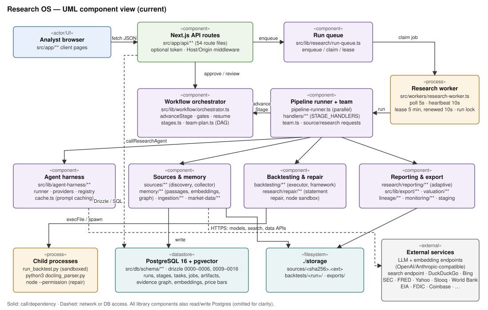
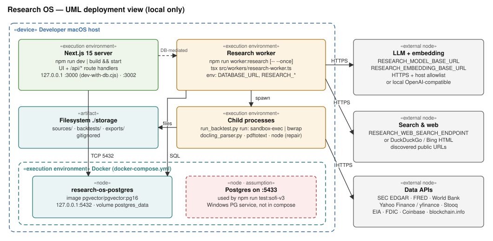
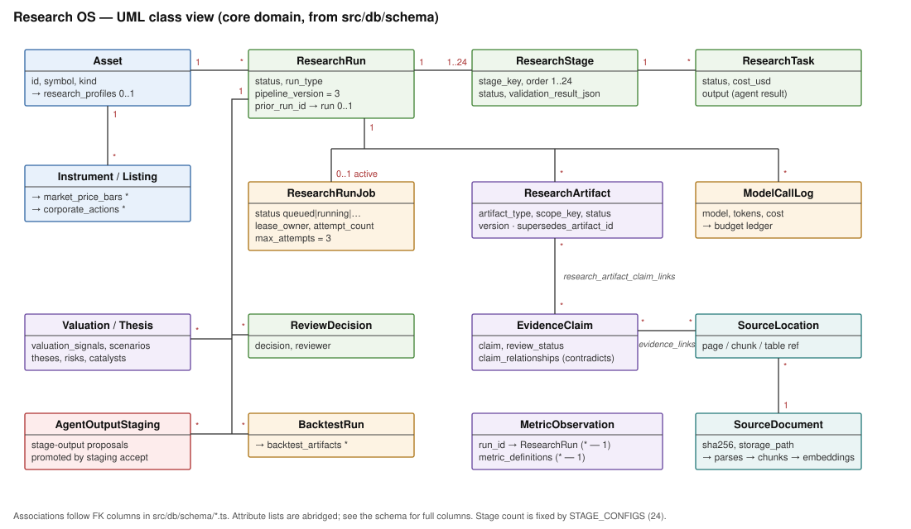
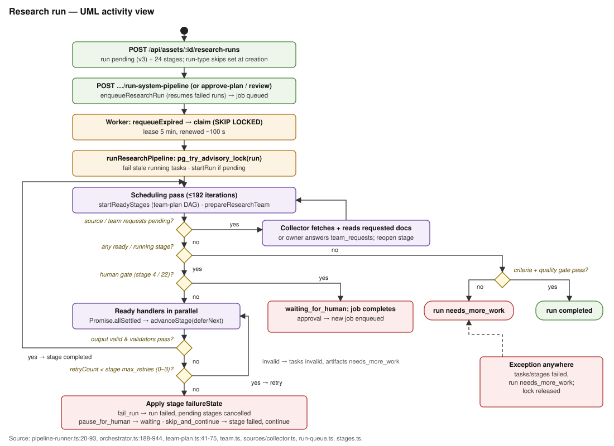
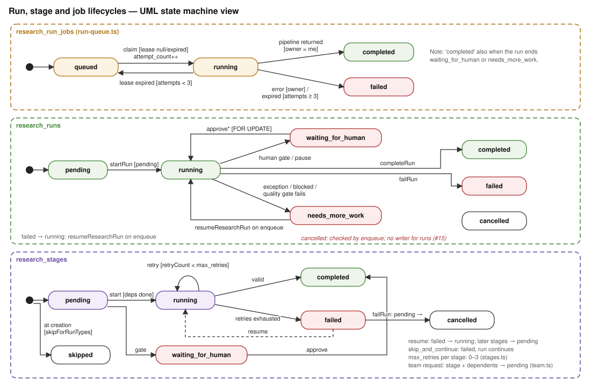
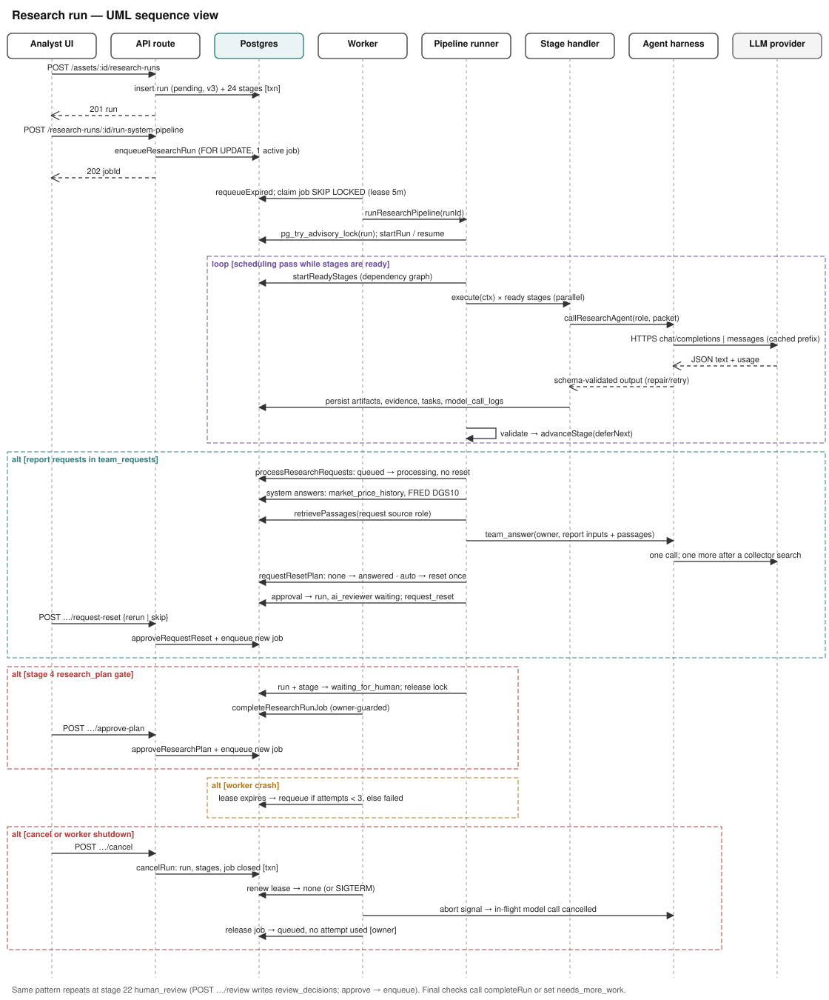

# Research OS — master architecture views

This document holds the master UML 2.5.1 views of the **current** system, traced from source on 2026-10-05 (pipeline version 3, 24 stages); research across runs added 2026-10-22.

- [system.md](system.md) owns component responsibilities, the specialist team and the research-memory narrative.
- [security.md](security.md) owns trust boundaries.
- [`../architecture.md`](../architecture.md) is the July 2026 target-state proposal and doesn't describe current behavior.

Diagrams are generated. Edit the script, run it, and commit both the script and the SVGs:

```bash
python3 docs/diagrams/_source/make_diagrams.py docs/diagrams
```

Labels in the views: *unverified* means the relationship wasn't proven from source. *assumption* means a runtime fact that wasn't observed. Issue numbers refer to open GitHub issues.

## 1. Structural — Component



**Drill-down: agent harness** (`src/lib/agent-harness/`):

- `providers/provider.ts` selects the provider from `RESEARCH_MODEL_PROVIDER`:
  - `mock`;
  - `direct-openai-compatible` (the default);
  - `opencode-go-direct`, which uses the Anthropic protocol for qwen and minimax models;
  - `anthropic-direct`, which calls the Anthropic Messages API (`api.anthropic.com`), omits `temperature` for Claude models and caches the instructions and the shared part of the task prompt, which ends before a call's per-call packet keys (`anthropic-cache.ts`). For Claude models it also sends the task's output schema as `output_config.format` when `anthropic-schema.ts` can express it, and resends once without it if the API rejects the schema (`RESEARCH_ANTHROPIC_STRUCTURED_OUTPUT=0` turns this off). Claude models that accept it (Opus/Sonnet 4.6+, Haiku 5+, Fable, Mythos) also get the task's `output_config.effort` with `thinking: {type: "adaptive"}`, never a `budget_tokens` (`RESEARCH_ANTHROPIC_EFFORT=0` turns this off). No other provider receives effort or thinking fields;
  - `local-openai-compatible`.
- `registry.ts` picks a research task's model (`resolveTaskModel`, called by `callResearchAgent` with the call site's `modelTier` and stage key) in this order:
  1. an explicit override;
  2. `RESEARCH_STAGE_<STAGE_KEY>_MODEL`;
  3. `RESEARCH_<TIER>_MODEL` for a premium, mid or cheap call;
  4. `RESEARCH_ALL_AGENTS_MODEL`;
  5. `RESEARCH_<AGENT>_MODEL`, then the agent config's variable (`RESEARCH_CHEAP_MODEL`, `RESEARCH_MID_MODEL`, `RESEARCH_VISION_MODEL`);
  6. the agent's default model.
  Calls outside `callResearchAgent` (`resolveAgentModel`) skip steps 2-3. Effort follows `RESEARCH_STAGE_<KEY>_EFFORT`, `RESEARCH_<TIER>_EFFORT`, `RESEARCH_EFFORT`, then the tier default (premium high, mid medium, cheap low). `src/lib/research/model-tiering.ts` adds the per-task output cap, premium timeout and budget reserve, and records each run's `effective_config`.
- `runner.ts` makes up to 4 model attempts with one schema repair, compaction fallback and output-limit doubling. 5xx and overload errors are retried with a 5 s floor, and a reply cut off at its output limit is regenerated with twice the limit rather than repaired.
- `cache.ts` handles prompt-cache layout and the affinity key.
- `output-parser.ts` and `validation.ts` parse and check structured output.

Model calls have no tool execution. [local-agent-harness.md](local-agent-harness.md) covers the configuration.

**Drill-down: stages** (`src/lib/workflow/stages.ts`; dependencies in `src/lib/research/team-plan.ts:41`). Run-type skips are set at creation through `skipForRunTypes`. Stages 16–19 are skipped for `quick_scan`. Stages 1–15, 20 and 24 are skipped for `backtest_only`.

| # | Stage | failureState | Retries | # | Stage | failureState | Retries |
| --- | --- | --- | --- | --- | --- | --- | --- |
| 1 | intake | fail_run | 2 | 13 | operating_model | skip_and_continue | 2 |
| 2 | asset_identity | fail_run | 2 | 14 | operating_scenarios | skip_and_continue | 2 |
| 3 | archetype_composition | fail_run | 2 | 15 | asset_valuation | skip_and_continue | 2 |
| 4 | research_plan **(gate)** | pause_for_human | 2 | 16 | indicator_design | fail_run | 1 |
| 5 | source_discovery | skip_and_continue | 3 | 17 | strategy_design | fail_run | 1 |
| 6 | source_ingestion | skip_and_continue | 3 | 18 | backtest_execution | fail_run | 1 |
| 7 | evidence_extraction | fail_run | 2 | 19 | backtest_review | fail_run | 1 |
| 8 | historical_record | fail_run | 2 | 20 | decision_synthesis | skip_and_continue | 2 |
| 9 | company_genesis | skip_and_continue | 2 | 21 | ai_reviewer | fail_run | 1 |
| 10 | historical_diagnosis | skip_and_continue | 2 | 22 | human_review **(gate)** | pause_for_human | 0 |
| 11 | business_process_analysis | skip_and_continue | 2 | 23 | export | skip_and_continue | 2 |
| 12 | moat_analysis | skip_and_continue | 2 | 24 | refresh_schedule | skip_and_continue | 1 |

Handlers are registered in the `STAGE_HANDLERS` map (`src/lib/research/handlers/index.ts`).

## 2. Structural — Deployment



There's no hosted deployment and no CI workflow in the repository, so there are no rollback or on-call procedures. `docs/operations.md` covers storage cleanup and research sync.

Machines share research only through the `research-store` branch on GitHub. `npm run store:sync` imports and exports each machine's local Postgres rows and `storage/` files through the gitignored `./research-store/` worktree ([operations](operations.md#sync-research-between-machines)).

Local entry points, all bound to `127.0.0.1`:
- `npm run dev` and `npm run start`;
- `.claude/launch.json`, which runs `scripts/dev-with-db.cjs` on :3000 or plain `next dev` on :3002.

`docker-compose.yml` publishes Postgres on `127.0.0.1:5432` only.

The port 5433 database used by `npm run test:sofi-v3` is a Windows PostgreSQL service and isn't defined in `docker-compose.yml` ([#18](https://github.com/ToRRIIDeR97/Investing-Research-Pipeline/issues/18)).

## 3. Structural — Class



Schema modules (`src/db/schema/`) and their key tables:

| Module | Key tables |
| --- | --- |
| core | assets, instruments, listings, entities |
| profiles | research_profiles, profile_module_schemas, asset_profile_assignments |
| workflow | runs (with `prior_run_id`, the run it builds on), stages, tasks, task dependencies, validation results |
| research-run-jobs | jobs, worker heartbeats |
| corpus | source documents, parses, chunks, `document_embeddings`, tables, locations |
| source-intelligence | source_retrieval_attempts, source_role_coverage, source_role_assignments, source_document_metadata |
| evidence | claims, links, `claim_relationships`, gaps |
| metrics | metric_definitions, metric_observations, metric_observation_inputs |
| valuation | valuation_methods, valuation_signals, scenarios |
| research-v2 | analysis_sections, valuation_model_runs, valuation_artifacts, indicator_definitions, indicator_observations, strategy_combinations |
| research-artifacts | artifacts, dependencies, claim links, assumptions |
| thesis | theses, risks, catalysts, review decisions, notebooks, exports |
| ai | staging, model calls, budgets, traces |
| backtesting | backtest_runs, backtest_artifacts |
| market-data | market_price_bars (with Stooq cross-check status; S&P 500 benchmark bars under the `benchmark-gspc` reference asset), corporate_actions, market_data_fetches, instrument_provider_mappings |
| saved-charts | saved_charts (My charts board definitions; series keys, never values) |
| monitoring | asset_monitor_checks (monitor-check results: refresh due, reasons, filings, KPI scores) |

Migrations are `0000`–`0006`, `0009_research_memory_graph`, which adds provenance and review fields plus a uniqueness constraint to `claim_relationships`, `0010_price_history_verification`, which adds the cross-check columns to `market_price_bars`, `0011_saved_charts`, which adds the `saved_charts` table, `0012_task_budget_reservation`, which adds `research_tasks.budget_reservation_usd` for in-flight budget reservations, `0013_research_memory_search`, which adds `document_chunks.search_tsv` (research-memory passages only, backfilled) with a partial GIN index, `0014_performance_indexes`, which indexes `document_chunks.source_document_id`, `evidence_claims (research_run_id, review_status)`, `evidence_links.evidence_claim_id` and `source_locations`' chunk and document columns, and `0015_valuation_v2`, which adds `research_runs.forecast_years` (3-10, set at the plan gate) and `instruments.depositary_ratio`, and `0016_research_lineage_monitoring`, which adds `research_runs.prior_run_id` (self-reference, set null on delete) and the `asset_monitor_checks` table.

Artifact statuses are listed in `src/lib/research/artifacts/contracts.ts`; the lifecycle is in the [state machine view](#5-behavioral--state-machine). Each run keeps one current version per artifact type and scope.

## 4. Behavioral — Activity



Other critical workflows are described in text:

- **Team collaboration** (source discovery review, specialist briefs, source requests, report requests). See the specialist flow chart in [system.md](system.md).
- **Upload ingest:** multipart upload → SHA-256 → `storage/sources` → `source_documents` → Docling subprocess → parses, chunks and passages.
- **Backtest task:** `POST …/backtests` → `backtest_runs` and a task → worker → `backtest-coder` → `python3 run_backtest.py fetch` (prices to CSV) → `run_backtest.py run` in an OS sandbox (`sandbox-exec` or `bwrap`) → `storage/backtests` and `backtest_artifacts`. Stage 18 uses the TypeScript `executeFrameworkBacktest` path instead, against the asset's sector benchmarks; with too little aligned history it records a withheld summary and marks stage 19 skipped ([framework backtests](system.md#framework-backtests)).
- **Financial analytics:** the historical-record stage builds `financial_analytics` from the merged statement, record and market rows (`history/analytics.ts:buildFinancialAnalytics`, on `MetricBook`) and `financial_statement_summary` (`history/statement-summary.ts`), and saves both. `run-context.ts:prepareResearchCall` puts `analyticsDigest` in the cached packet prefix of the seven analysis stages (`ANALYTICS_DIGEST_STAGES`), which is why `company_genesis` waits for `historical_record` and `business_process_analysis` for `historical_diagnosis`. Before each report draft, `reporting/runtime.ts:saveReportFacts` saves `report_facts` (`reporting/facts.ts`); the three lead every report packet (`splitReportArtifacts`), and `reporting/packet.ts` replaces `historical_record` observations with a small view. Decision synthesis fills monitoring levels by metric key (`decision/monitoring-levels.ts:fillMonitoringLevels`). See [system.md](system.md#financial-analytics-pack).
- **Statement repair:** the historical-record stage asks the repair agent for a `locateStatements` module, runs it in a Node sandbox, and saves a `statement_repair` artifact (up to 3 attempts).

### Asset valuation


The model makes the judgment calls: yearly drivers in operating scenarios and, for FCFF assets, three valuation sets (conservative, base, aggressive: discount rate, terminal growth, RONIC, fade years), adjusted from code defaults anchored on the cost-of-capital inputs (a regression beta against the S&P 500 and a dated implied equity risk premium, `valuation/cost-of-capital.ts`). Code builds the statements, schedules with fade years and a value-driver terminal, price path, anchors, the case × set matrix, cross-checks, sanity flags, stress cases and reverse valuation (`valuation/engine.ts`, `valuation/v2.ts`), and withholds a foreign listing without an FX rate and depositary ratio. `scripts/valuation-whatif.ts` recomputes a stored valuation without a model call. Banks keep model-built equity schedules, which code assembles the same way. Details are in [system.md](system.md#valuation-inputs-the-valuation-engine-and-withheld-valuations).

## 5. Behavioral — State machine



Guards:

- Every job update requires `status = 'running' AND lease_owner = <worker>` (`run-queue.ts`). A worker that stops, or finds the run locked by another worker, puts its job back to `queued` without using an attempt (`releaseResearchRunJob`). A renewal that finds the lease gone aborts the run.
- `cancelRun` moves a run, its open stages and its active job to a terminal state from any status but `completed`; `failRun` doesn't overwrite it.
- Each worker poll queues a job for a `running` run that had a job before and has had no job activity for 60 s (`reconcileOrphanedResearchRuns`).
- Gate approvals and the re-run decision take `FOR UPDATE` locks (`orchestrator.ts:409`, `467`, `538`, `583`).
- Artifacts: every artifact save takes a lock on its run, type and scope (the run row in `saveReportArtifact`, an advisory lock in `upsertArtifact`). Changed content or status inserts version n+1 and supersedes the earlier rows, and unchanged content keeps the current row. A failed stage validation moves the stage's `validated` artifacts to `needs_more_work`. `acceptCurrentArtifacts` (`reporting/store.ts`) moves the latest `validated` version to `accepted` inside the gate transaction: plan approval accepts `research_plan`, and stage-22 approval accepts every current artifact, which covers the approved report and its inputs. Later saves of an accepted artifact create a `validated` successor. Readers take `status IN ('validated', 'accepted')`, or `<> 'superseded'` in the read model.
- `retryCount` and `transient_failures` (stage reruns after transient model failures) live in `validation_result_json`; both are bounded by the stage's `max_retries`.
- The runner advances each stage as it settles and claims newly ready stages while others are in flight (`startReadyStages` filters out human_review). After any rejection, pause, skip or source/team request it launches nothing more until in-flight stages drain, so failures, requests and gates are still handled with nothing in flight.
- `resumeResearchRun` restarts at the first failed stage when a run is enqueued. Stages left `running` or `waiting_for_human` on a stopped run are failed first. A gate left `waiting_for_human`, or `human_review` in any state, is restored as `waiting_for_human` with the run instead. The runner stops a `running` run with no dispatchable stage as `needs_more_work`. `failRun`, `pauseForHumanReview` and the gate branch of `startNextStage` are single transactions.
- An arriving team request reopens nothing (`team.ts:processResearchRequests`). Only an owner's `requires_rerun` answer, or a review's `analysis_rework` finding (one rework request per named stage, after the first review), reopens its stage and dependents (`requestResetPlan`): automatically once per run when at most `RESEARCH_MAX_AUTO_RESET_STAGES` (default 6) analysis stages reopen; otherwise the run and the `ai_reviewer` stage become `waiting_for_human` with `metadata_json.request_reset` until `approveRequestReset` records `rerun` or `skip`. That decision is refused unless the run is paused on the re-run and while the plan or final-review gate waits.

## 6. Interaction — Sequence



Report requests (two rounds before drafting, one after the first review) are answered inside the scheduling loop without resetting stages: system answers from `market_price_history` (bars, valuation price, regression beta) and the FRED DGS10 document, otherwise the owner's `team_answer` call with research-memory passages, with at most one collector search per request. Inside the loop, business-process, moat, operating-model and report-section calls first load a byte-bounded set of filing passages (`loadFilingPassages`: passages of the newest 10-K, 10-Q and earnings materials that discuss drivers, segments and metric trends) into the shared part of their packet. `requestResetPlan` then leaves the batch answered, reopens stages once automatically, or pauses for `POST …/request-reset`.

## Coverage index

| Subsystem / store / integration / workflow | Views | Source paths / symbols |
| --- | --- | --- |
| UI pages | Component, Sequence | `src/app/**/page.tsx`, `src/components/**` |
| API routes | Component, Sequence, Trust | `src/app/api/**/route.ts`, `src/lib/api/*`, `src/proxy.ts` (Host and Origin guard, optional operator token), `src/lib/api/auth.ts`, `src/app/api/session/route.ts`, `src/app/login/page.tsx`, `next.config.ts` (no framing) |
| Run service and queue | Component, Activity, State, Sequence | `run-service.ts:createResearchRunWithStages`, `run-queue.ts` |
| Research worker | Component, Deployment, State, Sequence | `src/workers/research-worker.ts`, `src/workers/poll-loop.ts` |
| Pipeline runner, team and requests | Component, Activity, State, Sequence | `pipeline-runner.ts:runResearchPipeline`, `settleBatch`, `team.ts:processResearchRequests`, `systemAnswer`, `requestResetPlan`, `nextRequestBatch`, `team-plan.ts`, `sources/source-requests.ts:queryTermCoverage`, `sources/collector.ts` |
| Workflow orchestrator | Component, Activity, State, Sequence | `orchestrator.ts:advanceStage`, `startReadyStages`, `approveRequestReset`, `completeRun`, `failRun`, `cancelRun`, `resumeResearchRun` |
| Run cancellation | State, Sequence | `src/app/api/research-runs/[id]/cancel/route.ts`, Cancel run action in `src/app/assets/[id]/run/page.tsx` |
| Request re-run decision | State, Sequence, Trust | `src/app/api/research-runs/[id]/request-reset/route.ts`, run page panel in `src/app/assets/[id]/run/page.tsx` |
| Agent harness and prompt caching | Component, Sequence, Trust | `src/lib/agent-harness/**` |
| Research memory and evidence graph | Component, Class, Sequence | `src/lib/research/memory/**` (`filing-passages.ts`: `loadFilingPassages`, `latestFilings`, `passageScore`, `selectFilingPassages`) |
| Sources, ingestion and market data | Component, Deployment, Trust | `src/lib/research/sources/**`, `src/lib/ingestion/**`, `src/lib/market-data/**`, `src/lib/net.ts` (public-host check, capped reads, endpoint URLs), `src/lib/html-scan.ts` |
| Backtesting | Component, Deployment, State, Trust | `src/lib/backtesting/**` (`framework-runner.ts:frameworkBenchmarks`), `handlers/backtest-execution.ts`, `python/backtesting/**` |
| Repair specialist sandbox | Component, Deployment, Trust | `src/lib/research/repair/**` |
| Research framing and plan gate | Activity, State, Sequence | `framing.ts` (`ResearchFraming`, `classificationArchetypes`, `checkGateEdits`, `FRAMING_RULE`), `handlers/research-plan.ts` (`draftFraming`, `buildResearchPlan`), `handlers/archetype-composition.ts`, `orchestrator.ts` (`approveResearchPlan`, `applyPlanGateEdits`, `requestResearchPlanChanges`), `run-context.ts` (`researchFraming` injection), `src/app/api/research-runs/[id]/approve-plan/route.ts`, `request-plan-changes/route.ts`, `src/components/framing-editor.tsx` |
| Peer and demand benchmarks | Component, Activity, Trust | `sources/peers.ts` (`resolvePeers`, `buildPeerBenchmark`), `sources/demand.ts` (`buildDemandBackdrop`), `handlers/historical-record.ts:saveExternalBenchmarks`, `run-context.ts` (`BENCHMARK_INJECTIONS`) |
| Reporting and export | Component | `src/lib/research/reporting/**`, `src/lib/export/**` |
| Report review gate: depth checks, verdicts, rework | Activity, State, Sequence | `reporting/depth.ts` (`DEPTH_CHECKS`, `deriveReview`, `valuationFlags`, `reviewGate`), `reporting/compose.ts` (`composeReviewedReport`, `reconcileCoverage`), `reporting/runtime.ts` (`CONCLUSION_CONTRACT`, `rework`), `team.ts` (`reworkRequests`, `reworkAnswer`, `preDraftRequests`, `postReviewAnswers`), `src/app/api/research-runs/[id]/review/route.ts`, `src/components/review-findings.tsx` |
| Research scoring (eval harness) | Activity | `evals/eval-set.json`, `scripts/score-research.ts`, `scripts/judge-research.ts`, `src/lib/research/scoring/**` |
| Artifact lifecycle | Class, State | `artifacts/repository.ts:upsertArtifact`, `reporting/store.ts:saveReportArtifact`, `acceptCurrentArtifacts`, `orchestrator.ts:approveResearchPlan`, `approveHumanReview` |
| Foreign private issuers | Activity, Trust | `history/press-release.ts` (`scanTables`, `extractReleaseStatements`, `isResultsRelease`, `depositaryRatioFromText`), `history/filing-store.ts` (`captureReleaseStatements`, `quarterCoverage`), `sources/corpus.ts` (`isResultsCover`, `foreignResultsPayloads`, `fxSourcePayload`), `history/sec-companyfacts.ts` (`dominantCurrency`, `reportingTaxonomy`), `valuation/engine.ts:equityBridge` (IFRS 16), `scripts/fpi-capture-demo.ts`, `tests/fixtures/jd/` |
| Financial analytics pack | Activity | `history/analytics.ts` (`buildFinancialAnalytics`, `analyticsDigest`, `analyticsMetrics`), `history/statement-summary.ts`, `handlers/historical-record.ts`, `run-context.ts:prepareResearchCall`, `reporting/facts.ts:buildReportFacts`, `reporting/runtime.ts:splitReportArtifacts`, `reporting/packet.ts`, `decision/monitoring-levels.ts`, `scripts/report-packet-size.ts` |
| Valuation engine | Activity | `handlers/asset-valuation.ts`, `valuation/engine.ts`, `valuation/v2.ts`, `valuation/cost-of-capital.ts`, `handlers/operating-scenarios.ts`, `scripts/valuation-whatif.ts` |
| Financials view: metric catalogue, statement charts, My charts | Component, Class | `src/components/financial-statements.tsx`, `src/components/financials/**`, `reporting/metric-catalogue.ts`, `reporting/chart-series.ts`, `reporting/saved-charts.ts`, `src/app/api/saved-charts/**` |
| Postgres | Component, Deployment, Class | `src/db/schema/**`, `src/db/schemas.ts`, `drizzle/`, `docker-compose.yml` |
| `./storage` | Component, Deployment, Trust | `storage/` (gitignored); opt-in cleanup `scripts/storage-gc.ts`, `src/lib/maintenance/storage-gc.ts` ([operations](operations.md#storage-cleanup)) |
| Research store sync | Deployment, Trust | `scripts/research-store.ts`, `src/lib/maintenance/research-store.ts` (`exportStore`, `importStore`, `decideRow`, file guards `mirrorFiles` and `importFiles`), branch `research-store` checked out at `./research-store/` (gitignored) ([operations](operations.md#sync-research-between-machines)) |
| Child processes | Component, Deployment, Trust | `python/**`, `repair/sandbox.ts` |
| LLM and embedding providers | Component, Deployment, Sequence, Trust | `providers/*.ts`, `memory/embeddings.ts` |
| Search and data APIs | Component, Deployment, Trust | `sources/role-discovery.ts`, `sources/corpus.ts`, `market-data/providers/yahoo.ts`, `market-data/providers/stooq.ts` |
| Research across runs: lineage, change log, monitoring | [research-across-runs.svg](diagrams/research-across-runs.svg), Component, Class | `lineage/runs.ts` (`resolvePriorRunId`, `savePriorResearch`, `loadPriorResearch`, `saveVersionChangeLog`), `lineage/prior-research.ts`, `lineage/change-log.ts`, `run-context.ts:prepareResearchCall`, `handlers/ai-reviewer.ts`, `monitoring/monitor-check.ts`, `monitoring/monitor-score.ts`, `scripts/monitor-check.ts`, `src/app/api/assets/[id]/monitor/route.ts`, `src/app/api/research-runs/[id]/refresh/route.ts` ([system](system.md#research-across-runs), [operations](operations.md#monitoring-check)) |
| Research run workflow | Activity, State, Sequence | see the rows above |
| Development workflow | [dev-workflow.svg](diagrams/dev-workflow.svg) | [AGENTS.md](../AGENTS.md) |

## Unresolved boundaries

- Research-request and source-request loops are one activity node; the research-request path and its re-run approval have their own frame in the sequence view. The source-request loop has no sequence view.
