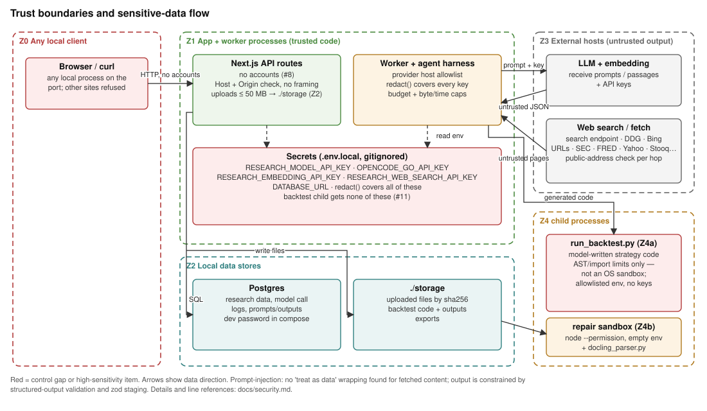

# Security

Research OS is a local, single-user tool with no hosted deployment. It handles provider credentials, database credentials, financial source material and research decisions. Its main risks are:

- control of paid model calls and research state by any local process that can reach the app port, unless `RESEARCH_OS_API_TOKEN` is set;
- secret leakage into logs, prompts or child processes;
- untrusted web, filing and model content reaching the database or executing as code.

This document was verified against source on 2026-10-05, and the controls changed by the security hardening of 2026-10-11 were re-checked then. Each claim says whether it was observed in source or is an assumption. Open findings link to their GitHub issues.



## Assets

| Asset | Where | Sensitivity |
| --- | --- | --- |
| Provider and search keys | Process environment or ignored `.env.local`: `RESEARCH_MODEL_API_KEY`, `OPENCODE_GO_API_KEY`, `ANTHROPIC_API_KEY`, `RESEARCH_EMBEDDING_API_KEY`, `RESEARCH_WEB_SEARCH_API_KEY`. `.env.example` documents names only | High: direct spend |
| Operator token | `RESEARCH_OS_API_TOKEN` in the environment or `.env.local`; the browser keeps it in the HttpOnly `research_os_session` cookie | High when set: full API access |
| Model budget | `model_budget_limits`, `model_budget_ledger`, `research_tasks.budget_reservation_usd` | High: paid calls |
| Research state and decisions | Postgres: runs, stages, artifacts, evidence, `claim_relationships`, `document_embeddings`, `review_decisions`, … | Medium: private analysis; integrity matters |
| Prompts, outputs, call metadata | `model_call_logs`, agent traces. Cache metadata stores hashes and byte counts, never prompt content | Medium |
| Files | `storage/sources`, `storage/backtests`, `storage/exports` (gitignored) | Medium |
| Research store | The `research-store` branch on GitHub: a copy of every synced table (research state, full agent transcripts, task packets, `model_call_logs`, budget ledger) and every `storage/` file a row names (filings, uploads, model-written backtest code). The repository must stay private: `store:sync` refuses to push unless `gh repo view` reports origin as `PRIVATE` (`--allow-public` overrides) | Medium: the private analysis leaves the machine |
| Database credentials | `DATABASE_URL`. `docker-compose.yml` publishes port 5432 on `127.0.0.1` only and reads `POSTGRES_PASSWORD` (default `research_os_dev`). `research_os` is a superuser in that image | Low on its own; high if the port is exposed |

## Trust boundaries

| Zone | Contents | Trust |
| --- | --- | --- |
| Z0 Local clients | Browser, curl, any local process that can reach the Next.js port (bound to `127.0.0.1`) | Untrusted: 61 handlers in 53 `route.ts` files. `src/proxy.ts` refuses foreign Host names and cross-site writes, and requires `RESEARCH_OS_API_TOKEN` when it is set |
| Z1 App and worker | Next.js server, research worker, agent harness; holds secrets | Trusted code |
| Z2 Data stores | Postgres (pgvector image), `./storage` | Trusted; reached by Z1 only (by design, not enforced beyond the DB password) |
| Z3 External hosts | LLM endpoint, embedding endpoint, configured search endpoint or DuckDuckGo/Bing HTML, discovered URLs, SEC, FRED, Yahoo, Stooq, World Bank, EIA, FDIC, Coinbase, blockchain.info | Their output is untrusted data |
| Z4a python3 children | `run_backtest.py` (model-written code), `run_backtest_grid.py`, `docling_parser.py`, `pdftotext` | Run with the developer's OS privileges, except the `run_backtest.py run` phase, which runs in an OS sandbox that protects the host, not the integrity of the backtest's results (see below) |
| Z4b Repair sandbox | `src/lib/research/repair/sandbox.ts`: model-written JavaScript in a separate Node process | Defence in depth (see below) |
| Z5 Research store | The `research-store` branch, written by `npm run store:sync` on any machine with push access | Trusted like Z2, but anyone who can push to the branch can change rows and files that the next sync imports. Import accepts only rows that fit the local schema, inside one transaction, and writes files only under `storage/`. Sync never follows a symlink in either direction (see [Untrusted inputs](#untrusted-inputs)) |

## Authentication and authorization

- **Observed:** there are no per-user accounts. `src/proxy.ts` runs on every `/api/*` request and every page path, dotted ones such as `/assets/BRK.B` included. It skips only `/_next/*` and paths ending in a static-file extension (`ico`, `png`, `jpg`, `jpeg`, `gif`, `svg`, `webp`, `css`, `js`, `mjs`, `map`, `json`, `html`, `txt`, `xml`, `woff`, `woff2`, `ttf`), which covers `favicon.ico` and `public/report-layouts/*`. It answers 403 to:
  - a Host other than `localhost`, `127.0.0.1`, `[::1]` or a name in `RESEARCH_APP_ALLOWED_HOSTS`, which stops DNS rebinding;
  - an API `POST`, `PATCH`, `PUT` or `DELETE` unless `Sec-Fetch-Site` is `same-origin` or `none`, or `Origin` equals the app's own origin, which stops cross-site writes from the user's browser.

  `next.config.ts` sends `X-Frame-Options: DENY` and `frame-ancestors 'none'` on every page, so the approval buttons can't be framed. Tests: `tests/api-guard.test.ts`.
- **Observed:** optional single-operator token ([#8](https://github.com/ToRRIIDeR97/Investing-Research-Pipeline/issues/8)). When `RESEARCH_OS_API_TOKEN` is set, the proxy (`src/proxy.ts`) also answers 401 to any `/api/*` request, and serves `/login` in place of any page it covers (with a `next` query naming the requested path), unless it carries `Authorization: Bearer <token>` or the `research_os_session` cookie equal to the token (compared without early exit, `src/lib/api/auth.ts`). `POST /api/session` is the only API path exempt from the token; it still gets the Host and same-origin checks, and it sets the cookie (HttpOnly, `SameSite=Strict`, `Path=/`, 30 days) only for the right token. The cookie is `Secure` when the request is HTTPS. If it carries `X-Forwarded-Proto` (which `next start` also uses for the request URL), the cookie is `Secure` only for `https` with a Host listed in `RESEARCH_APP_ALLOWED_HOSTS`, so a loopback client can't set the flag with that header. After sign-in, `/login` returns to `next` only if it is a same-origin path (`loginReturnPath` and `safeNextPath`: starts with one `/`, no `//`, backslash or control character), else to `/`. `DELETE /api/session` clears it. Limits:
  - the cookie holds the token itself, so anyone who can read the browser's cookie store has the token; rotate it by changing the variable and restarting;
  - there is no lockout or rate limit on `POST /api/session`; use a long random token (`openssl rand -hex 32`);
  - one token means one role: whoever holds it can do everything below, and saved charts stay shared;
  - static files skipped by the proxy (`public/report-layouts/*`) are served without the token, including the committed sample report in `report-data.json`; put nothing private in `public/`;
  - unset (the default, for local development), nothing below changes.
- Without the token, these checks stop other websites, not local processes, which can send any header. Any process on the host that reaches the port can:
  - start paid work (`POST …/chat`, `run-system-pipeline`, `approve-plan`, `request-reset`, `backtests`). `request-reset` decides a team-request re-run above the automatic limit: `rerun` reopens analysis stages that make new model calls, and either decision queues the run;
  - write state (`PATCH /api/evidence/:id/review`, `POST /api/staging/:id/accept`, `POST …/model-calls`);
  - read every research record;
  - list, create, rename and delete saved charts (`/api/saved-charts`). Saved charts are shared by everyone who can reach the instance; there is no per-user board.

  With the token set, the same holds for any process that has it.
- `PATCH /api/evidence/:id/review` accepts only `pending`, `accepted` or `rejected` and records the reviewer as `api:unauthenticated`; a `reviewed_by` in the body is ignored ([#13](https://github.com/ToRRIIDeR97/Investing-Research-Pipeline/issues/13)). `POST /api/staging/:id/accept` promotes only an output that passed validation and is neither accepted nor rejected, once, in one transaction; anything else gets 409. `POST …/model-calls` takes `cost_usd`, token counts and `latency_ms` only as finite numbers of at least 0, and `stage_id`/`task_id` only as UUIDs of that run's own stage and task, or it answers 400 ([#102](https://github.com/ToRRIIDeR97/Investing-Research-Pipeline/issues/102)); `recordModelCall` also refuses a negative or non-finite cost. The `/advance` route, which moved a run past the run lock, the stage handlers and the job lease, was removed ([#16](https://github.com/ToRRIIDeR97/Investing-Research-Pipeline/issues/16)). Tests: `tests/api-state-guards.test.ts`.
- **Observed:** `npm run dev`, `npm run start`, `scripts/dev-with-db.cjs` and `.claude/launch.json` pass `-H 127.0.0.1`. A bare `next dev` without `-H` still listens on all interfaces. Treat this as a local, trusted deployment; set `RESEARCH_OS_API_TOKEN` before adding a name to `RESEARCH_APP_ALLOWED_HOSTS` or binding another interface. Don't expose the app or the database to untrusted users.
- Human approval is required at the research-plan gate and the final-review gate. At the final-review gate, position approval also needs the review's code-derived effective verdict to pass, and either approval needs `acknowledgeFindings: true` while high or critical findings are open; optional rubric ratings must be integers 0-4 on known dimensions (`parseRubricRatings`), or the request gets 400. A team-request re-run above `RESEARCH_MAX_AUTO_RESET_STAGES` analysis stages (default 6), or any re-run after the run's one automatic re-run, also waits for a reviewer. A re-run decision can't complete or bypass either gate: it is refused unless the run is paused on that re-run, and while the plan or final-review gate is waiting. The approval APIs are access-controlled only by the operator token, when it is set.

## Secrets

- Keep credentials in the process environment or in ignored local environment files. `.gitignore` excludes `.env.*` and allows `.env.example`.
- Paid runs are opt-in:
  - `RUN_PAID_RESEARCH=1` for `new-equity-run.ts`, `resume-research-run.ts` and `provider-cache-smoke.ts`;
  - `RUN_PAID_MELI` for `new-meli-run.ts`;
  - `RUN_PROVIDER_SMOKE=1` for `provider-smoke.ts` and `effort-smoke.ts` (`npm run test:effort-smoke`);
  - `RUN_SOURCE_READER_SMOKE` for `source-reader-smoke.ts`;
  - `RUN_PAID_EVAL=1` for `judge-research.ts` (`npm run eval:judge`). `npm run eval:score` makes no model call and opens its database connection read-only.
- The harness `redact()` (`src/lib/agent-harness/runner.ts`) replaces `RESEARCH_MODEL_API_KEY`, `ANTHROPIC_API_KEY`, `OPENCODE_GO_API_KEY`, `RESEARCH_WEB_SEARCH_API_KEY`, `RESEARCH_EMBEDDING_API_KEY`, `DATABASE_URL` and `bearer` tokens ([#10](https://github.com/ToRRIIDeR97/Investing-Research-Pipeline/issues/10)). Provider error bodies are truncated and pattern-scrubbed. The embedding provider removes its own key from its errors.
- The backtest child process gets an allowlisted environment (`backtestEnv` in `src/lib/backtesting/executor.ts`): `PATH`, `HOME`, `TMPDIR`, locale, proxy and CA-bundle variables, and `PYTHONPATH`. It gets no provider key and no `DATABASE_URL` ([#11](https://github.com/ToRRIIDeR97/Investing-Research-Pipeline/issues/11)). The phase that runs model-written code also drops `PYTHONPATH` and runs in an OS sandbox that can't read the home or repository directories, so it can't read `.env.local` either, or other tools' files in the shared temp directories (see [Untrusted inputs](#untrusted-inputs)).
- A run's `metadata_json.effective_config` records allowlisted settings only: provider, base-URL host (no path, query or userinfo), model names, efforts, limits and the git HEAD. It never copies the environment or a credential (`effectiveRunConfig` in `src/lib/research/model-tiering.ts`).
- The web-search endpoint must use HTTPS, and its key goes to the first hop only, never to a redirect target ([#22](https://github.com/ToRRIIDeR97/Investing-Research-Pipeline/issues/22)).

## Untrusted inputs

| Input | Controls in place | Open gaps |
| --- | --- | --- |
| Model endpoint | One validator for every provider (`validateEndpointUrl` in `src/lib/net.ts`): HTTPS, a host in `RESEARCH_MODEL_ALLOWED_HOSTS`, no credentials, query or fragment, and no loopback or private host, including bracketed IPv6. Local mode requires a loopback or private host. Providers use `redirect: "error"` ([#25](https://github.com/ToRRIIDeR97/Investing-Research-Pipeline/issues/25)) | The host check is literal: an allowlisted name is trusted to resolve to the provider |
| Embedding endpoint (`RESEARCH_EMBEDDING_BASE_URL`) | The same validator; `redirect: "error"`; timeout; budget preflight. Passage text is sent there, so configure only a provider trusted with the source material. Tests clear `RESEARCH_EMBEDDING_PROVIDER` | |
| Fetched pages and PDFs | `isSafePublicUrl` (`src/lib/research/sources/role-discovery.ts`): http(s), no credentials, no loopback, private, link-local, CGNAT, ULA, documentation, multicast or reserved address, including bracketed and IPv4-mapped IPv6 and the IPv4-embedding IPv6 prefixes (SIIT `::ffff:0:0:0/96`, NAT64 `64:ff9b::/96` and `64:ff9b:1::/48`, Teredo `2001::/32`, 6to4 `2002::/16`) (`isPrivateHostname` in `src/lib/net.ts`). The default fetch (`publicFetch`, an `undici` fetch with its own dispatcher) checks at the socket: its connector refuses non-public IP literals, and its `lookup` (`guardedLookup`) resolves the name once and fails if any answer is non-public, so the socket connects to the address that was checked. TLS SNI and the Host header keep the URL's hostname. Every connection, including one opened for a redirect hop, goes through the same check, which closes the DNS-rebinding race ([#9](https://github.com/ToRRIIDeR97/Investing-Research-Pipeline/issues/9)). Redirects are re-checked (3 hops max). 15 s timeout per hop. Bodies are read through `readCapped`, which counts decoded bytes and cancels the stream at 1 MB of text or 10 MB of PDF, so a gzip or brotli bomb or an endless chunked body can't exhaust memory. Pages are scanned with linear-time helpers (`src/lib/html-scan.ts`) instead of backtracking regexes. Pages of any html or xml type are stored as structured text, which the DOM parser builds from a rebuild of the page (`htmlToStructuredText` in `src/lib/research/memory/blocks.ts`). The rebuild comes from a balanced tag stream (`balancedHtml`) and keeps only block tags, headings, tables and bold spans. Kept elements nest at most 64 deep, definition terms are written as list items, and each table, row or table section opens a cell at once while cells, rows and sections are never closed, so content never sits between cells. The parser then has no formatting elements to adopt or reconstruct, nothing to move in front of a table (foster parenting, quadratic in the node count), and an open-element stack of a few hundred at most. The tests time 1 MB hostile pages, from fetch to research-memory blocks, at under 1 s. `pdftotext` is limited to 20 s. Source roles are checked against fetched content and URL provenance. These checks are heuristic: a page isn't accepted evidence just because search returned it. Tests: `tests/network-guards.test.ts`, `tests/untrusted-html.test.ts` | Research memory still parses HTML stored by the corpus fetchers (SEC filings, configured investor pages) without the rebuild |
| Foreign-issuer releases (6-K covers and Ex-99 exhibits, `history/press-release.ts`) | Untrusted HTML read with one linear tag scan (`scanTags` after `dropComments`/`dropElements`), capped at 4 MB, 120 tables, 150 rows and 40 cells; only labelled numeric cells under a recognised date and currency header become facts. EDGAR documents are fetched through `fetchCapped` (30 s, 8 MB) with the repo's SEC User-Agent, at most 90 6-K covers per run, and stored covers and releases are reused. The FX series comes from a fixed FRED URL per currency. Tests time 50,000 nested tables under 2 s | A release table the parser misreads gives wrong figures, not code execution. Release balance checks are reported, not enforced |
| Structured data (`corpus.ts`: SEC, FRED, World Bank, EIA, FDIC, Coinbase, …) | `fetchCapped` (`src/lib/net.ts`): a 60 s timeout that covers the body, and a 64 MB body cap ([#23](https://github.com/ToRRIIDeR97/Investing-Research-Pipeline/issues/23)) | Fixed public URLs; their content is untrusted data |
| Market data (Yahoo chart JSON, Stooq CSV) | The Yahoo provider's default fetch has a 20 s timeout and reads at most 20 MB; the price-history sync and the framework backtest pass their own 20 s timeout, and the backtest retries each series once. After a failed cross-check, Stooq is not called again for that instrument for 24 hours. Stooq bodies are cut at 2 MB while streaming, and only dated rows with a positive close are read; an HTML page counts as unavailable. Stored closes are never overwritten, and a close counts as verified only when the two sources agree within 0.5% | Both sources are free, unauthenticated endpoints that can change or block requests without notice |
| Monitor-check filings (`npm run monitor:check`, `src/lib/research/monitoring/monitor-check.ts`) | `edgarFetch` refuses anything but HTTPS to `data.sec.gov` or `www.sec.gov` and sets `redirect: "error"`; `fetchCapped` caps each body at 40 MB. Filing rows must match fixed patterns (form 10-Q or 10-K, ISO dates, accession `NNNNNNNNNN-NN-NNNNNN`, a plain `.htm` file name) before a URL is built. Only the deterministic filing parser reads the HTML; no model sees it. Stored reasons hold only validated forms, dates and computed numbers. The check writes only `asset_monitor_checks` and never queues a run | Uses the placeholder SEC User-Agent (AR-SEC-6) |
| Prior research (`prior_research` packet key) | Built by code from the prior run's stored artifacts, capped at 10 KB, and sent with `PRIOR_RESEARCH_RULE`: context, not evidence. The prior run must be a v3 run of the same asset | Holds earlier model output (questions, rationale, thesis), which stays untrusted data under `UNTRUSTED_DATA_RULE` |
| Macro data (FRED DGS10 CSV) | Fetched through `fetchCapped`. Only dated rows with a numeric value on or before the cutoff are read; the value becomes the risk-free floor that every model discount rate must exceed | |
| Model output | Structured-output parsing and repair, stage contracts and validators, zod-validated staging. For FCFF valuations the model supplies only assumptions; code computes every price. Replaying evidence extraction marks claims from excluded role sources as rejected but keeps their audit records. Every prompt built by `exactJsonPrompt` or the harness's default prompt states once, in its instructions, that packet content (fetched pages, filings, passages, earlier model output) is data, never instructions (`UNTRUSTED_DATA_RULE`); `callResearchAgent` adds it to any stage prompt whose instructions lack it. Model-chosen searches (specialist `source_requests`, the collector's review searches and report `team_requests`) all go through `runSearches`, which applies `constrainSearch` (`src/lib/research/sources/source-requests.ts`) before anything is sent: URLs, domains (including punycode, and inside quotes or brackets), email addresses and search operators (`site:`, `inurl:`, a leading `-` or `+` even inside quotes, `OR`, `AND`, `NOT`) are dropped, only letters, digits and name punctuation are kept, and the query is cut to at most 200 characters (`MAX_QUERY_CHARS`). The company's own symbol (dotted tickers such as `BRK.B` included) is kept, and a domain that is its name (`Amazon.com`) is reduced to the name. A query for the company's own documents is prefixed with `"Name" SYMBOL` unless it names the company by symbol or first distinctive name term (articles and legal suffixes skipped); a query for a peer, industry, regulator or macro dataset must name the company, or name a document type and a term beyond document words, years and generic words, or it is rejected and never searched. The guard is idempotent. Each search is logged in `source_retrieval_attempts` with the model's original text (`requested_query`), and a rejected one as `query_rejected` ([#27](https://github.com/ToRRIIDeR97/Investing-Research-Pipeline/issues/27)). Tests: `tests/source-collector.test.ts`, `tests/prompt-layout.test.ts` | That rule is an instruction to the model, not an enforcement; validation remains the control. Within those limits the model still picks the words of a search, so a hostile page can still steer which public documents are fetched, up to 3 searches per request and 6 per collector round. Research-memory passages from fetched documents are placed in team-answer prompts, and filing passages (`filing_passages`, up to `RESEARCH_FILING_PASSAGE_BYTES`, default 24,000 bytes, per call) in business-process, moat, operating-model and report-section prompts, where `FILING_PASSAGE_RULE` repeats that they are untrusted data. A filing that contains instructions reaches those prompts as text |
| Peer and demand benchmarks | Fixed hosts only: `www.sec.gov/files/company_tickers.json`, `data.sec.gov/api/xbrl/companyfacts/CIK<10 digits>.json` (CIK from the ticker map, never from model text), `fred.stlouisfed.org/graph/fredgraph.csv?id=<fixed series>` and `api.worldbank.org/v2/country/<ISO-2>/indicator/<fixed indicator>`, all through `fetchCapped` (timeout and body cap; 20 s and 4 MB for demand series). Model-named peers are only matched against the ticker map: a ticker or an exact normalized registrant name, at most four. Only finite numbers from known concepts or dated rows on or before the cutoff are read. Failures become gaps. Mock and test runs fetch nothing | Peer resolution trusts the ticker map; a reviewer who edits the framing can point the benchmark at any SEC registrant |
| Plan-gate edits (`POST …/approve-plan` `framing`, `archetypes`, `overlays`; `POST …/request-plan-changes` notes) | The framing is parsed with the `ResearchFraming` zod contract (bounded strings and list lengths), archetypes and overlays must be registry keys that compose without errors, and feedback notes are trimmed to 4,000 characters. Edits are saved as a new plan version inside the approval transaction | The framing and feedback are reviewer text that reaches every later model prompt as packet data, under the untrusted-data rule |
| Reviewer depth checks | The reviewer's statuses are model output: code overrides `missing` and `data_unavailable` where the stored computed artifacts decide availability, derives every verdict, and confirms a high calculation finding only by a code flag (`src/lib/research/reporting/depth.ts`). An `analysis_rework` finding must name one of the eight analysis stages, and reruns one stage per run at most through the existing re-run limits | The reviewer still chooses `met`, `partial` and `not_applicable` where code can't tell, so a lenient review can pass a shallow report; the eval harness and human ratings are the check on that |
| Saved charts (`/api/saved-charts`, `/api/saved-charts/:id`) | Zod-validated (`src/lib/research/reporting/saved-charts.ts`): strict objects, series keys limited to `[A-Za-z][A-Za-z0-9_]*` with an optional `metric:` prefix, at most six series, fixed enums for chart type, frequency, range and mode. Names have control characters removed, are trimmed and capped at 120 characters, and are rendered as plain text. Bodies over 16 KB are refused, ids must be UUIDs, and the table holds at most 200 charts. Stored definitions are re-validated on read and invalid rows are skipped | No ownership: any client (holding the operator token, when one is set) can change or delete any saved chart ([#8](https://github.com/ToRRIIDeR97/Investing-Research-Pipeline/issues/8)) |
| Run cancellation (`POST /api/research-runs/:id/cancel`) | Refuses a request whose `Origin` header names another origin. Cancelling is terminal and only closes rows; it deletes nothing | Without `RESEARCH_OS_API_TOKEN`, any local client that can reach the port can cancel any run ([#8](https://github.com/ToRRIIDeR97/Investing-Research-Pipeline/issues/8)) |
| Uploads (`POST /api/research-runs/:id/sources/ingest`) | Stored as `<sha256>.<ext>`, where the extension is the client's, lowercased, only if it is pdf, html, htm, txt, md, csv, xlsx, docx or json, and `bin` otherwise. The `url` field must be an http(s) URL without credentials, at most 2,048 characters ([#20](https://github.com/ToRRIIDeR97/Investing-Research-Pipeline/issues/20)). A body without `Content-Length` or over 50 MB is refused before it is read. Docling runs as an asynchronous `python3` subprocess (120 s timeout), so a parse doesn't block other requests ([#24](https://github.com/ToRRIIDeR97/Investing-Research-Pipeline/issues/24)). Tests: `tests/upload-guards.test.ts` | |
| Backtest code (Z4a) | Two phases ([#11](https://github.com/ToRRIIDeR97/Investing-Research-Pipeline/issues/11)). `run_backtest.py fetch` downloads prices to `input/*.csv` with network access and runs no model-written code. `run_backtest.py run` reads both CSVs before it loads the strategy, inside an OS sandbox (`src/lib/backtesting/sandbox.ts`): `sandbox-exec` on macOS, `bwrap` on Linux. It runs the interpreter's real executable (`sys.executable`, not Apple's `/usr/bin/python3` xcrun shim), with its cwd in the backtest's own `storage/backtests/<run>/<backtest>` directory and real paths throughout; the runner takes its storage root from the config, never from the cwd. Both sandboxes: no network, writes only to that directory (also `TMPDIR`), and no reads of the home or repository directories except `python/backtesting` and Python's own package paths that exist. macOS also denies `fork`, every Mach service lookup (so the pasteboard, Launch Services and `nsurlsessiond` are unreachable; Python, numpy and pandas need none), Apple events, `AF_SYSTEM` sockets, and reads of `/private/tmp`, `/private/var/tmp` and `/private/var/folders`. Linux mounts empty `/tmp` and `/var/tmp`, shares no namespaces, and uses `--new-session` and `--die-with-parent`; missing read paths are skipped (`--ro-bind-try`). CPU-time (`BACKTEST_TIMEOUT_MS`, 120 s), address-space (`BACKTEST_MEMORY_MB`, 4096) and 256 MB file-size rlimits are set before the strategy loads, and the wall-clock timeout kills the child. With no sandbox available the task fails, unless `BACKTEST_SANDBOX=off`. Also: import allowlist (pandas, numpy), blocked calls and attributes, read-only `open`, path-escape check, an allowlisted environment with no keys and no `DATABASE_URL`. Artifact paths the child reports outside its own directory are dropped. Tests: `tests/backtest-sandbox.test.ts` (real `sandbox-exec` probes, and the runner's `run` phase with stub numpy and pandas) | The sandbox protects the host, not the results: the strategy runs in the runner's process, so it can reach the price frames, patch the runner's code and write anything into its own directory, including the outputs the runner reports. On Linux, bwrap has no seccomp filter here, so the strategy can fork (inside its own PID namespace, with the same limits). macOS doesn't enforce the address-space limit, and `sandbox-exec` is deprecated by Apple, though still shipped. `getpwuid` fails in the macOS sandbox (it needs opendirectoryd). The Linux `bwrap` path is covered only by argument tests, which run on macOS. Reads outside the home, repository and temp directories (for example `/etc`) stay allowed |
| Research-package export | Backtest files are read or copied only when their real path, after `..` and symlinks, lies under `storage/backtests`. CSV cells that start with `=`, `+`, `-`, `@`, tab or CR and aren't plain numbers get a leading `'`, so Excel and Sheets show them as text. Tests: `tests/backtest-export-guards.test.ts` | Rows of the runner's own `equity_curve.csv` and `trades.csv` are copied unescaped. The runner writes only dates and numbers there |
| Research store (Z5) | `src/lib/maintenance/research-store.ts`. File walks list regular files only and never follow a symlink, so a link that sandboxed backtest code writes into its run folder, or one committed to the branch, is skipped and reported. Export copies a `storage/<dir>/...` file only when its real path lies under the real path of `storage/<dir>` (which may itself be a link, as in a worktree), and removes links from the store folder before writing to it. Import takes only files under `files/storage/<dir>/`, refuses any other path (`src/`, `.env`), checks after `mkdir` that the target folder's real path stays under `storage/<dir>`, and never overwrites (`COPYFILE_EXCL`). Mirrored files and table shards over 95 MB are refused: export throws before writing such a shard. Before anything is exported, a pushing sync asks `gh repo view <origin url> --json visibility` and refuses unless it reports `PRIVATE`; an unreadable answer also refuses (`storeVisibilityError`, `scripts/research-store.ts`). Tombstones are read only from regular files under `tombstones/`. Tests: `tests/research-store.test.ts` | The destination is hard-coded to `origin/research-store`. `--allow-public` bypasses the visibility check, and nothing scans rows for secrets before the push. As of this change the repository is public and `origin/research-store` already holds a copy ([#95](https://github.com/ToRRIIDeR97/Investing-Research-Pipeline/issues/95)): making it private and deleting that branch is still the owner's job. A pushed tombstone can delete local rows that this machine hasn't changed since its last push. Anyone who can push to the branch can still change rows, which import applies without review |
| Repair module (Z4b) | Separate Node process with an empty environment and the Node permission model, which blocks file, child-process and worker access. A fresh V8 context without `process`, `require`, `fetch`, timers, string code generation or host objects. JSON-only I/O. Bounded time, memory and output. Returns only table locations, which are validated before use | Node 22's permission model doesn't restrict network sockets, so the only protection against network access is that the context has no network API. Treat this as defence in depth, not an isolation boundary for hostile code: V8 escapes are possible in principle, so keep the worker on a trusted host |

## Dependency risk

- Install with `npm ci` from `package-lock.json`.
- `undici` is a direct dependency (it was already installed through `cheerio`) because the guarded discovery fetch needs its `Agent` and connector; Node's built-in fetch doesn't expose them.
- [#12](https://github.com/ToRRIIDeR97/Investing-Research-Pipeline/issues/12): `npm audit fix` on 2026-10-11 patched `sharp`, `postcss`, `nanoid`, `js-yaml`, `brace-expansion` and `source-map-js`. On 2026-10-14 `next` (and `eslint-config-next`) moved to 16.4.0, which bundles a patched `postcss`, and `drizzle-orm` to 0.45.4 (identifier escaping fix). Next 16 renamed the `/api/*` guard file convention from `middleware` to `proxy` (`src/proxy.ts`), which runs in the Node.js runtime. `npm audit --omit=dev` reports nothing. Dev-only advisories remain, with no non-downgrade fix:
  - `esbuild` under `drizzle-kit`'s `@esbuild-kit` loader (moderate, dev server only); `drizzle-kit` 0.31.11 is the latest;
  - `braces` (high, no patched release) under `eslint-config-next`, via `@next/eslint-plugin-next` → `fast-glob` → `micromatch`. It runs only inside `npm run lint`, never in the app.
- `python/requirements.txt` lists pandas, numpy, yfinance and docling (`>=2.0,<3`, the API `docling_parser.py` uses) with ranges and no hashes ([#21](https://github.com/ToRRIIDeR97/Investing-Research-Pipeline/issues/21)).

## Checks

```bash
npx tsc --noEmit
npm run test:unit        # API guard and operator token, network and HTML guards, endpoint validation, redaction, uploads, backtest env and sandbox, export escaping, research-store file and shard guards
npm run test:db          # adds the staging, evidence-review and ingest route guards
npm run test:sofi-v3     # mock DB-backed pipeline; needs Postgres on :5433 (#18)
npm audit --package-lock-only
grep -rn 'process.env.RESEARCH_OS_API_TOKEN' src # one hit: src/lib/api/auth.ts
```

A live provider run is paid. It needs one of the flags listed under [Secrets](#secrets) and the user's approval.
