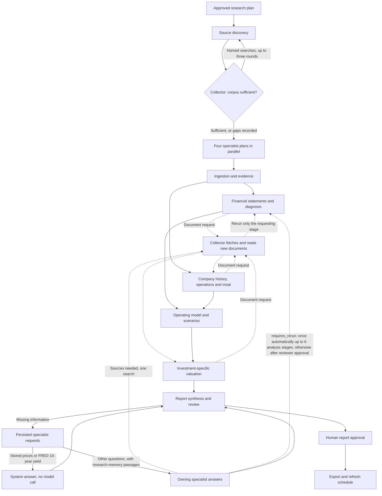

# Current system

Research OS creates evidence-backed investment research for an asset. PostgreSQL stores the workflow, sources, artifacts, decisions, and exported report. The Next.js app provides the UI and API; a separate worker runs queued research jobs.

| Component | Responsibility | Source |
| --- | --- | --- |
| UI pages | Client components that call the API: command center, asset catalog and detail, run cockpit, report view, review queue | `src/app/**/page.tsx`, `src/components/**` |
| API routes | 53 route files. Reads and writes over research tables, run control (create, enqueue, approve plan, request re-run decision, review, cancel), upload ingest, chat, export, saved charts. No authentication | `src/app/api/**`, `src/lib/api/*` |
| Run service and queue | Creates a run (`pending`, version 3) and its 24 stage rows. Enforces one active job per run. Claims with `SKIP LOCKED` under a 5-minute lease, with up to 3 attempts and worker heartbeats. Puts a job back without using an attempt (shutdown, run locked elsewhere) and re-queues running runs left without a job | `src/lib/research/run-service.ts`, `run-queue.ts` |
| Research worker | Polls every 5 s and survives failing polls (5 s to 60 s backoff). Requeues expired jobs and orphaned runs, claims a job, renews the lease every 10 s and runs the pipeline. A lost lease or a shutdown signal aborts the run. When idle, runs backtest tasks | `src/workers/research-worker.ts`, `poll-loop.ts` |
| Pipeline runner and team | Per-run advisory lock. Scheduling passes over ready stages, team briefs, source and research requests, handlers run in parallel. Retries a stage whose model call failed transiently | `src/lib/research/pipeline-runner.ts`, `handlers/**`, `team.ts`, `team-plan.ts`, `sources/collector.ts` |
| Workflow orchestrator | Stage configs (retries, budget, `failureState`), `advanceStage` validation, gates, resume, `completeRun`, `failRun` and `cancelRun` | `src/lib/workflow/stages.ts`, `orchestrator.ts` |
| Agent harness | Provider selection and model resolution, prompt caching, structured-output parsing and repair, deadlines, telemetry | `src/lib/agent-harness/**`; [local-agent-harness.md](local-agent-harness.md) |
| Sources and research memory | Discovery and safe fetch, structured data fetchers, daily price history, passages, per-need retrieval, embeddings, evidence graph | `src/lib/research/sources/**`, `src/lib/research/memory/**`, `src/lib/ingestion/**`, `src/lib/market-data/**` |
| Backtesting and repair | Framework backtests for stage 18. Python backtest tasks run model-written code. The statement-repair module runs in a Node sandbox | `src/lib/backtesting/**`, `python/backtesting/**`, `src/lib/research/repair/**` |
| Reporting and export | Adaptive report sections, report snapshot, memo and research-package export | `src/lib/research/reporting/**`, `src/lib/export/**`, `src/lib/valuation/**` |
| Database | 16 schema modules; migrations `0000`–`0006`, `0009`, `0010` and `0011` | `src/db/schema/**`, `drizzle/` |

Deeper views are in [architecture.md](architecture.md): deployment, class, the run activity, the state machines and the sequence.

The API creates a version 3 run with its 24 stage rows. A job lets the worker continue the pipeline outside the HTTP request. The research plan and final review stop for a human decision; approval queues another job. Stage contracts validate outputs before the pipeline persists typed artifacts. Export and refresh scheduling finish the run.

The composed research plan links each source role to specific artifacts. Source discovery records coverage only for fetched documents that pass role checks; evidence extraction rejects prior claims when their source is excluded on replay. Coverage records one representative document per role and artifact, while the evidence packet may use other eligible documents from the same run. A fetched page is dated from its HTML date tags; an SEC archive document (`sec.gov/Archives/edgar/data/...`), which has none, takes the filing date from its EDGAR filing index. Undated sources stay usable for analysis but cannot be cited in the report, which drops such citations and records them in the section gaps.

The pipeline runner dispatches independent handlers concurrently; `src/lib/workflow/orchestrator.ts` owns stage transitions, retries, human gates, resume, and completion checks. `src/lib/research/sources/corpus.ts` contains source ingestion and evidence persistence helpers. Quality gates read validated typed artifacts instead of treating completed model tasks as proof of artifact coverage.

Research is assigned to a data collector, four planning specialists and one on-demand repair specialist. Their definitions and stage dependencies live in `src/lib/research/team-plan.ts`.

| Specialist | Responsibility |
| --- | --- |
| Data | Discover and download sources, decide when the corpus is sufficient for the specialists to start, extract evidence, and fetch documents the specialists request. |
| Financials | Read filing statements, normalize periods and units, preserve reported line items, and reconcile financial records. |
| Business | Assess management, operations, history, competition and intangible advantages; develop operating assumptions and bear/base/bull scenarios with yearly growth and margin drivers. |
| Valuation | Choose each scenario's discount rate and terminal assumption; for banks, build equity valuation schedules. Application code builds the statements, cash-flow schedules, discounting, value bridge, price path, anchors and reverse valuation. |
| Report | Plan coverage, combine analyses, ask specialists for missing information, and prepare the document for review. |
| Repair (on demand) | When deterministic filing parsing cannot locate primary statements, write a run-scoped module that locates the statement tables. |

After plan approval, source discovery runs first and alone. It collects the base corpus, then the collector (`source-discovery-agent`) reviews coverage against the research plan and either declares the corpus sufficient or names up to six targeted searches, such as a named competitor's annual report. Targeted searches skip seed sites and generic role queries, and a named peer's filing need not mention the researched company. There are at most three review rounds (`MAX_DISCOVERY_ROUNDS`). A required source role that is still uncovered becomes a medium-severity gap owned by `system:source-collector`: the run continues, and the gap names the affected artifacts and the collector's reason. A failed review does not stop the run; the corpus goes forward with its gaps. Each round is saved in a `source_review` artifact.

Only then do the four planning roles (financials, business, valuation and report) prepare their work plans concurrently, with the collector's assessment and document list; the repair specialist has no plan and cannot receive report requests. These are saved as `agent_brief` artifacts and supplied to their later tasks. The stage scheduler starts independent work together: financial normalization and company history can overlap, followed by historical diagnosis and business-process analysis. Forecasts wait for both business analysis and financial diagnosis; valuation waits for operating scenarios. Tasks receive their owner's purpose, work plan, outstanding requests, accepted upstream artifacts and evidence. Planning does not count as completed analysis.

While a financials, business or valuation stage runs, its own analysis call may return an optional `source_requests` list of up to three named searches (`src/lib/research/sources/source-requests.ts`). The call then pauses its stage. Before the next scheduling pass, the runner fetches those documents, reads only them into evidence, refreshes role coverage and reruns the paused stage, which sees what each request found (`src/lib/research/sources/collector.ts`). Other branches and completed stages are not reopened. Each stage has at most two request rounds (`MAX_STAGE_SOURCE_REQUEST_ROUNDS`) and never repeats a query. Requests are saved per stage in `source_requests` artifacts, so a restarted worker resumes queued requests. Before searching, the collector asks research memory for the query within the requested source role. Keyword retrieval matches any query word, so a search counts as already answered only when a returned passage comes from a document of that role and contains at least 60% of the query's significant terms (`queryTermCoverage`: distinct tokens of three or more characters that are not stop words, such as `2025` or `10-k`). Such a search is recorded `in_corpus` with those documents and is not fetched. A peer's annual report that shares only "annual" and "report" with the query is still searched.

`team.ts` saves report questions as `team_requests` artifacts with an owner, source role, materiality and response. Arriving requests reset no stage, task or artifact (`processResearchRequests`). Each unanswered request is resolved in this order:

1. **System answers.** A `market_data` request, or a `data` request about a price or market cap, is answered from the run's latest validated `market_price_history` artifact when it holds bars: bar count, date range, provider, the Stooq cross-check's verified and unverified period counts and the valuation price (`resolved_by: "system:market-history"`). A question about DGS10, the 10-year Treasury, a Treasury yield, the risk-free rate or the discount rate is answered from the run's FRED DGS10 document with its latest non-blank value and date (`resolved_by: "system:fred"`). Neither makes a model call.
2. **Research memory.** Any other request goes to its owner (`TEAM_ROLES[role].agent`) with the report inputs and `passages`: research-memory passages of the request's source role from this run's documents (`retrievePassages`, keyword ranking until embeddings are configured). SEC questions are answered from the stored filings, never by a new EDGAR lookup. An answer cites evidence, artifacts or passage documents (`source_ids`); `keepCurrentReferences` drops IDs outside the run.
3. **One search.** When a request that needs sources matches no passage, or when the owner answers `needs_sources` and the run has not escalated yet, the collector runs one search for that request (recorded in `source_retrieval_attempts` with `request_id`), links new documents and reads evidence only from documents new to the run. The owner then answers once more with `source_search_attempted: true`; a second `needs_sources` becomes `unavailable`. An answer-triggered search sets `source_escalated` on the batch, which the next round keeps.
4. **Explicit re-runs.** Stages reopen only when an owner's answer sets `requires_rerun` (`requestResetPlan`). The owner stage and its dependents are reset, skipped stages excluded. The first such re-run in a run is automatic when it reopens at most `RESEARCH_MAX_AUTO_RESET_STAGES` analysis stages (default 6, the tail stages not counted; `metadata_json.request_auto_reset` records it). Otherwise the run pauses: the run and the `ai_reviewer` stage become `waiting_for_human`, and `metadata_json.request_reset` holds the stages, request IDs and an estimated cost (earlier model-call cost of those stages). A reviewer chooses re-run or skip on the run page (`POST /api/research-runs/:id/request-reset`, `approveRequestReset`). A re-run, automatic or approved, invalidates cached outputs and stale report approval, supersedes open source gaps written by the reopened stages, and asks the re-run requests again once the reopened analysis stages complete. A skip marks the requests unavailable ("Skipped by reviewer: re-run not approved") and the report continues. An approved re-run does not use up the automatic one. Data requests never reopen source discovery.

A rerun records any gap that still applies, and a replayed source discovery counts documents linked by earlier passes toward role coverage, because web search results vary between calls. When a failed stage blocks all remaining stages, the run stops with that stage's name and reason. A material unanswered or skipped request becomes a blocked report question and withholds the conclusion.

Automatic investigation is bounded to two report request rounds, one answer-triggered source escalation per run and one automatic re-run per run. The saved request state survives restarts, and a failed answer call leaves the stages unchanged; the request is answered on a later pass. Neither human gate can be bypassed by a request: re-runs refuse to start unless the run is `running`, and a re-run decision is refused while the research-plan or final-review gate is waiting. Missing disclosures remain explicit; the system does not claim that every fact can be obtained. A session lock prevents two workers from executing the same run, and each parallel batch finishes before failure or human-gate transitions. Model attempts reserve estimated budget under a database lock. Actual costs are always recorded, including costs above the reservation; subsequent attempts check both spending and outstanding reservations. A ledger row whose metadata PostgreSQL rejects is written again without the metadata, so its cost still reaches `model_budget_ledger`, and a failed ledger write never discards a successful model output.

Source text reaches the source reader through the research memory (`src/lib/research/memory/`, plan in `Implementations/research-memory`). When a source is stored, it is also split into passages along its headings, tables and pages, with HTML entities decoded, and saved as a `research-memory` parse whose chunks carry the section path. The original raw chunks stay as they were, because valuation reads them verbatim. Documents stored before this are indexed the first time a run retrieves from them. Evidence extraction asks one need per source role present in the run (for example "founder and company origin" for founder-history documents), scoped to the run's eligible documents, and passages whose section titles match rank first. The founder pass reads passages returned for the founder need and, after them, founding statements found in filings and investor material. The founder check counts only claims that affirm the founder or origin; absence statements, claims describing the supplied excerpt, and system inventory claims do not count. A role whose need matches nothing contributes its documents' first passages, except founder history, which records the gap instead of reading a cover page. Fetched web pages are stored as structured text with Markdown headings, so their sections survive.

Embeddings are off by default. With `RESEARCH_EMBEDDING_PROVIDER=openai-compatible` (or `mock` for tests), evidence extraction first gives every passage of the run's eligible documents a vector, stored in `document_embeddings` per embedding model, in requests of at most 64 passages; a misconfigured provider stops the stage with an error that names the variable. Each request is preceded by budget preflight and recorded in `model_call_logs` as the `embedder` agent, and so is the one-text request that embeds each need's query. When the budget refuses a request or the provider fails, that document stops embedding, keeps its keyword index, and records the failure in its parse warnings. Retrieval then fuses keyword and vector rankings with reciprocal rank fusion (k = 60), so a passage can be found by meaning without sharing a query word; it uses only vectors of the configured model. Vectors stay in the jsonb column and are compared in application code, streamed in batches: on a local database, 4,000 passages of 1,536 dimensions rank in about one second. pgvector can replace this comparison later behind the same function.

The evidence graph is written as research proceeds. A source-reader output may list contradictions between two of its claims (`{claim_texts, description, confidence}`); once both claims are stored, `persistEvidence` writes a `contradicts` row in `claim_relationships` with the confidence, the extractor and its prompt version, both claims' source locations and `review_status = 'unreviewed'`. Saving an artifact through `saveReportArtifact` or the artifact repository links it in `research_artifact_claim_links` (`support_type = 'cites'`) to the run's claims named under `evidence_ids`, `evidence_claim_ids`, `supporting_claim_ids` or `claim_ids` at any depth. A retrieval need can name seed claims or artifacts: the passages holding those claims, and the claims one unrejected relationship away, are returned with `matched: "graph"`, break ties among equally relevant passages, and take up to half of the result slots.

Each model request has an output limit (32,768 tokens by default; reasoning counts toward it). When a pass spends the whole limit on reasoning and writes no answer, or is cut off at the limit (`max_tokens` or `length`) before its JSON is complete, the next attempt doubles the limit instead of repairing the cut-off reply, up to `RESEARCH_MAX_OUTPUT_TOKENS_CEILING` (131,072 by default). Claude models are held to their documented output cap (128,000; 64,000 for Claude Haiku 4.5). `model_call_logs.request_metadata_json.max_output_tokens` records the limit each attempt used. Provider 5xx and overload errors (including Anthropic's 529, its mid-stream `overloaded_error` and `api_error` events, and OpenCode's 400 "Upstream request failed") are retried, and fallback models run on them; these and rate limits wait at least 5 s, doubling, or the `retry-after` the provider sent, up to 60 s. A 429 that reports a spent account limit (for example OpenCode Go's `GoUsageLimitError`) fails at once as `quota_exceeded` instead of being retried, so the run stops with that reason and can be resumed after the limit resets.

Model requests are laid out for provider prompt caching (`src/lib/agent-harness/cache.ts`, adapted from the Codetonomy foundation harness). An agent's instructions are sent as the system message and its task packet as the user message, with run-wide context (asset, question, evidence) at the start of the packet. A schema repair repeats the original request and appends the repair, so the provider can serve the repeated part from cache. Requests in the same run, model and instructions share an opaque affinity key, sent to OpenCode Go as `x-opencode-session`; the run ID itself is never sent. Anthropic-protocol requests mark the instructions with a cache breakpoint. For Claude models, `src/lib/agent-harness/providers/anthropic-cache.ts` also marks the end of the repeatable task prompt, so retries and repairs read it from cache. On `anthropic-direct`, Claude requests also carry the task's output schema as `output_config.format` when `providers/anthropic-schema.ts` can express it in the API's subset; local zod validation and repair are unchanged, and each pass records `structuredOutput: { sent, fallback }` under `provider_requests[]` ([structured output](local-agent-harness.md#structured-output)). TTL and switches are documented in [local-agent-harness](local-agent-harness.md#prompt-caching). Provider-reported cache reads and writes are priced separately and stored in `model_call_logs.response_metadata_json`. Each request also records, under `provider_requests[].cache`, hashes and byte counts comparing it with the previous request in its affinity group, and a reason when the cache was missed. These records never contain prompt content. `RUN_PAID_RESEARCH=1 npm run test:provider-cache-smoke` sends six small requests through the configured provider (DeepSeek V4.1 Flash by default, `RESEARCH_SMOKE_MODEL` to change it) and reports the prompt tokens it served from cache.

The mock acceptance test in `tests/sofi-research-e2e.test.ts` exercises API route handlers, queued worker jobs, both human approvals, export, and refresh scheduling against PostgreSQL. It also checks duplicate enqueue requests, lease recovery, failed-run resume, and model-task cache invalidation. It does not exercise the browser UI or paid providers. `tests/run-lifecycle-db.test.ts` covers the recovery and cancellation paths described below.

## Run failures, recovery and cancellation

- **Transient model failures.** When a stage handler fails because its model call ran out of attempts on a transient error (5xx or overload, rate limit, timeout, dropped connection, malformed stream, exhausted output), the stage stays `running` and is dispatched again after 30 s, doubling up to 120 s (`RESEARCH_STAGE_RETRY_DELAY_MS`), up to the stage's `max_retries`. The count is kept in `research_stages.validation_result_json.transient_failures`. Completed tasks are reused. Any other handler error stops the run as `needs_more_work`.
- **No replay of a failed attempt.** When a handler fails for another reason, all of its stage's completed tasks are marked `validation_status = 'invalid'`, as a validation failure does, so a resume calls the model again instead of replaying the output that led to the failure. This includes outputs the attempt replayed from before a transient retry or a resume.
- **Parallel batches.** Every finished stage of a batch is advanced before a failing sibling is handled, so finished work is kept.
- **Atomic transitions.** `failRun`, `pauseForHumanReview` and the gate branch of `startNextStage` write the run and its stages in one transaction. `resumeResearchRun` marks stages left `running` or `waiting_for_human` on a stopped run as failed and resumes from the earliest one. When that earliest stage is a gate left `waiting_for_human`, or is `human_review` (which no handler runs), the stage and the run go back to `waiting_for_human` for the reviewer instead. A pass that finds the run `running` with no stage it can dispatch stops it as `needs_more_work`, so the reconcile step below never requeues a run that cannot progress.
- **Worker shutdown and lost leases.** SIGINT or SIGTERM aborts the in-flight model call through the run's abort signal and puts the job back in the queue without using an attempt; the running stage reruns on the next claim. A second signal exits at once. A lease renewal (every 10 s) that finds the lease gone aborts the run the same way. A worker that finds the run locked by another worker puts the job back for one lease instead of failing it.
- **Orphaned runs.** Each poll queues a job for a `running` v3 run that had a job before and has seen no job activity for 60 s, for example after an approval whose enqueue failed, or a job that failed outside the pipeline. Retrying the final approval also queues the export.
- **Cancellation.** `POST /api/research-runs/:id/cancel` (the run page's **Cancel run**) sets the run, its open stages and tasks, and its active job to a terminal state: the run is `cancelled` and cannot be queued again. A worker running it aborts the in-flight model call at its next lease renewal. Work already done stays readable.

## Filing statements and the repair specialist

Source collection selects filings from the five years before the cutoff: up to five annual reports, twelve 10-Qs and four earnings 8-Ks for domestic issuers (`selectResearchFilings` in `src/lib/research/sources/corpus.ts`). SEC's `filings.recent` block holds only the latest 1,000 filings, which for an issuer with heavy Form 4 traffic (META) covers under two years. `loadSubmissionFilings` then fetches the older submission pages listed in `filings.files` that overlap the window, one at a time with the SEC User-Agent, until the rows reach the window start. It accepts only page names shaped `CIK##########-submissions-###.json`, and a failed page fails the SEC context rather than silently shortening history.

`src/lib/research/history/filing-statements.ts` reads primary statements from inline XBRL filings. Headings identify statements first; when a filing still lacks one, non-dimensional us-gaap tag fingerprints identify it. Each table records whether it came from a heading, tags or repair. Values always come from tagged facts. When an issuer recasts an earlier period, the latest filing's value is used for that metric and period even if the tag changed. A cash-flow statement's opening balance (an instant the day before its earliest period starts) is kept only for a period that other observations already fill, so it can't create an otherwise-empty fiscal-year column. Standalone quarters are derived from cumulative periods only for currency facts. Q4 weighted-average share counts and per-share values stay unavailable, because the 10-K reports only the annual figure and annual minus nine months isn't valid for weighted averages.

The extractor also keeps `segment` tables: facts whose context has exactly one dimension, `us-gaap:StatementBusinessSegmentsAxis`, for revenue and `OperatingIncomeLoss`. They become observations with the same `metric_key` as the consolidated line, `segment` set to the XBRL member (for example `meta:FamilyOfAppsMember`) and `metadata_json.statement = 'segment'`. Segment tables don't count toward statement coverage, and consolidated TTM series ignore any observation with a segment or geography. The operating-model stage passes them to the asset analyst as `reported_segment_history`, separate from the consolidated `recent_reported_history`.

The same capture reads total headcount from the run's 10-K, 10-Q and 8-K text (`src/lib/research/history/headcount.ts`). It accepts only company-wide statements with an as-of date: "Headcount was N as of <date>", "As of <date>, we had (approximately) N (full-time) employees", "we had a global workforce of N employees as of <date>", and the Total row of an "employees by country as of <date>" table. Forward-looking, conditional, segment, team, country-only and contractor wording is rejected, and conflicting counts for one date in a document give nothing. Each count becomes an `employees` observation (unit `persons`, `reporting_basis: 'as_reported'`, `metadata_json.metric_category: 'operating_metric'`, `period_type: 'instant'`) with the source document, a `text-offset:` locator and the evidence sentence in metadata. Like a balance-sheet amount it is quarterly, plus annual at fiscal year-end, and never summed into TTM. The as-of date must be a fiscal period end known from the captured statements, or fall within 10 days of the quarter grid from one; other dates are listed in `headcount_unplaced`. For one date the latest filing wins, and a 10-K or 10-Q beats an 8-K filed the same day. There is no model fallback yet (TODO in `headcount.ts`). The view lists headcount under "Other reported metrics".

If a readable filing still lacks a primary statement, the historical-record stage calls the repair specialist (`src/lib/research/repair/`). It writes a JavaScript `locateStatements(filings)` module from table summaries (surrounding text, tag names, row labels; no values). The module runs in a sandbox described in [security](security.md) and returns only table locations; the normal extractor then reads the facts. A repair is accepted only when every filing has all three statements, no unresolved facts and reconciling balance sheets. There are at most three attempts, each given the earlier errors. Every attempt's source, SHA-256 and errors are saved in a `statement_repair` artifact; nothing is written to the codebase. An unresolved repair leaves the stage failed with the original message and a summary.

## Price history and market data

Source discovery also keeps a daily price history for the asset (`src/lib/market-data/price-history.ts`). `syncAssetPriceHistory` runs beside the 5-day market snapshot and never fails the run; its summary is returned in the stage output as `priceHistory`.

- **Bars.** The first run backfills six years of Yahoo daily bars up to the run's market-data cutoff (or now) into `market_price_bars` through the market-data service (`syncDailyHistory`). Later runs fetch only from five days before the latest stored bar. Rows are stored under the exchange-local trading day at UTC midnight, with `available_at` at the next UTC midnight, after every regular session closes. A bar that is not final yet (today's live bar) is never stored, and stored rows are never overwritten. Readers use only bars with `available_at` on or before the cutoff.
- **Corporate actions.** Splits and dividends from the same provider go into `corporate_actions` up to now, not the cutoff: Yahoo closes are split-adjusted as of retrieval, so later splits are needed to recover the price as traded. A close is re-expressed on another split basis with `closeOnSplitBasis`.
- **Cross-check.** Unverified bars in the window are compared with Stooq's daily CSV (`src/lib/market-data/providers/stooq.ts`). A bar is `verified` when the closes agree within 0.5% (on the close, or on the dividend-adjusted close), `mismatch` otherwise, and stays `unverified` when Stooq has no row for the day. The result is stored in `verification_status`, `verification_json` and `verified_at` (migration `0010_price_history_verification`), and each Stooq request is logged in `market_data_fetches`. When Stooq is unavailable (HTTP error, rate limit or a browser check instead of CSV), prices stay unverified and the run continues.
- **Period-end observations.** After the filing statements are captured, the historical-record stage saves a `market_price_history` artifact (`src/lib/research/history/market-history.ts`). For each quarter and fiscal year in `financial_statement_set` up to the cutoff, it records `period_end_share_price` (the close on the last trading day on or before the period end, at most seven days earlier, as traded that day) and `market_cap` (that close × common shares outstanding at the period end). Share classes are summed from the per-class `us_gaap_CommonStockSharesOutstanding` facts, and a non-dimensional total wins when present. Without a period-end count, the latest diluted weighted-average count is used and labelled in `share_basis`. The close is put on the split basis of the share count's filing. Each row carries `metadata_json.verified`, the cross-check result and a source locator (provider, symbol, trading date, bar id). The Financials metric catalogue uses these rows for its price-based metrics; the artifact is excluded from report-writing inputs.
- **Valuation price.** The valuation stage uses the last stored close available by the cutoff (no older than seven days), with its verification status, as `current_market_price`, and records where it came from in `current_market_price_source`. Without a stored close it falls back to the snapshot's `regularMarketPrice`.

## Financials view: statements, metrics and charts

The asset's Financials view (`src/components/financial-statements.tsx`, `src/components/financials/**`) reads only saved observations: `researchObservations` merges the filed `financial_statement_set`, the `historical_record` and `market_price_history` rows, including `employees` headcount. It has six tabs (all statements, the three statements, Metrics and My charts) with the Quarterly/Annual toggle at the end of the tab row.

- **Statement charts.** Each statement opens with the compare-periods table (eight quarters or five years; "As filed" shows the original tables). Every row has a chart button: a click charts that row alone, shift-click adds or removes it, up to six series and two units. A sticky panel above the table charts the selection with Recharts (`chart-series.ts:buildChart`): editable name, values or change on a year earlier, bar or line per series, quick-compare presets, a tooltip listing every series for a period, percentages on the right axis, and gaps for missing values (never zero). The income statement adds italic calculated rows: gross profit (when not reported) and gross, operating and net margin.
- **Metric catalogue.** `metric-catalogue.ts` computes 39 metrics in nine groups (margins, valuation, returns, shareholder returns, stock-based compensation, yields, per share, per employee, leverage). Margins, SBC, payout and per-share metrics use flows of the same period. Returns divide trailing-12-month numerators by the average of the period-end balance and the balance a year earlier; ROIC uses income from operations × (1 − the period's effective tax rate) over equity + long-term debt − cash − marketable securities, and debt to EBITDA uses long-term debt over trailing EBITDA. Price metrics use the period-end market cap from `market_price_history` and are marked when the close was not cross-checked. Per-employee metrics divide trailing flows by the period-end headcount. When a quarterly flow is missing but the fiscal-year total and the other three quarters are saved, the quarter is derived from them and marked. Any missing, conflicting or mixed-currency input leaves the metric unavailable with that input named. Each value opens a detail panel with the formula, inputs and their basis, notes and sources.
- **My charts.** Saved charts are stored in `saved_charts` (migration `0011_saved_charts`) through `GET/POST /api/saved-charts` and `PATCH/DELETE /api/saved-charts/:id`. A definition (`saved-charts.ts`, zod-validated) holds series keys (an observation `metric_key` or `metric:<catalogue key>`), bar or line, axis, chart type, frequency, range and mode, never values, so the board fills with whichever asset is open. Saved charts are not scoped to a user or an asset.

## Valuation inputs, the valuation engine and withheld valuations

- **Financial inputs.** The valuation packet carries `financial_inputs` (`src/lib/research/valuation/financial-inputs.ts`), built from `financial_statement_set` and `market_price_history`. It holds the last 8 quarters and 4 fiscal years of revenue, cost of revenue, operating income, income before tax, income tax expense, D&A, SBC, operating cash flow, capex, cash, marketable securities, debt, lease liabilities, diluted shares, headcount, period-end close, market cap and `price_verified`. It is one columnar table in millions, with consolidated rows public by the market-data cutoff. Columns with no captured value are listed in `not_captured`. The layout is fixed, so identical inputs produce identical bytes for prompt caching and task reuse.
- **Yearly drivers.** Operating scenarios return `yearly_drivers` for every year of the forecast horizon: the latest captured fiscal year +1 to +N (`RESEARCH_FORECAST_YEARS`, default 3), checked by `validateScenarioDriverCoverage`. Each year has revenue growth and operating margin, with optional capex, D&A, tax and working-capital overrides. The handler stores the horizon and builds `resulting_financial_statements_json.years` with `buildScenarioStatements` (`src/lib/research/valuation/engine.ts`). The base case's first year takes revenue and operating income from `operating_model`, converted to millions when its unit can be matched to base-year revenue.
- **Valuation engine (FCFF assets).** The stage takes the last FRED DGS10 value on or before the cutoff from the run's macro document as `risk_free_rate`. `valuationReadiness` requires drivers for every horizon year, diluted shares (the reported SEC count, else the latest captured count), a price and base-year revenue. When anything is missing, the stage withholds with that list and makes no model call. Otherwise the model returns only `valuation_assumptions`: per scenario a discount rate above the risk-free rate, a terminal NOPAT multiple or a perpetuity growth rate below the discount rate, and a rationale. Code then builds:
  - the statements and FCFF schedules: NOPAT + D&A − capex − ΔNWC, with D&A and capex as the mean ratio to revenue over the last three fiscal years and the historical tax rate (21% when no tax was captured);
  - the equity bridge: cash + securities − debt − leases from the latest balance row;
  - the value per share at each year end, the anchors (the terminal-year values), the weighted target and the returns;
  - the reverse valuation: the uniform margin and the uniform growth at which the base value equals the market price, or null when no value in range reaches it.
- **Banks.** Runs with the bank archetype or the financials profile keep model-built FCFE, dividend or book schedules. Code raises any share count below the reported diluted count, takes the first method with all three scenarios and assembles the path, anchors and returns from it. The model writes no price path; its reverse valuation is kept.
- **Cash-flow build.** When D&A was captured, every model-built fcff and fcfe year must include a `build` (`starting_profit`, `depreciation_amortization`, `capital_expenditures`, `change_in_net_working_capital`, `other_adjustments`). That build must reconcile to `cash_flow` and add back positive D&A (`cashFlowBuildErrors` in `src/lib/research/valuation/schedules.ts`). Violations go through the normal schema repair.
- **Withheld valuation.** The stage withholds when the readiness check fails, when a bank analyst finds no method that can be built from the packet, or when a code-built anchor is not positive. It saves its artifacts with `valuation_status: "withheld"`, all three anchors exactly 0 and a `withheld_reason` (`withheldValuationReason` in `src/lib/research/valuation/contracts.ts`), writes the required lens signals as `not_applicable` with the reason, and stores no scenario anchors.
  - The stage's `valuation_depth_validation` accepts it as a warning, so the run continues.
  - Decision synthesis keeps the decision pending, sets `valuation_accepted_first` to false, prefixes the return linkage with the withheld marker and stores every return as null with `status: "withheld"`. The export prints the reason in place of the valuation tables.
  - At completion, the quality gate still reports the missing anchors under the key `valuation_withheld`, so the run ends `needs_more_work` rather than `completed`.

Historical v1 and v2 rows remain in the database. The current runner accepts version 3 runs. Source and market-data cutoffs are stored per run.

New plans enable [adaptive reports](adaptive-research.md). The review stage composes
company-specific sections before reviewing the complete document. Human approval
binds the report and its input snapshot; export reproduces that approved version.

## Decision synthesis

The model writes the judgment calls: thesis, risks, catalysts, breakers, monitoring KPIs, confidence and the no-rerating, weak-stock and permanent-loss returns. Code sets everything the valuation stage already decided. `finalizeDecisionOutput` (`src/lib/research/decision/finalize.ts`) is a pure step that runs in this order:

1. It drops citation IDs outside the accepted evidence packet.
2. It moves a catalyst flagged `is_business_driver_only` to `monitoring_dashboard.drivers`. A risk flagged `is_source_gap_only`, or left with no citations, becomes a medium source gap owned by `system:decision-synthesis`.
3. It reports an error only when the risk or catalyst register ends up empty.
4. It sets `valuation_accepted_first` and, when returns exist, the horizon and return linkage. A withheld valuation gets the withheld marker and a pending decision.
5. It sets `expected_return_matrix`. The status is `estimated` (bear, base and bull terminal returns plus the probability-weighted return), `withheld` (all seven returns null) or `unavailable` (no market price or terminal targets, or the terminal projection does not cover the reported diluted shares). `dilution_omitted` is always false.
6. It records what changed in `decision_record.adjustments` (`dropped_citation_ids`, `moved_catalysts`, `moved_risks`).

The model call uses `decisionOutputFormat`, which finalizes a copy before running `DECISION_SYNTHESIS_CONTRACT`. Flagged items, invented citations and code-owned fields therefore never trigger a repair. The raw answer is not mutated. Any `decision_record.adjustments` or `monitoring_dashboard.drivers` the model fills in is removed first (`stripCodeOwnedFields`), so only code writes them. The handler then finalizes once, checks the result, and saves the rows and the artifacts. It reconciles the gaps last: this attempt's gaps are opened, and open `system:decision-synthesis` gaps it no longer produces are resolved. Finalizing its own output changes nothing. The save-time validators (C12-T1 to C12-T6) still reject flagged items or omitted dilution if they ever reach a save. The export prints "Withheld" or "Not available" for null returns.

Company genesis follows the same rule for citations: IDs still unknown after its citation-repair call are dropped and listed in `company_genesis.citation_adjustments.dropped_citation_ids`.

## Invariants

- PostgreSQL owns all research state. Files under `storage/` are referenced from database rows by path and hash.
- Agents propose and validators accept. Model calls have no tool execution. Output passes structured-output parsing, then stage contracts and validators, before artifacts are `validated`.
- Execution goes only through `research_run_jobs`, which are owner-guarded by `lease_owner`, and through the per-run advisory lock in `runResearchPipeline`. The API never runs the pipeline in-process.
- `cancelled` and `completed` runs are terminal: enqueue refuses them and `failRun` never overwrites a cancellation.
- The 24 stages, their retries (0–3), budgets and `failureState` come from `STAGE_CONFIGS`. Dependencies come from `STAGE_DEPENDENCIES`. Human gates sit at stage 4 (research plan) and stage 22 (human review).
- Paid model calls are opt-in, and budget is reserved under a database lock before every attempt.

## Known gaps

Verified in source on 2026-10-05 and tracked as GitHub issues:

- No API authentication ([#8](https://github.com/ToRRIIDeR97/Investing-Research-Pipeline/issues/8)). `/advance` bypasses the run lock and the handlers ([#16](https://github.com/ToRRIIDeR97/Investing-Research-Pipeline/issues/16)).
- `accepted` artifacts are never written ([#14](https://github.com/ToRRIIDeR97/Investing-Research-Pipeline/issues/14)).
- Only model calls observe a run's abort signal. A shutdown or cancellation waits for other in-flight work, such as source fetches, to finish.
- `src/db/index.ts` leaves out the `source-intelligence` and `market-data` schemas ([#17](https://github.com/ToRRIIDeR97/Investing-Research-Pipeline/issues/17)).
- Data fetchers in `corpus.ts` and `yahoo.ts` have no timeouts of their own; the price-history sync passes them a fetch with a 20 s timeout ([#23](https://github.com/ToRRIIDeR97/Investing-Research-Pipeline/issues/23)). Docling parsing blocks the event loop ([#24](https://github.com/ToRRIIDeR97/Investing-Research-Pipeline/issues/24)).
- Security findings are listed in [security.md](security.md).
