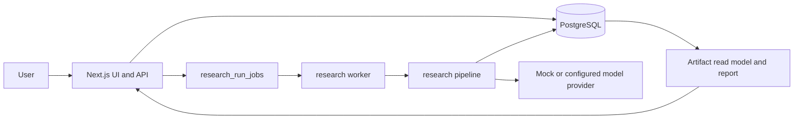
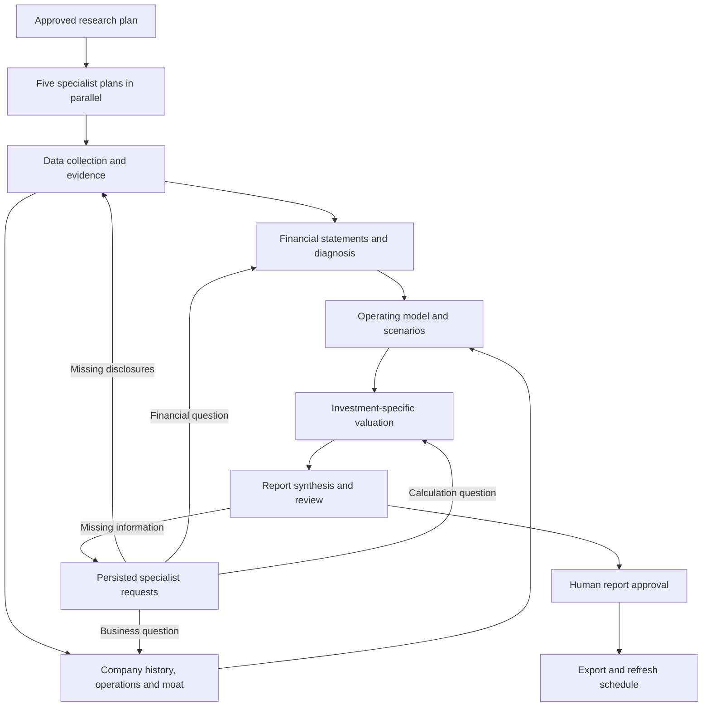

# Current system

Research OS creates evidence-backed investment research for an asset. PostgreSQL stores the workflow, sources, artifacts, decisions, and exported report. The Next.js app provides the UI and API; a separate worker runs queued research jobs.

The API creates a version 3 run with its 24 stage rows. A job lets the worker continue the pipeline outside the HTTP request. The research plan and final review stop for a human decision; approval queues another job. Stage contracts validate outputs before the pipeline persists typed artifacts. Export and refresh scheduling finish the run.

The composed research plan links each source role to specific artifacts. Source discovery records coverage only for fetched documents that pass role checks; evidence extraction rejects prior claims when their source is excluded on replay. Coverage records one representative document per role and artifact, while the evidence packet may use other eligible documents from the same run.

The pipeline runner dispatches independent handlers concurrently; `src/lib/workflow/orchestrator.ts` owns stage transitions, retries, human gates, resume, and completion checks. `src/lib/research/sources/corpus.ts` contains source ingestion and evidence persistence helpers. Quality gates read validated typed artifacts instead of treating completed model tasks as proof of artifact coverage.

Research is assigned to five specialist roles. Their definitions and stage dependencies live in `src/lib/research/team-plan.ts`.

| Specialist | Responsibility |
| --- | --- |
| Data | Discover and download sources, check coverage, extract evidence, and follow up on requested disclosures. |
| Financials | Read filing statements, normalize periods and units, preserve reported line items, and reconcile financial records. |
| Business | Assess management, operations, history, competition and intangible advantages; develop operating assumptions and bear/base/bull scenarios. |
| Valuation | Build investment-specific valuation schedules using checked financials and operating assumptions. Application code calculates discounting and value bridges. |
| Report | Plan coverage, combine analyses, ask specialists for missing information, and prepare the document for review. |

After plan approval, all five roles prepare their work plans concurrently. These are saved as `agent_brief` artifacts and supplied to their later tasks. The stage scheduler starts independent work together: financial normalization and company history can overlap, followed by historical diagnosis and business-process analysis. Forecasts wait for both business analysis and financial diagnosis; valuation waits for operating scenarios. Tasks receive their owner's purpose, work plan, outstanding requests, accepted upstream artifacts and evidence. Planning does not count as completed analysis.

`team.ts` saves report questions as `team_requests` artifacts with an owner, source role, materiality and response. A request reopens its specialist's stages and dependent stages, invalidates cached outputs and stale report approval, and uses normal validation before the report can continue. Specialists can escalate missing evidence to the data collector, which searches the specific question and applies existing document, source-role and cutoff checks. Answers must reference current evidence or artifacts. A material unanswered request becomes a blocked report question and withholds the conclusion.

Automatic investigation is bounded to two report request rounds with one source escalation per round. The saved request state survives restarts. Missing disclosures remain explicit; the system does not claim that every fact can be obtained. A session lock prevents two workers from executing the same run, and each parallel batch finishes before failure or human-gate transitions. Model attempts reserve estimated budget under a database lock. Actual costs are always recorded, including costs above the reservation; subsequent attempts check both spending and outstanding reservations.

The mock acceptance test in `tests/sofi-research-e2e.test.ts` exercises API route handlers, queued worker jobs, both human approvals, export, and refresh scheduling against PostgreSQL. It also checks duplicate enqueue requests, lease recovery, failed-run resume, and model-task cache invalidation. It does not exercise the browser UI or paid providers.

Historical v1 and v2 rows remain in the database. The current runner accepts version 3 runs. Source and market-data cutoffs are stored per run.

New plans enable [adaptive reports](adaptive-research.md). The review stage composes
company-specific sections before reviewing the complete document. Human approval
binds the report and its input snapshot; export reproduces that approved version.
