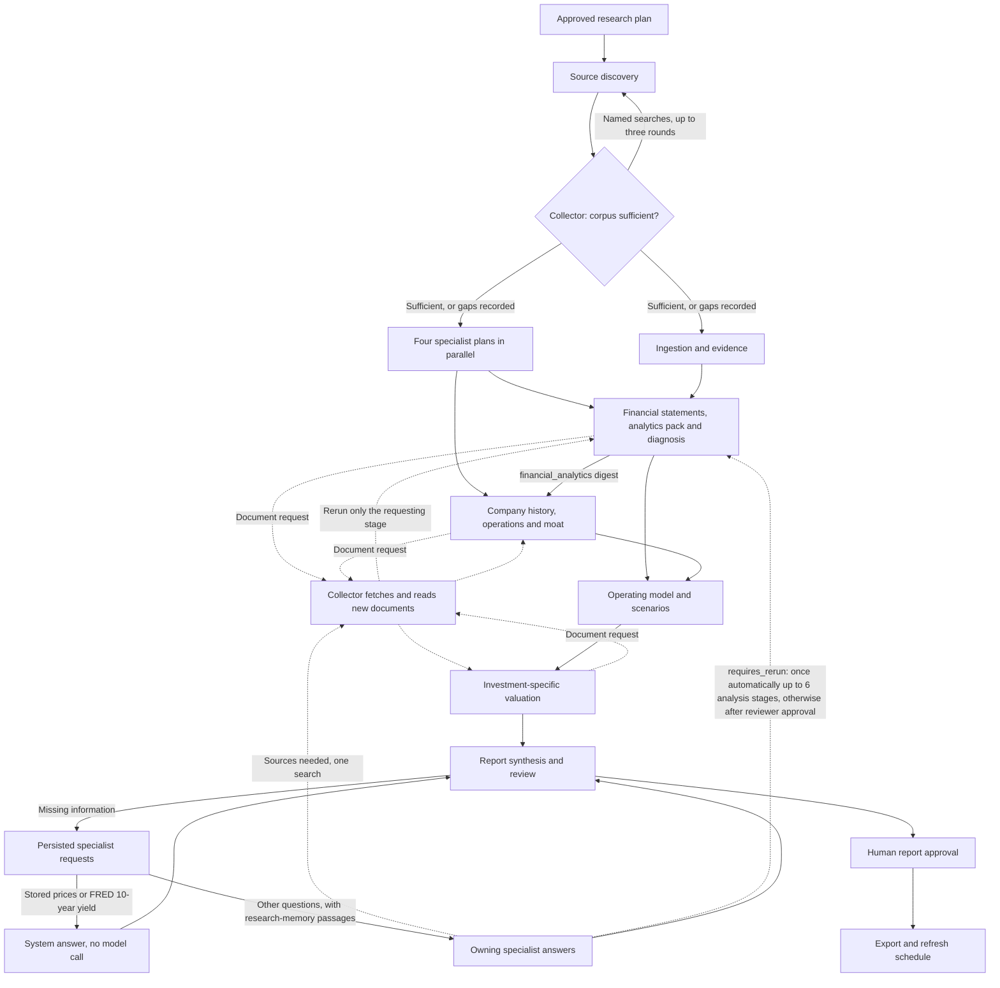
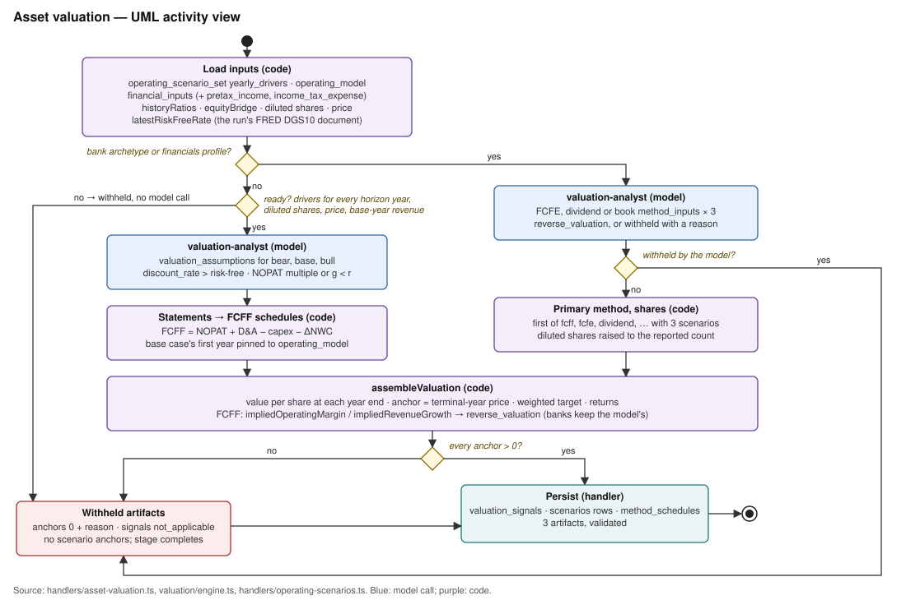
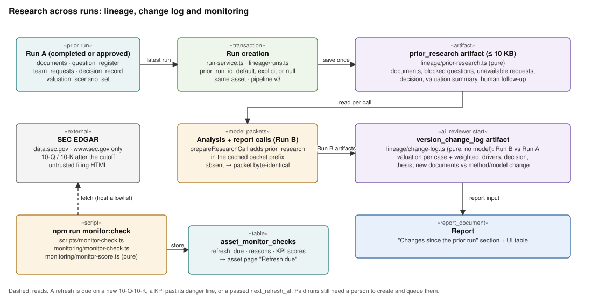

# Current system

Research OS creates evidence-backed investment research for an asset. PostgreSQL stores the workflow, sources, artifacts, decisions, and exported report. The Next.js app provides the UI and API; a separate worker runs queued research jobs.

| Component | Responsibility | Source |
| --- | --- | --- |
| UI pages | Client components that call the API: command center, asset catalog and detail, run cockpit, report view, review queue. The run cockpit polls every 5 s only while the run or its job is active, one request at a time and not while the tab is hidden; it asks for model calls and backtests with `?summary=1`, which returns only the fields it lists (no request/response metadata, parameters or results). The report view opens with `GET /api/research-runs/:id/report?summary=1`, which leaves out artifact bodies over 64 KB stored (marked `content_omitted`; the overview's own types are always sent) and the report document's `artifacts` copies. The Report, Financials and KPI views load the full report the first time they open and keep it until the run or its row changes. The view re-reads the run list every 60 s while visible, and the report itself only while its run is `running` or its run row changed. The polled run, quality and report routes share a long-lived raw pool (`sqlClient`, separate from drizzle's, whose timestamp parsers drizzle replaces); the quality gate reads artifact bodies only when a required module isn't covered by artifact names, evidence or metrics | `src/app/**/page.tsx`, `src/components/**` |
| API routes | 54 route files. Reads and writes over research tables, run control (create, enqueue, approve plan, request re-run decision, review, cancel), upload ingest, chat, export, saved charts, operator sign-in (`/api/session`). No accounts; `src/proxy.ts` refuses foreign Host names and cross-site writes and, when `RESEARCH_OS_API_TOKEN` is set, requires that token on every API route and page; only `/_next/*` and static files by extension skip the check ([security.md](security.md#authentication-and-authorization)) | `src/app/api/**`, `src/lib/api/*`, `src/proxy.ts`, `src/app/login/page.tsx` |
| Run service and queue | Creates a run (`pending`, version 3) and its 24 stage rows, linked to the asset's prior run with its `prior_research` block ([Research across runs](#research-across-runs)). Enforces one active job per run. Claims with `SKIP LOCKED` under a 5-minute lease, with up to 3 attempts and worker heartbeats. Puts a job back without using an attempt (shutdown, run locked elsewhere) and re-queues running runs left without a job | `src/lib/research/run-service.ts`, `run-queue.ts` |
| Research worker | Polls every 5 s and survives failing polls (5 s to 60 s backoff). Requeues expired jobs and orphaned runs, claims a job, renews the lease every 10 s and runs the pipeline. A lost lease or a shutdown signal aborts the run. When idle, runs backtest tasks | `src/workers/research-worker.ts`, `poll-loop.ts` |
| Pipeline runner and team | Per-run advisory lock. Scheduling passes over ready stages, team briefs, source and research requests. Handlers run in parallel as a dataflow: each stage is advanced when it settles and a clean completion starts its newly ready dependents at once; requests, failures, skips and gates wait until in-flight stages drain. Retries a stage whose model call failed transiently | `src/lib/research/pipeline-runner.ts`, `handlers/**`, `team.ts`, `team-plan.ts`, `sources/collector.ts` |
| Workflow orchestrator | Stage configs (retries, budget, `failureState`), `advanceStage` validation, gates, resume, `completeRun`, `failRun` and `cancelRun`. Stage transitions, artifact and stage validators, quality gates and model-call records share one lazily created pool (`pipelineSql`, idle connections close after 2 s so scripts and tests still exit); other pipeline code still opens a client per call. Keep session state (advisory locks, `SET`, `LISTEN`) and `drizzle()` off that pool | `src/lib/workflow/stages.ts`, `orchestrator.ts`, `src/db/pipeline-sql.ts` |
| Agent harness | Provider selection and model resolution, prompt caching, structured-output parsing and repair, deadlines, telemetry | `src/lib/agent-harness/**`; [local-agent-harness.md](local-agent-harness.md) |
| Sources and research memory | Discovery and safe fetch, structured data fetchers, daily price history, passages, per-need retrieval, embeddings, evidence graph | `src/lib/research/sources/**`, `src/lib/research/memory/**`, `src/lib/ingestion/**`, `src/lib/market-data/**` |
| Backtesting and repair | Framework backtests for stage 18. Python backtest tasks run model-written code in an OS sandbox (`sandbox.ts`: no network, writes only to the backtest directory; prices are fetched first, outside it). The statement-repair module runs in a Node sandbox | `src/lib/backtesting/**`, `python/backtesting/**`, `src/lib/research/repair/**` |
| Reporting and export | Adaptive report sections, report snapshot, memo and research-package export | `src/lib/research/reporting/**`, `src/lib/export/**`, `src/lib/valuation/**` |
| Lineage and monitoring | `prior_research` and `version_change_log` across runs; `npm run monitor:check` scores new filings and marks a refresh due | `src/lib/research/lineage/**`, `src/lib/research/monitoring/**`, `scripts/monitor-check.ts` |
| Database | 17 schema modules, registered once in `src/db/schemas.ts` for the app client and the migrator; migrations `0000`–`0006` and `0009`–`0016` | `src/db/schema/**`, `src/db/schemas.ts`, `drizzle/` |

Deeper views are in [architecture.md](architecture.md): deployment, class, the run activity, the state machines and the sequence.

The API creates a version 3 run with its 24 stage rows. A job lets the worker continue the pipeline outside the HTTP request. The research plan and final review stop for a human decision; approval queues another job. Stage contracts validate outputs before the pipeline persists typed artifacts. Export and refresh scheduling finish the run.

## Research framing and the plan gate

Framework Stage 1 ("Define the Asset") is one model call at the research-plan stage (`draftFraming` in `src/lib/research/handlers/research-plan.ts`, contract `ResearchFraming` in `src/lib/research/framing.ts`, task `plan:framing:<n>`). Before any document is collected it drafts the central question, a decisive-insight hypothesis, what the investor owns, up to five engines (earner, burner, growth investment, option) with how each is valued, up to eight key questions with falsifiers, named peers with tickers, priority documents, management axes, and proposed archetypes and overlays (registry keys only). All of it is labelled as hypotheses. The plan artifact stores it as `framing`, and the plan's questions become the central question plus the key questions. The plan no longer copies the doctrine (`report_standard.output_requirements` is a one-line note); every doctrine prompt already carries it.

- **Archetypes.** `archetype_composition` composes `operating_company_core` plus the archetypes the asset's stored sector and industry map to (`classificationArchetypes`, which reuses `kpiArchetypes`; the financials profile keeps bank and lender). Archetypes named at run creation are kept. The framing may add archetypes that compose without errors (`mergeFramingArchetypes`), and the reviewer can change them at the gate. `metadata_json.v3_archetypes_source` records `request`, `classification`, `framing` or `reviewer`. `advertiser_count` is optional in the advertising archetype, because many platforms don't report it.
- **The gate.** The run page shows the framing first, as editable fields, with archetype and overlay checkboxes and earlier feedback (`src/components/framing-editor.tsx`). `POST /api/research-runs/:id/approve-plan` accepts optional `framing`, `archetypes`, `overlays` and `forecast_years` (3-10, checked before anything is written; the horizon is written first, so the rebuilt plan carries it). `applyPlanGateEdits` validates them (`checkGateEdits`), recomposes the profile, saves the next plan version (`framing_source: "reviewer"`) and approves it in one transaction, with no model call; an invalid edit rolls back the whole approval, and edits sent for a plan already approved get 409 with no job queued. Approval writes the approved framing to `metadata_json.research_framing`.
- **Request plan changes.** `POST …/request-plan-changes` appends the notes to `metadata_json.research_plan_feedback`, reopens the research_plan stage, sets the run running and queues a job. The framing call reruns with every note and the previous framing, and the gate reopens on the next plan version. The old `action=request_changes` branch of approve-plan is removed.
- **Every packet.** `loadRunContext` exposes the approved framing as `ctx.researchFraming`, and `prepareResearchCall` puts it in every model packet, right after `research_question` in the shared prefix, except metric normalization and the framing call itself, with `FRAMING_RULE`: answer the key questions the stage can answer, keep the engines separate, flag contradicting evidence. That includes evidence extraction and the collector's source review, so priority documents and named peers steer collection.
- **The report answers it.** The outline is told to give each key question its own entry with the same id, organize sections around the central question and the engines, and state in the opening whether the central question held (`FRAMING_OUTLINE_RULE`). Key questions the outline skips are added as qualified material questions (`includeFramingQuestions`), visible to the reader and the reviewer, not blocked, so they never withhold the conclusion on their own.

**Analyst outputs with typed homes.**
- `business_process_analysis` makes a second, small call, `management_assessment` (`MANAGEMENT_CONTRACT`): five separately scored axes (operating execution, balance-sheet discipline, capital returns, capital allocation, governance alignment), each 1-5 or null. A score must cite a `financial_analytics` path or a claim, and governance needs a cited claim (`validateManagementAssessment`). The stage's stored outputs now include it.
- `moat_assessment` entries carry a framework §7.6 `classification` (unproven to exceptional), six 0-5 `scores`, `supporting_claim_ids` and `artifact_paths`. Code checks the citations against what the run stores and caps strong or exceptional at moderate, saying why in `classification_note`, unless the moat cites a history path that resolves in the stored `financial_analytics`, `historical_record` or `historical_diagnosis`, a `peer_benchmark.peers.<TICKER>` path naming a peer in a complete `peer_benchmark`, and at least one of the run's accepted claims (`capMoatClassifications`, `resolvesInArtifacts`, `resolvesToPeer`). Each attack names the moat it tests (`targets_moat`, checked against the assessment) and whether it survives fully, partially or not at all. Competitors may carry `ticker` and `peer_metrics`.

**Benchmarks beside the subject's history.** After the analytics pack, the historical-record stage saves two code-built artifacts (`saveExternalBenchmarks`). Network failures become gaps and never fail the stage, and mock or test runs fetch nothing (`status: "offline"`).
- `peer_benchmark` (`src/lib/research/sources/peers.ts`): the approved framing's named peers, at most four, resolved by ticker or exact normalized name against SEC `company_tickers.json`, then one companyfacts download each. Per peer, the last 8 quarters of revenue and operating income (SEC quarterly frames), TTM operating margin and revenue growth, and the last two fiscal years' operating cash flow, capex, capex/revenue and FCF margin, in USD millions, filed on or before the cutoff. Private and non-SEC peers are gaps. The ticker map is cached for a day and each peer's compact row per cutoff (at most 200 rows); the companyfacts file itself is not kept. Companyfacts has no segment detail.
- `demand_backdrop` (`src/lib/research/sources/demand.ts`): the normalized home country (`normalizeCountry`) picks keyless series. The US gets FRED RSAFS, PCE, ECOMSA and CPIAUCSL. Other countries get World Bank household consumption growth, CPI inflation and real GDP growth, and China also gets FRED DEXCHUS. Each series is reduced to its latest value, year-on-year change and five annual points on or before the cutoff.
- `prepareResearchCall` puts `peer_benchmark` into business, moat, valuation and decision packets, and `demand_backdrop` into business, operating-model and scenario packets, when their status is complete, with rules to compare against them and cite the artifact id. Report writers see both as ordinary artifacts. A historical_record rerun invalidates both.

**Issuer documents.** Every 8-K item 2.02 results release in the filing window is fetched, up to `MAX_EARNINGS_RELEASES` (21), instead of the newest four. Releases already stored are read back, not downloaded again. When SEC submissions name no investor website, discovery is seeded with the investor-relations host the asset's newest stored earnings exhibit names (`irHostsFromText`, for example investor.atmeta.com), so the IR role reaches the issuer's own site before aggregators. An asset's first run has no stored exhibit yet.

**Analyst behaviour rules.** The doctrine ends with five behaviour rules (`ANALYST_BEHAVIOUR_RULES`): separate earners from burners, place current metrics against their history, diagnose cash conversion, state what the investor owns, and go below the bear case with what would change your mind. Report prompts no longer repeat the doctrine, because `exactJsonPrompt` already adds it. The reviewer is told to challenge the valuation framing as calculation findings (`REVIEW_FRAMING_RULE`): a horizon inside a reinvestment cycle, terminal value above 75% of EV, terminal capex far above depreciation, unnormalized margins. It also checks that the report answers the central question.

The composed research plan links each source role to specific artifacts. Source discovery records coverage only for fetched documents that pass role checks; evidence extraction rejects prior claims when their source is excluded on replay. Coverage records one representative document per role and artifact, while the evidence packet may use other eligible documents from the same run. A fetched page is dated from its HTML date tags; an SEC archive document (`sec.gov/Archives/edgar/data/...`), which has none, takes the filing date from its EDGAR filing index. Accepted claims from undated sources (industry reports, peer PDFs, aggregator pages) reach specialist, team and report packets and can be cited; the report lists them as `undated`. Only a point-in-time run drops them, because an undated page may postdate its cutoff: a `backtest_only` run, or one whose source cutoff is more than a day before the run was created (`isPointInTimeRun` in `src/lib/research/reporting/store.ts`, applied by `loadReportInputs`).

The pipeline runner dispatches independent handlers concurrently; `src/lib/workflow/orchestrator.ts` owns stage transitions, retries, human gates, resume, and completion checks. `src/lib/research/sources/corpus.ts` contains source ingestion and evidence persistence helpers. Quality gates read validated typed artifacts instead of treating completed model tasks as proof of artifact coverage.

Research is assigned to a data collector, four planning specialists and one on-demand repair specialist. Their definitions and stage dependencies live in `src/lib/research/team-plan.ts`.

| Specialist | Responsibility |
| --- | --- |
| Data | Discover and download sources, decide when the corpus is sufficient for the specialists to start, extract evidence, and fetch documents the specialists request. |
| Financials | Read filing statements, normalize periods and units, preserve reported line items, and reconcile financial records. |
| Business | Assess management, operations, history, competition and intangible advantages; develop operating assumptions and bear/base/bull scenarios with yearly growth and margin drivers. |
| Valuation | Choose each scenario's discount rate and terminal assumption; for banks, build equity valuation schedules. Application code builds the statements, cash-flow schedules, discounting, value bridge, price path, anchors and reverse valuation. |
| Report | Plan coverage, combine analyses, ask specialists for missing information, and prepare the document for review. |
| Repair (on demand) | When deterministic filing parsing cannot locate primary statements, write a run-scoped module that locates the statement tables. |

After plan approval, source discovery runs first and alone. It collects the base corpus, then the collector (`source-discovery-agent`) reviews coverage against the research plan and either declares the corpus sufficient or names up to six targeted searches, such as a named competitor's annual report. Targeted searches skip seed sites and generic role queries, and a named peer's filing need not mention the researched company. There are at most three review rounds (`MAX_DISCOVERY_ROUNDS`). A required source role that is still uncovered becomes a medium-severity gap owned by `system:source-collector`: the run continues, and the gap names the affected artifacts and the collector's reason. A failed review does not stop the run; the corpus goes forward with its gaps. Each round is saved in a `source_review` artifact.

Only then do the four planning roles (financials, business, valuation and report) prepare their work plans concurrently, with the collector's assessment and document list; the repair specialist has no plan and cannot receive report requests. These are saved as `agent_brief` artifacts and supplied to their later tasks. The data role has no brief, so source ingestion and evidence extraction run while the plans are written, and the first stage owned by a briefed role waits for them (`teamBriefScheduler`). The stage scheduler starts independent work together: financial normalization and company history can overlap, followed by historical diagnosis and business-process analysis. Forecasts wait for both business analysis and financial diagnosis; valuation waits for operating scenarios. Tasks receive their owner's purpose, work plan, outstanding requests, accepted upstream artifacts and evidence. Planning does not count as completed analysis.

While a financials, business or valuation stage runs, its own analysis call may return an optional `source_requests` list of up to three named searches (`src/lib/research/sources/source-requests.ts`). The call then pauses its stage. Before the next scheduling pass, the runner fetches those documents, reads only them into evidence, refreshes role coverage and reruns the paused stage, which sees what each request found (`src/lib/research/sources/collector.ts`). Other branches and completed stages are not reopened. Each stage has at most two request rounds (`MAX_STAGE_SOURCE_REQUEST_ROUNDS`) and never repeats a query. Every model-chosen query, here and in the collector's review and report requests, passes `constrainSearch` first: plain words only (no URLs, domains or search operators), at most 200 characters, prefixed with the company's name and symbol when it asks for the company's own documents, and rejected when it asks for another organisation's documents without naming the company or a document type. Requests are saved per stage in `source_requests` artifacts, so a restarted worker resumes queued requests. Before searching, the collector asks research memory for the query within the requested source role. Keyword retrieval matches any query word, so a search counts as already answered only when a returned passage comes from a document of that role and contains at least 60% of the query's significant terms (`queryTermCoverage`: distinct tokens of three or more characters that are not stop words, such as `2025` or `10-k`). Such a search is recorded `in_corpus` with those documents and is not fetched. A peer's annual report that shares only "annual" and "report" with the query is still searched.

The report outline has two chapter rules: no chapter covers only history or evidence, and exactly one chapter covers valuation, together with forecasts and downside. Where a coverage label is enough, code fixes the outline before it is checked (`normalizeOutlineStructure` in `src/lib/research/reporting/contracts.ts`): a history- or evidence-only chapter also covers business, the valuation chapter after the opening summary gains forecasts and downside, and other chapters drop valuation, with the coverage map updated to match. Valuation listed only in the opening summary is left to the model's repair.

The outline also allocates each section its `key_figures`; a section writer explains its own and refers to other sections for theirs. After each AI review, `checkReportSubstance` (`src/lib/research/reporting/substance.ts`) adds `writing` findings for an `analysis` paragraph with no figure and no citation, and for reader-facing text that leaks pipeline terms (corpus, node fields, artifact, packet, supplied passages, record IDs, snake_case field names, numeric confidence scores) or process narration ("an earlier draft", "the model's note", "stored matrix/valuation outputs/FCFF cases", "the field is null", "code rebuilds", "reconciliation record", "citations removed"). It scans titles, paragraphs, counterevidence, implications, gaps, table titles, visual titles and captions, and, with no section attached, research questions and coverage rationales. Section findings send even a passed review through the one writing repair, which then rewrites only the flagged sections and the conclusion, without re-planning the outline; question and coverage findings are shown at human review but never force a rewrite. None fails the run, and any left after the repair stay on the saved review. A citation outside the report inputs is dropped from the section and recorded in the review's `dropped_citations`, never in reader-facing gaps (`keepUsableReferences`).

The outline also sets `chart_plan` on each quantitative chapter (history, business, forecasts, valuation). The section writer must then add that chart or record in `gaps` why it can't be drawn (`validateChartPlan`). Chart visuals (`history`, `series`, `ratio`, `scenarios`, `valuation_bridge` in `src/lib/research/reporting/visuals.ts`) name only an artifact, path and keys; `buildVisual` computes every number from stored `historical_record`, `operating_scenario_set` and `valuation_scenario_set` content. The report view draws them with Recharts and the Markdown export writes their data tables. A section table (`flatTable` in `src/lib/research/reporting/tables.ts`) must resolve to at most 60 flat rows: a `{ columns, rows }` table, one valuation schedule (`method_schedules.N`, printed as its years with the build as columns and the totals as a note) or a list of records nested at most one level, which become `parent.child` columns; a list of plain values (claim IDs, mitigants) prints as one `a; b` cell, and a record keyed by fiscal year prints one row per year. Anything else fails section validation with the nearest path to request instead, and a missing value prints as an em dash. Reports stored under `asset-framework-2.1-adaptive-1` keep the old renderer, so their content hash still verifies. Rules: [report-visual-guidelines.md](report-visual-guidelines.md).

The valuation chapter opens with a summary computed in the browser from the report's artifacts (`valuationSummary` in `src/lib/research/reporting/valuation-summary.ts`, drawn by `src/components/report/valuation-summary.tsx`). It reads `valuation_scenario_set`, `operating_scenario_set`, `expected_return_matrix`, `annual_price_target_path`, `reverse_valuation` and `decision_record`, and writes nothing. It shows the weighted target, the bear, base and bull values with probabilities, returns and each case's value today, three reasons computed from the base case, and collapsible detail: the calculation, key assumptions, what the last price implies (the reverse valuation against the scenarios' margins and growth), why it's not final, and the raw analyst notes. The page is marked not final while any issue is open. When a scenario's cash-flow model at the end of its last year doesn't give its scenario value, the summary names that case.

`team.ts` saves report questions as `team_requests` artifacts with an owner, source role, materiality and response. A round holds at most five new requests; any past the fifth are dropped before validation rather than repaired. Arriving requests reset no stage, task or artifact (`processResearchRequests`). Each unanswered request is resolved in this order:

1. **System answers.** A valuation-role or `market_data` request that asks in cost-of-capital terms (equity, levered, regression or stock beta, the equity risk premium, the cost of equity, CAPM, or beta alongside the discount rate or WACC) is answered first when the run's `market_price_history` holds a computed beta. A bare "beta" or "ERP", such as a product beta or ERP software, goes to the owner as usual. The answer gives the beta, the ERP and the CAPM cost of equity with the DGS10 rate (`resolved_by: "system:cost-of-capital"`). A `market_data` request, or a `data` request about a price or market cap, is answered from the run's latest validated `market_price_history` artifact when it holds bars: bar count, date range, provider, the Stooq cross-check's verified and unverified period counts and the valuation price (`resolved_by: "system:market-history"`). A question about DGS10, the 10-year Treasury, a Treasury yield, the risk-free rate or the discount rate is answered from the run's FRED DGS10 document with its latest non-blank value and date (`resolved_by: "system:fred"`). None of these makes a model call.
2. **Research memory.** Any other request goes to its owner (`TEAM_ROLES[role].agent`) with its slice of the report inputs, all accepted evidence and `passages`. The slice holds the artifacts of every stage the role owns and of the stages its home stage reads (`ownerArtifactTypes`), so the valuation owner sees operating scenarios but not the financial history. Passages are research-memory passages of the request's source role from this run's documents (`retrievePassages`, keyword ranking until embeddings are configured). When none of them matches the question by its words (for example a `proxy_and_governance` request in a run with no proxy statement), the issuer's own filings, earnings releases, investor-relations and proxy documents are searched once more, and each passage carries its own `source_role` (`requestPassages`). The current artifacts of the stages the role owns seed the evidence graph (`seedArtifactIds`), so passages holding the claims those artifacts cite reach the owner even when they share no word with the question: a quarter of the slots (2 of the default 8) when keyword matches could fill them all, and any slots keyword matches leave empty. SEC questions are answered from the stored filings, never by a new EDGAR lookup. An answer cites evidence, artifacts or passage documents (`source_ids`); `keepCurrentReferences` checks them against all current inputs and drops IDs outside the run.
3. **One search.** When a request that needs sources matches no passage by its words (cited graph passages don't count) or names a period (a date, quarter or year) that no document of its source role covers, or when the owner answers `needs_sources` and the run has not escalated yet, the collector runs one search for that request (recorded in `source_retrieval_attempts` with `request_id`). It searches the request's `document` field (organisation, document type and period, at most 200 characters), or the question when the requester gave none, through the same `constrainSearch` as stage searches, links new documents and reads evidence only from documents new to the run. The owner then answers once more with `source_search_attempted: true`; a second `needs_sources` becomes `unavailable`. Passages are retrieved once per answer: the owner reuses the retrieval made for the search test unless a search ran after it. An answer-triggered search sets `source_escalated` on the batch, which the next round keeps.
4. **Explicit re-runs.** Stages reopen only when an owner's answer sets `requires_rerun`, or a review's `analysis_rework` finding names the stage (`rework_stage`, see [Report review](#report-review-depth-checks-and-rework)) (`requestResetPlan`). The owner stage and its dependents are reset, skipped stages excluded. The first such re-run in a run is automatic when it reopens at most `RESEARCH_MAX_AUTO_RESET_STAGES` analysis stages (default 6, the tail stages not counted; `metadata_json.request_auto_reset` records it). Otherwise the run pauses: the run and the `ai_reviewer` stage become `waiting_for_human`, and `metadata_json.request_reset` holds the stages, request IDs and an estimated cost (earlier model-call cost of those stages). A reviewer chooses re-run or skip on the run page (`POST /api/research-runs/:id/request-reset`, `approveRequestReset`). A re-run, automatic or approved, invalidates cached outputs and stale report approval, supersedes open source gaps written by the reopened stages, and asks the re-run requests again once the reopened analysis stages complete. A skip marks the requests unavailable ("Skipped by reviewer: re-run not approved") and the report continues. An approved re-run does not use up the automatic one. Data requests never reopen source discovery.

A rerun records any gap that still applies, and a replayed source discovery counts documents linked by earlier passes toward role coverage, because web search results vary between calls. When a failed stage blocks all remaining stages, the run stops with that stage's name and reason. A material unanswered or skipped request becomes a blocked report question and withholds the conclusion.

Automatic investigation is bounded to two report request rounds before drafting plus one after the first review, one answer-triggered source escalation per run and one automatic re-run per run. The saved request state survives restarts, and a failed answer call leaves the stages unchanged; the request is answered on a later pass. Neither human gate can be bypassed by a request: re-runs refuse to start unless the run is `running`, and a re-run decision is refused while the research-plan or final-review gate is waiting. Missing disclosures remain explicit; the system does not claim that every fact can be obtained. A session lock prevents two workers from executing the same run, and each parallel batch finishes before failure or human-gate transitions. Model attempts reserve estimated budget under a database lock. Actual costs are always recorded, including costs above the reservation; subsequent attempts check both spending and outstanding reservations. A ledger row whose metadata PostgreSQL rejects is written again without the metadata, so its cost still reaches `model_budget_ledger`, and a failed ledger write never discards a successful model output.

Source text reaches the source reader through the research memory (`src/lib/research/memory/`, plan in `Implementations/research-memory`). When a source is stored, it is also split into passages along its headings, tables and pages, with HTML entities decoded, and saved as a `research-memory` parse whose chunks carry the section path. Table rows stay rows, also in fetched pages stored as text (cells joined by ` | `), and each later piece of a split table starts with the table's first row. Each passage stores `search_tsv`, its section path (weight A) and text (weight B) as a tsvector with a partial GIN index, so retrieval never re-parses passage text. The original raw chunks stay as they were, because valuation reads them verbatim; the SEC companyfacts context (`primary_source_context`) gets no passages and is outside the retrieval scope, because its data is read from the raw payload. Documents stored before this, or under an older parser version (`MEMORY_PARSER_VERSION`), are indexed the first time a run retrieves from them. Retrieval sees the run's documents with this run's own title and source role (from `research_run_sources`), so a document shared with another asset's run never shows that asset's name, and only the newest document per URL. Documents covering a period the need's query names (an ISO date, a quarter such as Q2 2026, or a year; a document counts when its period end, or without one its publication date, falls in the period's window: a date to 45 days after it, a quarter or year from 45 days after its start to 45 days after its end, so a release filed in a quarter's first weeks counts for the quarter before) are searched first and the rest of the scope fills the remaining slots; a named period no document covers is reported as a `no_documents_for_period` gap once its window has opened, so a maturity or target year after today is not a gap. Ties go to the newest document, and a note restated in several filings (same section and opening words, digits ignored) takes one slot for each named period (that period's newest copy), or one slot for the newest copy when no filing from a named period has it. Evidence extraction asks one need per source role present in the run (for example "founder and company origin" for founder-history documents), scoped to the run's eligible documents, and passages whose section titles match rank first. The needs share a passage budget of 4 per document, between 32 and 128 (`evidencePassageBudget`, `RESEARCH_EVIDENCE_PASSAGES_PER_SOURCE`, `RESEARCH_EVIDENCE_PASSAGES_MAX`). After the KPI and governance needs, the role needs split the rest in proportion to the square root of each role's stored passages, at least 3 each and never more than the role stores; slots a role cannot use go to the others, and rounding leftovers go to filings, then earnings releases, then any role with passages to spare (`rolePassageShares`, counts from `rolePassageCounts`). With META's 4,602 filing passages and a 20-passage IR aggregator page, the filings get about 60 slots and the page 3, where an equal split gave each 12. A `governance` need (8 passages) searches filings and proxy material for voting power, share classes, beneficial ownership, controlling holders, executive pay and repurchases. When the run has filings or earnings material, a `headline_kpis` need takes a quarter of that budget: it searches those documents for the headline operating KPIs of the run (`HEADLINE_KPIS` in `src/lib/research/memory/needs.ts`, for example daily active people, ARPP, ad impressions and average price per ad for an advertising platform, or net interest margin, deposits and credit losses for a bank), and the source reader is told to extract each reported KPI value as an `operating_kpi` claim. The KPI lists come from the run's composed archetypes plus those the asset's stored sector and industry, or the SEC SIC code kept in the primary source context's metadata, map to (`kpiArchetypes`); the generic operating-company list is used when nothing more specific applies, and also alongside an archetype that rests on the SIC code alone without confirming sector, industry or SIC-description text. SIC 7370 counts as an ad platform only with ad, social or internet-content wording; "Credit Services" without payment wording gives both the lender and payments lists; gas utilities are not commodity producers. The archetype composition uses the same classification (`classificationArchetypes`, see [Research framing](#research-framing-and-the-plan-gate)). The need matches each KPI's filing phrases whole (`phrases`, `phraseQuery`), so words such as "revenue" or "price" never match on their own. Batches that return under half their claim target get one gap retry each, run with the same concurrency as the batches. The claim target is 40 (deep dive and full initiation report) or 20, plus 3 per document, capped at 160 (`evidenceTargets`, `RESEARCH_EVIDENCE_TARGET_*`); the deterministic inventory fallback tops up only to the old floor of 25 or 12. Analysis stages read accepted evidence through `loadAcceptedEvidencePacket`: up to 120 claims (`RESEARCH_EVIDENCE_PACKET_LIMIT`), each with its supporting quote cut to 280 characters, ranked by confidence plus a recency bonus (measured from the newest claim date, capped at the run's cutoff) and taken round-robin across claim types, with source-inventory claims last (`rankEvidencePacket`). When neither founder need returns a passage, the stage asks the collector for founder history before any source-reader call: one search per round through the `evidence_extraction` source-request ledger, waiting while a round is queued, and once `MAX_STAGE_SOURCE_REQUEST_ROUNDS` rounds are used it fails with the `founder_origin` gap. The founder pass reads passages returned for the founder need and, after them, founding statements found in filings and investor material. The founder check counts only claims that affirm the founder or origin; absence statements, claims describing the supplied excerpt, and system inventory claims do not count. When the founder check is the stage's only validation error and the failing attempt ran a founder pass, the retry invalidates only that pass (`evidence_extraction_role_gap`, matched by the task key the attempt reports in its validation result; a pass left by an earlier attempt does not count), so the source-reader batches replay instead of re-reading the corpus; any other validation error invalidates every completed task. A role whose need matches nothing contributes its documents' first passages, except founder history, which records the gap instead of reading a cover page. Fetched web pages are stored as structured text with Markdown headings, so their sections survive. A source stored again (same content hash) keeps its file and its current research-memory parse: neither is rewritten or parsed again. The shared `source_documents` row keeps the asset, title and metadata of the run that stored it first, so each run reads a document's role from its own `research_run_sources.discovery_metadata_json` (falling back to the document's metadata when the link carries none, as for uploads): role coverage, evidence-extraction role checks and the stored-IR-seed lookup (which also matches an asset through the runs linked to a document) all do ([#114](https://github.com/ToRRIIDeR97/Investing-Research-Pipeline/issues/114)). The raw payload chunks (9,000-character slices) are written with their parse in one transaction under a per-document advisory lock, 200 rows per INSERT, so the companyfacts context's thousands of chunks no longer take one round trip each and a crash never leaves a partial chunk set ([#132](https://github.com/ToRRIIDeR97/Investing-Research-Pipeline/issues/132)). The companyfacts context is still chunked and stored per run, because valuation links the diluted-share fact to the chunk spanning its offset. Passages and their offsets live only in `document_chunks`; no normalized-text copy is written to `storage/parses` anymore (nothing read it), though older parses still name theirs. SEC appends a random script tag to every EDGAR response, so an Archives document (`sec.gov/Archives/edgar/data/...`) that an earlier run stored is read back from `storage/` instead of downloaded again (`storedSecFiling`); a new download would hash differently and be stored as another copy. Only rows the filing fetcher wrote (`metadata_json.source = 'sec_edgar_filing'`) whose file still matches its `file_hash` are reused, so an upload labelled as a filing never replaces the download. Copies stored before this, and files no database row names, are removed only by the opt-in cleanup in [operations.md](operations.md#storage-cleanup).

Embeddings are off by default. With `RESEARCH_EMBEDDING_PROVIDER=openai-compatible` (or `mock` for tests), evidence extraction first gives every passage of the run's eligible documents a vector, stored in `document_embeddings` per embedding model, in requests of at most 64 passages; a misconfigured provider stops the stage with an error that names the variable. Each request is preceded by budget preflight and recorded in `model_call_logs` as the `embedder` agent, and so is the one-text request that embeds each need's query. When the budget refuses a request or the provider fails, that document stops embedding, keeps its keyword index, and records the failure in its parse warnings. Retrieval then fuses keyword and vector rankings with reciprocal rank fusion (k = 60), so a passage can be found by meaning without sharing a query word; it uses only vectors of the configured model. Vectors stay in the jsonb column and are compared in application code, streamed in batches: on a local database, 4,000 passages of 1,536 dimensions rank in about one second. pgvector can replace this comparison later behind the same function.

The business-process, moat, operating-model and report-section calls also receive `filing_passages`, so they can explain why reported figures moved rather than only recite them (`src/lib/research/memory/filing-passages.ts`). `callResearchAgent` loads them for those four task types (`FILING_PASSAGE_TASKS`) after the evidence is in the packet. `latestFilings` picks the newest document of each form (source type) among the run's `regulatory_filing` and earnings documents published by the source cutoff, so the latest 10-K, 10-Q and earnings release are read rather than every year's copy of the same discussion; documents sharing a form's newest date are all kept, undated documents stay in, and a form whose newest copy is over two years older than the newest filing (an old annual report fetched from the web) is left out. Every research-memory passage of those documents is scored by `passageScore`: driver phrases ("driven by", "primarily due to", "attributable to", "compared to", up to 4) and stated changes ("increased 22%", "an increase of 7%", up to 3), plus the section title ("Trends in …" +4, "… Metrics" +2, MD&A, results of operations or executive overview +2, segment +1, revenue, cost, liquidity or outlook +1). Competition, common-stock and stockholders'-equity sections get +2. Intro boilerplate ("In this section, we discuss …", "should be read in conjunction"), number-only tables, and risk, forward-looking, exhibit, legal and metric-limitation sections score low, and a passage scoring 0 or less is never chosen. A risk passage that states share classes, votes per share, voting power, a controlled company, a VIE or depositary shares, or names competitors ("competitive products … such as TikTok") scores +3 instead, since the filing often says this nowhere else. `selectFilingPassages` takes the highest scores first, then the newer document, then document order. It keeps at most six passages per document and one passage per section title (the newer filing's copy), cuts each to 3,000 characters and stops at a JSON byte budget, `RESEARCH_FILING_PASSAGE_BYTES` (default 24,000; 0 turns the passages off). Each passage carries `passage_id` (the `document_chunks` row), `source_id`, title, section and `claim_ids`: the accepted evidence claims located in that chunk that the packet also carries, so a model cites a passage through IDs its stage's validators already accept. The prompt adds `FILING_PASSAGE_RULE`, which calls the passages untrusted data. The same inputs give the same passages in the same order. A compacted fallback request keeps the first four (`FALLBACK_FILING_PASSAGES` in `src/lib/agent-harness/runner.ts`).

The evidence graph is written as research proceeds. A source-reader output may list contradictions between two of its claims (`{claim_texts, description, confidence}`); once both claims are stored, `persistEvidence` writes a `contradicts` row in `claim_relationships` with the confidence, the extractor and its prompt version, both claims' source locations and `review_status = 'unreviewed'`. Saving an artifact through `saveReportArtifact` or the artifact repository links it in `research_artifact_claim_links` (`support_type = 'cites'`) to the run's claims named under `evidence_ids`, `evidence_claim_ids`, `supporting_claim_ids` or `claim_ids` at any depth. A retrieval need can name seed claims or artifacts: the passages holding those claims, and the claims one unrejected relationship away, are returned with `matched: "graph"`, break ties among equally relevant passages, and take a quarter of the result slots (rounded down) after the relevance matches, plus any slots those leave empty. Graph-only passages holding the most seed claims come first, then the newest filing and document order; a note restated in several filings keeps one copy, and none when a relevance match already holds it. The graph query returns at most five times the limit (at least 50) passages, and the text of only twice the limit graph-only passages is read. Team requests are the only caller that seeds it, with the owner's artifacts. Contradiction edges come only from claims within one source-reader batch (at most eight passages), so conflicts between filings are not recorded and the one-hop expansion rarely finds anything; recording them would need a pass over the merged outputs.

Each model request has an output limit (32,768 tokens by default; reasoning counts toward it). When a pass spends the whole limit on reasoning and writes no answer, or is cut off at the limit (`max_tokens` or `length`) before its JSON is complete, the next attempt doubles the limit instead of repairing the cut-off reply, up to `RESEARCH_MAX_OUTPUT_TOKENS_CEILING` (131,072 by default). Claude models are held to their documented output cap (128,000; 64,000 for Claude Haiku 4.5). `model_call_logs.request_metadata_json.max_output_tokens` records the limit each attempt used. Provider 5xx and overload errors (including Anthropic's 529, its mid-stream `overloaded_error` and `api_error` events, and OpenCode's 400 "Upstream request failed") are retried, and fallback models run on them; these and rate limits wait at least 5 s, doubling, or the `retry-after` the provider sent, up to 60 s. A 429 that reports a spent account limit (for example OpenCode Go's `GoUsageLimitError`) fails at once as `quota_exceeded` instead of being retried, so the run stops with that reason and can be resumed after the limit resets. Two mechanical slips are corrected in code instead of a repair pass: an answer for a single required key that returns the artifact itself, with `artifact_type` equal to that key, is wrapped under it (`src/lib/agent-harness/output-parser.ts`), and a report table path starting with `content_json.` resolves inside the artifact's content (`src/lib/research/reporting/tables.ts`).

Model requests are laid out for provider prompt caching (`src/lib/agent-harness/cache.ts`, adapted from the Codetonomy foundation harness). An agent's instructions are sent as the system message and its task packet as the user message, with run-wide context (asset, question, evidence, filing passages) at the start of the packet. The instructions also state once that everything in the packet (fetched pages, filings, passages and earlier model output) is data, never instructions (`UNTRUSTED_DATA_RULE`). Calls that run as siblings name their per-call packet keys (`perCallKeys`): a report section's plan, artifacts and completed sections, a source-reader batch and its corpus, a team request with its passages. `callResearchAgent` moves those keys after the shared context, including `team_context`, so the sibling calls send identical bytes up to them. A schema repair repeats the original request and appends the repair, so the provider can serve the repeated part from cache. Requests in the same run, model and instructions share an opaque affinity key, sent to OpenCode Go as `x-opencode-session`; the run ID itself is never sent. Anthropic-protocol requests mark the instructions with a cache breakpoint. For Claude models, `src/lib/agent-harness/providers/anthropic-cache.ts` also marks the end of the shared part of the task prompt, which sibling calls and repairs read from cache, or the end of the whole task prompt when a call names no per-call keys. On `anthropic-direct`, Claude requests also carry the task's output schema as `output_config.format` when `providers/anthropic-schema.ts` can express it in the API's subset; local zod validation and repair are unchanged, and each pass records `structuredOutput: { sent, fallback }` under `provider_requests[]` ([structured output](local-agent-harness.md#structured-output)). TTL and switches are documented in [local-agent-harness](local-agent-harness.md#prompt-caching). Provider-reported cache reads and writes are priced separately and stored in `model_call_logs.response_metadata_json`. Each request also records, under `provider_requests[].cache`, hashes and byte counts comparing it with the previous request in its affinity group, and a reason when the cache was missed. These records never contain prompt content. `RUN_PAID_RESEARCH=1 npm run test:provider-cache-smoke` sends six small requests through the configured provider (DeepSeek V4.1 Flash by default, `RESEARCH_SMOKE_MODEL` to change it) and reports the prompt tokens it served from cache.

The mock acceptance test in `tests/sofi-research-e2e.test.ts` exercises API route handlers, queued worker jobs, both human approvals, export, and refresh scheduling against PostgreSQL. It also checks duplicate enqueue requests, lease recovery, failed-run resume, and model-task cache invalidation. It does not exercise the browser UI or paid providers. `tests/run-lifecycle-db.test.ts` covers the recovery and cancellation paths described below.

## Run failures, recovery and cancellation

- **Transient model failures.** When a stage handler fails because its model call ran out of attempts on a transient error (5xx or overload, rate limit, timeout, dropped connection, malformed stream, exhausted output), the stage stays `running` and is dispatched again after 30 s, doubling up to 120 s (`RESEARCH_STAGE_RETRY_DELAY_MS`), up to the stage's `max_retries`. The count is kept in `research_stages.validation_result_json.transient_failures`. Completed tasks are reused. Any other handler error stops the run as `needs_more_work`.
- **No replay of a failed attempt.** When a handler or its post-check throws for another reason, all of its stage's completed tasks are marked `validation_status = 'invalid'`, as a validation failure does, so a resume calls the model again instead of replaying the output that led to the failure. This includes outputs the attempt replayed from before a transient retry or a resume. A stop from the model-call layer (any `ResearchAgentRunError`, such as a spent provider quota or an authentication error, or the run budget guard's `ModelBudgetExhausted`) says nothing about those outputs, so they stay valid and a resume replays them once the cause is fixed.
- **Parallel batches.** Every finished stage of a batch is advanced before a failing sibling is handled, so finished work is kept.
- **Atomic transitions.** `failRun`, `pauseForHumanReview` and the gate branch of `startNextStage` write the run and its stages in one transaction. `resumeResearchRun` marks stages left `running` or `waiting_for_human` on a stopped run as failed and resumes from the earliest one. When that earliest stage is a gate left `waiting_for_human`, or is `human_review` (which no handler runs), the stage and the run go back to `waiting_for_human` for the reviewer instead. A pass that finds the run `running` with no stage it can dispatch stops it as `needs_more_work`, so the reconcile step below never requeues a run that cannot progress.
- **Worker shutdown and lost leases.** SIGINT or SIGTERM aborts the in-flight model call through the run's abort signal and puts the job back in the queue without using an attempt; the running stage reruns on the next claim. A second signal exits at once. A lease renewal (every 10 s) that finds the lease gone aborts the run the same way. A worker that finds the run locked by another worker puts the job back for one lease instead of failing it.
- **Orphaned runs.** Each poll queues a job for a `running` v3 run that had a job before and has seen no job activity for 60 s, for example after an approval whose enqueue failed, or a job that failed outside the pipeline. Retrying the final approval also queues the export.
- **Cancellation.** `POST /api/research-runs/:id/cancel` (the run page's **Cancel run**) sets the run, its open stages and tasks, and its active job to a terminal state: the run is `cancelled` and cannot be queued again. A worker running it aborts the in-flight model call at its next lease renewal. Work already done stays readable.

## Filing statements and the repair specialist

Source collection selects filings from the five and a half years before the cutoff: up to five annual reports, every 10-Q whose period ends inside the 20 quarters ending at the newest 10-K or 10-Q period (15 for a calendar-year filer; the Q4s come from 10-Ks), four earnings 8-Ks, the newest DEF 14A and up to three SC 13D/G or SCHEDULE 13D/G filings for domestic issuers (`selectResearchFilings` in `src/lib/research/sources/corpus.ts`). Proxy and ownership filings are stored with `source_role: proxy_and_governance`; foreign issuers report the same in the 20-F. SEC's `filings.recent` block holds only the latest 1,000 filings, which for an issuer with heavy Form 4 traffic (META) covers under two years. `loadSubmissionFilings` then fetches the older submission pages listed in `filings.files` that overlap the window, one at a time with the SEC User-Agent and through `fetchCapped` (timeout and body cap), until the rows reach the window start. Each filing is stored as soon as it is read (`fetchSecFilingPayloads` with a callback), so one filing body is in memory at a time. It accepts only page names shaped `CIK##########-submissions-###.json`, and a failed page fails the SEC context rather than silently shortening history.

`src/lib/research/history/filing-statements.ts` reads primary statements from inline XBRL filings. Headings identify statements first; when a filing still lacks one, non-dimensional us-gaap tag fingerprints identify it. Each table records whether it came from a heading, tags or repair. Values always come from tagged facts. A fact in a zero format (`fixed-zero`, `zerodash`) is 0 whatever its text says ("no", "none", a dash), and `ixt-sec:numwordsen` maps no, none, nil, zero and one to twelve; any other text stays an unresolved fact. When an issuer recasts an earlier period, the latest filing's value is used for that metric and period even if the tag changed. A cash-flow statement's opening balance (an instant the day before its earliest period starts) is kept only for a period that other observations already fill, so it can't create an otherwise-empty fiscal-year column. Standalone quarters are derived from cumulative periods only for currency facts. Q4 weighted-average share counts and per-share values stay unavailable, because the 10-K reports only the annual figure and annual minus nine months isn't valid for weighted averages.

The SEC companyfacts series (`src/lib/research/history/sec-companyfacts.ts`) identifies quarters by each fact's own dates, so 52/53-week, June and September fiscal years keep their history: a quarter is a duration of 80 to 100 days or a fact SEC framed as a quarter, and a balance counts when it falls on a fiscal period end. A quarter not reported on its own is the year-to-date fact less the year-to-date fact with the same start that ends one quarter earlier. `historical_diagnosis` keeps metric observations by the same 80-to-100-day duration rather than by calendar quarter. Companyfacts and model rows carry dates only, so `historical_record` and `historical_diagnosis` label them on the filings' fiscal calendar (`src/lib/research/history/fiscal-calendar.ts`): the period ends and fiscal labels in `financial_statement_set`, extended along the quarter grid from the nearest known end (within 10 days). A June fiscal year's Jan-Mar quarter is therefore fiscal Q3 in both artifacts, and it fills only that slot of the record when no filing row has it. With known fiscal periods, a row off the grid, or an annual row that doesn't end a fiscal Q4, is left out; with none, rows keep calendar labels.

The extractor also keeps `segment` tables: facts whose context has exactly one dimension, `us-gaap:StatementBusinessSegmentsAxis`, for revenue and `OperatingIncomeLoss`. They become observations with the same `metric_key` as the consolidated line, `segment` set to the XBRL member (for example `meta:FamilyOfAppsMember`) and `metadata_json.statement = 'segment'`. Segment tables don't count toward statement coverage, and consolidated TTM series ignore any observation with a segment or geography. The operating-model stage passes them to the asset analyst as `reported_segment_history`, separate from the consolidated `recent_reported_history`.

The same capture reads total headcount from the run's 10-K, 10-Q and 8-K text (`src/lib/research/history/headcount.ts`). It accepts only company-wide statements with an as-of date: "Headcount was N as of <date>", "As of <date>, we had (approximately) N (full-time) employees", "we had a global workforce of N employees as of <date>", and the Total row of an "employees by country as of <date>" table. Forward-looking, conditional, segment, team, country-only and contractor wording is rejected, and conflicting counts for one date in a document give nothing. Each count becomes an `employees` observation (unit `persons`, `reporting_basis: 'as_reported'`, `metadata_json.metric_category: 'operating_metric'`, `period_type: 'instant'`) with the source document, a `text-offset:` locator and the evidence sentence in metadata. Like a balance-sheet amount it is quarterly, plus annual at fiscal year-end, and never summed into TTM. The as-of date must be a fiscal period end known from the captured statements, or fall within 10 days of the quarter grid from one; other dates are listed in `headcount_unplaced`. For one date the latest filing wins, and a 10-K or 10-Q beats an 8-K filed the same day. There is no model fallback yet (TODO in `headcount.ts`). The view lists headcount under "Other reported metrics".

The historical-record stage reads the filed statements and the SEC companyfacts series before it calls the metric-normalizer, so incomplete statements stop the stage before that call. The normalizer's packet lists `covered_metric_keys` (everything those two sources already supply) and `uncovered_required_metrics` (the research plan's required metric families they leave open; a family is covered by its own key, by a statement category or, for `share_count`, by a share-count fact). It is told to return at most 60 observations, for uncovered metrics only, which is also how many rows `persistMetrics` keeps. When every required family is covered the call is skipped.

If a readable filing still lacks a primary statement, the historical-record stage calls the repair specialist (`src/lib/research/repair/`). It writes a JavaScript `locateStatements(filings)` module from table summaries (surrounding text, tag names, row labels; no values). The module runs in a sandbox described in [security](security.md) and returns only table locations; the normal extractor then reads the facts. A repair is accepted only when every filing has all three statements, no unresolved facts and reconciling balance sheets. There are at most three attempts, each given the earlier errors. Every attempt's source, SHA-256 and errors are saved in a `statement_repair` artifact; nothing is written to the codebase. An unresolved repair leaves the stage failed with the original message and a summary.

## Foreign private issuers (20-F, 40-F and 6-K filers)

A foreign issuer files no 10-Q: its annual report is a 20-F or 40-F, and its quarters arrive as 6-K results releases (an Ex-99.1 press release with no inline XBRL). JD.com is the reference case (`tests/fixtures/jd/`, trimmed from real EDGAR filings).

- **Choosing 6-Ks.** A 6-K's description and `reportDate` say nothing about its content (JD files every 6-K as "FORM 6-K", dated on filing), so `selectResearchFilings` keeps every 6-K in the filing window as a candidate, up to `MAX_FOREIGN_UPDATES` (90). `fetchSecFilingPayloads` reads each cover (stored covers are reused), and keeps the filing only when the cover's exhibit index names a results release (`isResultsCover`). Each Ex-99 exhibit is then kept only if its own opening announces results (`isResultsRelease`). Notices, buyback announcements and interim-report duplicates are not stored.
- **Statements.** `captureFilingStatements` reads 20-F and 40-F annual reports with the inline-XBRL parser, and the stored results releases with `extractReleaseStatements` (`src/lib/research/history/press-release.ts`). That parser makes one linear tag scan (`scanTags`) with caps of 4 MB, 120 tables, 150 rows and 40 cells. A table counts only under a statement heading (operations, balance sheet, cash flows) or as a segment table (a "Total segment income from operations" line), and only under a recognised header: a period phrase, a date row and a currency row. "(1,234" followed by ")" is read as negative. Convenience-translation columns (US$ beside RMB) are dropped, so the reporting currency is the first column's. Three-month columns are quarters and full-year columns are years; six- and nine-month columns are year-to-date facts. Release labels map to US-GAAP concepts where they match (revenue, operating income, cash, debt, equity, operating cash flow, capex), so the metric catalogue and the analytics pack read them; other lines keep `press:<label>` concepts. Segment lines (`press:<Segment>Member`) are the names in the segment table's revenue section. A statement continued on the next page is merged into one table. The fiscal year end comes from the annual report's period.
- **Completeness.** `financial_statement_set.quarter_coverage` counts standalone quarters with consolidated revenue. A foreign issuer with fewer than `MIN_FOREIGN_QUARTERS` (12) stops the historical-record stage with the range it found. A release balance sheet can omit a line the filed one has (JD's Q2 2025 release drops a small mezzanine balance), so release balance checks that don't add up are reported as `unconfirmed` and don't stop the stage; filed-statement mismatches still do.
- **Currency.** `dominantCurrency` picks the ISO currency most companyfacts money facts use (CNY for JD) instead of assuming USD, for companyfacts quarters and book values. Companyfacts reads 20-F and 40-F facts as well as 10-K and 10-Q ones. The SEC context records `reportingCurrency` and `reportingTaxonomy`. For a non-USD reporter, source discovery stores the FRED FX series for a USD price (`fxSourcePayload`; DEXCHUS for CNY, map in `valuation/v2.ts:fxSeriesFor`) with `metadata_json.series_id`. The valuation reads its latest value on or before the cutoff.
- **ADS ratio.** Ordinary shares per ADS come from the newest results release that states them ("each ADS representing two Class A ordinary shares"), else from the 20-F (`depositaryRatioFromText`; several different ratios in one text give none). The historical-record stage writes it to one instrument only (`writeDepositaryRatio`): the asset's instrument typed or named ADS/ADR/depositary, else the instrument in the price currency, and only while its ratio is empty. An ordinary-share listing in Hong Kong keeps no ratio. With the FX series and the ratio, the valuation converts per-ordinary-share RMB values to a per-ADS USD value instead of withholding.
- **Leases.** `valuationFinancialInputs` records `accounting_standard` from the captured concepts (`ifrs-full` when IFRS facts outnumber US-GAAP ones). Under IFRS 16 every lease is a liability whose cost is outside FCFF's operating costs, so `equityBridge` subtracts `lease_liabilities_ifrs` (`ifrs-full:LeaseLiabilities`, or current plus non-current). Under US GAAP, operating lease liabilities stay out of the bridge, as before. JD reports under US GAAP.
- **Debt beyond the long-term total.** For a foreign issuer only (a statement set with `quarter_coverage`, passed as `foreignIssuer` by the valuation, operating-model and scenario stages), `valuationFinancialInputs` adds an `other_borrowings` column, summed per period (`otherBorrowingKeys`). US filers' inputs and bridges are unchanged: their `ShortTermBorrowings` and loan tags stay out, as before. Short-term borrowings and commercial paper are always included. Separately tagged notes, bonds and loans (current and non-current) are included only when no `LongTermDebt` or `LongTermDebtNoncurrent` total is captured for the period, because those totals already contain them. An earnings release's own face lines (senior notes, bonds, borrowings, loans; never totals) are always included. A release line that appears under both the current and non-current headings keeps a `_current` or `_non_current` suffix, so the two aren't merged. `equityBridge` subtracts the column, and invested capital includes it. For JD at 30 June 2026 the column holds RMB33.7bn: senior notes 13.6bn + 16.6bn, and short-term debts 3.5bn. The release's "Investment in equity investees" maps to `EquityMethodInvestments`, so it enters the bridge as `long_term_investments` (RMB58.0bn for JD). The JD demo bridge is RMB146.6bn, RMB98.42 per ADS.
- **Demo.** `npx tsx scripts/fpi-capture-demo.ts` runs the whole capture on the JD fixtures, with no database or network.

## Financial analytics pack

After it builds the record, the historical-record stage computes `financial_analytics` (`src/lib/research/history/analytics.ts`, `buildFinancialAnalytics`) from the merged statement, record and market rows, and saves it with a small zod schema (`FinancialAnalytics`). It reuses `MetricBook` for aliases, fourth quarters derived from the fiscal-year total, TTM sums and average balances, so nothing is estimated and a missing input stays null with its reason in `missing`. Amounts are currency millions, ratios decimals; every table is `{ columns, rows }` (about 16 KB for META). It holds:

- 20-quarter statistics (n, median, min, max, latest, percentile of the latest) for revenue YoY, gross, operating and FCF margin, capex/revenue, SBC/revenue, cash conversion, working-capital days, net cash, share change, yields and segment margins;
- segments from the filings' segment note (member prefix and `Member` suffix stripped, so `fb:` and `meta:` rows merge): quarterly and fiscal-year revenue, operating income, margin, share of consolidated operating income, cumulative operating income, an earner/burner role and a burner's loss as a share of the earners' operating income;
- cash conversion on TTM flows: FCF (also net of finance-lease principal), FCF/NI, OCF/NI, capex/D&A, capex − D&A as a growth-capex proxy, NOPAT at one normalized tax rate (the median quarterly effective rate within 0-50%), invested capital, ROIC, revenue/net PP&E, and 1/2/3-year incremental operating margin and ROIC;
- working capital: DSO on TTM revenue, DPO and DIO on TTM cost of revenue, CCC and NWC/revenue; trade payables win and total payables fill the rest, with the switch noted;
- capital allocation: net cash (cash + current securities − long-term debt), period-end shares summed over classes (`sharesAtPeriodEnd`) with the class split, TTM buybacks, dividends and SBC as a share of FCF, and buyback, dividend, FCF and FCF-minus-SBC yields on the period-end market cap.

The same stage saves `financial_statement_summary` (`src/lib/research/history/statement-summary.ts`): captured filings and their status, window quarters with no filing, reconciliation results and the latest balance sheet's lines, with flags for current debt and finance-lease lines. Doctrine item 1 tells writers to report a statement gap only where this summary shows one.

How the pack reaches the models:

- **Analysis stages.** `prepareResearchCall` puts `analyticsDigest` (every statistic and segment total, the last eight quarters of each table, about 11 KB) in the shared, cached packet prefix for `company_genesis`, `business_process_analysis`, `moat_analysis`, `operating_model`, `operating_scenarios`, `asset_valuation` and `decision_synthesis`. `company_genesis` therefore depends on `historical_record`, and `business_process_analysis` on `historical_diagnosis`, so a financials re-run also re-runs genesis, business and moat (13 analysis stages, above the automatic re-run limit).
- **Report packets.** `financial_analytics`, `financial_statement_summary` and `report_facts` lead the shared part of every outline, section and review packet (`splitReportArtifacts`). `packet.ts` replaces `historical_record` in model packets with a small view (coverage, reconciliation and a `chart_series` index of the quarterly series a chart may name); tables, charts and Financials still read the stored observations. Report packets drop `team_context.upstream_artifacts`, which repeated their own artifacts, and claim `url` and `location`, which code renders. Conclusion sections get a code-built digest of each finished chapter instead of its text (`chapterDigest`): title, implication, one key point per paragraph (its opening sentence, at most 320 characters), counterevidence and gaps, `other_figures` (every other figure the chapter states, each with the clause that carries it, at most 90 characters, cut so the figure survives), and every evidence and artifact ID the chapter cites. They also get only the claims those chapters cite, no filing passages, and an outline whose other section plans keep only id, title, coverage and key_figures (questions and coverage stay whole). Their selected artifacts go through the model view first (so `historical_record` keeps its coverage gaps and reconciliation summary) and then lose any top-level field over 4 KB (`conclusionArtifactView`, which lists the dropped fields in `omitted_fields`). The valuation v2 judgments `valuation_matrix`, `sanity`, `cross_checks`, `terminal_value_share` and `value_beyond_explicit_share` are always kept. `report_facts` and `financial_analytics` carry the remaining figures, and table paths into dropped fields still validate against the stored artifacts. No model call builds the digest. `reportSectionCall` in `runtime.ts` builds every section packet, for the runtime and the packet-size replay alike.
- **report_facts** (`src/lib/research/reporting/facts.ts`), saved before each report draft: per-case PV per share and return, terminal price target and undiscounted return, terminal value's share of EV, the explicit cash-flow sum, a no-rerating return (today's EV/NOPAT held to the terminal year), the probability-weighted PV, FCF and FCF-minus-SBC yields, and EV/NOPAT on TTM and next-year NOPAT.
- **Monitoring KPIs.** `fillMonitoringLevels` (`src/lib/research/decision/monitoring-levels.ts`) matches each KPI by `metric_key` and segment, never by name, first against the pack (adding `history_median` and `history_percentile`) and then against the latest consolidated reported observation, scaled into the KPI's unit. A KPI stated with the opposite sign keeps the model's level.

The record's TTM series and statistics cover the core consolidated flow lines present plus planned keys that are themselves observed flow keys (`ttmMetricKeys`); plan families stay coverage groups. The stage's validator fails a record with 12 or more quarters of consolidated revenue but no TTM revenue, or with no `financial_analytics`.

`npx tsx scripts/report-packet-size.ts <run-id>` (read-only) rebuilds a stored run's report-section prompts with the current code and prints their size. It replays sections in runtime order: each conclusion reads the sections before it, and the last one gets the provisional coverage and the conclusion contract. On META run `4fae0fb1` the ten body sections come to 81-105K estimated tokens (81-278K logged). With chapter digests (2026-10-22, after the phase 3 merge) the two conclusion sections are 86K and 91K, down from 115K and 146K with full chapter text (151K and 366K logged). `--live <section-id,...>` with `RUN_PAID_RESEARCH=1` also sends those sections to the configured provider, without writing to the database, and prints usage, cost and whether each output passes the section contract. On Claude Haiku 5.5 (2026-10-21) valuation-and-downside, executive-judgment and evidence-gaps-and-unresolved measured 93K, 110K and 133K input tokens and all three passed on the first attempt. Those conclusion measurements predate the digests.

## Price history and market data

Source discovery also keeps a daily price history for the asset (`src/lib/market-data/price-history.ts`). `syncAssetPriceHistory` runs beside the 5-day market snapshot and never fails the run; its summary is returned in the stage output as `priceHistory`.

- **Bars.** The first run backfills six years of Yahoo daily bars up to the run's market-data cutoff (or now) into `market_price_bars` through the market-data service (`syncDailyHistory`). Later runs fetch only from five days before the latest stored bar in the run's window. Coverage is judged inside the window: when it starts more than a week late or has a gap of more than seven days between bars (left by runs with other cutoffs), the whole window is fetched again. Rows are stored under the exchange-local trading day at UTC midnight, with `available_at` at the next UTC midnight, after every regular session closes. A bar that is not final yet (today's live bar) is never stored, and stored rows are never overwritten. Readers use only bars with `available_at` on or before the cutoff.
- **Corporate actions.** Splits and dividends from the same provider go into `corporate_actions` up to now, not the cutoff: Yahoo closes are split-adjusted as of retrieval, so later splits are needed to recover the price as traded. A close is re-expressed on another split basis with `closeOnSplitBasis`.
- **Cross-check.** Unverified bars in the window are compared with Stooq's daily CSV (`src/lib/market-data/providers/stooq.ts`). A bar is `verified` when the closes agree within 0.5% (on the close, or on the dividend-adjusted close), `mismatch` otherwise, and stays `unverified` when Stooq has no row for the day. The result is stored in `verification_status`, `verification_json` and `verified_at` (migration `0010_price_history_verification`), and each Stooq request is logged in `market_data_fetches`. When Stooq is unavailable (HTTP error, rate limit or a browser check instead of CSV), prices stay unverified and the run continues. After a failed cross-check Stooq is not called again for that instrument for 24 hours, and the summary's `cross_check.reason` says so. Source discovery saves the sync summary in the `source_review` artifact (`price_history_sync`), and `market_price_history` copies its `cross_check.status` and `reason` (`unknown` when no summary was recorded), adds a method line when the check did not run, and the system answer to a market-data request names the reason.
- **Period-end observations.** After the filing statements are captured, the historical-record stage saves a `market_price_history` artifact (`src/lib/research/history/market-history.ts`). For each quarter and fiscal year in `financial_statement_set` up to the cutoff, it records `period_end_share_price` (the close on the last trading day on or before the period end, at most seven days earlier, as traded that day) and `market_cap` (that close × common shares outstanding at the period end). Share classes are summed from the per-class `us_gaap_CommonStockSharesOutstanding` facts, and a non-dimensional total wins when present. Without a period-end count, the latest diluted weighted-average count is used and labelled in `share_basis`. The close is put on the split basis of the share count's filing. Each row carries `metadata_json.verified`, the cross-check result and a source locator (provider, symbol, trading date, bar id). The Financials metric catalogue uses these rows for its price-based metrics; the artifact is excluded from report-writing inputs.
- **Benchmark and beta.** Beside the asset's sync, `syncBenchmarkPriceHistory` stores S&P 500 (`^GSPC`) bars the same way, cross-checked against Stooq's `^spx`. They live under a shared reference asset (slug `benchmark-gspc`, `asset_kind` `index`, `status` `reference`), which the asset list omits. Test mode (`RESEARCH_TEST_MODE=1` or the mock acceptance provider) skips this sync. The `market_price_history` artifact then carries `beta` (`regressionBeta` in `src/lib/research/valuation/cost-of-capital.ts`). It is the OLS slope of weekly simple price returns on the index: each week's last close available by the cutoff, split-adjusted, no dividends. The window is the 104 weeks ending in the cutoff week, and only returns between consecutive weeks that both series traded count. The artifact records the raw beta, the Blume-adjusted beta (0.67 × raw + 0.33, the value used), R², standard error, observation count and window. With fewer than 52 returns it records `status: "unavailable"` and a reason. The beta counts as `verified` only when every weekly close in the window passed the cross-check.
- **Valuation price.** The valuation stage uses the last stored close available by the cutoff (no older than seven days), with its verification status, as `current_market_price`, and records where it came from in `current_market_price_source`. The 5-day market snapshot is always a live fetch, so a run whose snapshot was fetched more than a day after its cutoff is historical: the valuation packet gets only the snapshot's currency, never its live price or 52-week range. Without a stored close, a historical run is withheld ("no stored close on or before the cutoff") with no model call; only a run valued as of its fetch date falls back to the snapshot's `regularMarketPrice`.

## Financials view: statements, metrics and charts

The asset's Financials view (`src/components/financial-statements.tsx`, `src/components/financials/**`) reads only saved observations: `researchObservations` merges the filed `financial_statement_set`, the `historical_record` and `market_price_history` rows, including `employees` headcount. It has six tabs (all statements, the three statements, Metrics and My charts) with the Quarterly/Annual toggle at the end of the tab row.

- **Statement charts.** Each statement opens with the compare-periods table (eight quarters or five years; "As filed" shows the original tables). Every row has a chart button: a click charts that row alone, shift-click adds or removes it, up to six series and two units. A sticky panel above the table charts the selection with Recharts (`chart-series.ts:buildChart`): editable name, values or change on a year earlier, bar or line per series, quick-compare presets, a tooltip listing every series for a period, percentages on the right axis, and gaps for missing values (never zero). The income statement adds italic calculated rows: gross profit (when not reported) and gross, operating and net margin.
- **Metric catalogue.** `metric-catalogue.ts` computes 39 metrics in nine groups (margins, valuation, returns, shareholder returns, stock-based compensation, yields, per share, per employee, leverage). Margins, SBC, payout and per-share metrics use flows of the same period. Returns divide trailing-12-month numerators by the average of the period-end balance and the balance a year earlier; ROIC uses income from operations × (1 − the period's effective tax rate) over equity + long-term debt − cash − marketable securities, and debt to EBITDA uses long-term debt over trailing EBITDA. Price metrics use the period-end market cap from `market_price_history` and are marked when the close was not cross-checked. Per-employee metrics divide trailing flows by the period-end headcount. When a quarterly flow is missing but the fiscal-year total and the other three quarters are saved, the quarter is derived from them and marked. Any missing, conflicting or mixed-currency input leaves the metric unavailable with that input named. Each value opens a detail panel with the formula, inputs and their basis, notes and sources.
- **My charts.** Saved charts are stored in `saved_charts` (migration `0011_saved_charts`) through `GET/POST /api/saved-charts` and `PATCH/DELETE /api/saved-charts/:id`. A definition (`saved-charts.ts`, zod-validated) holds series keys (an observation `metric_key` or `metric:<catalogue key>`), bar or line, axis, chart type, frequency, range and mode, never values, so the board fills with whichever asset is open. Saved charts are not scoped to a user or an asset.

## Valuation inputs, the valuation engine and withheld valuations

- **Financial inputs.** The valuation packet carries `financial_inputs` (`src/lib/research/valuation/financial-inputs.ts`), built from `financial_statement_set` and `market_price_history`. It holds the last 8 quarters and 4 fiscal years of revenue, cost of revenue, operating income, income before tax, income tax expense, D&A, SBC, operating cash flow, capex, cash, marketable securities, debt, lease liabilities, non-operating investments (equity-method and non-marketable stakes, including company-prefixed `*_NonmarketableEquitySecuritiesCarryingValue` tags), noncontrolling interest, net PP&E, stockholders' equity, diluted shares, headcount, period-end close, market cap and `price_verified`. It is one columnar table in millions, with consolidated rows public by the market-data cutoff. Columns with no captured value are listed in `not_captured`. The layout is fixed, so identical inputs produce identical bytes for prompt caching and task reuse.
- **Yearly drivers.** Operating scenarios return `yearly_drivers` for every year of the forecast horizon: the latest captured fiscal year +1 to +N, checked by `validateScenarioDriverCoverage`. N is the run's `forecast_years` (3-10, migration `0015_valuation_v2`): set at run creation (`forecast_years` in the create-run body) or by the reviewer at the plan gate (`forecast_years` in the `approve-plan` body; the plan card shows it and the run page has the input). Without it, `RESEARCH_FORECAST_YEARS`, else 5 (`forecastYears` in `engine.ts`). The research plan records the proposed value; the approval writes `research_runs.forecast_years`. Each year has revenue growth and operating margin, with optional capex, D&A, tax and working-capital overrides, and optionally `segment_operating_income` ([{segment, operating_income}], summing to consolidated within 0.5%) for the loss-segment cross-check. D&A without an override rolls forward from net PP&E: base-year D&A over the prior year-end net PP&E, times the PP&E each year starts with, closing = opening + capex − D&A (revenue × the history ratio only when PP&E was not captured). Each year also records maintenance capex (up to D&A), growth capex, net reinvestment, invested capital (rolled forward from the base year's equity + debt − cash − securities), ROIC and incremental ROIC. The handler stores the horizon and builds `resulting_financial_statements_json.years` with `buildScenarioStatements` (`src/lib/research/valuation/engine.ts`). The base case's first year takes revenue and operating income from `operating_model`, converted to millions when its unit can be matched to base-year revenue. Code gives `operating_model` its forecast period (`forecast_period`: the year after the latest captured fiscal year), and its check rejects a `consolidated_revenue` within 0.5% of the reported base year, which would restate that year instead of forecasting the next.
- **Forecast inputs.** `business_process_analysis` records an undisclosed competitor share or bottleneck capacity as null, never a placeholder number, and the share-loss rule (C8-T6) applies only to a disclosed share above 10%. `operating_model` sets `top_down_bottom_up_reconciliation.bottom_up_forecast_total` to the segment revenue sum in code, before the model's answer is checked and before it is stored, and the contract rejects a bottom-up total above a sourced TAM or customer budget (C10-T5). `operating_scenarios` states the capex it copies from `reinvestment_model`; the zero-capex placeholder sentences appear only when that forecast is empty or all zero, and an empty working-capital forecast keeps the model's text and is recorded as a source gap.
- **Valuation engine (FCFF assets).** The stage takes the last FRED DGS10 value on or before the cutoff from the run's macro document as `risk_free_rate`. Both valuation packets (FCFF and bank) also carry `cost_of_capital_inputs` (`costOfCapitalInputs`). It holds the captured `beta`, an `equity_risk_premium` and their CAPM cost of equity: risk-free rate + adjusted beta × ERP, marked unverified when the beta is. The ERP is Damodaran's year-end implied ERP for the S&P 500 (FCFE model), recorded with its source URL in `IMPLIED_ERP_YEAR_END` from the January 2026 update. A year-end value counts as public from 15 January of the next year. The stage takes the latest value public by the cutoff and flags it as stale when it is over 400 days old. A missing, unverified or stale input is added to `source_gaps`, and the set is saved on `valuation_scenario_set.cost_of_capital_inputs`. The prompt tells the model to build its discount rates from these inputs and explain any departure from the CAPM rate. Adding the next year's value means appending a row to `IMPLIED_ERP_YEAR_END`. `valuationReadiness` requires drivers for every horizon year, diluted shares (the reported SEC count, else the latest captured count), a price and base-year revenue. When anything is missing, the stage withholds with that list and makes no model call. Statements in one currency and a price in another need an FX rate (a FRED `DEX*` series document in the run, on or before the cutoff) and the depositary ratio (`instruments.depositary_ratio`, ordinary shares per listed share): without either the stage withholds and names it (`currencyConversion` in `src/lib/research/valuation/v2.ts`). A depositary listing (an instrument typed or named ADS/ADR/depositary, or a run with 20-F/40-F filings) needs the ratio even in one currency, and an uncaptured statement currency also withholds. With both, amounts are converted to the price currency and values are per listed share. Source discovery stores the FX series and the historical-record stage the ratio for a foreign issuer (see Foreign private issuers). Otherwise the model returns only `valuation_assumptions.sets`: three valuation sets, conservative, base and aggressive, each with a discount rate, terminal growth, RONIC, fade years and rationale, separate from the operating cases. The packet carries `default_valuation_sets` (base = CAPM, used as the FCFF rate; ±1pt; terminal growth 2.5% capped at the risk-free rate, ±0.5pt; 5 fade years) and `ronic_default` (the mean of the 20-quarter median ROIC and the base case's explicit incremental ROIC, bounded to 4-60%; the discount rate when neither exists). The validator requires r above the risk-free rate, conservative ≥ base ≥ aggressive rates and the reverse for growth, g below r and not above the risk-free rate, RONIC above terminal growth (at or below it the value-driver terminal is zero or negative; the schedule math rejects it too), and a `ronic_rationale` for a RONIC more than 0.5pt from the default. Code then builds (`buildFcffValuation` in `v2.ts`):
  - per case and set, an FCFF schedule: the explicit years, then fade years in which growth moves linearly to g, the margin holds and reinvestment = g / RONIC × NOPAT, and a value-driver terminal TV = NOPAT × (1 + g) × (1 − g / RONIC) / (r − g);
  - timing: discounting at year fractions from the valuation date (the price's trading date), with the first year counting only its cash flow after the quarters already reported (NOPAT + D&A − capex; pro-rated when a quarter lacks a component);
  - the equity bridge: each item's latest value on or before the latest balance-sheet date, cash + securities + non-operating investments − debt − finance leases − noncontrolling interest. Operating lease liabilities are not subtracted, because their cost is already in operating income;
  - the value per share at each explicit year end (the bridge grows by the FCFF retained, as no dividends are forecast), the anchors and weighted target on the base set, `value_today_*`, `weighted_value_today` and the annualized return to the terminal year;
  - `valuation_matrix` (every case × every set, value today) and `sensitivity_grid` (base case, r ± 1pt × g ± 1pt);
  - `reverse_valuation`: the EV/NOPAT at the end of the forecast the price needs (closed form), the perpetual growth that reproduces it at the base RONIC, and 10-year growth from TTM NOPAT, NOPAT − (capex − D&A) and OCF − capex with the value of flat cash flow; the uniform margin and growth stay as secondary fields;
  - `cross_checks`: EV/NOPAT, EV/EBIT, P/FCF and FCF yields (OCF and NOPAT bases, SBC treatment stated) at the price, the stock's quarterly EV/NOPAT and FCF-yield range from `financial_analytics` (one currency only), the EV/NOPAT the valuation assumes at the forecast end, and per case the no-rerating value (today's EV/NOPAT on terminal-year NOPAT, plus bridge and retained FCFF). `decision_synthesis` takes `no_rerating_return` from the base case in code;
  - `lens_values` for the required lenses: dcf (weighted value today), multiple (own-history median EV/NOPAT on next-year NOPAT) and cash_flow (TTM FCF at the own-history median yield), written as `valuation_signals` with a cheap-to-expensive signal from value / price, or `not_applicable` with the reason, which the profile gate reports as a warning;
  - `terminal_value_share` (the terminal value alone, after the fade years: the same measure as `report_facts.tv_share_of_ev`, which the depth review gates at 0.85) and `value_beyond_explicit_share` (fade years plus terminal: information, not a gate);
  - `sanity`: flags for a terminal value above 85% of EV, weighted value / price outside 0.6-1.6, the assumed terminal multiple outside the own-history range and terminal-year capex above 1.5× D&A, with one-at-a-time per-share deltas (terminal at the own-history median multiple, r at CAPM, RONIC at the history ROIC, ten fade years, g at the risk-free rate) when the value or terminal flag fires;
  - `stress_cases` below bear: impairment (bear operations, conservative set, RONIC = r) and tail (also g = 0 and the final explicit NOPAT cut 30%);
  - `segment_cross_check`: loss-making segments as an after-tax loss stream, persistent or fading to zero over the fade years, with core value and value if losses fade; `segments_reconciled` comes from the segment sums;
  - `depreciation_warnings` when D&A/revenue rises more than 3pt while the margin also rises.
- **What-if.** `npx tsx scripts/valuation-whatif.ts <run-id> [--rebuild] [--set base] [--discount-rate r] [--terminal-growth g] [--ronic x] [--fade-years n] [--grid] [--json]` (read-only, no model call) recomputes a stored FCFF valuation: from the stored v2 statements and sets, or, for a run valued before v2 or with `--rebuild`, from the stored scenarios, statements, price and cost-of-capital inputs under the code-default sets. More explicit years need new drivers, so the horizon is the stored one.
- **Banks.** Runs with the bank archetype or the financials profile keep model-built FCFE, dividend or book schedules. Code raises any share count below the reported diluted count, takes the first method with all three scenarios and assembles the path, anchors and returns from it. The model writes no price path; its reverse valuation is kept.
- **Cash-flow build.** When D&A was captured, every model-built fcff and fcfe year must include a `build` (`starting_profit`, `depreciation_amortization`, `capital_expenditures`, `change_in_net_working_capital`, `other_adjustments`). That build must reconcile to `cash_flow` and add back positive D&A (`cashFlowBuildErrors` in `src/lib/research/valuation/schedules.ts`). Violations go through the normal schema repair.
- **Reported diluted shares.** The latest quarterly `WeightedAverageNumberOfDilutedSharesOutstanding` fact becomes an accepted evidence claim. It is linked to its source by its character offset in the stored companyfacts file: the chunk or chunks spanning that offset (chunks are fixed 9,000-character slices of the file), so a fact that straddles a chunk boundary is still linked.
- **Withheld valuation.** The stage withholds when the readiness check fails, when a historical run has no stored close by its cutoff, when a bank analyst finds no method that can be built from the packet, or when a code-built anchor is not positive. It saves its artifacts with `valuation_status: "withheld"`, all three anchors exactly 0 and a `withheld_reason` (`withheldValuationReason` in `src/lib/research/valuation/contracts.ts`), writes the required lens signals as `not_applicable` with the reason, and stores no scenario anchors.
  - The stage's `valuation_depth_validation` accepts it as a warning, so the run continues.
  - Decision synthesis keeps the decision pending, sets `valuation_accepted_first` to false, prefixes the return linkage with the withheld marker and stores every return as null with `status: "withheld"`. The export prints the reason in place of the valuation tables.
  - At completion, the quality gate still reports the missing anchors under the key `valuation_withheld`, so the run ends `needs_more_work` rather than `completed`.

Historical v1 and v2 rows remain in the database. The current runner accepts version 3 runs. Source and market-data cutoffs are stored per run.

New plans enable [adaptive reports](adaptive-research.md). The review stage composes
company-specific sections before reviewing the complete document. Human approval
binds the report and its input snapshot; export reproduces that approved version.

## Report review, depth checks and rework

The reviewer (`research-reviewer`, `AI_REVIEWER_CONTRACT`) answers a fixed list of 19 `depth_checks` beside its findings (`DEPTH_CHECKS` in `src/lib/research/reporting/depth.ts`), keyed to framework sections 8 and 11 and the JD example: decisive insight, what the investor owns, segment economics, history statistics, cash conversion, working capital, capital allocation, demand backdrop, moat attacks, management, the valuation matrix, reverse valuation, FCF-yield cross-check, no-rerating return, a tail below bear, thesis breakers, monitoring, what would change my mind and a scorecard. Each check is `met`, `partial`, `missing` (the stored data supports it and the report lacks it), `data_unavailable` or `not_applicable`; the contract rejects a review that skips or repeats one. 13 checks are decision-critical, and each names the analysis stage that owns it.

Code derives the verdicts (`deriveReview`); the reviewer's own verdict is kept as `model_verdict`.

- **Code overrides availability.** Where the stored computed artifacts decide it (`depthDataSupport`: `financial_analytics` statistics, segments, cash conversion, working capital and capital allocation; `report_facts` no-rerating returns and yields), a `data_unavailable` answer about data that exists becomes `missing`, and a `missing` answer about data that doesn't becomes `data_unavailable`.
- **`review_verdict`** is the worse of the model's verdict and the depth verdict: a missing decision-critical check gives `needs_more_work`; a decision-critical `partial` or `data_unavailable`, or a missing optional check, gives at most `conditional_pass`. It drives the repair round.
- **`effective_verdict`** also counts blocking findings: any critical finding left in the final review, and any high `calculation` finding that a code flag confirms (`valuationFlags`: terminal value above 85% of EV, no no-rerating return, a permanent-loss limit equal to the bear return, a terminal multiple on a year whose FCFF is under half of NOPAT). Unconfirmed high findings don't block, because model severity labels are noisy.
- **Repair.** A review whose effective verdict doesn't pass, or that has any open high or critical finding, gets the one repair round with all of its findings plus each missing decision-critical check as a `depth_gap` finding. That category goes to the section repair, not the outline re-plan, and names the reviewer's section or the first section covering the check's coverage key (`depthFindings`).

**Rework after the review.** Pre-draft report requests may use two rounds; a third is kept for the first review (`RequestBatch.post_review_round`, `requestMissingResearch(..., "post_review")`). After the first review is saved, `research_gap`, `calculation`, `evidence` and `analysis_rework` findings, and missing decision-critical checks, go to the report owner, which asks the specialists as before. An `analysis_rework` finding names `owner_stage` (one of `REWORK_STAGES`, the eight analysis stages); code turns it into one rework request per stage (`reworkRequests`) whose answer sets `requires_rerun` with no model call, so the stage and its dependents rerun through `rerunRequestStages`, automatically once per run within `RESEARCH_MAX_AUTO_RESET_STAGES`, otherwise after reviewer approval. After the rerun the request is answered (`reworked`), never rerun again. The outline and section writers see only pre-draft requests (`preDraftRequests`), so the post-review answers don't invalidate their cached calls; the answers reach the repair round as feedback to the sections they name (`postReviewAnswers`).

**Final coverage.** The last conclusion writer receives the planner's coverage as `provisional_coverage` and returns `coverage` with each key's status and rationale set to what the chapters delivered (`CONCLUSION_CONTRACT`). `reconcileCoverage` uses it, keeps the planner's section links, and corrects two things code can check: `downside` can't be satisfied without a computed no-rerating return in `report_facts` unless a downside chapter's gap says so, and `monitoring` can't be satisfied while a review finding says its thresholds can't be tested.

**Human gate.** `/review` shows the reviewer and effective verdicts, what blocks a position, the depth checks and findings by severity (`src/components/review-findings.tsx`). `reviewGate` decides what `POST /api/research-runs/:id/review` allows: tracking needs the reviewer's own verdict to pass, so a check the data can never satisfy can't deadlock approval; a position also needs the effective verdict to pass (`REVIEW_BLOCKS_POSITION`). Approving with open high or critical findings needs `acknowledgeFindings: true` (`FINDINGS_NOT_ACKNOWLEDGED`). Optional 0-4 ratings on the ten rubric dimensions (`rubricRatings`, `src/lib/research/scoring/rubric.ts`) are stored in `research_runs.metadata_json.review_rubric` with the report hash. A review stored before depth checks has no effective verdict; it gates as before, except that an open critical finding blocks a position.

## Measuring research quality

`evals/eval-set.json` fixes the cases: META (baseline run `4fae0fb1` plus three earlier runs), SOFI and DECK at 2026-07-17 with the .docx references, MELI at 2026-08-06, and JD as a coverage stress case that is expected to fail statement coverage until foreign issuers are supported. DECK has no asset in the database yet.

- **`npm run eval:score`** (`scripts/score-research.ts`) opens the database read-only (`default_transaction_read_only`) and makes no model calls. For a run that predates the analytics pack it computes `financial_analytics`, the statement summary and `report_facts` in memory (`scoring/load.ts`). It runs the code checks in `scoring/checks.ts`: TTM statistics present, pack and facts saved, no-rerating and FCF yield computed, terminal-value share, a tail below bear, depth checks answered and none critical missing, the effective verdict, coverage consistent with facts and findings, reader-facing leaks, figure tracing (figures with 3 or more significant digits matched against the paragraph's cited inputs at displayed precision and unit scale) and cutoff hygiene. It counts 12 JD traits in the prose and runs the case's depth probes (`scoring/depth-probes.ts`): facts the run's chunks, claims or observations hold that the report never mentions or calls unavailable. Results go to `evals/results/<case>/<run>.json` (ignored) and one row per run per scoring commit in `evals/scores.csv`. `--stability <case>` compares the case's runs: per-case coefficient of variation of PV per share and terminal anchors, and the terminal multiples and discount rates the model chose.
- **`npm run eval:judge`** (`scripts/judge-research.ts`) is the opt-in LLM judge and refuses to run without `RUN_PAID_EVAL=1`. One call per rubric dimension, given only that dimension's chapters and `report_facts`; its quotes must appear verbatim in them (`judgeContract`). `RESEARCH_EVAL_JUDGE_MODEL` overrides the model for that process. It writes `evals/results/<asset>/<run>.judge.json` with agreement against the human ratings and nothing to the database.
- The rubric anchors level 3 on the JD example and keeps 4 for depth beyond it.

## Framework backtests

Stages 16 to 19 run a fixed catalog of 16 price-based indicators and 50 strategy combinations (`src/lib/backtesting/framework.ts`) on Yahoo daily prices up to the market-data cutoff (`src/lib/backtesting/framework-runner.ts`).

- **Benchmarks.** QQQ (growth market), SPY (broad market) and the SPDR ETF for `assets.sector` (XLK, XLC, XLY, XLP, XLV, XLI, XLE, XLB, XLU, XLRE or XLF; `frameworkBenchmarks`). Banks also get KRE. When the sector maps to no ETF there is no sector benchmark: `sector_relative_strength` and `commodity_or_input_trend` are null, so no rule using them passes, and `indicator_design` catalogues them `not_usable`. The chosen symbols are stored in `backtest_runs.assumptions_json` and the `backtest_execution_summary`. Each series is fetched with a 20 s timeout and one retry.
- **Withheld backtest.** With fewer than 260 trading days aligned across the asset and its benchmarks, `backtest_execution` writes a `backtest_execution_summary` with `status: "withheld"` and the reason, and marks `backtest_review` skipped with that reason. Decision synthesis then runs without backtest evidence.
- **Selection.** `final_score`, and so the ranking, uses in-sample metrics only (the first 70% of the dates). Out-of-sample results are checked after selection in the status rules, and `backtest_review.benchmark_conclusion.basis` says which period each flag covers.

## Decision synthesis

The model writes the judgment calls: thesis, risks, catalysts, breakers, monitoring KPIs, confidence and the no-rerating, weak-stock and permanent-loss returns. Monitoring current levels come from code where the KPI's metric key matches the analytics pack or a reported series ([Financial analytics pack](#financial-analytics-pack)); `latest_reported_metrics` holds consolidated rows only. Code sets everything the valuation stage already decided. `finalizeDecisionOutput` (`src/lib/research/decision/finalize.ts`) is a pure step that runs in this order:

1. It drops citation IDs outside the accepted evidence packet.
2. It moves a catalyst flagged `is_business_driver_only` to `monitoring_dashboard.drivers`. A risk flagged `is_source_gap_only`, or left with no citations, becomes a medium source gap owned by `system:decision-synthesis`.
3. It reports an error only when the risk or catalyst register ends up empty.
4. It sets `valuation_accepted_first` and, when returns exist, the horizon and return linkage. A withheld valuation gets the withheld marker and a pending decision.
5. It sets `expected_return_matrix`. The status is `estimated` (bear, base and bull terminal returns plus the probability-weighted return), `withheld` (all seven returns null) or `unavailable` (no market price or terminal targets, or the terminal projection does not cover the reported diluted shares). `dilution_omitted` is always false.
6. It records what changed in `decision_record.adjustments` (`dropped_citation_ids`, `moved_catalysts`, `moved_risks`).

The stage makes two model calls (`src/lib/research/handlers/decision-synthesis.ts`):

- A premium call (`asset-analyst:decision:thesis`) writes `investment_thesis`, `confidence_assessment` and `decision_record`, checked by `DECISION_THESIS_CONTRACT` after finalizing.
- A cheap call (`asset-analyst:decision:registers`, task type `decision_registers`) gets that answer as `decided_thesis`. It writes the five registers (risks, catalysts, the return matrix, thesis breakers, monitoring), and its answer is judged merged with the thesis by `decisionOutputFormat`.

Each call keeps only the keys it owns. If the registers call fails and its last merged check blamed a thesis key, as when a cached thesis fails a validator, the thesis task is invalidated once and both calls run again (`runDecisionCalls`). Any other failure goes to the stage's normal retry. The merged answer goes through the same finalize step and `DECISION_SYNTHESIS_CONTRACT` as before, so the stage contract and validators still decide what is accepted. Both calls start at 65,536 output tokens ([model tiers](local-agent-harness.md#model-tiers-and-effort)). `decisionOutputFormat` finalizes a copy before running `DECISION_SYNTHESIS_CONTRACT`. Flagged items, invented citations and code-owned fields therefore never trigger a repair. The raw answer is not mutated. Any `decision_record.adjustments` or `monitoring_dashboard.drivers` the model fills in is removed first (`stripCodeOwnedFields`), so only code writes them. The handler then finalizes once, checks the result, and saves the rows and the artifacts. The `theses`, `risks` and `catalysts` rows are written in one transaction that replaces the previous attempt's: the thesis row is updated in place (thesis drivers reference it), and risks and catalysts are deleted and rewritten, so exports and the fallback thesis view match the validated artifacts after a retry. The valuation stage likewise deletes `valuation_signals` whose keys its latest attempt no longer writes. It reconciles the gaps last: this attempt's gaps are opened, and open `system:decision-synthesis` gaps it no longer produces are resolved. Finalizing its own output changes nothing. The save-time validators (C12-T1 to C12-T6) still reject flagged items or omitted dilution if they ever reach a save. The export prints "Withheld" or "Not available" for null returns.

Company genesis follows the same rule for citations: IDs still unknown after its citation-repair call are dropped and listed in `company_genesis.citation_adjustments.dropped_citation_ids`, and an entry left with no supporting citation is removed rather than failing the artifact contract. Its prompt asks for at least one founder motivation other than `unknown`, citing the founder/origin claim that evidence extraction guarantees, which is what `validateGenesisArtifact` and `validateFounderProfile` require.

## Research across runs

A run builds on the asset's previous run instead of starting from nothing. None of this calls a model.

- **Lineage.** `research_runs.prior_run_id` names the earlier run. When the API creates a run without `prior_run_id`, `resolvePriorRunId` links the asset's most recent pipeline-v3 run that is `completed`, or has an approving review decision and was not since cancelled or failed. `prior_run_id: null` starts fresh. An explicit id, or the run a refresh starts from, must be a v3 run of the same asset that is not still `pending` or `running` (404 or 422 otherwise). The refresh route (`POST /api/research-runs/[id]/refresh`) creates a run of the original's type linked to that run. It is created `pending`, and queuing it is a separate request (`src/lib/research/lineage/runs.ts`, `run-service.ts`).
- **prior_research.** In the creation transaction, `buildPriorResearch` (`lineage/prior-research.ts`) saves a `prior_research` artifact of at most 10 KB. It holds the prior run's documents (ids and titles), blocked `question_register` entries with their follow-up, unavailable team requests, the decision and thesis, a valuation summary (weighted terminal-year target and value today, per-case value today, probabilities, discount rates and terminal-year targets, explicit forecast years, and for valuation v2 the 3x3 case-by-set matrix and the valuation sets), and the reviewer's open questions. Over the cap it drops the oldest documents first, then requests, then questions, and counts what it dropped. `review_status` is `unreviewed` when no human gate accepted the prior run. `prepareResearchCall` adds the block to the calls of `PRIOR_RESEARCH_STAGES` (historical diagnosis through decision synthesis, and the report calls of `ai_reviewer`), with `PRIOR_RESEARCH_RULE`. It sits right after `research_framing` in the cached run-context prefix. A run without a prior gets no block and no rule, so its packets are byte-identical to before. `prior_research` is a product: it is not a report input.
- **version_change_log.** At the start of `ai_reviewer`, `saveVersionChangeLog` diffs a fixed field list against the prior run (`lineage/change-log.ts`). The list covers valuation status, the weighted terminal-year target and value today, per-case value today and probabilities, explicit forecast years, per-case drivers (discount rate, terminal-year target, revenue CAGR, operating margin), and for valuation v2 every matrix cell and each valuation set's discount rate, terminal growth and RONIC, the decision, the expected-return status and the thesis statement. A numeric move of 10% or more, and any categorical change, is material. It also counts documents the prior run lacked: with none, the cause is `method_or_model`, not new evidence. The artifact is a report input. `createReport` renders it as "Changes since the prior run", and the report view shows it on the research-questions page. A run without a prior has no change log, and its report bytes are unchanged.
- **Monitoring.** `npm run monitor:check [-- slug …]` (`scripts/monitor-check.ts`, `src/lib/research/monitoring/`) takes each asset's latest completed run. It reads the EDGAR submissions index (`loadSubmissionFilings`) for 10-Q and 10-K filings after the run's source cutoff, fetching only `data.sec.gov` and `www.sec.gov` over HTTPS with no redirects. It reuses a stored copy (`storedSecFiling`) or downloads the newest four, and parses them with `extractFilingStatements`. `scoreDashboard` then scores each `monitoring_dashboard` item from the new quarter only, through a metric-catalogue ratio, `capex_intensity`, or the item's observation key. The run's earlier statement tables only help turn year-to-date flows into quarters. An item with no new reading is `not_checkable`, never `healthy`. A refresh is due on a new filing, a KPI in danger, or a passed `next_refresh_at`. The result goes to `asset_monitor_checks`, and the asset page shows "Refresh due" with the reasons from `GET /api/assets/[id]/monitor`. The check never writes to a run, never queues one, and makes no model call. `refresh_schedule` now writes `automatic_refresh: false`.
- **Run types.** `valuation_refresh` and `source_update` can no longer be created. They ran all 24 stages on lower evidence targets and had no link to the original. A refresh is now an ordinary run linked through `prior_run_id`. Old rows keep their quality-gate settings.

## Invariants

- PostgreSQL owns all research state. Files under `storage/` are referenced from database rows by path and hash. Each machine has its own database; `npm run store:sync` copies rows and files between machines through the `research-store` branch ([operations](operations.md#sync-research-between-machines)).
- Agents propose and validators accept. Model calls have no tool execution. Output passes structured-output parsing, then stage contracts and validators, before artifacts are `validated`. A human gate moves what it approved to `accepted`: plan approval accepts `research_plan`, and stage-22 approval accepts every current artifact (the approved report and its inputs). Artifacts saved after that gate (export, refresh schedule, chat) stay `validated`.
- A run has one current artifact per type and scope. A save with changed content or status adds the next version and marks the earlier ones `superseded`, including on stage retries and re-runs; an unchanged save keeps the current row. Readers take `validated` or `accepted` and never `superseded`.
- Execution goes only through `research_run_jobs`, which are owner-guarded by `lease_owner`, and through the per-run advisory lock in `runResearchPipeline`. The API never runs the pipeline in-process.
- `cancelled` and `completed` runs are terminal: enqueue refuses them and `failRun` never overwrites a cancellation.
- The 24 stages, their retries (0–3), budgets and `failureState` come from `STAGE_CONFIGS`. Dependencies come from `STAGE_DEPENDENCIES`. Human gates sit at stage 4 (research plan) and stage 22 (human review).
- Paid model calls are opt-in, and budget is reserved under a database lock before every attempt, in `research_tasks.budget_reservation_usd`.
- A model task's `input_json` holds its packet once. A prompt that ends with exactly that packet is stored as `prompt_instructions` plus `prompt_sha256` and `prompt_bytes`; jsonb reorders keys, so the hash identifies the bytes sent. Other prompts are stored whole.

## Known gaps

Verified in source on 2026-10-05 and tracked as GitHub issues:

- One shared operator, no per-user accounts ([#8](https://github.com/ToRRIIDeR97/Investing-Research-Pipeline/issues/8)). With `RESEARCH_OS_API_TOKEN` unset (the default) any local process can call the API; with it set, every caller needs the token, and anyone holding it has full access, including all saved charts.
- Only model calls observe a run's abort signal. A shutdown or cancellation waits for other in-flight work, such as source fetches, to finish.
- Research across runs (2026-10-22): monitor-check does not store the new filings as `source_documents`, so the next run downloads them again. Most model-written dashboard `metric_key`s match no statement line and are reported `not_checkable`. Thesis breakers are still free text. Genesis and claims are not reused across runs (GAP-2-5). The review route does not yet write `follow_up_date`.
- Security findings are listed in [security.md](security.md).
