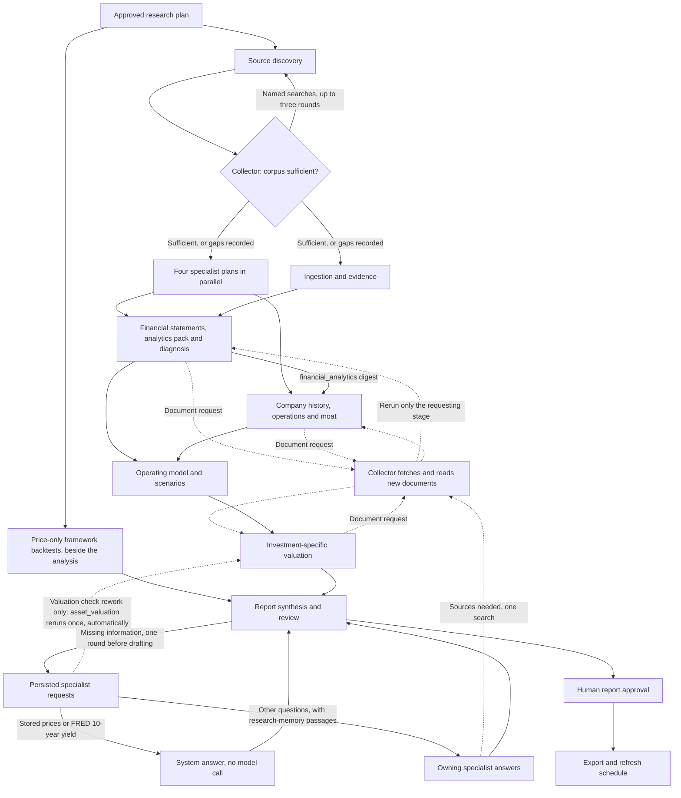
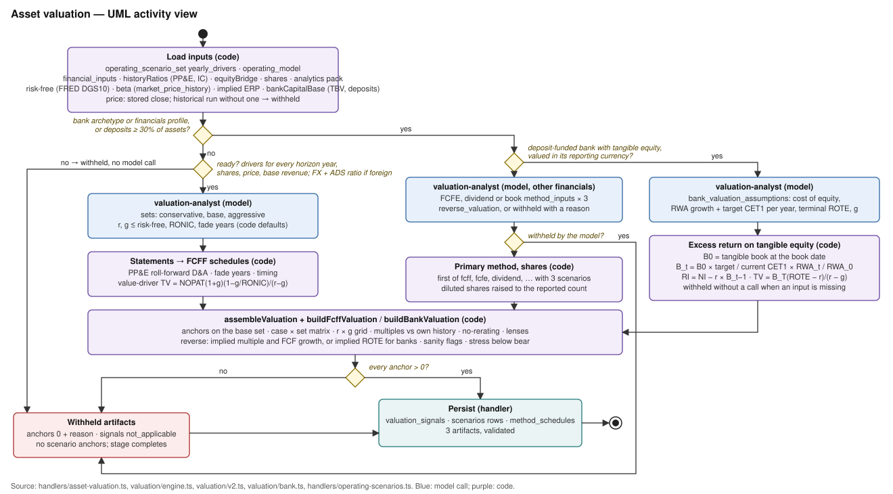
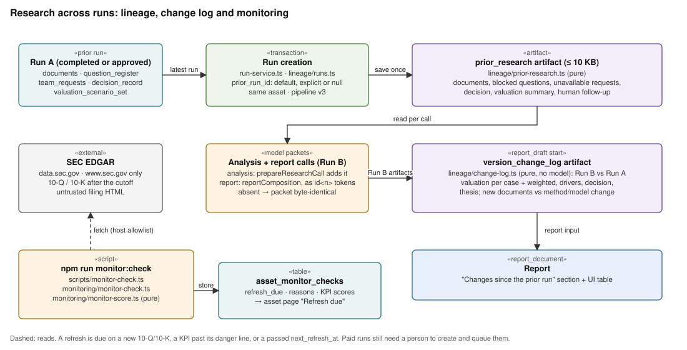

---
covers:
  - src/lib/workflow/**
  - src/lib/research/*.ts
  - src/lib/research/handlers/index.ts
  - src/workers/**
  - src/lib/research/rating/**
---

# Current system

Pragma Research creates evidence-backed investment research for an asset. PostgreSQL stores the workflow, sources, artifacts, decisions, and exported report. The Next.js app provides the UI and API; a separate worker runs queued research jobs.

| Component | Responsibility | Source |
| --- | --- | --- |
| UI pages | Client components that call the API: command center, asset catalog and detail, run cockpit, report view, review queue. One shell (`src/components/app-shell.tsx`) draws the Pragma Research top bar: Home, Research, Reviews with the count of decisions waiting (`reviewCount`: one per company), inline asset search and Start research. Pages lay out flat tiles on a 12-column grid from `src/components/research-ui.module.css`; colour and type tokens (navy ink, sage mark, Plus Jakarta Sans headings, Inter text and figures) live in `src/app/globals.css`. The report (`src/components/research-report.tsx`) shows a contents rail of short chapter names (`railName`) beside each chapter as tiles: header, takeaway (the implication), analysis beside counterarguments and evidence gaps, then the chapter's exhibit index and exhibits. For a report of standard `asset-framework-2.1-adaptive-3` the exhibits are the code-built ones placed in the chapter (`chapterExhibits`), each drawn by one tile (`src/components/report/exhibit-tile.tsx`: title, caption, the formatted table with numeric columns right-aligned, notes; a chart drawn with `ChartPlot` from `report-visual.tsx` with its data table one click away). Reports of earlier standards keep the `Exhibit` heuristics (visible tables or record cards built from the model's table requests) and `sectionVisuals`. The run cockpit polls every 5 s only while the run or its job is active, one request at a time and not while the tab is hidden; it asks for model calls and backtests with `?summary=1`, which returns only the fields it lists (no request/response metadata, parameters or results). The report view opens with `GET /api/research-runs/:id/report?summary=1`, which leaves out artifact bodies over 64 KB stored (marked `content_omitted`; the overview's own types are always sent) and the report document's `artifacts` copies. The Report, Financials and KPI views load the full report the first time they open and keep it until the run or its row changes. The view re-reads the run list every 60 s while visible, and the report itself only while its run is `running` or its run row changed. The polled run, quality and report routes share a long-lived raw pool (`sqlClient`, separate from drizzle's, whose timestamp parsers drizzle replaces); the quality gate reads artifact bodies only when a required module isn't covered by artifact names, evidence or metrics | `src/app/**/page.tsx`, `src/components/**` |
| API routes | Route files under `src/app/api` ([inventory](architecture.md#api-route-inventory)). Reads and writes over research tables, run control (create, enqueue, approve plan, request re-run decision, review, cancel), upload ingest, chat, export, saved charts, operator sign-in (`/api/session`). No accounts; `src/proxy.ts` refuses foreign Host names and cross-site writes and, when `RESEARCH_OS_API_TOKEN` is set, requires that token on every API route and page; only `/_next/*` and static files by extension skip the check ([security.md](security.md#authentication-and-authorization)) | `src/app/api/**`, `src/lib/api/*`, `src/proxy.ts`, `src/app/login/page.tsx` |
| Run service and queue | Creates a run (`pending`, version 3) and its 25 stage rows, linked to the asset's prior run with its `prior_research` block ([Research across runs](#research-across-runs)). Enforces one active job per run. Claims with `SKIP LOCKED` under a 5-minute lease, with up to 3 attempts and worker heartbeats. Queue functions, including the 10 s lease renewal, run on the shared pool rather than opening a connection each. Puts a job back without using an attempt (shutdown, run locked elsewhere) and re-queues running runs left without a job | `src/lib/research/run-service.ts`, `run-queue.ts` |
| Research worker | Polls every 5 s and survives failing polls (5 s to 60 s backoff). Requeues expired jobs and orphaned runs, claims a job, renews the lease every 10 s and runs the pipeline. A lost lease or a shutdown signal aborts the run. When idle, runs backtest tasks | `src/workers/research-worker.ts`, `poll-loop.ts` |
| Pipeline runner and team | Per-run advisory lock, held on a one-connection client of its own for the whole job; every other runner query uses the shared pool. Scheduling passes over ready stages, team briefs, source and research requests. Handlers run in parallel as a dataflow: each stage is advanced when it settles and a clean completion starts its newly ready dependents at once; requests, failures, skips and gates wait until in-flight stages drain. A job makes at most `MAX_SCHEDULING_PASSES` (eight per stage, 200) passes and launches before it fails the run as looping. Retries a stage whose model call failed transiently | `src/lib/research/pipeline-runner.ts`, `handlers/**`, `team.ts`, `team-plan.ts`, `sources/collector.ts` |
| Workflow orchestrator | Stage configs (retries, budget, `failureState`), `advanceStage` validation, gates, resume, `completeRun`, `failRun` and `cancelRun`. Pipeline, queue, worker and API code share two lazily created pools in `src/db/pipeline-sql.ts` instead of opening a client per call: `pipelineSql()` for raw SQL and `pipelineDb()`, a drizzle client on a pool of its own (drizzle replaces its client's timestamp and date parsers and serializers (so raw `sql.json` and `Date` parameters break on it), so it never wraps the raw pool). Both close idle connections after 2 s, so scripts, tests and `worker --once` exit without calling `end()`, and nothing calls `end()` on them. Only `src/db/**` and the runner's run lock construct a client. Keep session state (session advisory locks, `SET`, `LISTEN`) off the pools: use a transaction (`pg_advisory_xact_lock`, as the artifact repository and price sync do) or a client of your own. The historical-record stage runs its raw queries on `pipelineDb().$client`, as it always ran them on its drizzle client | `src/lib/workflow/stages.ts`, `orchestrator.ts`, `src/db/pipeline-sql.ts` |
| Agent harness | Provider selection and model resolution, prompt caching, structured-output parsing and repair, deadlines, telemetry | `src/lib/agent-harness/**`; [local-agent-harness.md](local-agent-harness.md) |
| Sources and research memory | Discovery and safe fetch, structured data fetchers, daily price history, passages, per-need retrieval, embeddings, evidence graph | `src/lib/research/sources/**`, `src/lib/research/memory/**`, `src/lib/ingestion/**`, `src/lib/market-data/**` |
| Backtesting and repair | Framework backtests for stage 18. Python backtest tasks run model-written code in an OS sandbox (`sandbox.ts`: no network, writes only to the backtest directory; prices are fetched first, outside it). The statement-repair module runs in a Node sandbox | `src/lib/backtesting/**`, `python/backtesting/**`, `src/lib/research/repair/**` |
| Reporting and export | Adaptive report sections, report snapshot, memo and research-package export | `src/lib/research/reporting/**`, `src/lib/export/**`, `src/lib/valuation/**` |
| Lineage and monitoring | `prior_research` and `version_change_log` across runs; `npm run monitor:check` scores new filings, including the operator's notebook KPIs, and marks a refresh due | `src/lib/research/lineage/**`, `src/lib/research/monitoring/**`, `scripts/monitor-check.ts` |
| Investing notebook | Per-asset pins, personal KPIs, report and filing annotations and a thesis journal; references and text only, values drawn from the latest run in code ([Investing notebook](#investing-notebook)) | `src/lib/research/notebook/**`, `src/lib/api/notebook.ts`, `src/app/api/assets/[id]/notebook/**`, `src/components/notebook/**` |
| Theme research | From a theme and objectives: a model framing, candidates from two model prompts, SEC's SIC company lists and the operator's tickers counted for agreement, exclusions, an SEC companyfacts scorecard, a ranking and a shortlist of four ([Theme research](#theme-research)) | `src/lib/research/themes/**`, `src/lib/api/themes.ts`, `src/app/api/themes/**`, `src/app/themes/**` |
| Investment checklist | Checklists of items measured by code from a run's stored data or judged by one model call with cited evidence; a score of met over evaluated weight ([Investment checklist](#investment-checklist)) | `src/lib/research/checklist/**`, `src/lib/api/checklists.ts`, `src/app/api/checklists/**`, `src/app/api/assets/[id]/checklist-evaluations/route.ts`, `src/components/notebook/checklist-panel.tsx` |
| Filings library | The asset's stored primary filings from the last two years, as compressed outlines, section text and plain-text downloads, in the notebook panel ([Filings library](#filings-library)) | `src/lib/research/filings/library.ts`, `src/lib/api/filings.ts`, `src/app/api/assets/[id]/filings/**`, `src/components/notebook/filings-panel.tsx` |
| Valuation workbench | Recomputes a run's stored v2 FCFF valuation in code under typed changes, keeps named scenarios per run, applies the chat's scenario proposals ([Valuation workbench](#valuation-workbench)) | `src/lib/research/valuation/whatif.ts`, `whatif-data.ts`, `workbench-draft.ts`, `src/lib/api/workbench.ts`, `src/app/api/research-runs/[id]/workbench/**`, `src/components/workbench/**` |
| Database | 21 schema modules, registered once in `src/db/schemas.ts` for the app client and the migrator; migrations `0000`–`0006` and `0009`–`0023` | `src/db/schema/**`, `src/db/schemas.ts`, `drizzle/` |

Deeper views are in [architecture.md](architecture.md): deployment, class, the run activity, the state machines and the sequence.

The API creates a version 3 run with its 25 stage rows. A job lets the worker continue the pipeline outside the HTTP request. The research plan and final review stop for a human decision; approval queues another job. Stage contracts validate outputs before the pipeline persists typed artifacts. Export and refresh scheduling finish the run.

## Research framing and the plan gate

Framework Stage 1 ("Define the Asset") is one model call at the research-plan stage (`draftFraming` in `src/lib/research/handlers/research-plan.ts`, contract `ResearchFraming` in `src/lib/research/framing.ts`, task `plan:framing:<n>`). Before any document is collected it drafts the central question, a decisive-insight hypothesis, what the investor owns, up to five engines (earner, burner, growth investment, option) with how each is valued, up to eight key questions with falsifiers, named peers with tickers, priority documents, management axes, and proposed archetypes and overlays (registry keys only). All of it is labelled as hypotheses. The plan artifact stores it as `framing`, and the plan's questions become the central question plus the key questions. The plan no longer copies the doctrine (`report_standard.output_requirements` is a one-line note); every doctrine prompt already carries it.

- **Archetypes.** `archetype_composition` composes `operating_company_core` plus the archetypes the asset's stored sector and industry map to (`classificationArchetypes`, which reuses `kpiArchetypes`; the financials profile keeps bank and lender). Archetypes named at run creation are kept. The framing may add archetypes that compose without errors (`mergeFramingArchetypes`), and the reviewer can change them at the gate. `metadata_json.v3_archetypes_source` records `request`, `classification`, `framing` or `reviewer`. `advertiser_count` is optional in the advertising archetype, because many platforms don't report it.
- **The gate.** The run page shows the framing first, as editable fields, with archetype and overlay checkboxes and earlier feedback (`src/components/framing-editor.tsx`). `POST /api/research-runs/:id/approve-plan` accepts optional `framing`, `archetypes`, `overlays` and `forecast_years` (3-10, checked before anything is written; the horizon is written first, so the rebuilt plan carries it). `applyPlanGateEdits` validates them (`checkGateEdits`), recomposes the profile, saves the next plan version (`framing_source: "reviewer"`) and approves it in one transaction, with no model call; an invalid edit rolls back the whole approval, and edits sent for a plan already approved get 409 with no job queued. Approval writes the approved framing to `metadata_json.research_framing`.
- **Request plan changes.** `POST …/request-plan-changes` saves the notes as a `research_plan_feedback` row (trimmed, at most 4,000 characters), reopens the research_plan stage, sets the run running and queues a job. The framing call reruns with every note, in `requested_at` order, and the previous framing, and the gate reopens on the next plan version. The old `action=request_changes` branch of approve-plan is removed.
- **Every packet.** `loadRunContext` exposes the approved framing as `ctx.researchFraming`, and `prepareResearchCall` puts it in every model packet, right after `research_question` in the shared prefix, except metric normalization and the framing call itself, with `FRAMING_RULE`: answer the key questions the stage can answer, keep the engines separate, flag contradicting evidence. That includes evidence extraction and the collector's source review, so priority documents and named peers steer collection.
- **The report answers it.** The outline is told to give each key question its own entry with the same id, frame each chapter around the central question and the engines, and state in the opening verdict whether the central question held (`FRAMING_OUTLINE_RULE`). Key questions the outline skips are added as qualified material questions (`includeFramingQuestions`), visible to the reader and the reviewer, not blocked, so they never withhold the conclusion on their own.

**Analyst outputs with typed homes.**
- `business_process_analysis` makes a second, small call, `management_assessment` (`MANAGEMENT_CONTRACT`): five separately scored axes (operating execution, balance-sheet discipline, capital returns, capital allocation, governance alignment), each 1-5 or null. A score must cite a `financial_analytics` path or a claim, and governance needs a cited claim (`validateManagementAssessment`). The stage's stored outputs now include it.
- `moat_assessment` entries carry a framework §7.6 `classification` (unproven to exceptional), six 0-5 `scores`, `supporting_claim_ids` and `artifact_paths`. Code checks the citations against what the run stores and caps strong or exceptional at moderate, saying why in `classification_note`, unless the moat cites a history path that resolves in the stored `financial_analytics`, `historical_record` or `historical_diagnosis`, a `peer_benchmark.peers.<TICKER>` path naming a peer in a complete `peer_benchmark`, and at least one of the run's accepted claims (`capMoatClassifications`, `resolvesInArtifacts`, `resolvesToPeer`). Each attack names the moat it tests (`targets_moat`, checked against the assessment) and whether it survives fully, partially or not at all. Competitors may carry `ticker` and `peer_metrics`.

**Benchmarks beside the subject's history.** After the analytics pack, the historical-record stage saves two code-built artifacts (`saveExternalBenchmarks`). Network failures become gaps and never fail the stage, and mock or test runs fetch nothing (`status: "offline"`).
- `peer_benchmark` (`src/lib/research/sources/peers.ts`): the approved framing's named peers, at most four, resolved by ticker or exact normalized name against SEC `company_tickers.json`, then one companyfacts download each. Per peer, the last 8 quarters of revenue and operating income (SEC quarterly frames), TTM operating margin and revenue growth, and the last two fiscal years' operating cash flow, capex, capex/revenue and FCF margin, in USD millions, filed on or before the cutoff. Private and non-SEC peers are gaps. The ticker map is cached for a day and each peer's compact row per cutoff (at most 200 rows); the companyfacts file itself is not kept. Companyfacts has no segment detail.
- `demand_backdrop` (`src/lib/research/sources/demand.ts`): the normalized home country (`normalizeCountry`) picks keyless series. The US gets FRED RSAFS, PCE, ECOMSA and CPIAUCSL. Other countries get World Bank household consumption growth, CPI inflation and real GDP growth, and China also gets FRED DEXCHUS. Each series is reduced to its latest value, year-on-year change and five annual points on or before the cutoff.
- `prepareResearchCall` puts `peer_benchmark` into business, moat, valuation and decision packets, and `demand_backdrop` into business, operating-model and scenario packets, when their status is complete, with rules to compare against them and cite the artifact id. Report writers see both as ordinary artifacts. A historical_record rerun invalidates both.

**Issuer documents.** Every 8-K item 2.02 results release in the filing window is fetched, up to `MAX_EARNINGS_RELEASES` (21), instead of the newest four. Releases already stored are read back, not downloaded again. When SEC submissions name no investor website, discovery is seeded with the investor-relations host the asset's newest stored earnings exhibit names (`irHostsFromText`, for example investor.atmeta.com), so the IR role reaches the issuer's own site before aggregators. An asset's first run has no stored exhibit yet.

**Analyst behaviour rules.** The doctrine ends with five behaviour rules (`ANALYST_BEHAVIOUR_RULES`): separate earners from burners, place current metrics against their history, diagnose cash conversion, state what the investor owns, and go below the bear case with what would change your mind. Report prompts no longer repeat the doctrine, because `exactJsonPrompt` already adds it. The reviewer is told to challenge the valuation framing as calculation findings (`REVIEW_FRAMING_RULE`): a horizon inside a reinvestment cycle, terminal value above 75% of EV, terminal capex far above depreciation, unnormalized margins. It also checks that the report answers the central question.

The composed research plan links each source role to specific artifacts. Source discovery records coverage only for fetched documents that pass role checks; evidence extraction rejects prior claims when their source is excluded on replay. Coverage records one representative document per role and artifact, while the evidence packet may use other eligible documents from the same run. A fetched page is dated from its HTML date tags; an SEC archive document (`sec.gov/Archives/edgar/data/...`), which has none, takes the filing date from its EDGAR filing index. Accepted claims from undated sources (industry reports, peer PDFs, aggregator pages) reach specialist, team and report packets and can be cited; the report lists them as `undated`. Only a point-in-time run drops them, because an undated page may postdate its cutoff: a `backtest_only` run, or one whose source cutoff is more than a day before the run was created (`isPointInTimeRun` in `src/lib/research/reporting/store.ts`, applied by `loadReportInputs`).

The pipeline runner dispatches independent handlers concurrently; `src/lib/workflow/orchestrator.ts` owns stage transitions, retries, human gates, resume, and completion checks. `src/lib/research/sources/corpus.ts` contains source ingestion and evidence persistence helpers. Quality gates read validated typed artifacts instead of treating completed model tasks as proof of artifact coverage.

Research is assigned to a data collector, four planning specialists and one on-demand repair specialist. Their definitions and stage dependencies live in `src/lib/research/team-plan.ts`.

| Specialist | Responsibility |
| --- | --- |
| Data | Discover and download sources, decide when the corpus is sufficient for the specialists to start, extract evidence, and fetch documents the specialists request. |
| Financials | Read filing statements, normalize periods and units, preserve reported line items, and reconcile financial records. |
| Business | Assess management, operations, history, competition and intangible advantages; develop operating assumptions and bear/base/bull scenarios with yearly growth and margin drivers. |
| Valuation | Choose each scenario's discount rate and terminal assumption; for banks, build equity valuation schedules. Application code builds the statements, cash-flow schedules, discounting, value bridge, price path, anchors and reverse valuation. |
| Report | Plan coverage, combine analyses, ask specialists for missing information, and prepare the document for review. |
| Repair (on demand) | When deterministic filing parsing cannot locate primary statements, write a run-scoped module that locates the statement tables. |

After plan approval, source discovery runs first and alone. It collects the base corpus, then the collector (`source-discovery-agent`) reviews coverage against the research plan and either declares the corpus sufficient or names up to six targeted searches, such as a named competitor's annual report. Targeted searches skip seed sites and generic role queries, and a named peer's filing need not mention the researched company. There are at most three review rounds (`MAX_DISCOVERY_ROUNDS`). A required source role that is still uncovered becomes a medium-severity gap owned by `system:source-collector`: the run continues, and the gap names the affected artifacts and the collector's reason. That includes `founder_and_company_history`: `company_genesis` then writes the history from the filings and other accepted claims at low confidence and says no history source was available (`MISSING_HISTORY_RULE`, with `missing_source_roles` in its packet), where it used to stop the run. A failed review does not stop the run; the corpus goes forward with its gaps. Each round is saved in a `source_review` artifact.

Only then do the four planning roles (financials, business, valuation and report) prepare their work plans concurrently, with the collector's assessment and document list; the repair specialist has no plan and cannot receive report requests. These are saved as `agent_brief` artifacts and supplied to their later tasks. The data role has no brief, so source ingestion and evidence extraction run while the plans are written, and the first stage owned by a briefed role waits for them (`teamBriefScheduler`). The stage scheduler starts independent work together: financial normalization and company history can overlap, followed by historical diagnosis and business-process analysis. Forecasts wait for both business analysis and financial diagnosis; valuation waits for operating scenarios. Tasks receive their owner's purpose, work plan, outstanding requests, accepted upstream artifacts and evidence. Planning does not count as completed analysis.

While a financials, business or valuation stage runs, its own analysis call may return an optional `source_requests` list of up to three named searches (`src/lib/research/sources/source-requests.ts`). The call then pauses its stage. Before the next scheduling pass, the runner fetches those documents, reads only them into evidence, refreshes role coverage and reruns the paused stage, which sees what each request found (`src/lib/research/sources/collector.ts`). Other branches and completed stages are not reopened. Each stage has at most two request rounds (`MAX_STAGE_SOURCE_REQUEST_ROUNDS`) and never repeats a query. Every model-chosen query, here and in the collector's review and report requests, passes `constrainSearch` first: plain words only (no URLs, domains or search operators), at most 200 characters, prefixed with the company's name and symbol when it asks for the company's own documents, and rejected when it asks for another organisation's documents without naming the company or a document type. Requests are saved per stage in `source_requests` artifacts, so a restarted worker resumes queued requests. Before searching, the collector asks research memory for the query within the requested source role. Keyword retrieval matches any query word, so a search counts as already answered only when a returned passage comes from a document of that role and contains at least 60% of the query's significant terms (`queryTermCoverage`: distinct tokens of three or more characters that are not stop words, such as `2025` or `10-k`). Such a search is recorded `in_corpus` with those documents and is not fetched. A peer's annual report that shares only "annual" and "report" with the query is still searched.

**Six fixed chapters** (standard `asset-framework-2.1-adaptive-4`, `REPORT_CHAPTERS` in `src/lib/research/reporting/contracts.ts`): Verdict (conclusion; written last, shown first), The business and what the investor owns (business, ownership, constraints), Track record and management (history, management, evidence), Competitive position (moat), Scenarios, valuation and downside (forecasts, valuation, downside) and What to watch (monitoring). The outline call is given `report_chapters` and fills them in: a company-specific title and purpose per chapter, its `artifact_ids`, its `key_figures`, coverage statuses and at most eight questions (`MAX_REPORT_QUESTIONS`). Code then fixes the structure (`fitOutlineToChapters`): the six ids and coverage in order, the model's wording for each id it used, the chapter's own artifact types when it named none, and each coverage key linked to its chapter, so the two old chapter rules (no history- or evidence-only chapter; one valuation chapter with forecasts and downside) hold by construction. Writers are asked for three to five paragraphs and at most 600 words a chapter, the first sentence stating its conclusion (`SECTION_RULES`), and the Verdict for at most 400 words opening with the view (attractive, fairly priced, unattractive or not yet investable) and its confidence (`VERDICT_RULE`); `storedSection` keeps at most six paragraphs (`MAX_SECTION_PARAGRAPHS`). A blocked material question or coverage still keeps `conclusion_status: "withheld"`, so position approval stays blocked, but the writers give a provisional view with its confidence, and the report's banner says so instead of "Conclusion withheld". `normalizeOutlineStructure` is still exported for stored outlines and is no longer called for new writes. Reports stored under adaptive-3 and earlier keep their banner and render byte for byte as before.

**Report packets stay under 100K tokens.** Haiku 5.5 bills a prompt over 100K tokens at five times its rate, input and output; on SoFi run `0c9a2731` (2026-11-18) 94% of the $9.74 run cost came from 90 such calls, nearly all report calls. Every report-stage packet (outline, section, review, team requests) now goes through `fitPacket` (`src/lib/research/reporting/packet.ts`, `REPORT_PACKET_BYTES` = 120 KB before rules and passages): when it is larger, artifacts are capped at 8 KB then 2 KB per top-level field (`cappedArtifactView`, the old conclusion view, which names what it left out in `omitted_fields`), claims lose their quotes and are cut down to 20, and last the largest artifacts are dropped and named in `omitted_artifacts`; a packet that fits is unchanged. A body chapter also reads only its own claims (`sectionEvidence`: those its artifacts cite, then those sharing the most words with its title, purpose, key figures and coverage, at most 40), the compact outline (every chapter's id, title, coverage and key figures; questions without answers) and the team answers clipped to 600 characters (`compactRequests`); its claims and filing passages are per-call keys. The reviewer reads only the claims the report cites. Replayed on `0c9a2731` (`scripts/report-packet-size.ts`), body sections came to 62-81K estimated tokens, from 95-314K.

The outline also allocates each section its `key_figures`; a section writer explains its own and refers to other sections for theirs. After each AI review, `checkReportSubstance` (`src/lib/research/reporting/substance.ts`) adds `writing` findings for an `analysis` paragraph with no figure and no citation, and for reader-facing text that leaks pipeline terms (corpus, node fields, artifact, packet, supplied passages, record IDs, snake_case field names, numeric confidence scores) or process narration ("an earlier draft", "the model's note", "stored matrix/valuation outputs/FCFF cases", "the field is null", "code rebuilds", "reconciliation record", "citations removed"). In conclusion chapters it also flags "falsifier": only conclusion prompts carry the plain-language rule, so body chapters aren't sent to a paid rewrite for it. It scans titles, paragraphs, counterevidence, implications, gaps, table titles, visual titles and captions, a conclusion's key reasons, and, with no section attached, research questions and coverage rationales. They join the reviewer's findings on the saved review and are shown at human review; nothing is rewritten for them (since pipeline-simplification there is no repair round), and none fails the run. Before an outline, section or conclusion answer is validated or stored, code cleans its reader-facing fields (`cleanReaderFields` in `src/lib/research/reporting/reader-prose.ts`: titles, paragraph text, counterevidence, implication, gaps, visual titles and captions, lane notes, node labels, a conclusion's key reasons, question answers and follow-ups, coverage rationales). Amounts written in thousands are rewritten as millions or billions (`withoutThousands`: "240,989 thousand" → "241.0 million"). This happens only when an answer is written, so stored reports render and hash as before. `readerProse` removes reference tokens (`ev3`, `ar2`, `id1`), UUIDs (with a preceding "see") and brackets left empty, and turns snake_case identifiers into words with finance acronyms in upper case (`operating_margin` → "operating margin", `fcf_margin` → "FCF margin"); figures, `10-K`, `FY2024`, `S&P 500` and `EV/EBIT` are unchanged. The substance check therefore finds no field-name or record-ID leak in those fields; it still flags pipeline words and process narration. Citations in an answer are packet tokens: `refs.resolve` maps every `evidence_ids` and `artifact_ids` array, at any depth, back to stored UUIDs. A token that is unknown or of the wrong kind (an `ar` token among `evidence_ids`, say), and any citation outside the report inputs, is dropped from the section and recorded in the review's `dropped_citations`, never in reader-facing gaps (`keepUsableReferences`). Stored sections hold UUIDs only, so scoring, depth checks and export read them as before.

**Exhibits are code-built** (standards `asset-framework-2.1-adaptive-3` and `-adaptive-4`, `STANDARD_VERSION` in `contracts.ts`, `hasCodeExhibits` in `exhibits.ts`). The model writes prose; code decides every table and chart. `src/lib/research/reporting/exhibits.ts` holds the launch catalogue (`EXHIBITS`, twelve entries, each with a home coverage area and fallbacks): quarterly results, history statistics and the operating margin trend chart (history); segment economics and cash conversion (business); capital allocation (management); scenario drivers (forecasts); the scenario values and valuation bridge charts, the valuation matrix and the sensitivity grid (valuation); stress cases (downside). `buildExhibits(artifacts, { cutoff })` builds them, in catalogue order and deterministically, from the newest `financial_analytics`, `operating_scenario_set` and `valuation_scenario_set`, with reader column labels and formatted cells (percent with one decimal, currency millions grouped with the currency in the caption, per-share values with two decimals, `—` for missing). It never throws: an exhibit whose artifact is missing or malformed, whose chart has too few points, or whose valuation is withheld (`withheldValuationReason`) comes back unavailable with a reason. The two valuation charts reuse `buildVisual` and carry their data as a table. `placeExhibits` gives each available exhibit to the first chapter, other than the conclusion, that covers its home area, else the first that covers a fallback, and each exhibit appears at most once.

- **Outline.** The outline packet lists the catalogue (`exhibit_catalogue`: key, title, home, available) with `EXHIBIT_CATALOGUE_RULE` in `runtime.ts`: code places these exhibits, so the outline plans no tables or charts. `OUTLINE_CONTRACT` has no `chart_plan`. `RESEARCH_DOCTRINE` (`contracts.ts`) says the same to every report call: tables and charts are built by code from stored artifacts, and writers never author table values or chart specifications.
- **Section writer.** Each body section packet carries `section_exhibits`, the built exhibits placed in that chapter in compact form (`compactExhibit`), with `SECTION_EXHIBITS_RULE`: the writer discusses them by title without repeating every number. Conclusion sections get none. `reportSectionCall` takes the exhibits as a trailing optional parameter, so the packet-size replay builds the same packet. `SECTION_CONTRACT` asks for the plan fields, at least one paragraph, counterevidence, implication, gaps and optional qualitative `visuals` (`process` and `organization` only); its schema names no `tables`, `chart_plan` or quantitative kind. An answer that still sends `tables`, `chart_plan`, `exhibits` or quantitative visuals is accepted, and `storedSection(answer, placement[section.id])` strips them: the stored section has `tables: []`, no `chart_plan`, only valid qualitative visuals, and `exhibits` set to the placed keys. `validateChartPlan`, `fillChartPlanGap` and `CHART_PLAN_GAP` are still exported but are no longer called for new writes, and a section without prose is still rejected.
- **Rendering.** `createReport` (`report.ts`) renders each section's `exhibits` from `buildExhibits(input.artifacts, { cutoff })` as a `### <title>` block with the caption, a Markdown table of the formatted cells (a chart as its data table) and the notes, skipping unknown or unavailable keys, and the content hash covers the rendered exhibits. The report view reads the same exhibits back through `chapterExhibits(document, sectionId)`.
- **Reviewer.** Writers and the reviewer receive `VISUAL_GUIDELINES` (`visuals.ts`) for `process` and `organization` visuals only. The reviewer is told the exhibits are built by code from stored data: it checks that the prose agrees with them, not how they are drawn.

**Earlier reports.** Stored sections still parse every earlier shape (model `tables`, all visual kinds, `chart_plan`), and reports stored under `asset-framework-2.1-adaptive-1` and `-adaptive-2` render byte for byte as before, so their content hash still verifies: `adaptive-1` keeps the old table renderer (`tableMarkdown`), and `adaptive-2` keeps the model's tables (`flatTableMarkdown`) and visuals. In those reports the outline set `chart_plan` on each quantitative chapter and the writer added that chart or a gap (`validateChartPlan`, `fillChartPlanGap`); chart visuals (`history`, `series`, `ratio`, `scenarios`, `valuation_bridge`) named only an artifact, path and keys for `buildVisual`, and a table request (`flatTable` in `src/lib/research/reporting/tables.ts`) resolved to at most 60 flat rows, with a missing value as an em dash. Rules: [report-visual-guidelines.md](report-visual-guidelines.md).

The valuation chapter opens with a summary computed in the browser from the report's artifacts (`valuationSummary` in `src/lib/research/reporting/valuation-summary.ts`, drawn by `src/components/report/valuation-summary.tsx`). It reads `valuation_scenario_set`, `operating_scenario_set`, `expected_return_matrix`, `annual_price_target_path`, `reverse_valuation` and `decision_record`, and writes nothing. It shows the weighted target, the bear, base and bull values with probabilities, returns and each case's value today, three reasons computed from the base case, and collapsible detail: the calculation, key assumptions, what the last price implies (the reverse valuation against the scenarios' margins and growth), why it's not final, and the raw analyst notes. The page is marked not final while any issue is open. When a scenario's cash-flow model at the end of its last year doesn't give its scenario value, the summary names that case.

`team.ts` saves report questions as `team_requests` artifacts with an owner, source role, materiality and response. A round holds at most five new requests; any past the fifth are dropped before validation rather than repaired. Arriving requests reset no stage, task or artifact (`processResearchRequests`). Each unanswered request is resolved in this order:

1. **System answers.** A valuation-role or `market_data` request that asks in cost-of-capital terms (equity, levered, regression or stock beta, the equity risk premium, the cost of equity, CAPM, or beta alongside the discount rate or WACC) is answered first when the run's `market_price_history` holds a computed beta. A bare "beta" or "ERP", such as a product beta or ERP software, goes to the owner as usual. The answer gives the beta, the ERP and the CAPM cost of equity with the DGS10 rate (`resolved_by: "system:cost-of-capital"`). A `market_data` request, or a `data` request about a price or market cap, is answered from the run's latest validated `market_price_history` artifact when it holds bars: bar count, date range, provider, the Stooq cross-check's verified and unverified period counts and the valuation price (`resolved_by: "system:market-history"`). A question about DGS10, the 10-year Treasury, a Treasury yield, the risk-free rate or the discount rate is answered from the run's FRED DGS10 document with its latest non-blank value and date (`resolved_by: "system:fred"`). None of these makes a model call.
2. **Research memory.** Any other request goes to its owner (`TEAM_ROLES[role].agent`) with its slice of the report inputs, all accepted evidence and `passages`. The slice holds the artifacts of every stage the role owns and of the stages its home stage reads (`ownerArtifactTypes`), so the valuation owner sees operating scenarios but not the financial history. Passages are research-memory passages of the request's source role from this run's documents (`retrievePassages`, keyword ranking until embeddings are configured). When none of them matches the question by its words (for example a `proxy_and_governance` request in a run with no proxy statement), the issuer's own filings, earnings releases, investor-relations and proxy documents are searched once more, and each passage carries its own `source_role` (`requestPassages`). The current artifacts of the stages the role owns seed the evidence graph (`seedArtifactIds`), so passages holding the claims those artifacts cite reach the owner even when they share no word with the question: a quarter of the slots (2 of the default 8) when keyword matches could fill them all, and any slots keyword matches leave empty. SEC questions are answered from the stored filings, never by a new EDGAR lookup. An answer cites evidence, artifacts or passage documents (`source_ids`); `keepCurrentReferences` checks them against all current inputs and drops IDs outside the run.
3. **One search.** When a request that needs sources matches no passage by its words (cited graph passages don't count) or names a period (a date, quarter or year) that no document of its source role covers, or when the owner answers `needs_sources` and the run has not escalated yet, the collector runs one search for that request (recorded in `source_retrieval_attempts` with `request_id`). It searches the request's `document` field (organisation, document type and period, at most 200 characters), or the question when the requester gave none, through the same `constrainSearch` as stage searches, links new documents and reads evidence only from documents new to the run. The owner then answers once more with `source_search_attempted: true`; a second `needs_sources` becomes `unavailable`. Passages are retrieved once per answer: the owner reuses the retrieval made for the search test unless a search ran after it. An answer-triggered search sets `source_escalated` on the batch, which the next round keeps.
4. **Explicit re-runs.** Since pipeline-simplification only code's rework requests reopen stages: the valuation check's `analysis_rework` finding (`valuationRework`, see [Report review](#report-review-depth-checks-and-rework)) becomes a request with `rework_stage`, whose system answer asks for the rerun (`requestStageRoots`, `requestResetPlan`). An owner's answer never reruns a stage: the owner prompt no longer offers `requires_rerun`, the answer contract has no such field, and a stored legacy `requires_rerun` is dropped with the answer's status and text kept (`settleRerunRequests`). The reworked stage and its dependents are reset, skipped stages excluded, only automatically: once per run, when the reset reopens at most `RESEARCH_MAX_AUTO_RESET_STAGES` analysis stages (default 6, the tail stages not counted), recorded as an `auto`/`applied` row in `research_run_resets`, whose existence marks the automatic re-run as used. Otherwise nothing reruns and nothing pauses: the rework request becomes `unavailable` ("Not rerun: … was not rerun because …") and stays an open report question, and the report continues. An automatic re-run invalidates cached outputs and stale report approval, supersedes open source gaps written by the reopened stages, and answers the rework request once the reopened analysis stages complete (`reworked`). No `approval` row is created any more. A legacy `approval`/`pending` row (at most one per run, enforced by a partial unique index) can still be decided: `GET /api/research-runs/:id` returns it as `request_reset` (`{ stages, request_ids, estimated_cost_usd }`, else `null`), and a reviewer chooses re-run or skip on the run page (`POST /api/research-runs/:id/request-reset`, `approveRequestReset`, which sets the row `applied` or `skipped` with `decided_by` and `decided_at`; a skip marks the requests unavailable, "Skipped by reviewer: re-run not approved"). SoFi `7c70364e` paused for approval four times on one valuation question under the old owner re-runs. Data requests never reopen source discovery.

A rerun records any gap that still applies, and a replayed source discovery counts documents linked by earlier passes toward role coverage, because web search results vary between calls. When a failed stage blocks all remaining stages, the run stops with that stage's name and reason. A material unanswered or skipped request becomes a blocked report question and withholds the conclusion.

Automatic investigation is bounded to one report request round per run, before drafting (`MAX_PRE_DRAFT_ROUNDS` = 1; the outline's blocked questions and the review start no round, and `requestMissingResearch` makes no planner call once the round is used), one answer-triggered source escalation per run and one automatic re-run per run. The saved request state survives restarts, and a failed answer call leaves the stages unchanged; the request is answered on a later pass. Neither human gate can be bypassed by a request: re-runs refuse to start unless the run is `running`, nothing pauses the run for a re-run, and a legacy re-run decision is refused while the research-plan or final-review gate is waiting. Missing disclosures remain explicit; the system does not claim that every fact can be obtained. A session lock prevents two workers from executing the same run, and each parallel batch finishes before failure or human-gate transitions. Model attempts reserve estimated budget under a database lock. Actual costs are always recorded, including costs above the reservation; subsequent attempts check both spending and outstanding reservations. A ledger row whose metadata PostgreSQL rejects is written again without the metadata, so its cost still reaches `model_budget_ledger`, and a failed ledger write never discards a successful model output.

Source text reaches the source reader through the research memory (`src/lib/research/memory/`, plan in `Implementations/research-memory`). When a source is stored, it is also split into passages along its headings, tables and pages, with HTML entities decoded, and saved as a `research-memory` parse whose chunks carry the section path. Table rows stay rows, also in fetched pages stored as text (cells joined by ` | `), and each later piece of a split table starts with the table's first row. Each passage stores `search_tsv`, its section path (weight A) and text (weight B) as a tsvector with a partial GIN index, so retrieval never re-parses passage text. The original raw chunks stay as they were, because valuation reads them verbatim; the SEC companyfacts context (`primary_source_context`) gets no passages and is outside the retrieval scope, because its data is read from the raw payload. Documents stored before this, or under an older parser version (`MEMORY_PARSER_VERSION`), are indexed the first time a run retrieves from them. Retrieval sees the run's documents with this run's own title and source role (from `research_run_sources`), so a document shared with another asset's run never shows that asset's name, and only the newest document per URL. Documents covering a period the need's query names (an ISO date, a quarter such as Q2 2026, or a year; a document counts when its period end, or without one its publication date, falls in the period's window: a date to 45 days after it, a quarter or year from 45 days after its start to 45 days after its end, so a release filed in a quarter's first weeks counts for the quarter before) are searched first and the rest of the scope fills the remaining slots; a named period no document covers is reported as a `no_documents_for_period` gap once its window has opened, so a maturity or target year after today is not a gap. Ties go to the newest document, and a note restated in several filings (same section and opening words, digits ignored) takes one slot for each named period (that period's newest copy), or one slot for the newest copy when no filing from a named period has it. Evidence extraction asks one need per source role present in the run (for example "founder and company origin" for founder-history documents), scoped to the run's eligible documents, and passages whose section titles match rank first. The needs share a passage budget of 4 per document, between 32 and 128 (`evidencePassageBudget`, `RESEARCH_EVIDENCE_PASSAGES_PER_SOURCE`, `RESEARCH_EVIDENCE_PASSAGES_MAX`). After the KPI and governance needs, the role needs split the rest in proportion to the square root of each role's stored passages, at least 3 each and never more than the role stores; slots a role cannot use go to the others, and rounding leftovers go to filings, then earnings releases, then any role with passages to spare (`rolePassageShares`, counts from `rolePassageCounts`). With META's 4,602 filing passages and a 20-passage IR aggregator page, the filings get about 60 slots and the page 3, where an equal split gave each 12. A `governance` need (8 passages) searches filings and proxy material for voting power, share classes, beneficial ownership, controlling holders, executive pay and repurchases. When the run has filings or earnings material, a `headline_kpis` need takes a quarter of that budget: it searches those documents for the headline operating KPIs of the run (`HEADLINE_KPIS` in `src/lib/research/memory/needs.ts`, for example daily active people, ARPP, ad impressions and average price per ad for an advertising platform, or net interest margin, deposits and credit losses for a bank), and the source reader is told to extract each reported KPI value as an `operating_kpi` claim. The KPI lists come from the run's composed archetypes plus those the asset's stored sector and industry, or the SEC SIC code kept in the primary source context's metadata, map to (`kpiArchetypes`); the generic operating-company list is used when nothing more specific applies, and also alongside an archetype that rests on the SIC code alone without confirming sector, industry or SIC-description text. SIC 7370 counts as an ad platform only with ad, social or internet-content wording; "Credit Services" without payment wording gives both the lender and payments lists; gas utilities are not commodity producers. The archetype composition uses the same classification (`classificationArchetypes`, see [Research framing](#research-framing-and-the-plan-gate)). The need matches each KPI's filing phrases whole (`phrases`, `phraseQuery`), so words such as "revenue" or "price" never match on their own. Batches that return under half their claim target get one gap retry each, run with the same concurrency as the batches. The claim target is 40 (deep dive and full initiation report) or 20, plus 3 per document, capped at 160 (`evidenceTargets`, `RESEARCH_EVIDENCE_TARGET_*`); the deterministic inventory fallback tops up only to the old floor of 25 or 12. Analysis stages read accepted evidence through `loadAcceptedEvidencePacket`: up to 120 claims (`RESEARCH_EVIDENCE_PACKET_LIMIT`), each with its supporting quote cut to 280 characters, ranked by confidence plus a recency bonus (measured from the newest claim date, capped at the run's cutoff) and taken round-robin across claim types, with source-inventory claims last (`rankEvidencePacket`). When neither founder need returns a passage, the stage asks the collector for founder history before any source-reader call: one search per round through the `evidence_extraction` source-request ledger, waiting while a round is queued, and once `MAX_STAGE_SOURCE_REQUEST_ROUNDS` rounds are used it fails with the `founder_origin` gap. The founder pass reads passages returned for the founder need and, after them, founding statements found in filings and investor material. The founder check counts only claims that affirm the founder or origin; absence statements, claims describing the supplied excerpt, and system inventory claims do not count. When the founder check is the stage's only validation error and the failing attempt ran a founder pass, the retry invalidates only that pass (`evidence_extraction_role_gap`, matched by the task key the attempt reports in its validation result; a pass left by an earlier attempt does not count), so the source-reader batches replay instead of re-reading the corpus; any other validation error invalidates every completed task. A role whose need matches nothing contributes its documents' first passages, except founder history, which records the gap instead of reading a cover page. Fetched web pages are stored as structured text with Markdown headings, so their sections survive. A source stored again (same content hash) keeps its file and its current research-memory parse: neither is rewritten or parsed again. Passages and their offsets live only in `document_chunks`; no normalized-text copy is written to `storage/parses` anymore (nothing read it), though older parses still name theirs. SEC appends a random script tag to every EDGAR response, so an Archives document (`sec.gov/Archives/edgar/data/...`) that an earlier run stored is read back from `storage/` instead of downloaded again (`storedSecFiling`); a new download would hash differently and be stored as another copy. Only rows the filing fetcher wrote (`metadata_json.source = 'sec_edgar_filing'`) whose file still matches its `file_hash` are reused, so an upload labelled as a filing never replaces the download. Copies stored before this, and files no database row names, are removed only by the opt-in cleanup in [operations.md](operations.md#storage-cleanup).

Embeddings are off by default. With `RESEARCH_EMBEDDING_PROVIDER=openai-compatible` (or `mock` for tests), evidence extraction first gives every passage of the run's eligible documents a vector, stored in `document_embeddings` per embedding model, in requests of at most 64 passages; a misconfigured provider stops the stage with an error that names the variable. Each request is preceded by budget preflight and recorded in `model_call_logs` as the `embedder` agent, and so is the one-text request that embeds each need's query. When the budget refuses a request or the provider fails, that document stops embedding, keeps its keyword index, and records the failure in its parse warnings. Retrieval then fuses keyword and vector rankings with reciprocal rank fusion (k = 60), so a passage can be found by meaning without sharing a query word; it uses only vectors of the configured model. Vectors stay in the jsonb column and are compared in application code, streamed in batches: on a local database, 4,000 passages of 1,536 dimensions rank in about one second. pgvector can replace this comparison later behind the same function.

The business-process, moat, operating-model and report-section calls also receive `filing_passages`, so they can explain why reported figures moved rather than only recite them (`src/lib/research/memory/filing-passages.ts`). `callResearchAgent` loads them for those four task types (`FILING_PASSAGE_TASKS`) after the evidence is in the packet. `latestFilings` picks the newest document of each form (source type) among the run's `regulatory_filing` and earnings documents published by the source cutoff, so the latest 10-K, 10-Q and earnings release are read rather than every year's copy of the same discussion; documents sharing a form's newest date are all kept, undated documents stay in, and a form whose newest copy is over two years older than the newest filing (an old annual report fetched from the web) is left out. Every research-memory passage of those documents is scored by `passageScore`: driver phrases ("driven by", "primarily due to", "attributable to", "compared to", up to 4) and stated changes ("increased 22%", "an increase of 7%", up to 3), plus the section title ("Trends in …" +4, "… Metrics" +2, MD&A, results of operations or executive overview +2, segment +1, revenue, cost, liquidity or outlook +1). Competition, common-stock and stockholders'-equity sections get +2. Intro boilerplate ("In this section, we discuss …", "should be read in conjunction"), number-only tables, and risk, forward-looking, exhibit, legal and metric-limitation sections score low, and a passage scoring 0 or less is never chosen. A risk passage that states share classes, votes per share, voting power, a controlled company, a VIE or depositary shares, or names competitors ("competitive products … such as TikTok") scores +3 instead, since the filing often says this nowhere else. `selectFilingPassages` takes the highest scores first, then the newer document, then document order. It keeps at most six passages per document and one passage per section title (the newer filing's copy), cuts each to 3,000 characters and stops at a JSON byte budget, `RESEARCH_FILING_PASSAGE_BYTES` (default 24,000; 0 turns the passages off). Each passage carries `passage_id` (the `document_chunks` row), `source_id`, title, section and `claim_ids`: the accepted evidence claims located in that chunk that the packet also carries, so a model cites a passage through IDs its stage's validators already accept. The prompt adds `FILING_PASSAGE_RULE`, which calls the passages untrusted data. The same inputs give the same passages in the same order. A compacted fallback request keeps the first four (`FALLBACK_FILING_PASSAGES` in `src/lib/agent-harness/runner.ts`).

The evidence graph is written as research proceeds. A source-reader output may list contradictions between two of its claims (`{claim_texts, description, confidence}`); once both claims are stored, `persistEvidence` writes a `contradicts` row in `claim_relationships` with the confidence, the extractor and its prompt version, both claims' source locations and `review_status = 'unreviewed'`. Saving an artifact through `saveReportArtifact` or the artifact repository links it in `research_artifact_claim_links` (`support_type = 'cites'`) to the run's claims named under `evidence_ids`, `evidence_claim_ids`, `supporting_claim_ids` or `claim_ids` at any depth. A retrieval need can name seed claims or artifacts: the passages holding those claims, and the claims one unrejected relationship away, are returned with `matched: "graph"`, break ties among equally relevant passages, and take a quarter of the result slots (rounded down) after the relevance matches, plus any slots those leave empty. Graph-only passages holding the most seed claims come first, then the newest filing and document order; a note restated in several filings keeps one copy, and none when a relevance match already holds it. The graph query returns at most five times the limit (at least 50) passages, and the text of only twice the limit graph-only passages is read. Team requests are the only caller that seeds it, with the owner's artifacts. Contradiction edges come only from claims within one source-reader batch (at most eight passages), so conflicts between filings are not recorded and the one-hop expansion rarely finds anything; recording them would need a pass over the merged outputs.

Each model request has an output limit (32,768 tokens by default; reasoning counts toward it). When a pass spends the whole limit on reasoning and writes no answer, or is cut off at the limit (`max_tokens` or `length`) before its JSON is complete, the next attempt doubles the limit instead of repairing the cut-off reply, up to `RESEARCH_MAX_OUTPUT_TOKENS_CEILING` (131,072 by default). Claude models are held to their documented output cap (128,000; 64,000 for Claude Haiku 4.5). `model_call_logs.request_metadata_json.max_output_tokens` records the limit each attempt used. Provider 5xx and overload errors (including Anthropic's 529, its mid-stream `overloaded_error` and `api_error` events, and OpenCode's 400 "Upstream request failed") are retried, and fallback models run on them; these and rate limits wait at least 5 s, doubling, or the `retry-after` the provider sent, up to 60 s. A 429 that reports a spent account limit (for example OpenCode Go's `GoUsageLimitError`) fails at once as `quota_exceeded` instead of being retried, so the run stops with that reason and can be resumed after the limit resets. Two mechanical slips are corrected in code instead of a repair pass: an answer for a single required key that returns the artifact itself, with `artifact_type` equal to that key, is wrapped under it (`src/lib/agent-harness/output-parser.ts`), and a report table path starting with `content_json.` resolves inside the artifact's content (`src/lib/research/reporting/tables.ts`).

Model requests are laid out for provider prompt caching (`src/lib/agent-harness/cache.ts`, adapted from the Codetonomy foundation harness). An agent's instructions are sent as the system message and its task packet as the user message, with run-wide context (asset, question, evidence, filing passages) at the start of the packet. The instructions also state once that everything in the packet (fetched pages, filings, passages and earlier model output) is data, never instructions (`UNTRUSTED_DATA_RULE`). Calls that run as siblings name their per-call packet keys (`perCallKeys`): a report section's plan, artifacts and completed sections, a source-reader batch and its corpus, a team request with its passages. `callResearchAgent` moves those keys after the shared context, including `team_context`, so the sibling calls send identical bytes up to them. A schema repair repeats the original request and appends the repair, so the provider can serve the repeated part from cache. Requests in the same run, model and instructions share an opaque affinity key, sent to OpenCode Go as `x-opencode-session`; the run ID itself is never sent. Anthropic-protocol requests mark the instructions with a cache breakpoint. For Claude models, `src/lib/agent-harness/providers/anthropic-cache.ts` also marks the end of the shared part of the task prompt, which sibling calls and repairs read from cache, or the end of the whole task prompt when a call names no per-call keys. On `anthropic-direct`, Claude requests also carry the task's output schema as `output_config.format` when `providers/anthropic-schema.ts` can express it in the API's subset; local zod validation and repair are unchanged, and each pass records `structuredOutput: { sent, fallback }` under `provider_requests[]` ([structured output](local-agent-harness.md#structured-output)). TTL and switches are documented in [local-agent-harness](local-agent-harness.md#prompt-caching). Provider-reported cache reads and writes are priced separately and stored in `model_call_logs.response_metadata_json`. Each request also records, under `provider_requests[].cache`, hashes and byte counts comparing it with the previous request in its affinity group, and a reason when the cache was missed. These records never contain prompt content. `RUN_PAID_RESEARCH=1 npm run test:provider-cache-smoke` sends six small requests through the configured provider (DeepSeek V4.1 Flash by default, `RESEARCH_SMOKE_MODEL` to change it) and reports the prompt tokens it served from cache.

**Analysis packets stay under 100K tokens.** Haiku 5.5 bills a prompt over 100K input tokens at five times its rate. On SoFi run `7c70364e` (2026-11-25) 30 of 106 calls went over and cost $3.92 of the run's $4.83, nearly all in analysis stages (valuation up to 255K tokens per log row, business process 216K, operating model 183K). Every call from the analysis branch and the decision (`ANALYSIS_PACKET_STAGES` in `src/lib/research/call-packet.ts`: historical record through asset valuation, and decision synthesis, team answers included) is fitted to `ANALYSIS_PACKET_BYTES` (160 KB; analysis calls log 0.42 to 0.48 tokens per prompt byte, so with about 12 KB of rules a call stays near 82K tokens). `prepareResearchCall` applies it last, after every block above is added (`finishCallPacket` with a budget). `fitAnalysisPacket` stops at the first step that fits: (1) an upstream artifact the stage already sends, with the same content or under its type name as a key or one level down, becomes a pointer (`content_in`); (2) arrays of three or more objects with the same keys become `{columns, rows}` tables; (3) artifacts in `artifacts` and `team_context.upstream_artifacts` keep fields up to 8 KB, then 2 KB (`cappedArtifactView`, which names the rest in `omitted_fields`); (4) claims (`evidence_claims`, or `evidence` in team answers) lose their quotes; (5) the most claims that fit are kept, cut from the end of the ranked packet and never below 20; (6) the largest artifacts are dropped; (7) the stage's own inputs, largest first, keep nested fields up to 8 KB, then 2 KB, and the first entries of longer arrays. Steps 1 and 2 drop nothing. Whatever is left out is named in `packet_cap` (`claim_quotes_omitted`, `omitted_claims`, `omitted_artifacts`, `omitted_inputs`), and the prompt gains `CAPPED_PACKET_RULE`, which tells the model not to treat an omitted input as missing research. A packet that already fits is sent unchanged. Per-call keys are left out of the fit and follow it unchanged; the shared part is fitted against the budget less `PER_CALL_RESERVE_BYTES` (24 KB), so sibling calls still send the same cached prefix. The operating model also sends its reported history as `{unit, values by period, source_document_ids}` per metric instead of one object per value (`recentByMetric`), which took SoFi's 222 metrics from 129 KB to 68 KB. `npx tsx scripts/analysis-packet-size.ts <run-id>` replays a stored run's analysis calls through the cap without writing anything, and prints each call's bytes and estimated tokens before and after, and what was cut. On `7c70364e`, 20 of its 35 stored analysis calls were over 100K tokens; after the cap none are, and the largest is the operating model at about 81K (it keeps 27 of 165 claims). The token figures are estimates from logged byte ratios; no paid run has confirmed them yet.

The mock acceptance test in `tests/sofi-research-e2e.test.ts` exercises API route handlers, queued worker jobs, both human approvals, export, and refresh scheduling against PostgreSQL. It also checks duplicate enqueue requests, lease recovery, failed-run resume, and model-task cache invalidation. It does not exercise the browser UI or paid providers. `tests/run-lifecycle-db.test.ts` covers the recovery and cancellation paths described below.

## Run failures, recovery and cancellation

- **Transient model failures.** When a stage handler fails because its model call ran out of attempts on a transient error (5xx or overload, rate limit, timeout, dropped connection, malformed stream, exhausted output), the stage stays `running` and is dispatched again after 30 s, doubling up to 120 s (`RESEARCH_STAGE_RETRY_DELAY_MS`), up to the stage's `max_retries`. The count is kept in `research_stages.transient_failures` (with `last_transient_error`). It is reset wherever the stage itself is reset (re-run, resume, plan changes, report revision) and after a validation retry, and kept when the stage completes. Completed tasks are reused. Any other handler error stops the run as `needs_more_work`.
- **No replay of a failed attempt.** When a handler or its post-check throws for another reason, all of its stage's completed tasks are marked `validation_status = 'invalid'`, as a validation failure does, so a resume calls the model again instead of replaying the output that led to the failure. This includes outputs the attempt replayed from before a transient retry or a resume. A stop from the model-call layer (any `ResearchAgentRunError`, such as a spent provider quota or an authentication error, or the run budget guard's `ModelBudgetExhausted`) says nothing about those outputs, so they stay valid and a resume replays them once the cause is fixed.
- **Parallel batches.** Every finished stage of a batch is advanced before a failing sibling is handled, so finished work is kept.
- **Atomic transitions.** `failRun`, `pauseForHumanReview` and the gate branch of `startNextStage` write the run and its stages in one transaction. `resumeResearchRun` marks stages left `running` or `waiting_for_human` on a stopped run as failed and resumes from the earliest one. When that earliest stage is a gate left `waiting_for_human`, or is `human_review` (which no handler runs), the stage and the run go back to `waiting_for_human` for the reviewer instead. A pass that finds the run `running` with no stage it can dispatch stops it as `needs_more_work`, so the reconcile step below never requeues a run that cannot progress.
- **Worker shutdown and lost leases.** SIGINT or SIGTERM aborts the in-flight model call through the run's abort signal and puts the job back in the queue without using an attempt; the running stage reruns on the next claim. A second signal exits at once. A lease renewal (every 10 s) that finds the lease gone aborts the run the same way. A worker that finds the run locked by another worker puts the job back for one lease instead of failing it.
- **Orphaned runs.** Each poll queues a job for a `running` v3 run that had a job before and has seen no job activity for 60 s, for example after an approval whose enqueue failed, or a job that failed outside the pipeline. Retrying the final approval also queues the export.
- **Cancellation.** `POST /api/research-runs/:id/cancel` (the run page's **Cancel run**) sets the run, its open stages and tasks, and its active job to a terminal state: the run is `cancelled` and cannot be queued again. A worker running it aborts the in-flight model call at its next lease renewal. Work already done stays readable.

## Filing statements and the repair specialist

Source collection selects filings from the five and a half years before the cutoff: up to five annual reports, every 10-Q whose period ends inside the 20 quarters ending at the newest 10-K or 10-Q period (15 for a calendar-year filer; the Q4s come from 10-Ks), four earnings 8-Ks, the newest DEF 14A and up to three SC 13D/G or SCHEDULE 13D/G filings for domestic issuers (`selectResearchFilings` in `src/lib/research/sources/corpus.ts`). Proxy and ownership filings are stored with `source_role: proxy_and_governance`; foreign issuers report the same in the 20-F. SEC's `filings.recent` block holds only the latest 1,000 filings, which for an issuer with heavy Form 4 traffic (META) covers under two years. `loadSubmissionFilings` then fetches the older submission pages listed in `filings.files` that overlap the window, one at a time with the SEC User-Agent, until the rows reach the window start. It accepts only page names shaped `CIK##########-submissions-###.json`, and a failed page fails the SEC context rather than silently shortening history.

`src/lib/research/history/filing-statements.ts` reads primary statements from inline XBRL filings. Headings identify statements first; when a filing still lacks one, non-dimensional us-gaap tag fingerprints identify it. Each table records whether it came from a heading, tags or repair. Values always come from tagged facts. A fact in a zero format (`fixed-zero`, `zerodash`) is 0 whatever its text says ("no", "none", a dash), and `ixt-sec:numwordsen` maps no, none, nil, zero and one to twelve; any other text stays an unresolved fact. When an issuer recasts an earlier period, the latest filing's value is used for that metric and period even if the tag changed. A cash-flow statement's opening balance (an instant the day before its earliest period starts) is kept only for a period that other observations already fill, so it can't create an otherwise-empty fiscal-year column. Standalone quarters are derived from cumulative periods only for currency facts. Q4 weighted-average share counts and per-share values stay unavailable, because the 10-K reports only the annual figure and annual minus nine months isn't valid for weighted averages.

The SEC companyfacts series (`src/lib/research/history/sec-companyfacts.ts`) identifies quarters by each fact's own dates, so 52/53-week, June and September fiscal years keep their history: a quarter is a duration of 80 to 100 days or a fact SEC framed as a quarter, and a balance counts when it falls on a fiscal period end. A quarter not reported on its own is the year-to-date fact less the year-to-date fact with the same start that ends one quarter earlier. `historical_diagnosis` keeps metric observations by the same 80-to-100-day duration rather than by calendar quarter. Companyfacts and model rows carry dates only, so `historical_record` and `historical_diagnosis` label them on the filings' fiscal calendar (`src/lib/research/history/fiscal-calendar.ts`): the period ends and fiscal labels in `financial_statement_set`, extended along the quarter grid from the nearest known end (within 10 days). A June fiscal year's Jan-Mar quarter is therefore fiscal Q3 in both artifacts, and it fills only that slot of the record when no filing row has it. With known fiscal periods, a row off the grid, or an annual row that doesn't end a fiscal Q4, is left out; with none, rows keep calendar labels.

The extractor also keeps `segment` tables: facts whose context has exactly one dimension, `us-gaap:StatementBusinessSegmentsAxis`, for revenue and `OperatingIncomeLoss`. They become observations with the same `metric_key` as the consolidated line, `segment` set to the XBRL member (for example `meta:FamilyOfAppsMember`) and `metadata_json.statement = 'segment'`. Segment tables don't count toward statement coverage, and consolidated TTM series ignore any observation with a segment or geography. The operating-model stage passes them to the asset analyst as `reported_segment_history`, separate from the consolidated `recent_reported_history`.

The same capture reads total headcount from the run's 10-K, 10-Q and 8-K text (`src/lib/research/history/headcount.ts`). It accepts only company-wide statements with an as-of date: "Headcount was N as of <date>", "As of <date>, we had (approximately) N (full-time) employees", "we had a global workforce of N employees as of <date>", and the Total row of an "employees by country as of <date>" table. Forward-looking, conditional, segment, team, country-only and contractor wording is rejected, and conflicting counts for one date in a document give nothing. Each count becomes an `employees` observation (unit `persons`, `reporting_basis: 'as_reported'`, `metadata_json.metric_category: 'operating_metric'`, `period_type: 'instant'`) with the source document, a `text-offset:` locator and the evidence sentence in metadata. Like a balance-sheet amount it is quarterly, plus annual at fiscal year-end, and never summed into TTM. The as-of date must be a fiscal period end known from the captured statements, or fall within 10 days of the quarter grid from one; other dates are listed in `headcount_unplaced`. For one date the latest filing wins, and a 10-K or 10-Q beats an 8-K filed the same day. There is no model fallback yet (TODO in `headcount.ts`). The view lists headcount under "Other reported metrics".

The historical-record stage reads the filed statements and the SEC companyfacts series before it calls the metric-normalizer, so incomplete statements stop the stage before that call. The normalizer's packet lists `covered_metric_keys` (everything those two sources already supply) and `uncovered_required_metrics` (the research plan's required metric families they leave open; a family is covered by its own key, by a statement category or, for `share_count`, by a share-count fact). It is told to return at most 60 observations, for uncovered metrics only, which is also how many rows `persistMetrics` keeps. When every required family is covered the call is skipped.

If a readable filing still lacks a primary statement, the historical-record stage calls the repair specialist (`src/lib/research/repair/`). It writes a JavaScript `locateStatements(filings)` module from table summaries (surrounding text, tag names, row labels; no values). The module runs in a sandbox described in [security](security.md) and returns only table locations; the normal extractor then reads the facts. A repair is accepted only when every filing has all three statements, no unresolved facts and reconciling balance sheets. There are at most three attempts, each given the earlier errors. Every attempt's source, SHA-256 and errors are saved in a `statement_repair` artifact; nothing is written to the codebase. An unresolved repair leaves the stage failed with the original message and a summary.

## Companyfacts source: SEC or the XBRL warehouse

The XBRL warehouse in `services/xbrl/` (formerly the `XBRL-Parser` repository) parses filings with Arelle into its own PostgreSQL, ClickHouse and MinIO stores and serves them through a read-only FastAPI. Its data contract, sources (SEC, ESEF, EDINET, DART and operator inbox sources) and checks are in `services/xbrl/AGENTS.md`. It runs as its own compose project (`npm run xbrl:compose`); the pipeline never writes to it.

`fetchSecContext` (`src/lib/research/sources/corpus.ts`) fetches SEC submissions, then calls `loadCompanyFacts` (`src/lib/research/history/xbrl-warehouse.ts`):

- Without `XBRL_WAREHOUSE_URL` it fetches SEC companyfacts as before.
- With it (a loopback or private http(s) URL, no credentials or query, checked by `validateEndpointUrl(..., { local: true })`):
  - It lists the warehouse's filings for the CIK, sending `XBRL_WAREHOUSE_API_KEY` as a Bearer key when set (the warehouse's `XBRL_API_KEY`).
  - It requires every 10-K, 10-Q, 20-F or 40-F (amendments included) that SEC submissions show filed in the run's 66-month window up to the market-data cutoff. Accessions are compared without dashes.
  - It reads `/v1/facts` for each loaded periodic filing filed by the cutoff, 10,000 rows a page. A 503 (the API's 16 MiB result cap) retries the page with 2,000, then 400 rows.
  - `warehouseFactsToCompanyFacts` rebuilds SEC's companyfacts shape from non-dimensional (`dimensions_json` `[]`), non-nil numeric facts, keeping the first of each duplicate set (`duplicate_ordinal` 1), in `us-gaap`, `dei`, `ifrs-full` and `srt`:
    - units such as `USD`, `shares` and `USD/shares`;
    - `start`/`end` for durations and `end` for instants;
    - one row per concept, unit, period and accession, sorted by end, filed and accession.
  - SEC's `frame` field isn't reproduced. Quarter detection already falls back to the 80-100-day duration rule.
- Any warehouse failure falls back to SEC companyfacts and never fails the run. That covers no filings, a periodic filing in the window missing, an HTTP error (a 401 when the API key is wrong or missing), bad JSON, facts that rebuild to no `us-gaap` or `ifrs-full` concept, or more than about 20,000 facts in one filing.

`secContext.companyFactsOrigin` records `{ provider: xbrl_warehouse | sec_companyfacts, url, reason?, accessions? }`, and `secContext.source` names the origin. Every companyfacts reader is unchanged.

Only companyfacts moves. Submissions, filing documents, peers, themes and monitor-check still call SEC directly. The warehouse enforces one SEC-active process for its own workers only, so run its SEC fetch worker when no research run is collecting sources. The filing-statement extractor and the repair specialist still read statements from filing HTML. Retiring them needs parity runs against a loaded warehouse.

## Foreign private issuers (20-F, 40-F and 6-K filers)

A foreign issuer files no 10-Q: its annual report is a 20-F or 40-F, and its quarters arrive as 6-K results releases (an Ex-99.1 press release with no inline XBRL). JD.com is the reference case (`tests/fixtures/jd/`, trimmed from real EDGAR filings).

- **Choosing 6-Ks.** A 6-K's description and `reportDate` say nothing about its content (JD files every 6-K as "FORM 6-K", dated on filing), so `selectResearchFilings` keeps every 6-K in the filing window as a candidate, up to `MAX_FOREIGN_UPDATES` (90). `fetchSecFilingPayloads` reads each cover (stored covers are reused), and keeps the filing only when the cover's exhibit index names a results release (`isResultsCover`). Each Ex-99 exhibit is then kept only if its own opening announces results (`isResultsRelease`). Notices, buyback announcements and interim-report duplicates are not stored.
- **Statements.** `captureFilingStatements` reads 20-F and 40-F annual reports with the inline-XBRL parser, and the stored results releases with `extractReleaseStatements` (`src/lib/research/history/press-release.ts`). That parser makes one linear tag scan (`scanTags`) with caps of 4 MB, 120 tables, 150 rows and 40 cells. A table counts only under a statement heading (operations, balance sheet, cash flows) or as a segment table (a "Total segment income from operations" line), and only under a recognised header: a period phrase, a date row and a currency row. "(1,234" followed by ")" is read as negative. Convenience-translation columns (US$ beside RMB) are dropped, so the reporting currency is the first column's. Three-month columns are quarters and full-year columns are years; six- and nine-month columns are year-to-date facts. Release labels map to US-GAAP concepts where they match (revenue, operating income, cash, debt, equity, operating cash flow, capex), so the metric catalogue and the analytics pack read them; other lines keep `press:<label>` concepts. Segment lines (`press:<Segment>Member`) are the names in the segment table's revenue section. A statement continued on the next page is merged into one table. The fiscal year end comes from the annual report's period.
- **Completeness.** `financial_statement_set.quarter_coverage` counts standalone quarters with consolidated revenue. A foreign issuer with fewer than `MIN_FOREIGN_QUARTERS` (12) stops the historical-record stage with the range it found. A release balance sheet can omit a line the filed one has (JD's Q2 2025 release drops a small mezzanine balance), so release balance checks that don't add up are reported as `unconfirmed` and don't stop the stage; filed-statement mismatches still do.
- **Currency.** `dominantCurrency` picks the ISO currency most companyfacts money facts use (CNY for JD) instead of assuming USD, for companyfacts quarters and book values. Companyfacts reads 20-F and 40-F facts as well as 10-K and 10-Q ones. The SEC context records `reportingCurrency` and `reportingTaxonomy`. For a non-USD reporter, source discovery stores the FRED FX series for a USD price (`fxSourcePayload`; DEXCHUS for CNY, map in `valuation/v2.ts:fxSeriesFor`) with `metadata_json.series_id`. The valuation reads its latest value on or before the cutoff.
- **ADS ratio.** Ordinary shares per ADS come from the newest results release that states them ("each ADS representing two Class A ordinary shares"), else from the 20-F (`depositaryRatioFromText`; several different ratios in one text give none). The historical-record stage writes it to one instrument only (`writeDepositaryRatio`): the asset's instrument typed or named ADS/ADR/depositary, else the instrument in the price currency, and only while its ratio is empty. An ordinary-share listing in Hong Kong keeps no ratio. With the FX series and the ratio, the valuation converts per-ordinary-share RMB values to a per-ADS USD value instead of withholding.
- **Leases.** `valuationFinancialInputs` records `accounting_standard` from the captured concepts (`ifrs-full` when IFRS facts outnumber US-GAAP ones). Under IFRS 16 every lease is a liability whose cost is outside FCFF's operating costs, so `equityBridge` subtracts `lease_liabilities_ifrs` (`ifrs-full:LeaseLiabilities`, or current plus non-current). Under US GAAP, operating lease liabilities stay out of the bridge, as before. JD reports under US GAAP.
- **Debt beyond the long-term total.** For a foreign issuer only (a statement set with `quarter_coverage`, passed as `foreignIssuer` by the valuation, operating-model and scenario stages), `valuationFinancialInputs` adds an `other_borrowings` column, summed per period (`otherBorrowingKeys`). US filers' inputs and bridges are unchanged: their `ShortTermBorrowings` and loan tags stay out, as before. Short-term borrowings and commercial paper are always included. Separately tagged notes, bonds and loans (current and non-current) are included only when no `LongTermDebt` or `LongTermDebtNoncurrent` total is captured for the period, because those totals already contain them. An earnings release's own face lines (senior notes, bonds, borrowings, loans; never totals) are always included. A release line that appears under both the current and non-current headings keeps a `_current` or `_non_current` suffix, so the two aren't merged. `equityBridge` subtracts the column, and invested capital includes it. For JD at 30 June 2026 the column holds RMB33.7bn: senior notes 13.6bn + 16.6bn, and short-term debts 3.5bn. The release's "Investment in equity investees" maps to `EquityMethodInvestments`, so it enters the bridge as `long_term_investments` (RMB58.0bn for JD). The JD demo bridge is RMB146.6bn, RMB98.42 per ADS.
- **Demo.** `npx tsx scripts/fpi-capture-demo.ts` runs the whole capture on the JD fixtures, with no database or network.

## Financial analytics pack

After it builds the record, the historical-record stage computes `financial_analytics` (`src/lib/research/history/analytics.ts`, `buildFinancialAnalytics`) from the merged statement, record and market rows, and saves it with a small zod schema (`FinancialAnalytics`). It reuses `MetricBook` for aliases, fourth quarters derived from the fiscal-year total, TTM sums and average balances, so nothing is estimated and a missing input stays null with its reason in `missing`. Amounts are currency millions, ratios decimals; every table is `{ columns, rows }` (about 16 KB for META). It holds:

- 20-quarter statistics (n, median, min, max, latest, percentile of the latest) for revenue YoY, gross, operating and FCF margin, capex/revenue, SBC/revenue, cash conversion, working-capital days, net cash, share change, yields and segment margins;
- segments from the filings' segment note (member prefix and `Member` suffix stripped, so `fb:` and `meta:` rows merge): quarterly and fiscal-year revenue, operating income, margin, share of consolidated operating income, cumulative operating income, an earner/burner role and a burner's loss as a share of the earners' operating income;
- cash conversion on TTM flows: FCF (also net of finance-lease principal), FCF/NI, OCF/NI, capex/D&A, capex − D&A as a growth-capex proxy, NOPAT at one normalized tax rate (the median quarterly effective rate within 0-50%), invested capital, ROIC, revenue/net PP&E, and 1/2/3-year incremental operating margin and ROIC;
- working capital: DSO on TTM revenue, DPO and DIO on TTM cost of revenue, CCC and NWC/revenue; trade payables win and total payables fill the rest, with the switch noted;
- capital allocation: net cash (cash + current securities − long-term debt), period-end shares summed over classes (`sharesAtPeriodEnd`) with the class split, TTM buybacks, dividends and SBC as a share of FCF, and buyback, dividend, FCF and FCF-minus-SBC yields on the period-end market cap.

The same stage saves `financial_statement_summary` (`src/lib/research/history/statement-summary.ts`): captured filings and their status, window quarters with no filing, reconciliation results and the latest balance sheet's lines, with flags for current debt and finance-lease lines. Doctrine item 1 tells writers to report a statement gap only where this summary shows one.

How the pack reaches the models:

- **Analysis stages.** `prepareResearchCall` puts `analyticsDigest` (every statistic and segment total, the last eight quarters of each table, about 11 KB) in the shared, cached packet prefix for `company_genesis`, `business_process_analysis`, `moat_analysis`, `operating_model`, `operating_scenarios`, `asset_valuation` and `decision_synthesis`. `company_genesis` therefore depends on `historical_record`, and `business_process_analysis` on `historical_diagnosis`, so a financials re-run also re-runs genesis, business and moat (9 analysis stages, above the automatic re-run limit; the backtests don't depend on the analysis, so no analysis re-run reopens them).
- **Report packets.** Report packets carry no UUID. One `citationRefs` per composition (`src/lib/research/reporting/refs.ts`) passes every outline, section, conclusion and review packet through `refs.packet`, which replaces evidence ids with `ev<n>` (evidence order), artifact ids with `ar<n>` (artifact order) and any other UUID with `id<n>`; the tokens are stable across the composition's packets, and every answer goes back through `refs.resolve` (see the citation rule above). `reportComposition` loads `prior_research` itself, before tokenizing, so the prior run's ids also become `id<n>` tokens; `prepareResearchCall` doesn't add it again to a packet that already has it. Analysis-stage and team-request packets keep UUIDs. Known limits: a retry prompt after a failed validation can still quote stored ids from the validator's message (readers never see them, because the answer is cleaned), and `readerProse` can leave doubled punctuation where it removes a bare token from the middle of a list ("rates,, and FX"). `financial_analytics`, `financial_statement_summary` and `report_facts` lead the shared part of every outline, section and review packet (`splitReportArtifacts`). `packet.ts` replaces `historical_record` in model packets with a small view (coverage, reconciliation and a `chart_series` index of the quarterly series); tables, charts and Financials still read the stored observations. The view's note says only that `chart_series` lists the quarterly series captured. Adaptive-3 writers request no charts, so the index is context for the model, not something a chart can name. Report packets drop `team_context.upstream_artifacts`, which repeated their own artifacts, and claim `url` and `location`, which code renders. Conclusion sections get a code-built digest of each finished chapter instead of its text (`chapterDigest`): title, implication, one key point per paragraph (its opening sentence, at most 320 characters), counterevidence and gaps, `other_figures` (every other figure the chapter states, each with the clause that carries it, at most 90 characters, cut so the figure survives), and every evidence and artifact ID the chapter cites. They also get only the claims those chapters cite, no filing passages, and an outline whose other section plans keep only id, title, coverage and key_figures (questions and coverage stay whole). Their selected artifacts go through the model view first (so `historical_record` keeps its coverage gaps and reconciliation summary) and then lose any top-level field over 4 KB (`conclusionArtifactView`, which lists the dropped fields in `omitted_fields`). The valuation v2 judgments `valuation_matrix`, `sanity`, `cross_checks`, `terminal_value_share` and `value_beyond_explicit_share` are always kept. `report_facts` and `financial_analytics` carry the remaining figures, and table paths into dropped fields still validate against the stored artifacts. No model call builds the digest. `reportSectionCall` in `runtime.ts` builds every section packet, for the runtime and the packet-size replay alike.
- **report_facts** (`src/lib/research/reporting/facts.ts`), saved before each report draft (with the valuation check above): per-case PV per share and return, terminal price target and undiscounted return, terminal value's share of EV, the explicit cash-flow sum, a no-rerating return (today's EV/NOPAT held to the terminal year; for equity methods such as FCFE, today's P/E on terminal-year net income), the probability-weighted PV, FCF and FCF-minus-SBC yields, EV/NOPAT on TTM and next-year NOPAT (FCFF only), and P/E, next-year P/E and earnings yield from `financial_analytics` `net_income_ttm`. Earnings yield also satisfies the FCF-yield depth check, since a bank has no meaningful FCF or NOPAT.
- **Monitoring KPIs.** `fillMonitoringLevels` (`src/lib/research/decision/monitoring-levels.ts`) matches each KPI by `metric_key` and segment, never by name, first against the pack (adding `history_median` and `history_percentile`) and then against the latest consolidated reported observation, scaled into the KPI's unit. A KPI stated with the opposite sign keeps the model's level.

The record's TTM series and statistics cover the core consolidated flow lines present plus planned keys that are themselves observed flow keys (`ttmMetricKeys`); plan families stay coverage groups. The stage's validator fails a record with 12 or more quarters of consolidated revenue but no TTM revenue, or with no `financial_analytics`.

`npx tsx scripts/report-packet-size.ts <run-id>` (read-only) rebuilds a stored run's report-section prompts with the current code and prints their size. It replays sections in runtime order: each conclusion reads the sections before it, and the last one gets the provisional coverage and the conclusion contract. On META run `4fae0fb1` the ten body sections come to 81-105K estimated tokens (81-278K logged). With chapter digests (2026-10-22, after the phase 3 merge) the two conclusion sections are 86K and 91K, down from 115K and 146K with full chapter text (151K and 366K logged). `--live <section-id,...>` with `RUN_PAID_RESEARCH=1` also sends those sections to the configured provider, without writing to the database, and prints usage, cost and whether each output passes the section contract. On Claude Haiku 5.5 (2026-10-21) valuation-and-downside, executive-judgment and evidence-gaps-and-unresolved measured 93K, 110K and 133K input tokens and all three passed on the first attempt. Those conclusion measurements predate the digests.

## Price history and market data

Source discovery also keeps a daily price history for the asset (`src/lib/market-data/price-history.ts`). `syncAssetPriceHistory` runs beside the 5-day market snapshot and never fails the run; its summary is returned in the stage output as `priceHistory`.

- **Bars.** The first run backfills six years of Yahoo daily bars up to the run's market-data cutoff (or now) into `market_price_bars` through the market-data service (`syncDailyHistory`). Later runs fetch only from five days before the latest stored bar in the run's window. Coverage is judged inside the window: when it starts more than a week late or has a gap of more than seven days between bars (left by runs with other cutoffs), the whole window is fetched again. Rows are stored under the exchange-local trading day at UTC midnight, with `available_at` at the next UTC midnight, after every regular session closes. A bar that is not final yet (today's live bar) is never stored, and stored rows are never overwritten. Readers use only bars with `available_at` on or before the cutoff.
- **Corporate actions.** Splits and dividends from the same provider go into `corporate_actions` up to now, not the cutoff: Yahoo closes are split-adjusted as of retrieval, so later splits are needed to recover the price as traded. A close is re-expressed on another split basis with `closeOnSplitBasis`.
- **Cross-check.** Unverified bars in the window are compared with Stooq's daily CSV (`src/lib/market-data/providers/stooq.ts`). A bar is `verified` when the closes agree within 0.5% (on the close, or on the dividend-adjusted close), `mismatch` otherwise, and stays `unverified` when Stooq has no row for the day. The result is stored in `verification_status`, `verification_json` and `verified_at` (migration `0010_price_history_verification`), and each Stooq request is logged in `market_data_fetches`. When Stooq is unavailable (HTTP error, rate limit or a browser check instead of CSV), prices stay unverified and the run continues. After a failed cross-check Stooq is not called again for that instrument for 24 hours, and the summary's `cross_check.reason` says so. Source discovery saves the sync summary in the `source_review` artifact (`price_history_sync`), and `market_price_history` copies its `cross_check.status` and `reason` (`unknown` when no summary was recorded), adds a method line when the check did not run, and the system answer to a market-data request names the reason.
- **Period-end observations.** After the filing statements are captured, the historical-record stage saves a `market_price_history` artifact (`src/lib/research/history/market-history.ts`). For each quarter and fiscal year in `financial_statement_set` up to the cutoff, it records `period_end_share_price` (the close on the last trading day on or before the period end, at most seven days earlier, as traded that day) and `market_cap` (that close × common shares outstanding at the period end). Share classes are summed from the per-class `us_gaap_CommonStockSharesOutstanding` facts, and a non-dimensional total wins when present. Without a period-end count, the latest diluted weighted-average count is used and labelled in `share_basis`. The close is put on the split basis of the share count's filing. Each row carries `metadata_json.verified`, the cross-check result and a source locator (provider, symbol, trading date, bar id). The Financials metric catalogue uses these rows for its price-based metrics; the artifact is excluded from report-writing inputs.
- **Benchmark and beta.** Beside the asset's sync, `syncBenchmarkPriceHistory` stores S&P 500 (`^GSPC`) bars the same way, cross-checked against Stooq's `^spx`. They live under a shared reference asset (slug `benchmark-gspc`, `asset_kind` `index`, `status` `reference`), which the asset list omits. Test mode (`RESEARCH_TEST_MODE=1` or the mock acceptance provider) skips this sync. The `market_price_history` artifact then carries `beta` (`regressionBeta` in `src/lib/research/valuation/cost-of-capital.ts`). It is the OLS slope of weekly simple price returns on the index: each week's last close available by the cutoff, split-adjusted, no dividends. The window is the 104 weeks ending in the cutoff week, and only returns between consecutive weeks that both series traded count. The artifact records the raw beta, the Blume-adjusted beta (0.67 × raw + 0.33, the value used), R², standard error, observation count and window. With fewer than 52 returns it records `status: "unavailable"` and a reason. The beta counts as `verified` only when every weekly close in the window passed the cross-check.
- **Price chart read API.** `GET /api/assets/[id]/prices?range=1M|3M|6M|1Y|5Y` (`src/app/api/assets/[id]/prices/route.ts`, default `6M`) returns `{ currency, range, points: [{ day, close }], last }` for the company price chart. It checks the range (exact, else 400 `INVALID_RANGE`) and the id (UUID, else 400 `INVALID_ID`) before any query; an unknown asset is a 404 `NOT_FOUND`. It reads the asset's stored primary (Yahoo) bars with `loadStoredPriceHistory` for the symbol of its newest bar, puts every close on the newest bar's split basis with `closeOnSplitBasis` (so the last point is the as-traded close the valuation uses), and windows them with `pricePoints` (`src/lib/market-data/price-series.ts`, pure: sorted, last close per day, the last day minus 1/3/6/12/60 calendar months, clamped to month end). No stored bars give 200 with `points: []` and `last: null`. It is read-only: it never calls a provider or triggers a sync, and never fills gaps.
- **Valuation price.** The valuation stage uses the last stored close available by the cutoff (no older than seven days), with its verification status, as `current_market_price`, and records where it came from in `current_market_price_source`. The 5-day market snapshot is always a live fetch, so a run whose snapshot was fetched more than a day after its cutoff is historical: the valuation packet gets only the snapshot's currency, never its live price or 52-week range. Without a stored close, a historical run is withheld ("no stored close on or before the cutoff") with no model call; only a run valued as of its fetch date falls back to the snapshot's `regularMarketPrice`.

## Financials view: statements, metrics and charts

The asset's Financials view (`src/components/financial-statements.tsx`, `src/components/financials/**`) reads only saved observations: `researchObservations` merges the filed `financial_statement_set`, the `historical_record` and `market_price_history` rows, including `employees` headcount. It has six tabs (all statements, the three statements, Metrics and My charts) with the Quarterly/Annual toggle at the end of the tab row.

- **Statement charts.** Each statement opens with its chart card over the compare-periods table (eight quarters or five years; "As filed" shows the original tables). The card (`financials/chart-panel.tsx`) has a command bar (`financials/series-search.tsx`): type to find any line item from the three statements, a catalogue metric or a saved bundle, and add it with Enter (`/` focuses it). It charts up to six series in two units with Recharts (`chart-series.ts:buildChart`): editable name, separate, stacked or one total, values or change on a year earlier, bar or line per series, a tooltip listing every series for a period, percentages on the right axis, and gaps for missing values (never zero). "Sum into one line" turns two or more amounts in one unit into a single summed series with a name, each line added or subtracted (series key `sum:+a-b`, `chart-series.ts:summedSeries`; a period with any part missing is a gap). The chart opens on lines the company reports with values. Every table row is a toggle: a click anywhere on it (or its chart button) adds it to the chart or takes it off.
- **Statement tables.** Workshop T3 (`prototype/workshop/financials-charts.html`, `financials/statement-table.tsx`, helpers in `financials/statement-rows.ts`): the most common unit once in the head, currency in millions to one decimal, and the statement read top-down: each total sits above the lines that add up to it, nested and foldable (Total net revenue, then net interest income, then interest income and its lines). The nesting comes from the numbers (`statement-rows.ts:statementTree`): a total takes the lines that sum to it in every on-screen period where all are reported, at least three; "Net …" lines inside a total may subtract costs; lines filed out of place move under their total; headline lines (navy band) only nest under other headline lines; anything that adds up to nothing stays where it was filed. A click anywhere on a row adds it to the chart or takes it off (a number opens its sources), and under each value its change on the same period a year earlier (green or red; for parts of an expense total, up is red). Rows with nothing in the window hide behind a "Show N lines" link, and each calculated row (gross profit when not reported; gross, operating and net margin) shows once, as a small grey row. The All statements summaries use the same number format and change line.
- **Metric catalogue.** `metric-catalogue.ts` computes 39 metrics in nine groups (margins, valuation, returns, shareholder returns, stock-based compensation, yields, per share, per employee, leverage). Margins, SBC, payout and per-share metrics use flows of the same period. Returns divide trailing-12-month numerators by the average of the period-end balance and the balance a year earlier; ROIC uses income from operations × (1 − the period's effective tax rate) over equity + long-term debt − cash − marketable securities, and debt to EBITDA uses long-term debt over trailing EBITDA. Price metrics use the period-end market cap from `market_price_history` and are marked when the close was not cross-checked. Per-employee metrics divide trailing flows by the period-end headcount. When a quarterly flow is missing but the fiscal-year total and the other three quarters are saved, the quarter is derived from them and marked. Any missing, conflicting or mixed-currency input leaves the metric unavailable with that input named. Each value opens a detail panel with the formula, inputs and their basis, notes and sources.
- **Bundles and My charts.** A bundle is a saved chart: "Save as bundle" on any chart card stores it, the card lists saved bundles as links under its legend table (one row per series: latest value, trend, change on a year earlier), and the command bar finds them by name; loading one refills it with the open company's numbers. Saved charts are stored in `saved_charts` (migration `0011_saved_charts`) through `GET/POST /api/saved-charts` and `PATCH/DELETE /api/saved-charts/:id`. A definition (`saved-charts.ts`, zod-validated) holds series keys (an observation `metric_key`, `metric:<catalogue key>`, or a `sum:` of two to six of them with an optional plain-text label), bar or line, axis, chart type, frequency, range and mode, never values, so the board fills with whichever asset is open. Saved charts are not scoped to a user or an asset.

## Valuation inputs, the valuation engine and withheld valuations

- **Financial inputs.** The valuation packet carries `financial_inputs` (`src/lib/research/valuation/financial-inputs.ts`), built from `financial_statement_set` and `market_price_history`. It holds the last 8 quarters and 4 fiscal years of revenue (a bank's total net revenue, `RevenuesNetOfInterestExpense`, when no other revenue line is captured), cost of revenue, operating income, income before tax, income tax expense, D&A, SBC, operating cash flow, capex, cash, marketable securities, debt, lease liabilities, non-operating investments (equity-method and non-marketable stakes, including company-prefixed `*_NonmarketableEquitySecuritiesCarryingValue` tags), noncontrolling interest, net PP&E, stockholders' equity, diluted shares, headcount, period-end close, market cap and `price_verified`. It is one columnar table in millions, with consolidated rows public by the market-data cutoff. Columns with no captured value are listed in `not_captured`. The layout is fixed, so identical inputs produce identical bytes for prompt caching and task reuse.
- **Yearly drivers.** Operating scenarios return `yearly_drivers` for every year of the forecast horizon: the latest captured fiscal year +1 to +N, checked by `validateScenarioDriverCoverage`. N is the run's `forecast_years` (3-10, migration `0015_valuation_v2`): set at run creation (`forecast_years` in the create-run body) or by the reviewer at the plan gate (`forecast_years` in the `approve-plan` body; the plan card shows it and the run page has the input). Without it, `RESEARCH_FORECAST_YEARS`, else 5 (`forecastYears` in `engine.ts`). The research plan records the proposed value; the approval writes `research_runs.forecast_years`. Each year has revenue growth and operating margin, with optional capex, D&A, tax and working-capital overrides, and optionally `segment_operating_income` ([{segment, operating_income}], summing to consolidated within 0.5%) for the loss-segment cross-check. D&A without an override rolls forward from net PP&E: base-year D&A over the prior year-end net PP&E, times the PP&E each year starts with, closing = opening + capex − D&A (revenue × the history ratio only when PP&E was not captured). Each year also records maintenance capex (up to D&A), growth capex, net reinvestment, invested capital (rolled forward from the base year's equity + debt − cash − securities), ROIC and incremental ROIC. The handler stores the horizon and builds `resulting_financial_statements_json.years` with `buildScenarioStatements` (`src/lib/research/valuation/engine.ts`). The base case's first year takes revenue and operating income from `operating_model`, converted to millions when its unit can be matched to base-year revenue. Code gives `operating_model` its forecast period (`forecast_period`: the year after the latest captured fiscal year), and its check rejects a `consolidated_revenue` within 0.5% of the reported base year, which would restate that year instead of forecasting the next.
- **Forecast inputs.** `business_process_analysis` records an undisclosed competitor share or bottleneck capacity as null, never a placeholder number, and the share-loss rule (C8-T6) applies only to a disclosed share above 10%. `operating_model` sets `top_down_bottom_up_reconciliation.bottom_up_forecast_total` to the segment revenue sum in code, before the model's answer is checked and before it is stored, and the contract rejects a bottom-up total above a sourced TAM or customer budget (C10-T5). `operating_scenarios` states the capex it copies from `reinvestment_model`; the zero-capex placeholder sentences appear only when that forecast is empty or all zero, and an empty working-capital forecast keeps the model's text and is recorded as a source gap.
- **Valuation engine (FCFF assets).** The stage takes the last FRED DGS10 value on or before the cutoff from the run's macro document as `risk_free_rate`. Both valuation packets (FCFF and bank) also carry `cost_of_capital_inputs` (`costOfCapitalInputs`). It holds the captured `beta`, an `equity_risk_premium` and their CAPM cost of equity: risk-free rate + adjusted beta × ERP, marked unverified when the beta is. The ERP is Damodaran's year-end implied ERP for the S&P 500 (FCFE model), recorded with its source URL in `IMPLIED_ERP_YEAR_END` from the January 2026 update. A year-end value counts as public from 15 January of the next year. The stage takes the latest value public by the cutoff and flags it as stale when it is over 400 days old. A missing, unverified or stale input is added to `source_gaps`, and the set is saved on `valuation_scenario_set.cost_of_capital_inputs`. The prompt tells the model to build its discount rates from these inputs and explain any departure from the CAPM rate. Adding the next year's value means appending a row to `IMPLIED_ERP_YEAR_END`. `valuationReadiness` requires drivers for every horizon year, diluted shares (the reported SEC count, else the latest captured count), a price and base-year revenue. When anything is missing, the stage withholds with that list and makes no model call. Statements in one currency and a price in another need an FX rate (a FRED `DEX*` series document in the run, on or before the cutoff) and the depositary ratio (`instruments.depositary_ratio`, ordinary shares per listed share): without either the stage withholds and names it (`currencyConversion` in `src/lib/research/valuation/v2.ts`). A depositary listing (an instrument typed or named ADS/ADR/depositary, or a run with 20-F/40-F filings) needs the ratio even in one currency, and an uncaptured statement currency also withholds. With both, amounts are converted to the price currency and values are per listed share. Source discovery stores the FX series and the historical-record stage the ratio for a foreign issuer (see Foreign private issuers). Otherwise the model returns only `valuation_assumptions.sets`: three valuation sets, conservative, base and aggressive, each with a discount rate, terminal growth, RONIC, fade years and rationale, separate from the operating cases. The packet carries `default_valuation_sets` (base = CAPM, used as the FCFF rate; ±1pt; terminal growth 2.5% capped at the risk-free rate, ±0.5pt; 5 fade years) and `ronic_default` (the mean of the 20-quarter median ROIC and the base case's explicit incremental ROIC, bounded to 4-60%; the discount rate when neither exists). The validator requires r above the risk-free rate, conservative ≥ base ≥ aggressive rates and the reverse for growth, g below r and not above the risk-free rate, RONIC above terminal growth (at or below it the value-driver terminal is zero or negative; the schedule math rejects it too), and a `ronic_rationale` for a RONIC more than 0.5pt from the default. Code then builds (`buildFcffValuation` in `v2.ts`):
  - per case and set, an FCFF schedule: the explicit years, then fade years in which growth moves linearly to g, the margin holds and reinvestment = g / RONIC × NOPAT, and a value-driver terminal TV = NOPAT × (1 + g) × (1 − g / RONIC) / (r − g);
  - timing: discounting at year fractions from the valuation date (the price's trading date), with the first year counting only its cash flow after the quarters already reported (NOPAT + D&A − capex; pro-rated when a quarter lacks a component);
  - the equity bridge: each item's latest value on or before the latest balance-sheet date, cash + securities + non-operating investments − debt − finance leases − noncontrolling interest. Operating lease liabilities are not subtracted, because their cost is already in operating income;
  - the value per share at each explicit year end (the bridge grows by the FCFF retained, as no dividends are forecast), the anchors and weighted target on the base set, `value_today_*`, `weighted_value_today` and the annualized return to the terminal year;
  - `valuation_matrix` (every case × every set, value today) and `sensitivity_grid` (base case, r ± 1pt × g ± 1pt);
  - `reverse_valuation`: the EV/NOPAT at the end of the forecast the price needs (closed form), the perpetual growth that reproduces it at the base RONIC, and 10-year growth from TTM NOPAT, NOPAT − (capex − D&A) and OCF − capex with the value of flat cash flow; the uniform margin and growth stay as secondary fields;
  - `cross_checks`: EV/NOPAT, EV/EBIT, P/FCF and FCF yields (OCF and NOPAT bases, SBC treatment stated) at the price, the stock's quarterly EV/NOPAT and FCF-yield range from `financial_analytics` (one currency only), the EV/NOPAT the valuation assumes at the forecast end, and per case the no-rerating value (today's EV/NOPAT on terminal-year NOPAT, plus bridge and retained FCFF). `decision_synthesis` takes `no_rerating_return` from the base case in code;
  - `lens_values` for the required lenses: dcf (weighted value today), multiple (own-history median EV/NOPAT on next-year NOPAT) and cash_flow (TTM FCF at the own-history median yield), written as `valuation_signals` with a cheap-to-expensive signal from value / price, or `not_applicable` with the reason, which the profile gate reports as a warning;
  - `terminal_value_share` (the terminal value alone, after the fade years: the same measure as `report_facts.tv_share_of_ev`, which the depth review gates at 0.85) and `value_beyond_explicit_share` (fade years plus terminal: information, not a gate);
  - `sanity`: flags for a terminal value above 85% of EV, weighted value / price outside 0.6-1.6, the assumed terminal multiple outside the own-history range and terminal-year capex above 1.5× D&A, with one-at-a-time per-share deltas (terminal at the own-history median multiple, r at CAPM, RONIC at the history ROIC, ten fade years, g at the risk-free rate) when the value or terminal flag fires;
  - `stress_cases` below bear: impairment (bear operations, conservative set, RONIC = r) and tail (also g = 0 and the final explicit NOPAT cut 30%);
  - `segment_cross_check`: loss-making segments as an after-tax loss stream, persistent or fading to zero over the fade years, with core value and value if losses fade; `segments_reconciled` comes from the segment sums;
  - `depreciation_warnings` when D&A/revenue rises more than 3pt while the margin also rises.
- **What-if.** `npx tsx scripts/valuation-whatif.ts <run-id> [--rebuild] [--set base] [--discount-rate r] [--terminal-growth g] [--ronic x] [--fade-years n] [--grid] [--json]` (read-only, no model call) recomputes a stored FCFF valuation: from the stored v2 statements and sets, or, for a run valued before v2 or with `--rebuild`, from the stored scenarios, statements, price and cost-of-capital inputs under the code-default sets. More explicit years need new drivers, so the horizon is the stored one. The [valuation workbench](#valuation-workbench) does the same from the asset page for v2 runs.
- **Method choice.** The stage picks one of three paths (`assetValuationHandler`):
  - a **deposit-funded bank** takes the excess-return method below. That means the research plan's bank archetype, or deposits of at least 30% of total assets in the SEC filings (`isDepositFundedBank`), plus positive tangible equity in the filings, with the price and statements in the filings' currency.
  - **other financials** (the financials profile, or the bank archetype without those inputs, such as a foreign bank's ADR) keep model-built FCFE, dividend or book schedules.
  - everything else takes the FCFF engine above.
- **Banks: excess return on tangible equity.** A bank's growth is funded by deposits; what shareholders fund is the capital that growth ties up. FCFE that deducts that capital leaves the explicit years negative and nearly all the value in the terminal value: on SoFi (run `7c70364e`) the terminal value was 83-106% of the base value in four passes, which never converged. So the bank method (`src/lib/research/valuation/bank.ts`) values tangible common equity plus the returns it earns above the cost of equity: value = B₀ + Σ PV(NIₜ − r × Bₜ₋₁) + PV(B_T × (ROTE − r) / (r − g)).
  - **Inputs (code, `bankCapitalBase`).** Opening tangible equity B₀ is the latest `StockholdersEquity` less goodwill, other intangibles and preferred equity; a concept the company never tagged counts as zero, with a note. The filings also give deposits, total assets, a tagged CET1 ratio when there is one, and the first forecast year's net income to the book date (the year-to-date `NetIncomeLoss` fact). Net income each year is the operating scenarios' operating income after tax (`buildScenarioStatements`), so the drivers and the `operating_model` pin are the FCFF ones.
  - **Capital constraint.** Tangible equity each year is the capital the risk-weighted assets need at the target CET1 ratio: Bₜ = B₀ × targetₜ / current CET1 × RWAₜ / RWA₀. Capital above it is distributable; a shortfall is capital the bank must raise. A raise at intrinsic value leaves today's value per share unchanged, and `sanity.flags` (`capital_raise_*`) reports it with the amounts. The current CET1 ratio is an accepted metric with the same key the scenarios' CET1 targets use (same entity and basis), else the tagged filing ratio, else any accepted CET1-ratio metric. Without one, tangible equity holds its current ratio to RWA and a source gap says so.
  - **First year.** Only the part after the book date counts: net income less what was reported to then (pro-rated without the fact), the equity charge for that fraction and that fraction of the year's RWA growth. A forecast year that ended by the book date is dropped. Discounting runs from the valuation date.
  - **Assumptions (model).** The analyst returns only `bank_valuation_assumptions`: per case a cost of equity, a capital path (RWA growth and target CET1 for every year), a terminal ROTE and terminal growth, plus the current CET1 ratio and its source. The packet's `default_bank_assumptions` set the cost of equity at CAPM and the RWA growth from the scenarios' RWA-growth assumption, else loan growth, else revenue growth. The target CET1 comes from the scenarios' CET1 assumption, else the current ratio. Terminal growth is 2.5% capped at the risk-free rate, and terminal ROTE is halfway from the final explicit ROTE to the cost of equity. The validator (`validateBankAssumptions`) requires the cost of equity above the risk-free rate and growth below it and below the cost of equity. ROTE must be above growth and at most 50%, targets 7-30% (the 4.5% minimum plus the 2.5% buffer), and a target only with a current ratio. When drivers, shares, price or base revenue are missing the stage withholds without a call, as for FCFF.
  - **Output (code, `buildBankValuation`).** Schedules use method `residual_income`, whose cash flows are the excess returns, bridge is B₀ and terminal is `excess_return` (`schedules.ts`). The price path at each year end is that year's tangible equity plus the value of later excess returns and the capital distributed to then. Code also builds `capital_schedule` per case, `terminal_value_share` (the terminal over the whole equity value, book included) and `cross_checks`: P/TBV, P/E, next-year ROTE, and a no-rerating return with today's P/TBV on terminal-year tangible equity plus capital distributed. It adds a cost of equity × terminal ROTE `sensitivity_grid`, `stress_cases` below bear (cost of equity +1pt with no excess return after the forecast; then net income −30% and zero growth) and `lens_values` (`residual_income`, `nav`). `reverse_valuation.implied_rote` is the sustained ROTE the price implies on today's book, P/TBV = (ROTE − g) / (r − g). On SoFi's inputs it gives 5.14, 8.62 and 11.07 a share for bear, base and bull, against a 12.86 price that implies a 20.9% ROTE. The terminal value is 12.5% of the base value (`tests/bank-excess-return.test.ts`).
- **Other financials.** Runs on the legacy equity path keep model-built FCFE, dividend or book schedules. Code raises any share count below the reported diluted count, takes the first method with all three scenarios and assembles the path, anchors and returns from it. The model writes no price path; its reverse valuation is kept. FCFE deducts only the equity retained to hold the target capital ratio as the balance sheet grows, not loan growth itself (`BANK_FCFE_RULE` in `handlers/asset-valuation.ts`). Without RWA or a target ratio in the packet it uses the reported CET1 or equity-to-assets ratio, or 10% as a stated assumption; missing capital data is a gap, not a reason to withhold. Fast balance-sheet growth can still leave retained equity above net income, which the terminal-share flag reports.
- **Cash-flow build.** When D&A was captured, every model-built fcff and fcfe year must include a `build` (`starting_profit`, `depreciation_amortization`, `capital_expenditures`, `change_in_net_working_capital`, `other_adjustments`). That build must reconcile to `cash_flow` and add back positive D&A (`cashFlowBuildErrors` in `src/lib/research/valuation/schedules.ts`). Violations go through the normal schema repair.
- **Reported diluted shares.** The latest quarterly `WeightedAverageNumberOfDilutedSharesOutstanding` fact becomes an accepted evidence claim. It is linked to its source by its character offset in the stored companyfacts file: the chunk or chunks spanning that offset (chunks are fixed 9,000-character slices of the file), so a fact that straddles a chunk boundary is still linked.
- **Withheld valuation.** The stage withholds when the readiness check fails, when a historical run has no stored close by its cutoff, when a bank analyst finds no method that can be built from the packet, or when a code-built anchor is not positive. It saves its artifacts with `valuation_status: "withheld"`, all three anchors exactly 0 and a `withheld_reason` (`withheldValuationReason` in `src/lib/research/valuation/contracts.ts`), writes the required lens signals as `not_applicable` with the reason, and stores no scenario anchors.
  - The stage's `valuation_depth_validation` accepts it as a warning, so the run continues.
  - Decision synthesis keeps the decision pending, sets `valuation_accepted_first` to false, prefixes the return linkage with the withheld marker and stores every return as null with `status: "withheld"`. The export prints the reason in place of the valuation tables.
  - At completion, the quality gate still reports the missing anchors under the key `valuation_withheld`, so the run ends `needs_more_work` rather than `completed`.

Historical v1 and v2 rows remain in the database. The current runner accepts version 3 runs. Source and market-data cutoffs are stored per run.

New plans enable [adaptive reports](adaptive-research.md). The review stage composes
company-specific sections before reviewing the complete document. Human approval
binds the report and its input snapshot; export reproduces that approved version.

## Report review, depth checks and rework

The report is written in two stages (`src/lib/research/reporting/runtime.ts`, `compose.ts`). **`report_draft`** (stage 21, `fail_run`, 2 retries) saves the version change log, saves `report_facts`, runs the pre-draft request rounds (the first may send the valuation back, see below), plans the outline and writes every section, then saves the first `report_document` (`draftReport`, `composeDraft`). What its artifacts don't hold (the artifact ids, the input and content hashes, the last conclusion's coverage and the dropped citations) is saved on its stage row (`completion_criteria_json.report_draft`). **`ai_reviewer`** (stage 22, shown as Report Review, `fail_run`, 1 retry) rebuilds that draft from the artifacts (zod restores the key order jsonb drops, so each packet is the one a single composition would have built), reviews it once and saves the review as advisory findings (`reviewReport`, `reviewDraftedReport`). It makes no outline, section or request call, whatever the verdict: there is no repair round and no post-review question round (pipeline-simplification). When the run's report inputs no longer match the draft (a request round added evidence, for example), `ai_reviewer` reopens `report_draft` and the runner redrafts, as one composition did on resume. A review call that fails (a provider or code error) propagates, so the stage's own retry runs it again; it leaves the draft and its tasks valid. A plan without a `report_standard` keeps the single review call in `ai_reviewer`, and `report_draft` completes without a model call. Both stages are tail stages for request re-runs: an analysis re-run reopens both, and a revision request at the final gate resets both. **Budgets:** each report stage has its own $5 stage cap (`maxBudgetUsd`, checked against the stage's recorded cost when it settles), where one $5 cap used to cover all report work; the run budget (`budget_limit_usd`, reserved before every model attempt) remains the hard limit.

The reviewer (`research-reviewer`, `AI_REVIEWER_CONTRACT`) answers a fixed list of 19 `depth_checks` beside its findings (`DEPTH_CHECKS` in `src/lib/research/reporting/depth.ts`), keyed to framework sections 8 and 11 and the JD example: decisive insight, what the investor owns, segment economics, history statistics, cash conversion, working capital, capital allocation, demand backdrop, moat attacks, management, the valuation matrix, reverse valuation, FCF-yield cross-check, no-rerating return, a tail below bear, thesis breakers, monitoring, what would change my mind and a scorecard. Each check is `met`, `partial`, `missing` (the stored data supports it and the report lacks it), `data_unavailable` or `not_applicable`; the contract rejects a review that skips or repeats one. 13 checks are decision-critical, and each names the analysis stage that owns it.

Code derives the verdicts (`deriveReview`); the reviewer's own verdict is kept as `model_verdict`.

- **Code overrides availability.** Where the stored computed artifacts decide it (`depthDataSupport`: `financial_analytics` statistics, segments, cash conversion, working capital and capital allocation; `report_facts` no-rerating returns and yields), a `data_unavailable` answer about data that exists becomes `missing`, and a `missing` answer about data that doesn't becomes `data_unavailable`.
- **`review_verdict`** is the worse of the model's verdict and the depth verdict: a missing decision-critical check gives `needs_more_work`; a decision-critical `partial` or `data_unavailable`, or a missing optional check, gives at most `conditional_pass`.
- **`effective_verdict`** also counts blocking findings: any critical finding left in the final review, and any high `calculation` finding that a code flag confirms (`valuationFlags`: terminal value above 85% of EV, no no-rerating return, a permanent-loss limit equal to the bear return, a terminal multiple on a year whose FCFF is under half of NOPAT). Unconfirmed high findings don't block, because model severity labels are noisy.
- **Advisory verdict.** The review is saved once, as `report_review` with `round: 0`, holding the reviewer's findings plus code's substance findings, and the draft stays the report. A `needs_more_work`, `fail` or `failed` verdict is a warning, not a blocker: `validateReviewOutcome` (`validators.ts`) passes the stage with the verdict in its warnings, and the completion quality gate (`addAiReviewCoverage` in `quality-gates.ts`) reports it as `ai_review_outcome` with `requiredForCompletion: false`, which doesn't make the run `needs_more_work` and caps action readiness at `review_ready`. The run therefore reaches `human_review` with the verdict and findings for the reviewer. A missing review (`ai_review_missing`) or a review with no parsed verdict still fails the stage. At the final review `reviewGate` makes any completed review trackable, so `approved_for_tracking` is allowed whatever the verdict; the position guard is unchanged: blocking findings (`effective_verdict`) and a withheld conclusion still refuse `approved_for_position`.
- **Removed (pipeline-simplification).** Before this change a failing review, or a passing one with open high or critical findings or substance findings, got a post-review question round and one repair round that rewrote the chapters findings named, then a second review; a `needs_more_work` second review failed the stage, as in SoFi `0c9a2731` and `7c70364e`. Reviews stored then may carry `round: 1` or `repair: { status: "failed" }`. The draft-restoring saves at the start of the review stage remain, so a legacy run left mid-repair is reviewed on its draft.

**Valuation check before writing.** `buildReportFacts` adds `valuation_check` (`valuationCheck` in `facts.ts`): it is `flagged`, with reader-facing reasons, when the probability-weighted value per share is under 40% or over three times the market price (`VALUE_TO_PRICE_BAND`), when the explicit cash flows are negative in all three cases (not for a bank's excess-return method, whose explicit sum is excess returns and is negative whenever the bank earns below its cost of equity), or when the base case's terminal value is over 90% of its value. `draftReport` saves `report_facts` before the run's one request round; a flagged check sends `asset_valuation` back once per run as an `analysis_rework` finding (`valuationRework`), which joins that round and reruns `asset_valuation` and its dependents through the automatic re-run, the only automatic re-run a run has. While a stage is sent back, the request round asks its owner nothing else (`withoutReworkedOwners` in `team.ts`) and the planner sees it under `reworking` rather than in `findings`: in SoFi `7c70364e` the planner repeated the check as a second valuation question, whose post-rerun answer asked for a second rerun and paused the run for approval (owner answers now never rerun a stage, see **Explicit re-runs**). When the run already reworked it, the report is written on the valuation it has, and writers are told to say plainly that the model's value is not reliable and why. SoFi `0c9a2731` (weighted value 1.38 against a 14.28 price, every case's cash flows negative) is flagged on all three reasons.

**Rework requests.** The review opens no request round: there is no post-review phase (`RequestPhase` is only `pre_draft`; `nextRequestBatch` never sets `post_review_round`, which batches stored earlier may still carry; such a batch opens no further round). The reviewer may still label a finding `analysis_rework` with an `owner_stage`; it stays an advisory finding. Rework requests now come only from the valuation check above: an `analysis_rework` finding names `owner_stage` (one of `REWORK_STAGES`, the eight analysis stages), and code turns it into one rework request per stage (`reworkRequests`) whose answer sets `requires_rerun` with no model call, so the stage and its dependents rerun through `rerunRequestStages`, automatically once per run within `RESEARCH_MAX_AUTO_RESET_STAGES`; otherwise the request becomes unavailable and nothing reruns. After the rerun the request is answered (`reworked`), never rerun again. Writers and the outline read every stored request (there is no post-review split any more).

**Key reasons.** A conclusion writer may return `section.key_reasons`:
- what it is: up to three reasons a reader should take away, each `{ headline, explanation, figure, evidence_ids }` (`KeyReason`, `ConclusionSectionAnswer` in `contracts.ts`);
- which contract: the last conclusion uses `CONCLUSION_CONTRACT`, and a conclusion that isn't the last uses `CONCLUSION_SECTION_CONTRACT`;
- prompt rules: `KEY_REASONS_RULE` and `PLAIN_LANGUAGE_RULE` (no pipeline vocabulary, amounts in millions or billions, never thousands) are added to conclusion prompts only, so body prompts and their cache are unchanged;
- storing: `storedSection` keeps at most three, and only on conclusion coverage. A fourth is dropped in code rather than costing a repair. Their evidence is resolved and filtered like paragraph citations;
- rendering: they are not rendered into the Markdown, and the report standard is unchanged. Their evidence joins Sources after everything else cited, so a report without key reasons numbers and hashes exactly as before;
- reading: the research memo shows them as its reasons.

**Final coverage.** The last conclusion writer receives the planner's coverage as `provisional_coverage` and returns `coverage` with each key's status and rationale set to what the chapters delivered (`CONCLUSION_CONTRACT`). `reconcileCoverage` uses it, keeps the planner's section links, and corrects two things code can check: `downside` can't be satisfied without a computed no-rerating return in `report_facts` unless a downside chapter's gap says so, and `monitoring` can't be satisfied while a review finding says its thresholds can't be tested.

**Human gate.** `GET /api/review/queue` (`src/lib/review/review-queue.ts:loadReviewQueue`) lists runs waiting for the final review, newest first, grouped one per company (`groupReviewQueue`, pure in `src/lib/review/queue-rules.ts`): the newest waiting run of a company is the one to decide on, and older waiting runs of that company carry `replaced_by` (the newer run id). Each row carries a read-only `latest_decision`; runs with a final decision drop out, and so does the whole company when its newest waiting run has one (see Decisions below). The nav badge, Home and the Research list count only current runs (`reviewCount`, `currentReviews`) and ask for `?summary=0`, which runs only the waiting-runs query (`assembleReviewQueue` with no summary loader); only `/review` asks for the summaries. Each current run carries `summary` (`loadReviewSummary`): `currency`, `price`, `price_verified`, `value` (the base case) and `gap`, read through `buildResearchMemo` from the artifact versions the report was built from; `valuation_complete` and `withheld_reason`; `conclusion_status` of the current report document; and `review`, the AI review of that report through `reviewGate` (`verdict`, `open_severe`, `blocking`, `trackable`, `positionable`), or null when none is stored for that report version. `/review` lists one card per company (value against price, the AI review outcome in words) and opens a run's decision page: value against price (`ValueMeter`, `ScenarioPicker`), the AI review as a donut of serious findings by chapter with the findings grouped by chapter below (`groupFindingsByChapter`, `src/components/review-findings.tsx`), "Why it's blocked", what the report says and the other side, and the decision card (`src/components/review-decision.tsx`). `decisionOptions` (`src/lib/review/review-view.ts`) works out from the same gate which approvals the route will accept and why not; `reviewBody` builds the request; `refusalWords` shows the route's refusal codes in words. The route decides on the newest validated or accepted report (`getReportState`), so when the report the page loaded is not one of those, `withReportCheck` blocks both approvals and sending back with "This report version hasn't passed its checks yet" (the route would answer `STALE_REPORT`). The page only explains: the route still decides. `reviewGate` decides what `POST /api/research-runs/:id/review` allows: tracking needs only a completed AI review, whatever its verdict (the verdict is advisory since pipeline-simplification; with no review the route answers `REPORT_REVIEW_FAILED`); a position also needs the effective verdict to pass (`REVIEW_BLOCKS_POSITION`). Approving with open high or critical findings needs `acknowledgeFindings: true` (`FINDINGS_NOT_ACKNOWLEDGED`). Optional 0-4 ratings on the ten rubric dimensions (`rubricRatings`, `src/lib/research/scoring/rubric.ts`) are stored in `research_runs.metadata_json.review_rubric` with the report hash. A review stored before depth checks has no effective verdict; it gates as before, except that an open critical finding blocks a position.

## Measuring research quality

`evals/eval-set.json` fixes the cases: META (baseline run `4fae0fb1` plus three earlier runs), SOFI and DECK at 2026-07-17 with the .docx references, MELI at 2026-08-06, and JD as a coverage stress case that is expected to fail statement coverage until foreign issuers are supported. DECK has no asset in the database yet.

- **`npm run eval:score`** (`scripts/score-research.ts`) opens the database read-only (`default_transaction_read_only`) and makes no model calls. For a run that predates the analytics pack it computes `financial_analytics`, the statement summary and `report_facts` in memory (`scoring/load.ts`). It runs the code checks in `scoring/checks.ts`: TTM statistics present, pack and facts saved, no-rerating and FCF yield computed, terminal-value share, a tail below bear, depth checks answered and none critical missing, the effective verdict, coverage consistent with facts and findings, reader-facing leaks, figure tracing (figures with 3 or more significant digits matched against the paragraph's cited inputs at displayed precision and unit scale) and cutoff hygiene. It counts 12 JD traits in the prose and runs the case's depth probes (`scoring/depth-probes.ts`): facts the run's chunks, claims or observations hold that the report never mentions or calls unavailable. Results go to `evals/results/<case>/<run>.json` (ignored) and one row per run per scoring commit in `evals/scores.csv`. `--stability <case>` compares the case's runs: per-case coefficient of variation of PV per share and terminal anchors, and the terminal multiples and discount rates the model chose.
- **`--latest` and `--check`.** `npm run eval:score -- --latest` scores, for each case whose asset exists, the newest pipeline-v3 run that is completed or approved (`defaultPriorRunId`, the rule a new run uses for its prior run), read-only as above and with the same output; a case without one prints "no run yet" and the command still exits 0. `npm run eval:score -- --check` reads only `evals/scores.csv` (no database) and prints one line per case: runs, the previous and latest pass rate (`checks_passed / checks_applicable`), reader leaks and the verdict (`scoring/trend.ts`: `parseScores`, `scoreTrend`). A case regresses when its latest run's pass rate is below the previous run's, or its reader leaks rose; a case with one run never does. It exits 1 when any case regressed. The loop after a change to prompts, contracts or models: `--latest`, then `--check`, and quote the rows in the PR.
- **`npm run eval:judge`** (`scripts/judge-research.ts`) is the opt-in LLM judge and refuses to run without `RUN_PAID_EVAL=1`. One call per rubric dimension, given only that dimension's chapters and `report_facts`; its quotes must appear verbatim in them (`judgeContract`). `RESEARCH_EVAL_JUDGE_MODEL` overrides the model for that process. It writes `evals/results/<asset>/<run>.judge.json` with agreement against the human ratings and nothing to the database.
- The rubric anchors level 3 on the JD example and keeps 4 for depth beyond it.

## Framework backtests

Stages 16 to 19 run a fixed catalog of 16 price-based indicators and 50 strategy combinations (`src/lib/backtesting/framework.ts`) on Yahoo daily prices up to the market-data cutoff (`src/lib/backtesting/framework-runner.ts`).

- **Schedule.** The backtests read only the approved plan's profile and archetypes, the asset's sector, the symbol and prices, never an analysis artifact. So `indicator_design` depends on `research_plan` alone (`STAGE_DEPENDENCIES` in `src/lib/research/team-plan.ts`): plan approval starts it beside `source_discovery`, and the chain runs beside the analysis. The four stages are owned by the business specialist but don't wait for the specialists' briefs (`BRIEF_FREE_STAGES`, `stageNeedsBriefs`). `decision_synthesis` waits for both `asset_valuation` and `backtest_review`, and a re-run of valuation or any analysis stage doesn't reopen the backtests. A failing backtest stage still fails the run (`fail_run`); analysis stages already in flight finish first.

- **Benchmarks.** QQQ (growth market), SPY (broad market) and the SPDR ETF for `assets.sector` (XLK, XLC, XLY, XLP, XLV, XLI, XLE, XLB, XLU, XLRE or XLF; `frameworkBenchmarks`). Banks also get KRE. When the sector maps to no ETF there is no sector benchmark: `sector_relative_strength` and `commodity_or_input_trend` are null, so no rule using them passes, and `indicator_design` catalogues them `not_usable`. The chosen symbols are stored in `backtest_runs.assumptions_json` and the `backtest_execution_summary`. Each series is fetched with a 20 s timeout and one retry.
- **Withheld backtest.** With fewer than 260 trading days aligned across the asset and its benchmarks, `backtest_execution` writes a `backtest_execution_summary` with `status: "withheld"` and the reason, and marks `backtest_review` skipped with that reason. Decision synthesis then runs without backtest evidence.
- **Selection.** `final_score`, and so the ranking, uses in-sample metrics only (the first 70% of the dates). Out-of-sample results are checked after selection in the status rules, and `backtest_review.benchmark_conclusion.basis` says which period each flag covers.

## Decision synthesis

The model writes the judgment calls: thesis, risks, catalysts, breakers, monitoring KPIs, confidence and the no-rerating, weak-stock and permanent-loss returns. Monitoring current levels come from code where the KPI's metric key matches the analytics pack or a reported series ([Financial analytics pack](#financial-analytics-pack)); `latest_reported_metrics` holds consolidated rows only. Code sets everything the valuation stage already decided. `finalizeDecisionOutput` (`src/lib/research/decision/finalize.ts`) is a pure step that runs in this order:

1. It drops citation IDs outside the accepted evidence packet.
2. It moves a catalyst flagged `is_business_driver_only` to `monitoring_dashboard.drivers`. A risk flagged `is_source_gap_only`, or left with no citations, becomes a medium source gap owned by `system:decision-synthesis`.
3. It reports an error only when the risk or catalyst register ends up empty.
4. It sets `valuation_accepted_first` and, when returns exist, the horizon and return linkage. A withheld valuation gets the withheld marker and a pending decision.
5. It sets `expected_return_matrix`. The status is `estimated` (bear, base and bull terminal returns plus the probability-weighted return), `withheld` (all seven returns null) or `unavailable` (no market price or terminal targets, or the terminal projection does not cover the reported diluted shares). `dilution_omitted` is always false.
6. It records what changed in `decision_record.adjustments` (`dropped_citation_ids`, `moved_catalysts`, `moved_risks`).

The stage makes two model calls (`src/lib/research/handlers/decision-synthesis.ts`):

- A premium call (`asset-analyst:decision:thesis`) writes `investment_thesis`, `confidence_assessment` and `decision_record`, checked by `DECISION_THESIS_CONTRACT` after finalizing.
- A cheap call (`asset-analyst:decision:registers`, task type `decision_registers`) gets that answer as `decided_thesis`. It writes the five registers (risks, catalysts, the return matrix, thesis breakers, monitoring), and its answer is judged merged with the thesis by `decisionOutputFormat`.

Each call keeps only the keys it owns. If the registers call fails and its last merged check blamed a thesis key, as when a cached thesis fails a validator, the thesis task is invalidated once and both calls run again (`runDecisionCalls`). Any other failure goes to the stage's normal retry. The merged answer goes through the same finalize step and `DECISION_SYNTHESIS_CONTRACT` as before, so the stage contract and validators still decide what is accepted. Both calls start at 65,536 output tokens ([model tiers](local-agent-harness.md#model-tiers-and-effort)). `decisionOutputFormat` finalizes a copy before running `DECISION_SYNTHESIS_CONTRACT`. Flagged items, invented citations and code-owned fields therefore never trigger a repair. The raw answer is not mutated. Any `decision_record.adjustments` or `monitoring_dashboard.drivers` the model fills in is removed first (`stripCodeOwnedFields`), so only code writes them. The handler then finalizes once, checks the result, and saves the rows and the artifacts. The `theses`, `risks` and `catalysts` rows are written in one transaction that replaces the previous attempt's: the thesis row is updated in place (thesis drivers reference it), and risks and catalysts are deleted and rewritten, so exports and the fallback thesis view match the validated artifacts after a retry. The valuation stage likewise deletes `valuation_signals` whose keys its latest attempt no longer writes. It reconciles the gaps last: this attempt's gaps are opened, and open `system:decision-synthesis` gaps it no longer produces are resolved. Finalizing its own output changes nothing. The save-time validators (C12-T1 to C12-T6) still reject flagged items or omitted dilution if they ever reach a save. The export prints "Withheld" or "Not available" for null returns.

Company genesis follows the same rule for citations: IDs still unknown after its citation-repair call are dropped and listed in `company_genesis.citation_adjustments.dropped_citation_ids`, and an entry left with no supporting citation is removed rather than failing the artifact contract. Its prompt asks for at least one founder motivation other than `unknown`, citing the founder/origin claim that evidence extraction guarantees, which is what `validateGenesisArtifact` and `validateFounderProfile` require.

## Stock rating

After its sub-artifacts, `decision_synthesis` writes a code-built `stock_rating` artifact (`saveStockRating` in `handlers/decision-synthesis.ts`, pure functions in `src/lib/research/rating/`). These methods come from the deprecated Pragma platform (PragValue's deviation bands and PragTrend). No model writes or sees the rating. The report document embeds and hashes it like any report input, but `modelVisibleArtifacts` (`reporting/store.ts`, `MODEL_HIDDEN_REPORT_TYPES`) drops it from the report, review and team-request packets, so prompts are unchanged. It is information, not a gate. If building it throws, a withheld rating with `withheld_reason: "Rating failed: …"` is stored and the stage continues.

- **Inputs.**
  - From `valuation_scenario_set`: `current_market_price`, `value_today_{bear,base,bull}`, `valuation_status` and `sanity.flags`.
  - From `market_price_history`: whether the valuation price and the beta were verified.
  - From `historical_record`: the number of consolidated annual fiscal years.
  - The stock's and ^GSPC's stored daily bars by the market-data cutoff, restated on the latest bar's split basis (`splitAdjustedCloses`).
- **Confidence** (`confidence.ts`):
  - Base 85 when both the price and the beta are verified, 65 when one is, 40 when neither.
  - +8 for 5+ fiscal years, +3 for 3+.
  - −3 per sanity flag, at most −10.
- **Valuation grade** (`grade.ts`):
  - Deviation = price ÷ base value today − 1. Adjusted deviation = deviation × √(confidence ÷ 100).
  - Bands from A+ to F: −40%, −25%, −15%, −8%, −3%, +3%, +8%, +15%, +25%, +40%, each exclusive.
- **Combined grade.**
  - 0.55 × adjusted deviation + 0.25 × asymmetry + 0.20 × macro.
  - Asymmetry: the bull upside ÷ |bear downside| ratio, clamped to 0-5, scored up to ±0.30.
  - Macro: −0.10 × the credit z-score, clamped to ±2. Runs collect no credit-spread series yet, so `macro.status` is `unavailable` and the term is 0.
- **Trend** (`trend.ts`): nine conditions, each `pass`, `fail` or `unavailable`:
  - price above the 150-, 200- and 50-day averages;
  - 150-day above 200-day;
  - 200-day rising for two months;
  - 50-day above the 150- and 200-day;
  - at least 30% above the 52-week low;
  - within 25% of the 52-week high;
  - RS rating above 70 vs the S&P 500.
  - Mansfield RS on weekly closes is reported alongside.
  - A condition without enough history is unavailable and leaves the denominator.
- **Withheld.** The rating is withheld, with nulls for every grade, deviation and confidence field, when there is no accepted valuation, the valuation is withheld, or the price or base value is not positive. The trend is still reported.

The valuation summary shows it as **Rating and trend** (`src/components/report/stock-rating.tsx`). Two checklist measures read it: `trend_score_pct` and `valuation_deviation_pct`.

## Quant page (PragValue and PragTrend)

`/quant/[ticker]` shows Pragma's quantitative read for any US-listed stock, separate from Research and without a run or a model call (plan: `Implementations/quant-page/`).
- **Layout.** A summary rail (price, PQ-Grade, PulseScore gauge, trend score, stage, confidence, research link) and Value and Trend tabs, kept in `?tab=` (`src/components/quant/**`, `src/app/quant/**`). `/quant` is the finder (`src/components/quant/quant-finder.tsx`): a type-ahead over SEC's ticker directory with each match's PQ-Grade when it has a snapshot, quick picks, and the recently checked tickers as cards, all from `GET /api/quant-finder?q=` (`src/lib/quant/directory.ts`; SEC's map is fetched at most once a day per server process, and when SEC or the database is down the search still opens any typed ticker). The main nav has a Quant entry, and a researched asset's page links to it.
- **Inputs** (`src/lib/quant/inputs.ts`):
  - Yahoo instrument metadata refuses non-equities (422).
  - `resolveSecCik` and SEC submissions give the issuer and its SIC code.
  - `loadCompanyFacts` gives companyfacts (warehouse or SEC), and `annualFundamentals` (`fundamentals.ts`) maps PulseValue's yfinance fields to SEC concepts for five fiscal years. A missing field is null with a reason.
  - Daily bars, now including volume, are synced through `syncAssetPriceHistory` onto a researched asset that lists the ticker, else onto a `quant-<ticker>` reference asset. Reference assets stay out of every list.
  - Benchmarks: ^GSPC and the issuer's SPDR sector ETF (`benchmark-<etf>` reference assets).
- **Sector routing.** `sic.ts` maps SIC codes to the Yahoo-style sector and industry names Pragma's router and fair-multiple tables use. The narrowest range containing a code wins. Two plan rules override Pragma's router: mining (SIC 1000–1499) always uses engine F (`valuationEngine`), and pre-revenue or loss-making pharma (2834–2836) is relabelled Biotechnology so it routes to B2 (`valuationIndustry`).
- **PragValue** (`src/lib/quant/value/`) is a port of `pulsevalue.py`: engines A, B, B2, C, D, E, F and G, the multi-metric DCF with weighted-median aggregation, PulseScore, confidence, and the PulseGrade and PQ-Grade bands (shared with `rating/grade.ts`). The page shows only PQ-Grade, the more complete of the two: it blends the value gap PulseGrade measures (55%) with the upside/downside balance (25%) and a credit term (zero until credit spreads are collected). It matches Pragma's Python on eight fixtures, checked by `fixtures/pragma_parity.py`. Known differences:
  - Peer industry growth isn't fetched, so scenario exits are the stock's own historical multiples (Pragma's behaviour when that lookup fails).
  - The Credit Impact Scalar is 1.0 until a credit-spread series is collected.
  - Y0 is the latest fiscal year rather than trailing twelve months.
  - Analyst forward EPS is absent.
  - Engine B's ramped DCF isn't ported; it never ran in Pragma.
- **PragTrend** (`src/lib/quant/trend/`):
  - The nine conditions and Mansfield RS come from `rating/trend.ts`. Rule 9 uses Pragma's combined RS against the S&P 500 and the sector ETF.
  - Weinstein stage and a 52-week stage history, pocket pivots and VCP are ports of `pragtrend.py` and `pattern_detector.py`, also checked against Pragma's Python.
  - Performance is rebased to 100 a year ago.
- **Snapshot.** `GET /api/quant/:ticker` (`src/lib/api/quant.ts`) caches one snapshot per ticker and UTC day in `quant_snapshots` (migration `0025_quant_snapshots`).
  - `?refresh=1` recomputes, at most once every five minutes per ticker; a sooner refresh returns the cached snapshot.
  - Errors: malformed 400, unknown ticker 404, no prices from a working provider 404, not an equity 422. SEC unreachable (ticker map or submissions) is 503, and so is a failed price sync with no stored prices.
  - A non-SEC issuer gets a partial snapshot with Value unavailable and its reason.
  - A snapshot built while SEC companyfacts, Yahoo's listing check, or the ticker, S&P 500 or sector-ETF price sync failed is served from what's stored, but not cached, so the next request retries.
  - A cached snapshot's research link is the one at compute time; a run started later that day shows after the next refresh or the next UTC day.
  - Nothing here writes research artifacts. The Quant modules don't load the agent harness: `resolveSecCik` lives in `research/sources/sec-cik.ts` and `ResearchRunQueueError` in `research/run-queue-error.ts`, both re-exported from their old modules. A test checks the loaded modules at runtime.
- **Fundamentals detail.** IFRS filers use `ifrs-full` concepts. Debt is the combined total if filed, else long-term (total or parts) plus short-term; cash adds marketable securities. The latest four discrete quarters of revenue and operating income (Q4 derived from the year) feed Pragma's falling-margin check. Pharma (SIC 2834–2836) that is pre-revenue or loss-making is valued as Biotechnology, so it routes to engine B2.
- **Fuzz.** `fixtures/pragma_fuzz.py` mutates the eight fixtures into 400 cases (other engines, credit z, short and null-ridden statements, quarterly margins, forward EPS), and `p2c-fuzz.test.ts` checks each against Pragma's own result. The port sums with Python's compensated `sum()` (`pySum`) so weighted-median ties break the same way.

## Research across runs

A run builds on the asset's previous run instead of starting from nothing. None of this calls a model.

- **Lineage.** `research_runs.prior_run_id` names the earlier run. When the API creates a run without `prior_run_id`, `resolvePriorRunId` links the asset's most recent pipeline-v3 run that is `completed`, or has an approving review decision and was not since cancelled or failed. `prior_run_id: null` starts fresh. An explicit id, or the run a refresh starts from, must be a v3 run of the same asset that is not still `pending` or `running` (404 or 422 otherwise). The refresh route (`POST /api/research-runs/[id]/refresh`) creates a run of the original's type linked to that run. It is created `pending`, and queuing it is a separate request (`src/lib/research/lineage/runs.ts`, `run-service.ts`).
- **prior_research.** In the creation transaction, `buildPriorResearch` (`lineage/prior-research.ts`) saves a `prior_research` artifact of at most 10 KB. It holds the prior run's documents (ids and titles), blocked `question_register` entries with their follow-up, unavailable team requests, the decision and thesis, a valuation summary (weighted terminal-year target and value today, per-case value today, probabilities, discount rates and terminal-year targets, explicit forecast years, and for valuation v2 the 3x3 case-by-set matrix and the valuation sets), and the reviewer's open questions. Over the cap it drops the oldest documents first, then requests, then questions, and counts what it dropped. `review_status` is `unreviewed` when no human gate accepted the prior run. `prepareResearchCall` adds the block, with `PRIOR_RESEARCH_RULE`, to the analysis-stage calls of `PRIOR_RESEARCH_STAGES` (historical diagnosis through decision synthesis), right after `research_framing` in the cached run-context prefix. The report calls of `report_draft` and `ai_reviewer` get it from `reportComposition` (`reporting/runtime.ts`), which adds the block and rule before `refs.packet` tokenizes the packet, so the prior run's ids reach the model as `id<n>` tokens; `prepareResearchCall` skips a packet that already has it. A run without a prior gets no block and no rule, so its packets are byte-identical to before. `prior_research` is a product: it is not a report input.
- **version_change_log.** At the start of `report_draft`, `saveVersionChangeLog` diffs a fixed field list against the prior run (`lineage/change-log.ts`). The list covers valuation status, the weighted terminal-year target and value today, per-case value today and probabilities, explicit forecast years, per-case drivers (discount rate, terminal-year target, revenue CAGR, operating margin), and for valuation v2 every matrix cell and each valuation set's discount rate, terminal growth and RONIC, the decision, the expected-return status and the thesis statement. A numeric move of 10% or more, and any categorical change, is material. It also counts documents the prior run lacked: with none, the cause is `method_or_model`, not new evidence. The artifact is a report input. `createReport` renders it as "Changes since the prior run", and the report view shows it on the research-questions page. A run without a prior has no change log, and its report bytes are unchanged.
- **Monitoring.** `npm run monitor:check [-- slug …]` (`scripts/monitor-check.ts`, `src/lib/research/monitoring/`) takes each asset's latest completed run. It reads the EDGAR submissions index (`loadSubmissionFilings`) for 10-Q and 10-K filings after the run's source cutoff, fetching only `data.sec.gov` and `www.sec.gov` over HTTPS with no redirects. It reuses a stored copy (`storedSecFiling`) or downloads the newest four, and parses them with `extractFilingStatements`. `scoreDashboard` then scores each `monitoring_dashboard` item from the new quarter only, through a metric-catalogue ratio, `capex_intensity`, or the item's observation key. The run's earlier statement tables only help turn year-to-date flows into quarters. An item with no new reading is `not_checkable`, never `healthy`. A refresh is due on a new filing, a KPI in danger, or a passed `next_refresh_at`. The result goes to `asset_monitor_checks`, and the asset page shows "Refresh due" with the reasons from `GET /api/assets/[id]/monitor`. The check never writes to a run, never queues one, and makes no model call. `refresh_schedule` now writes `automatic_refresh: false`.
- **Run types.** `valuation_refresh` and `source_update` can no longer be created. They ran every stage on lower evidence targets and had no link to the original. A refresh is now an ordinary run linked through `prior_run_id`. Old rows keep their quality-gate settings.

## Investing notebook

Each asset has a notebook for the operator's own work beside the research (the **Notebook** tab of `/assets/:id/view`, and a panel that slides in from the right on every other tab). It stores references and text in four tables (migration `0019_investing_notebook`, `src/db/schema/notebook.ts`), never computed values: values are drawn from the asset's latest run's stored artifacts in code when the page renders (`src/lib/research/notebook/readings.ts`). No model call is made.

- **Pins** (`notebook_pins`): a report exhibit key from the exhibit catalogue (`EXHIBITS` in `src/lib/research/reporting/exhibits.ts`) or a Financials metric key (`metric-catalogue.ts`) with a frequency. `pinViews` redraws each pin: an exhibit through `buildExhibits`, a metric as its last eight values in display units (percent for ratios, currency millions for money); a pin whose data the run lacks says why. Pins work on reports of any standard, because exhibits are built from the stored artifacts, not from the report.
- **My KPIs** (`notebook_kpis`): a catalogue metric (`metric:<key>`) or a captured observation key, an optional segment, and the operator's own danger (bear) and target (bull) lines in the KPI's display unit. `kpiReading` takes the latest value and its status with `kpiStatus` (`kpi-health.ts`). `npm run monitor:check` scores them on new filings after the run's monitoring dashboard (`notebookMonitorItems`: a catalogue metric carries its `display_scale`, which `scoreDashboard` applies), marks them `source: "notebook"`, and a notebook KPI in danger makes a refresh due ("Your KPI … is in danger").
- **Report annotations** (`notebook_annotations`): a note on a chapter, an exhibit or a paragraph of the report, written from the panel after selecting a passage (the report marks its chapter `data-report-chapter`, paragraphs `data-paragraph` and exhibits `data-exhibit-key`). The row keeps the run, chapter id, title, coverage keys, exhibit key or paragraph index and the start of the passage. `placeAnnotation` puts it back: on the report it was written on, where it was; on another run's report, with its exhibit (whichever chapter now shows it), else the same chapter id, else the body chapter sharing most coverage keys (never the opening conclusion), dropping a paragraph anchor to the chapter. A note nothing matches is listed as unattached, never dropped; deleting a run keeps its notes (`research_run_id` set null).
- **Thesis journal** (`notebook_journal_entries`): dated entries with a thesis, a price (defaulting to the run's last close), what would change the operator's mind and notes. Each entry keeps a snapshot of the KPI readings at the time (`kpiSnapshot`), shown beside today's readings. A general note from the panel is saved as a journal entry.

Routes (`src/app/api/assets/[id]/notebook/**`, logic in `src/lib/api/notebook.ts`): `GET /api/assets/:id/notebook` returns all four lists; `POST /api/assets/:id/notebook/:kind` (`pins`, `kpis`, `annotations`, `journal`) adds one; `PATCH` and `DELETE /api/assets/:id/notebook/:kind/:itemId` change or remove one, scoped to the asset. Requests are checked by `src/lib/research/notebook/contracts.ts`: references must name a catalogue exhibit or metric, a run named by a note or entry must be one of the asset's runs, the danger and target lines must differ as stored, and text is cleaned of control characters. Like saved charts, the notebook has no owner: one operator, no accounts.

- **Filing notes** (`notebook_annotations` with `anchor_kind = 'filing'`, migration `0021_filing_notes`): a note on a passage of a stored filing, written from the panel's Filings tab. The row keeps the filing (`source_document_id`, set null if the document is deleted, so the note stays), the section (`section_id` `filing-<n>`, `section_title`) and the passage. Filing notes are listed under their filing and in a "Filing notes" group on the Notebook tab; `placeAnnotation` never puts them on a report chapter. Rows written before `0021` are report notes (`anchor_kind` defaults to `report`).

The panel also offers **Ask about this** for a selected report passage: it sends a `research-chat:ask` window event (`askResearchChat` in `src/components/research-chat.tsx`) with the quote (at most 300 characters) and the chapter id, and the chat opens with the passage attached.

## Filings library

The notebook panel's **Filings** tab lists the asset's stored primary filings from the last two years: 10-K, 10-Q, 20-F, 40-F, 6-K and 8-K (`FILING_FORMS`), newest first, one per URL (`src/lib/research/filings/library.ts`, pure). A document's form comes from `metadata_json.form` (EDGAR filings carry it), else a whole-word match in the title or URL (`filingForm`; "10-K/A" is a 10-K). Candidates are the asset's documents of type `sec_filing_*`, `regulatory_filing` or `earnings_release` that belong to one of its runs (`source_documents.research_run_id` or `research_run_sources`) or carry its `asset_id`; peer documents and failed downloads are left out (`src/lib/api/filings.ts`).

- **Outline** (`compressFiling`): the filing's stored passages (the `research-memory` parse in `document_chunks`, else the newest completed parse), ordered by `chunk_index`; consecutive passages with the same section title form one section ("Section <n>" when untitled), each with its size and a preview of at most 400 characters cut at a word. Text is plain: tags removed, common entities decoded, whitespace collapsed. A filing read is bounded (20,000 passages, 8 million characters; the outline says when it was shortened).
- **Section** (`sectionText`): one section's full text, rendered as plain text in the panel; selecting a passage there offers a filing note.
- **Download text** (`filingText`): `# <title>` then `## <section>` and its text, as `text/plain; charset=utf-8` with `Content-Disposition: attachment`. **Original** links the stored URL through `safeUrl`.

Routes (read only): `GET /api/assets/:id/filings` (the list, with whether each filing's text is stored), `GET /api/assets/:id/filings/:docId` (the outline), `GET …/:docId?section=<n>` (one section) and `GET …/:docId/text` (the download). A document that is not one of the asset's filings is a 404; nothing is read from disk, and no client-supplied path or URL is fetched. Nothing is indexed on read: a filing whose passages are not stored says so and links the original.

## Theme research

`/themes` takes a theme, a horizon (3-30 years), the roles wanted (suppliers, operators, other), a minimum exposure, US listings only or not, weights for four objectives (growth, quality, value, balance sheet) and optional tickers such as an ETF's holdings (`ThemeRequest`). It follows the method in Nanalyze's "How to Invest in the Future of …" videos: a durable demand driver, picks-and-shovels candidates triangulated from independent sources and counted for agreement, exclusions with reasons, a shortlist of four before any deep work, a simple fundamentals comparison, then full research on the finalists. `runThemeResearch` (`src/lib/research/themes/pipeline.ts`; pure parts in `index.ts`):

1. **Framing** (mid tier): the demand driver, its components over the horizon, the exposure to want, sources to read (names as text) and ETFs that track the theme. Shown as "Model framing".
2. **Two candidate lists** (mid tier) from different prompts, pure-play suppliers per component and the leaders a thematic ETF would hold, each with a role, an estimated exposure share (a model estimate), whether it has a US listing and a one-line reason.
3. **SEC industry lists**: the model names one to three SIC codes (cheap tier); code reads EDGAR's company list per code (`browse-edgar?action=getcompany&SIC=<code>&type=10-K&count=100`, parsed by `parseSicCompanies`) and maps CIKs to tickers through `company_tickers.json`.
4. **Agreement** (`countAgreement`) across the model lists, the SIC lists and the operator's tickers. Candidates are what a model list or the operator named; SIC lists corroborate (companies only in them are counted, not carried). Tickers are checked against SEC's list (`validateTickers`); exclusions (`excludeCandidates`) give reasons: a role not asked for, exposure below the minimum (an unknown exposure is kept and flagged), no US listing. An operator ticker no model list classified takes the first role asked for, flagged.
5. **Scorecard** (`scorecardRow`) from SEC companyfacts for the most agreed kept candidates (at most 12): revenue, one-year growth, five-year CAGR, operating margin, net debt, FCF, payback years and trailing P/E (from the latest stored close in `market_price_bars`, no live quote; none gives no P/E). **Ranking** (`rankCandidates`): percentiles within the set weighted by the objectives; the top four are the **shortlist**, each with "Start research" (the new-research page, prefilled with `?ticker=&name=`). **Ownership options** as text: an equal-weight basket, the single leader, or a theme ETF.

Model outputs are checked by contracts (`FRAMING_CONTRACT`, `CANDIDATES_CONTRACT`, `SIC_CONTRACT`; bad output goes through the runner's repair), the calls carry the untrusted-data rule and have no tools. **Accounting:** theme calls belong to no research run, so they are outside `model_calls` and the per-run budget ledger; `theme_research.cost_usd` and a cumulative cap are their record. The cap (`THEME_RESEARCH_BUDGET_USD`, default $2) covers all of a theme's runs: a run may spend the cap minus the stored `cost_usd` (checked before each attempt with the tier's reserve), its spend is added to `cost_usd` in the same update that sets the final status, on success and on failure alike, and a theme at its cap is refused with 409 `BUDGET_SPENT`. Fetches go only to `www.sec.gov` and `data.sec.gov` over HTTPS with the SEC User-Agent and no redirects (`edgarFetch`); the ticker map and compact scorecard rows are cached for a day. Storage: `theme_research` (migration `0023_theme_research`: theme, request, status `pending | running | completed | failed`, result, reader-facing error, model cost, timestamps; at most 200). Routes (`src/lib/api/themes.ts`): `POST /api/themes` creates; `POST /api/themes/:id/run` runs it behind the paid gate (503 when off, 409 while running unless the run is over 15 minutes old, 409 `BUDGET_SPENT` at the cap, 502 with the stored error when it fails; only the run that claimed the theme writes its status and result, and a run overtaken by a stuck-run reclaim only adds its spend); `GET /api/themes` and `GET /api/themes/:id`. Writes refuse another `Origin`. Nothing here starts a research run on its own.

## Investment checklist

A checklist is a named list of up to 30 weighted items (weight 1-3), each either **measured** by code (`measure`, `op` `>=` or `<=`, `threshold` in the measure's display unit) or **judged** by the model (`question`). Contracts and scoring are pure (`src/lib/research/checklist/index.ts`, `measures.ts`).

- **Measures** (`MEASURES`, `measureValue`) read the run's newest validated or accepted `financial_analytics`, `report_facts` and `stock_rating`: the medians of revenue growth, operating margin, FCF margin and ROIC (`statistics`, in percent); net-debt payback years (−`net_cash` of the latest `capital_allocation.quarterly` row ÷ the latest `cash_conversion.quarterly.fcf_ttm`; net cash is 0 years; no value when trailing FCF is not positive); the latest year-over-year share change (percent); trailing P/E (`report_facts.market.pe_ttm`); the base case's terminal-value share of EV (percent); the share of evaluated trend conditions met (`trend_score_pct`); and the confidence-adjusted price-to-value deviation (`valuation_deviation_pct`, negative below value), both from the newest [stock rating](#stock-rating). A missing input gives a reason, never a number.
- **Judgements**: one cheap-tier `asset-analyst` call per evaluation (task type `checklist_judgement`, stage `ai_reviewer` like the chat) with a digest of the run's report (each chapter's title, implication, counterevidence, gaps and first key points) and its evidence, under the untrusted-data rule. The output is `{ results: { id, status: met | not_met | unclear, rationale, evidence_ids }[] }`, checked by `judgementErrors` (every judgement item once, only this run's evidence), so bad output goes through repair. It runs only behind the paid gate (`RUN_PAID_RESEARCH=1` or the mock provider) and the run's budget; otherwise, or when the run has no report or the call fails, judgement items are `unknown` with that reason. `unclear` scores as unknown.
- **Score** (`scoreChecklist`): met weight over evaluated weight; unknown items count in neither, and `percent` (one decimal) is null when nothing was evaluated.
- **Default checklist** (`DEFAULT_CHECKLIST`, after the Nanalyze theme method): pure-play exposure, net debt repaid within three years of FCF, revenue growth of at least 10%, an investment-grade balance sheet, a segment that tracks the theme, management that met its targets, a dividend record, trailing P/E at most 30x and terminal value at most 75% of EV. It is stored (`is_default`) the first time `GET /api/checklists` finds no checklist, and can be edited like any other.

Storage (migration `0022_investment_checklists`, `src/db/schema/checklists.ts`): `investment_checklists` (global, at most 50, unique names) and `checklist_evaluations` (asset, run, checklist link set null on delete, a snapshot of the checklist, each item's result with cited evidence, score, max, percent, unknown count, `judged_by` `model` or `none`, the judgement note). Routes (`src/lib/api/checklists.ts`): `GET`/`POST /api/checklists`, `GET`/`PATCH`/`DELETE /api/checklists/:id`; `GET /api/assets/:id/checklist-evaluations` and `POST` `{ checklist_id, research_run_id? }`, which evaluates the named run (it must be the asset's) or the asset's newest run with a report. The notebook panel's **Checklist** tab and a tile on the Notebook tab pick a checklist, evaluate it, show the score and each item's status, value, reason and cited evidence, and edit checklists. Nothing writes `research_artifacts`.

## Valuation workbench

The **Workbench** tab of `/assets/:id/view` recomputes the selected run's stored valuation under the operator's assumptions, in code, with no model call (`src/lib/research/valuation/whatif.ts`). It works on runs valued by the v2 FCFF engine; a bank's model-built FCFE schedule, an older engine or a withheld valuation is unavailable, with the reason shown (`whatIfAvailability`).

It recomputes the valuation the run's report was built from, so its baseline ("The report's valuation") equals the report's value today. `whatif-data.ts:loadWhatIfData` reads the `valuation_scenario_set`, `operating_scenario_set` and `financial_analytics` versions recorded in the current report document's `artifacts`, through `src/lib/research/reporting/report-pins.ts`:

- `loadReportPins` reads the recorded versions;
- `chooseArtifactVersions` picks the pinned version, even if it was later superseded;
- with no report, it picks the latest validated or accepted version.

A validated valuation stored after the report's (for example after a repair or a re-valuation) is returned as `newer_valuation` and shown as a note. It is never used silently: the review gate already treats such a report as stale (`STALE_REPORT_INPUTS`), so regenerating the report is what brings the newer valuation in. The chat's scenario packet reads the same versions.

- **Inputs** (`workbenchInputs`): the three valuation sets (discount rate, terminal growth, RONIC, fade years), each case's yearly revenue growth and operating margin, and the case probabilities. The form keeps what the operator typed (rates in percent) and turns it into a typed `WorkbenchChange` holding only what differs from the stored inputs (`workbench-draft.ts:draftChange`; display rounding is not a change).
- **Recompute** (`computeWhatIf`): driver edits re-derive the case statements from the first edited year (`editStatements`), set edits are checked against the valuation contract's rules (`validateValuationSets`), and `buildFcffValuation` rebuilds the schedules. With no change it reproduces the stored valuation. A change that breaks a rule is refused with a reader-facing `WhatIfError` (HTTP 422). Results show value today per case and probability-weighted, return against the stored price, change against the stored values, terminal-year anchors and the engine's sanity flags.
- **Saved scenarios** (`valuation_scenarios`, migration `0020_valuation_scenarios`, `src/db/schema/workbench.ts`): a name unique per run, a rationale, the source (`user` or `assistant`), the typed change and its summary (`scenarioSummary`: values, returns, anchors, weights). The server recomputes the summary from the stored valuation when it saves; a client never supplies it. At most 50 per run; rows cascade with their run. Scenarios never touch `research_artifacts`, so a report, its hashes and its approval are unchanged.
- **Chat proposals.** The chat packet carries `workbench` (availability, the inputs and the stored values) and the response contract gains `scenario_proposals`: at most three `{ name, rationale, change }` objects, each checked by `scenarioProposalErrors` (strict shape, the change must compute against this run), so a bad proposal goes through the normal repair. The stored conversation keeps them; the chat shows each with **Open in workbench**, which opens the tab with `?proposal=<message>.<index>` and applies it, and the tab lists them under "Suggested by the assistant". The model never computes a value; the workbench does.

Routes (`src/app/api/research-runs/[id]/workbench/**`, logic in `src/lib/api/workbench.ts`): `GET …/workbench` returns `{ available, reason?, inputs, baseline, scenarios }` (200 also when unavailable); `POST …/workbench` `{ change }` returns the recomputed `WhatIfResult` and writes nothing; `GET`/`POST …/workbench/scenarios` list and save; `DELETE …/workbench/scenarios/:scenarioId` removes one, scoped to the run. `scripts/valuation-whatif.ts` is the command-line counterpart.

## Interface: design system, key numbers and company profiles

The pages follow one design system, the "consumer remaster" (Implementations/consumer-remaster):

- **Colour.** A cream page with a faint diamond grid, white cards, navy as the only accent over warm greys. Green, red and amber appear only on small numbers and status dots, never as fills; caution text uses `--caution-ink`.
- **Type and shape.** Plus Jakarta Sans for headings and big numbers, Inter for text and figures (tabular), no serif or monospace, no uppercase labels. 24px card corners, pill navigation, buttons and segmented toggles.
- **Where the values live.** Colours are tokens in `src/app/globals.css`. Charts and SVGs, which can't read CSS variables reliably, take the same values from `src/components/ui/palette.ts`. Shared primitives (`Card`, `Tag`, `Segmented`, `BigNumber`) live in `src/components/ui/primitives.tsx`. A test (`Implementations/consumer-remaster/acceptance/p1-foundation.test.ts`) fails on any other raw hex colour in `src/app` or `src/components`.
- **Interactive chart kit** (`src/components/interactive/`, hand-written SVG, no chart library; maths in `src/lib/ui/chart-math.ts`): `PriceChart` (stored closes from the price chart read API, a scrub and keyboard cursor that rewrites the big number, range toggles, a dashed value line), `ValueMeter` and `ScenarioPicker` (the gap of the bear, base or bull value to the price), `BlendSlider` (the reader's own mix of the cases, never labelled as the report's value), `FindingsDonut` (serious review findings by group) and `RunsBars` (each run's real cost against the budget). Each renders on the server, has a text equivalent and a plain empty state, and never generates or interpolates data.

Every asset page opens with its identity and its numbers:

- **The hero** (`AssetHero`): the company's logo, name, ticker, kind and status (a `Tag` in the one status vocabulary).
- **The key-numbers strip** (`KeyNumbers`), with these tiles:
  - price, marked verified or unverified;
  - base, bull and bear value per share, with the gap to price;
  - the probability-weighted value;
  - the first monitored KPIs, with a good or bad tone.

The numbers come from `assetSnapshot` (`src/lib/research/asset-snapshot.ts`, pure), which reads a run's code-computed artifacts and never re-derives a figure:

- **Case values and price**: `report_facts` first (`cases.pv_per_share` found by column name, `market_price` and `weighted.pv_per_share`), else the `value_today_<case>` fields of `valuation_scenario_set`. A `report_facts.valuation_status` other than `complete` withholds the case values.
- **Yearly targets**: `annual_price_target_path`.
- **KPIs**: `monitoring_dashboard` items with a numeric level. Each KPI is "good" on or past its bull threshold and "bad" on or past its bear threshold.

The overview shows these on a value ruler, a price fan with the target table, KPI gauges and a risk heat list. The risk heat ranks risks by likelihood × severity from `risk_register`. KPI gauges run on a bad-to-good scale: the bear threshold is always on the left and the bull threshold on the right, whichever direction the metric improves in.

"Value" on every surface means value per share today. The report's verdict bar shows value today from `report_facts` (the figure the header shows) and labels each `valuation_scenario_set.terminal_anchor_<case>` as the terminal-year price target. Runs without `report_facts` keep the terminal targets, labelled with their year.

**The research memo** (`src/lib/research/reporting/research-memo.ts:buildResearchMemo`, pure) is one reading view of a run. `getResearchRunReport` builds it on the server and returns it as `memo` with both the summary and the full report. A separate query loads the memo's inputs: `report_facts`, `valuation_scenario_set`, `monitoring_dashboard`, `thesis_breakers`, `question_register`, `confidence_assessment`, `risk_register`, `decision_record`, and the quarterly snapshot metrics of `financial_statement_set`, which are filtered in the database (`SNAPSHOT_METRIC_KEYS`). Large artifact bodies therefore never reach the browser for it. The memo holds:

- **verdict**: price, value today per case, weighted value, gap, confidence (from `confidence_assessment.valuation` and the number of open questions), the conclusion's implication, and one run status (`memoStatus`: Researching, Needs plan approval, Needs your decision, Decided or Stopped);
- **reasons**: the conclusion's stored `key_reasons` as written (headline, explanation, the figure shown beside it, sources). For reports written before key reasons, it uses the lead sentence of up to three evidence-bearing fact or analysis paragraphs in the conclusion chapter, after its opening paragraph, with their sources;
- **signals**: `monitoring_dashboard` items placed on the same bad-to-good scale, with their base range; blocked `question_register` entries are listed as untestable;
- **valuation**: the case table (value today, probability, terminal-year target, exit valuation in words), the discount rate with the beta's verification flag, and a base-case bridge (terminal present value plus forecast-year present value, per diluted share). The bridge is shown only when its parts reproduce value today within one cent;
- **risks**, a same-quarter-last-year **snapshot**, **open questions** (blocked first) and the cited **evidence** (quote, URL, source title) for a source drawer.

The memo's inputs are pinned the same way: `getResearchRunReport` picks each memo artifact at the version the report recorded (`chooseArtifactVersions`, any status but superseded, when there is no report), so the bridge and discount rate come from the report's valuation. A later validated valuation sets `memo.newerValuation`, and the verdict shows a note. The Report tab's verdict bar reads the report document's own artifact copies.

A withheld valuation gives a verdict without numbers and no valuation section. Amounts written in thousands in model prose are restated in millions or billions (`tidyProse`); no other wording changes. **The Memo tab** (`src/components/memo/research-memo.tsx`, `?view=memo`) is the asset report page's reading view; links that mean "read the research" (Home's featured company, the Reviews decision page's "Open full report", the run page's and the asset details page's "Read research") open it explicitly. It draws the memo in a fixed order: verdict, why, what would change the view, how the value is reached, risks, the business now, open questions. The verdict sentence comes from the numbers (`verdictLine`), never from model prose. Bars and the valuation bridge draw at their measured width, so labels keep their size on a phone. Citation chips open a source drawer (`source-drawer.tsx`) with the cited passage, the source title and a link to the document (http and https only).

While the run's `human_review` stage waits (`memo.reviewOpen`), the verdict carries a decision panel (`decision-panel.tsx`). It records Reject, Watchlist or Needs more work through `POST /api/research-runs/:id/review` with the report hash, as the Reviews page does. "Approve…" opens the full review form, where open review findings are read and acknowledged and the report is rated. The approval gate is unchanged.

The page has four tabs (`src/lib/research/report-tabs.ts`):

- **Memo**.
- **Model** (`src/components/memo/model-view.tsx`), one page for both `?view=valuation` and `?view=workbench` (the latter scrolls to the workbench):
  - the memo's valuation section (`MemoValuation`);
  - the year-end targets from `annual_price_target_path`, labelled as future prices;
  - the stored valuation signals as "other valuation checks", with plain names, a 0–1 cheapness score and rounded readings;
  - the valuation workbench.
- **Financials**: Statements, KPIs and Metrics.
- **Audit**: Report, Evidence, Sources, Backtests and Run history.

The active tab's earlier views appear as sub-tabs (Model has none), and every earlier `?view=` value still opens its view.

The Audit and Financials views use `src/lib/research/reporting/audit-format.ts`, so no view shows snake_case keys, raw floats or JSON:

- Metric values read in their stored unit: money, %, bp, scaled currency.
- Metric names come from the definition, joined in `getResearchRunReport`.
- Providers and source types read as plain names.
- Backtests show each measure for the whole period, in sample and out of sample, instead of the metrics JSON.
- The Metrics view drops the mixed-unit bar chart. The company overview (`?view=overview`) is the first tab, Overview, and the page opens on it: no `?view=`, or an unknown one, opens the Overview (`viewFromQuery`, `src/lib/research/report-tabs.ts`); search results, asset cards and rows land there. The notebook opens from the header's Notebook button (`NOTEBOOK_OPEN_EVENT`); the drawer's edge tab only appears to note a text selection. The key-numbers strip is hidden on the Memo and Overview tabs and shows no KPI tiles on the others. The Overview (`src/app/assets/[id]/view/company-overview.tsx`, design in `prototype/workshop/sofi-research-redesign.html`) shows, in order: a decision strip when the memo's final review is open (`memo.reviewOpen`: the report's lead sentence, its weighted value against today's close, the waiting run's date and cost, the memo's open questions in a drawer, and "Review and decide", which opens Memo); "What it's worth" (the report's weighted value, with how it is made from the stored case weights, bear/base/bull tiles with gaps against today's close and a pocket door with weight and gap against the report price, and the reader's blend, which starts at the report's weighting via `reportBlendT`) beside the price chart from `GET /api/assets/[id]/prices` (1M to 1Y; the dashed line follows the picked case). Gaps use today's stored close; the report's own price is labelled with its date (`memo.verdict.priceDate`). Then "The report says" (three lines and Read more), what would change the view (`memo.breakers`), and drawers for the other side and missing sections; KPIs from `memo.signals` (status word, base band, bear and bull triggers; `formatLevel` and `parseBaseRange` read scaled units such as USD thousands) beside risks (likelihood × severity score, severity pips, top five then the rest in a drawer, a row opens how it would show up); then every run's real cost (`RunsBars` fed by `runBars`) beside compact leadership. Cards in a row stretch to equal height with footers at the bottom.

Run status uses one vocabulary (`src/lib/research/run-status.ts`: `runStatusWord`, `statusTone`) on the asset hero, the asset cards and rows, Home and the Research list: Not started, Needs plan approval, Needs your decision, Researching, Decided, Stopped (theme runs read Completed when finished). `researchBriefAction` speaks it too. A run waiting for a person (`waiting_for_human`) reads Needs your decision, or Needs plan approval at the `research_plan` gate; a run the pipeline stopped (`needs_more_work`: a failed stage, the quality gate or the budget, via `failRun`) reads Stopped, like failed or cancelled. A reviewer's send-back puts the run back to `waiting_for_human`. A company with a run waiting at the final review (`human_review`, or a current review in `/api/review/queue?summary=0`) reads Needs your decision on its card, row, Home counts and hero even when a later run stopped (`companyStatusWord`, `stageOf` with the queue's asset ids); otherwise its latest run's word applies, and every asset counts under one stage. `runBars` follows the same rule: only `waiting_for_human` runs wait, the newest one outside the plan gate is the current decision and older ones read Superseded. A run waiting at the plan gate reads Needs plan approval everywhere: `listAssetOverviews` gives the latest run a read-only `waiting_stage_key` (same rule as the runs route), `stageOf` (in `run-status.ts`) counts it under its own `plan` stage, and the hero and `runBars` read the same key. Home lists current reviews only (no run ids or run types), the newest valuation, your companies as cards and where things stand; the Research list filters by stage with counts, type and search, one row per company by default; Start research is two steps (pick or add a company, then the run page sets the question and budget). The memo uses the same words (`memoStatus`: a `needs_more_work`, failed or cancelled run reads Stopped).

**Decisions.** A run whose latest review decision (the newest `review_decisions.status`, by `reviewed_at`) is final (`approved_for_tracking`, `approved_for_position`, `watchlist` or `reject`: `FINAL_DECISIONS`, `isFinalDecision` in `run-status.ts`) reads Decided everywhere: `runStatusWord(status, waitingStageKey, latestDecision)`, `companyStatusWord`, `stageOf`, `runBars` (outcome Decided, never current) and `memoStatus`. A `needs_more_work` decision is a send-back and changes nothing. The queue query leaves out, before its 50-row limit, runs whose latest decision is final and the older waiting runs of the same company, so settled runs never push waiting ones out and older versions don't resurface; `groupReviewQueue` applies the same rule to the rows it gets (it drops runs with a final decision, and a company entirely when its newest waiting run carries one). The review route is unchanged.

**The run a company page shows.** Without `?run=`, the company page shows `primaryRun(runs)` (`src/lib/research/primary-run.ts`, pure), first match wins: (1) the newest run waiting for the final decision (`waiting_for_human`, not at `research_plan`, no final decision); (2) the newest decided or finished run (`completed`/`approved` or a final decision); (3) the newest run that didn't stop (not `failed`, `cancelled`, `needs_more_work`); (4) the newest run. A `?run=` still wins. When the run shown stopped before review (and has no final decision), the page says "From a run that stopped before review" under the hero. For SoFi this is the report under review (base $8.80), not the later over-budget draft.

**Local times.** `runBars(runs, { timeZone })` labels runs ("23 Sep", or "18 Nov 19:05" when two runs share a day) and detects same-day runs in the given IANA zone, defaulting to the viewer's zone (`Intl.DateTimeFormat().resolvedOptions().timeZone`). The company overview passes none, so labels follow the reader's clock.

**Test assets.** `isTestAsset` (`src/lib/research/test-assets.ts`, re-exported from `asset-overview.ts`) is true for status `test` or a slug with `-e2e-` and 6+ hex characters (the end-to-end fixtures). `listAssetOverviews` (Home, the Research list), `GET /api/assets` (search and the Start research list) leave them out; a direct URL still opens them.

`GET /api/assets/:id/research-runs` returns the asset's `research_runs` rows, oldest first, each with a read-only `waiting_stage_key`: the `stage_key` of its stage in `waiting_for_human` (the human gate, `research_plan` or `human_review`, when several), else null; and a read-only `latest_decision`, the run's newest `review_decisions.status`, else null. `runBars` (`src/lib/research/run-bars.ts`) reads both: a run at `research_plan` reads Needs plan approval and is never the current decision, so it does not mark an older final-report run Superseded.

Code-computed `{ columns, rows }` tables in older reports (for example `report_facts.cases`) render as record tables through `src/lib/research/reporting/grid-table.ts:columnTable`, with plain column names, ratios as percentages and years without separators.

`GET /api/assets/overview` (`listAssetOverviews`) gives the home feed and the Research list every research asset except test assets in one call. Each entry has its primary ticker, its newest run (with `waiting_stage_key` and `latest_decision`), and the snapshot of the run `primaryRun` picks among its runs that still have `report_facts` (`snapshot_run`, with the same two fields). The call reads only those small artifacts, plus the two price fields of `valuation_scenario_set`.

The run page (`src/app/assets/[id]/run/page.tsx`), the valuation workbench (`src/components/workbench/*`) and the investing notebook (`src/components/notebook/*`) use the `Card` (with `flush` when the content pads itself) and `Tag` primitives: short sentence-case card titles, counts as small figures in the card head, stage, task, job and check states as Tags (`stateTone`, colour only on the dot), pill buttons and pill tab groups. Their handlers, fetches and both gates are unchanged.

**Company profiles** add each company's logo and its founders and executives with photos. They are display only and never a report input.

- **The lookup** (`resolveCompanyProfile`, `src/lib/company-profiles/resolve.ts`):
  1. It searches Wikidata for the cleaned company name. With a ticker, it accepts only an entity whose listing (P414) carries that ticker (P249; `.` and `-` match), so a namesake never lends its logo. Without a ticker, the label must match.
  2. The logo comes from Wikidata P154, else the article infobox's `logo`.
  3. People come from the English Wikipedia infobox: `key_people` with their roles, then `founders` or `founder` as Co-founder or Founder. When the infobox names nobody, Wikidata's CEO (P169), founders (P112) and chair (P488) are used instead.
  4. Photos come from Wikipedia's page images for linked people, or Wikidata P18. Unlinked people get initials.
- **Untrusted data.** Names and roles are stripped to plain text. Logo URLs are rebuilt from validated Commons file names (`commonsFileUrl`). Photo URLs must be https on `upload.wikimedia.org`, `thumb.wikimedia.org` or `commons.wikimedia.org`, and lose their query (`safeImageUrl`).
- **Cache.** Results are cached in the `company_profiles` table, keyed `ticker:<TICKER>` or `name:<name>` (`getCompanyProfiles`, `cache.ts`). A resolved row lasts 30 days, not found 7 days and failed 1 hour. A failed refresh keeps the last good profile.
- **API.** `POST /api/company-profiles` takes 1–40 subjects, each an `asset_id` or a name with an optional ticker. It answers within 2.5 s (`getCompanyProfilesWithin`) with the known profiles, the keys still `pending` and `throttled` (true while keys are pending and lookups run unidentified, `lookupThrottled`). Those lookups finish in the background and land in the cache. The browser store (`useCompanyProfile`) batches every logo on a page into one call and asks again for pending keys every 7 s. While `throttled`, `Leadership` shows a quiet slow-lookup note under its placeholder and the logo monogram carries it as its tooltip (`SLOW_LOOKUP_NOTE`).
- **Rate limits.** Wikimedia rate-limits its APIs (2026 rules: a User-Agent without contact details gets 10 requests a minute; 3 or fewer concurrent requests; honour Retry-After). So `wikimediaFetchJson` sends one request at a time, spaced 6.5 s apart, or 0.4 s when `WIKIMEDIA_CONTACT` puts contact details in the User-Agent (`wikimediaIdentified`, `wikimediaSpacingMs`). The first unidentified request logs one server line (`createUnidentifiedNotice`) naming the setting and [operations](operations.md#company-profiles-logos-and-leadership), never a value. A 429 or 503 pauses all lookups for its Retry-After, at least 60 s, and is not cached (`RateLimitedError`).
- **Client.** It uses undici's `request`, because Wikipedia refuses Node's global `fetch` (its browser-style headers trip the bot filter).
- **Off switch.** With `COMPANY_PROFILES=off`, only cached profiles are served.

## Invariants

- PostgreSQL owns all research state. Files under `storage/` are referenced from database rows by path and hash. Each machine has its own database; `npm run store:sync` copies rows and files between machines through the `research-store` branch ([operations](operations.md#sync-research-between-machines)).
- Agents propose and validators accept. Model calls have no tool execution. Output passes structured-output parsing, then stage contracts and validators, before artifacts are `validated`. A human gate moves what it approved to `accepted`: plan approval accepts `research_plan`, and stage-23 approval accepts every current artifact (the approved report and its inputs). Artifacts saved after that gate (export, refresh schedule, chat) stay `validated`.
- A run has one current artifact per type and scope. A save with changed content or status adds the next version and marks the earlier ones `superseded`, including on stage retries and re-runs; an unchanged save keeps the current row. Readers take `validated` or `accepted` and never `superseded`.
- Execution goes only through `research_run_jobs`, which are owner-guarded by `lease_owner`, and through the per-run advisory lock in `runResearchPipeline`. The API never runs the pipeline in-process.
- `cancelled` and `completed` runs are terminal: enqueue refuses them and `failRun` never overwrites a cancellation.
- The 25 stages, their retries (0–3), budgets and `failureState` come from `STAGE_CONFIGS`. Dependencies come from `STAGE_DEPENDENCIES`. Human gates sit at stage 4 (research plan) and stage 23 (human review).
- Paid model calls are opt-in, and budget is reserved under a database lock before every attempt, in `research_tasks.budget_reservation_usd`.
- A model task's `input_json` holds its packet once. A prompt that ends with exactly that packet is stored as `prompt_instructions` plus `prompt_sha256` and `prompt_bytes`; jsonb reorders keys, so the hash identifies the bytes sent. Other prompts are stored whole.

## Known gaps

Verified in source on 2026-10-05 and tracked as GitHub issues:

- One shared operator, no per-user accounts ([#8](https://github.com/ToRRIIDeR97/Investing-Research-Pipeline/issues/8)). With `RESEARCH_OS_API_TOKEN` unset (the default) any local process can call the API; with it set, every caller needs the token, and anyone holding it has full access, including all saved charts.
- Only model calls observe a run's abort signal. A shutdown or cancellation waits for other in-flight work, such as source fetches, to finish.
- XBRL warehouse and stock rating (2026-11-24):
  - Only companyfacts can come from the warehouse. The filing-statement extractor and the repair specialist aren't retired yet; that needs parity runs against a loaded warehouse.
  - The warehouse has no write path for the pipeline, so issuers are loaded by an operator (`filing discover --cik`).
  - The rating's credit term is unavailable until a credit-spread series is collected.
  - RS compares with the S&P 500 only.
- Research across runs (2026-10-22): monitor-check does not store the new filings as `source_documents`, so the next run downloads them again. Most model-written dashboard `metric_key`s match no statement line and are reported `not_checkable`. Thesis breakers are still free text. Genesis and claims are not reused across runs (GAP-2-5). The review route does not yet write `follow_up_date`.
- Security findings are listed in [security.md](security.md).
