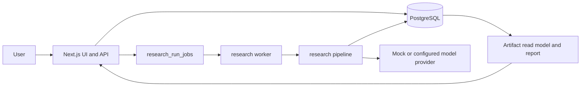
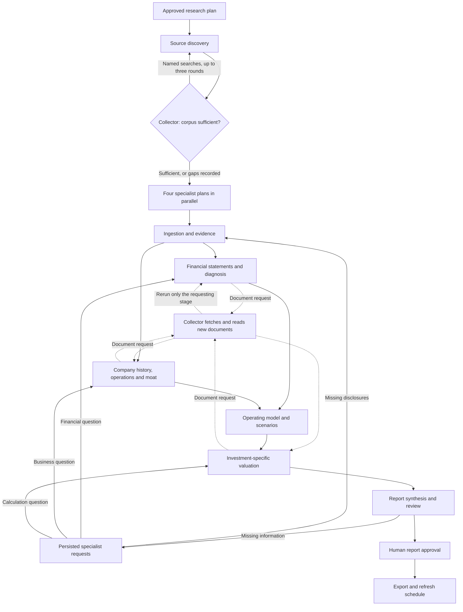

# Current system

Research OS creates evidence-backed investment research for an asset. PostgreSQL stores the workflow, sources, artifacts, decisions, and exported report. The Next.js app provides the UI and API; a separate worker runs queued research jobs.

The API creates a version 3 run with its 24 stage rows. A job lets the worker continue the pipeline outside the HTTP request. The research plan and final review stop for a human decision; approval queues another job. Stage contracts validate outputs before the pipeline persists typed artifacts. Export and refresh scheduling finish the run.

The composed research plan links each source role to specific artifacts. Source discovery records coverage only for fetched documents that pass role checks; evidence extraction rejects prior claims when their source is excluded on replay. Coverage records one representative document per role and artifact, while the evidence packet may use other eligible documents from the same run.

The pipeline runner dispatches independent handlers concurrently; `src/lib/workflow/orchestrator.ts` owns stage transitions, retries, human gates, resume, and completion checks. `src/lib/research/sources/corpus.ts` contains source ingestion and evidence persistence helpers. Quality gates read validated typed artifacts instead of treating completed model tasks as proof of artifact coverage.

Research is assigned to a data collector, four planning specialists and one on-demand repair specialist. Their definitions and stage dependencies live in `src/lib/research/team-plan.ts`.

| Specialist | Responsibility |
| --- | --- |
| Data | Discover and download sources, decide when the corpus is sufficient for the specialists to start, extract evidence, and fetch documents the specialists request. |
| Financials | Read filing statements, normalize periods and units, preserve reported line items, and reconcile financial records. |
| Business | Assess management, operations, history, competition and intangible advantages; develop operating assumptions and bear/base/bull scenarios. |
| Valuation | Build investment-specific valuation schedules using checked financials and operating assumptions. Application code calculates discounting and value bridges. |
| Report | Plan coverage, combine analyses, ask specialists for missing information, and prepare the document for review. |
| Repair (on demand) | When deterministic filing parsing cannot locate primary statements, write a run-scoped module that locates the statement tables. |

After plan approval, source discovery runs first and alone. It collects the base corpus, then the collector (`source-discovery-agent`) reviews coverage against the research plan and either declares the corpus sufficient or names up to six targeted searches, such as a named competitor's annual report. Targeted searches skip seed sites and generic role queries, and a named peer's filing need not mention the researched company. There are at most three review rounds (`MAX_DISCOVERY_ROUNDS`). A required source role that is still uncovered becomes a medium-severity gap owned by `system:source-collector`: the run continues, and the gap names the affected artifacts and the collector's reason. A failed review does not stop the run; the corpus goes forward with its gaps. Each round is saved in a `source_review` artifact.

Only then do the four planning roles (financials, business, valuation and report) prepare their work plans concurrently, with the collector's assessment and document list; the repair specialist has no plan and cannot receive report requests. These are saved as `agent_brief` artifacts and supplied to their later tasks. The stage scheduler starts independent work together: financial normalization and company history can overlap, followed by historical diagnosis and business-process analysis. Forecasts wait for both business analysis and financial diagnosis; valuation waits for operating scenarios. Tasks receive their owner's purpose, work plan, outstanding requests, accepted upstream artifacts and evidence. Planning does not count as completed analysis.

While a financials, business or valuation stage runs, its own analysis call may return an optional `source_requests` list of up to three named searches (`src/lib/research/sources/source-requests.ts`). The call then pauses its stage. Before the next scheduling pass, the runner fetches those documents, reads only them into evidence, refreshes role coverage and reruns the paused stage, which sees what each request found (`src/lib/research/sources/collector.ts`). Other branches and completed stages are not reopened. Each stage has at most two request rounds (`MAX_STAGE_SOURCE_REQUEST_ROUNDS`) and never repeats a query. Requests are saved per stage in `source_requests` artifacts, so a restarted worker resumes queued requests.

`team.ts` saves report questions as `team_requests` artifacts with an owner, source role, materiality and response. A request reopens its specialist's stages and dependent stages, invalidates cached outputs and stale report approval, supersedes open source gaps written by the reopened stages, and uses normal validation before the report can continue. A rerun records any gap that still applies, and a replayed source discovery counts documents linked by earlier passes toward role coverage, because web search results vary between calls. When a failed stage blocks all remaining stages, the run stops with that stage's name and reason. Specialists can escalate missing evidence to the data collector, which searches the specific question and applies existing document, source-role and cutoff checks. Answers must reference current evidence or artifacts. A material unanswered request becomes a blocked report question and withholds the conclusion.

Automatic investigation is bounded to two report request rounds with one source escalation per round. The saved request state survives restarts. Missing disclosures remain explicit; the system does not claim that every fact can be obtained. A session lock prevents two workers from executing the same run, and each parallel batch finishes before failure or human-gate transitions. Model attempts reserve estimated budget under a database lock. Actual costs are always recorded, including costs above the reservation; subsequent attempts check both spending and outstanding reservations.

The mock acceptance test in `tests/sofi-research-e2e.test.ts` exercises API route handlers, queued worker jobs, both human approvals, export, and refresh scheduling against PostgreSQL. It also checks duplicate enqueue requests, lease recovery, failed-run resume, and model-task cache invalidation. It does not exercise the browser UI or paid providers.

## Filing statements and the repair specialist

`src/lib/research/history/filing-statements.ts` reads primary statements from inline XBRL filings. Headings identify statements first; when a filing still lacks one, non-dimensional us-gaap tag fingerprints identify it. Each table records whether it came from a heading, tags or repair. Values always come from tagged facts. When an issuer recasts an earlier period, the latest filing's value is used for that metric and period even if the tag changed.

If a readable filing still lacks a primary statement, the historical-record stage calls the repair specialist (`src/lib/research/repair/`). It writes a JavaScript `locateStatements(filings)` module from table summaries (surrounding text, tag names, row labels; no values). The module runs in a sandbox described in [security](security.md) and returns only table locations; the normal extractor then reads the facts. A repair is accepted only when every filing has all three statements, no unresolved facts and reconciling balance sheets. There are at most three attempts, each given the earlier errors. Every attempt's source, SHA-256 and errors are saved in a `statement_repair` artifact; nothing is written to the codebase. An unresolved repair leaves the stage failed with the original message and a summary.

Historical v1 and v2 rows remain in the database. The current runner accepts version 3 runs. Source and market-data cutoffs are stored per run.

New plans enable [adaptive reports](adaptive-research.md). The review stage composes
company-specific sections before reviewing the complete document. Human approval
binds the report and its input snapshot; export reproduces that approved version.
