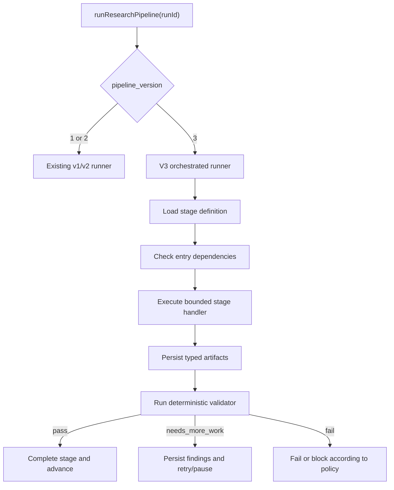

# Research OS v3 Runtime Integration and SOFI Acceptance Plan

**Status:** Required implementation handoff
**Date:** 2026-07-18
**Target asset:** SoFi Technologies, Inc. (`SOFI`)
**Primary objective:** Make Research OS v3 executable end to end and prove it with a source-grounded SOFI initiation run
**Migration rule:** Preserve v1/v2 behavior and historical runs; implement v3 additively

---

## 1. Outcome required

The implementation is complete only when a new `pipeline_version = 3` SOFI run can execute this chain:

```text
intake
→ asset identity
→ archetype composition
→ human-approved research plan
→ source-role discovery and ingestion
→ evidence extraction
→ twenty-quarter historical record
→ company genesis
→ historical diagnosis
→ business-process analysis
→ moat analysis
→ driver-based operating model
→ bear/base/bull operating scenarios
→ independent valuation scenarios
→ annual bear/base/bull price-target paths
→ thesis, risks, catalysts, breakers, and monitoring
→ AI review
→ genuine human review
→ v3 report export
```

Every material conclusion must be traceable:

```text
source document
→ exact source location
→ accepted evidence claim
→ normalized metric or qualitative fact
→ analytical artifact
→ assumption
→ operating scenario
→ valuation calculation
→ annual price target
→ expected return
→ monitoring threshold
```

The target is not merely to make the v3 unit tests pass. The production runtime must create and consume the v3 artifacts.

---

## 2. Verified current state

The following facts were established during the SOFI dry run:

- The v3 schemas, contracts, validators, archetypes, report generator, and many component tests exist.
- Database migrations `0003`–`0005` apply successfully after correcting the migration journal.
- The executable `runSystemResearchPipeline` still uses the v2 stage sequence and v2 persistence paths.
- The executable pipeline currently forces pending runs to `pipeline_version = 2`.
- `scripts/new-equity-run.ts` rejects v3 deliberately because pretending that v2 execution is v3 would be unsafe.
- A SOFI v2 mock run reached `waiting_for_human` with 29 live source documents and no failed stages.
- That run used synthetic model outputs and therefore is not investment research.
- The v2 run still executed 50 backtests despite there being no explicit timing hypothesis.
- The current v3 component tests prove contract behavior in isolation, not end-to-end runtime integration.

Reference dry run:

```text
run_id: dac4339a-04dc-43de-83cb-05249af00f1e
asset: SOFI
pipeline_version: 2
provider: mock
status: waiting_for_human
model_cost: USD 0
```

Do not reuse this run as v3 acceptance evidence.

---

## 3. Non-negotiable implementation rules

1. **Do not rewrite v2 into v3.** Route explicitly by `pipeline_version`.
2. **Do not use one giant report prompt.** Each agent produces one bounded artifact family.
3. **Evidence is not analysis.** `evidence_only` cannot satisfy an analytical stage.
4. **Mock output is synthetic.** It must be tagged, isolated, watermarked, and unable to become investment-ready.
5. **Candidate URLs are not sources.** Only successfully retrieved substantive content can satisfy source-role coverage.
6. **No silent stage skipping.** Every skipped stage records a reason and whether it is blocking.
7. **No fabricated human approval.** Automated test approval is allowed only in explicit test mode.
8. **No forced backtesting.** Without an accepted timing hypothesis, v3 records `not_applicable`.
9. **No interpolated price targets.** Each annual target is recalculated from that year’s operating and valuation assumptions.
10. **No company-specific runtime branches.** SOFI must be represented through composable archetypes and data, not `if symbol === "SOFI"`.
11. **No lookahead.** Sources, market prices, shares, and disclosures must be available by the run cutoff.
12. **No orphaned work.** A terminal or waiting run cannot leave stages or tasks marked `running`.

---

## 4. Target runtime architecture

Implement a version dispatcher and a dedicated v3 stage-handler registry.



Recommended interfaces:

```ts
interface ResearchPipelineRunner {
  run(runId: string): Promise<PipelineResult>;
}

interface V3StageHandler<TOutput = unknown> {
  stageKey: V3StageKey;
  execute(context: V3RunContext): Promise<TOutput>;
  validate(context: V3RunContext, output: TOutput): Promise<ValidationResult>;
}

interface V3RunContext {
  runId: string;
  assetId: string;
  symbol: string;
  cutoffAt: Date;
  runType: string;
  pipelineVersion: 3;
  composedProfile: ComposedResearchProfile;
  budgetRemainingUsd: number;
  testMode: boolean;
}
```

Do not add more v3 logic to the existing monolithic v2 function than the version dispatch itself.

---

## 5. Ownership and AI work-package rules

The implementing AI is the lead and owns integration decisions, test status, and the final handover.

If work is delegated later, use these boundaries:

| Role | Responsibility | Must not do |
|---|---|---|
| Repository finder | Locate symbols, tables, stage flows, and tests | Edit files |
| Runtime developer | Version dispatch, v3 runner, stage handlers | Change analytical contracts without approval |
| Research developer | Source, history, genesis, business, and moat handlers | Change workflow state machine |
| Forecast developer | Operating model, scenarios, valuation paths | Modify source ingestion |
| Tester | Fixtures, integration tests, failure diagnosis | Silently modify production logic |
| Reviewer | Independent correctness and regression audit | Make edits |

Serialize edits to these shared files:

```text
src/lib/research/system-pipeline.ts
src/lib/workflow/orchestrator.ts
src/lib/workflow/stages.ts
src/lib/workflow/validators.ts
src/lib/workflow/quality-gates.ts
src/db/index.ts
src/db/migrate.ts
src/db/schema/**
drizzle/**
package.json
package-lock.json
```

Every work-package handoff must contain:

```text
Objective
Owned files
Known dependencies
Required behavior
Acceptance criteria
Test IDs
Commands executed
Remaining risks
```

---

# Work packages

## Work Package 0 — Freeze the baseline and add an executable acceptance harness

### Objective

Preserve the currently working v2 behavior and create a safe harness for starting or resuming generic v3 research runs.

### Required changes

- Keep `scripts/new-equity-run.ts` generic by asset slug or ticker.
- Support:
  - `RESEARCH_ASSET`
  - `RESEARCH_PIPELINE_VERSION`
  - `RESEARCH_ACCEPTANCE_PROVIDER`
  - `RESEARCH_ACCEPTANCE_BUDGET_USD`
  - `RESEARCH_ACCEPTANCE_CUTOFF_AT`
  - `RESEARCH_QUESTION`
  - `RUN_PAID_RESEARCH`
- Remove the temporary rejection of version 3 only after the v3 dispatcher is executable.
- Never auto-approve production research-plan or final human-review gates.
- Allow research-plan approval in explicit `RESEARCH_TEST_MODE=1` only, with test metadata.
- Print the run ID immediately.
- Print final stage counts, cost, failed gates, and pending human actions.
- Add a generic resume script using `RESEARCH_RUN_ID`.
- Preserve `npm run test:sofi-mock`.

### Files

```text
scripts/new-equity-run.ts
scripts/resume-research-run.ts
package.json
tests/research-run-harness.test.ts
```

### Test cases

| ID | Test | Expected result |
|---|---|---|
| WP0-T1 | Start `SOFI` by symbol | Correct asset and primary listing resolved |
| WP0-T2 | Start `sofi` by slug | Same asset resolved |
| WP0-T3 | Request unknown asset | Fails before creating a run |
| WP0-T4 | Request paid provider without `RUN_PAID_RESEARCH=1` | Fails before model call |
| WP0-T5 | Request v3 after dispatcher implementation | Run remains version 3 |
| WP0-T6 | Resume existing run | Reuses run ID and completed outputs |
| WP0-T7 | Production mode reaches research-plan gate | Waits for a human |
| WP0-T8 | Test mode approves research plan | Approval marked test-only |
| WP0-T9 | Harness attempts final human approval | Rejected |
| WP0-T10 | Run ID logging | Run ID appears before network/model work |

### Verification

```bash
npx tsx --test tests/research-run-harness.test.ts
npx tsc --noEmit
```

---

## Work Package 1 — Version dispatch and v3 stage-runner foundation

### Objective

Stop the forced v2 downgrade and execute a dedicated v3 runtime without changing v2 results.

### Required changes

- Replace the unconditional v2 update in `runSystemResearchPipeline`.
- Introduce an explicit dispatcher:

```ts
pipelineVersion >= 3
  ? runResearchPipelineV3(runId)
  : runResearchPipelineV2(runId)
```

- Move or preserve the current implementation as the v1/v2 runner.
- Implement `V3StageHandler` registration.
- Reject duplicate stage keys at startup.
- Fail closed when a v3 stage has no handler.
- Use `STAGE_CONFIGS_V3` through version-aware accessors everywhere.
- Update `validateStageCompletion` to use `getStageConfig(stageKey, pipelineVersion)`, not the v2-only map.
- Add handlers incrementally, but never mark an unimplemented stage completed.
- Persist handler, schema, validator, and prompt versions.

### Files

```text
src/lib/research/system-pipeline.ts
src/lib/research/v3-pipeline.ts
src/lib/research/v3-stage-registry.ts
src/lib/research/v3-context.ts
src/lib/workflow/stages.ts
src/lib/workflow/validators.ts
tests/v3-pipeline-dispatch.test.ts
tests/v3-stage-registry.test.ts
```

### Test cases

| ID | Test | Expected result |
|---|---|---|
| WP1-T1 | Pending v3 run starts | `pipeline_version` remains 3 |
| WP1-T2 | Pending v2 run starts | Existing v2 runner used |
| WP1-T3 | Historical v2 run resumed | No v3 stages or artifacts added |
| WP1-T4 | V3 stage configuration lookup | Returns v3 configuration |
| WP1-T5 | V3 stage lacks handler | Run fails with explicit missing-handler error |
| WP1-T6 | Duplicate handler registration | Startup/test failure |
| WP1-T7 | Handler returns no required artifact | Stage validation fails |
| WP1-T8 | Unknown validation rule | Fail closed |
| WP1-T9 | Stage retries exhausted | Correct stage/run terminal state |
| WP1-T10 | Terminal failure | No running task or stage remains |

### Verification

```bash
npx tsx --test tests/v3-pipeline-dispatch.test.ts tests/v3-stage-registry.test.ts
RUN_DB_INTEGRATION=1 npx tsx --test tests/v3-pipeline-integration.test.ts
```

---

## Work Package 2 — Intake, asset identity, archetype composition, and research plan

### Objective

Make the first four v3 stages produce persisted, validated outputs before any research is gathered.

### Required changes

- `intake`:
  - Validate asset, run type, cutoffs, budget, and research question.
- `asset_identity`:
  - Resolve legal entity, primary instrument/listing, currency, exchange, and profile.
  - Create a run-scoped profile assignment if needed.
- `archetype_composition`:
  - Compose SOFI from general archetypes such as:
    - bank
    - lender
    - financial marketplace
    - technology platform
  - Store the composed profile and conflicts.
- `research_plan`:
  - Persist required artifact types, source roles, metrics, valuation lenses, and open questions.
  - Pause for genuine human approval outside test mode.

No `SOFI` symbol or slug branch is allowed in runtime contracts.

### Files

```text
src/lib/research/v3/handlers/intake.ts
src/lib/research/v3/handlers/asset-identity.ts
src/lib/research/v3/handlers/archetype-composition.ts
src/lib/research/v3/handlers/research-plan.ts
src/lib/research/archetypes/**
src/lib/research/v3-contracts.ts
tests/v3-intake-and-planning.test.ts
```

### Test cases

| ID | Test | Expected result |
|---|---|---|
| WP2-T1 | SOFI composition | Bank, lender, marketplace, and technology-platform requirements composed |
| WP2-T2 | Duplicate module from two archetypes | Deduplicated with provenance |
| WP2-T3 | Conflicting archetype rule | Explicit conflict requiring resolution |
| WP2-T4 | Search runtime for SOFI branch | No company-specific branch |
| WP2-T5 | Missing primary listing | Asset-identity stage fails |
| WP2-T6 | Missing active assignment but primary profile exists | Run-scoped assignment created idempotently |
| WP2-T7 | Research plan omits required source role | Plan validation fails |
| WP2-T8 | Production approval by system actor | Rejected |
| WP2-T9 | Test-mode approval | Allowed and visibly marked synthetic/test-only |
| WP2-T10 | Repeat stage execution | No duplicate profile or plan artifact |

---

## Work Package 3 — Executable source-role planning, retrieval, and coverage

### Objective

Turn the v3 source-intelligence contracts into an actual information-gathering workflow.

### Required SOFI source roles

```text
annual_filing
quarterly_filing
earnings_release
earnings_presentation
earnings_transcript
proxy_governance
investor_relations
founder_company_history
bank_regulatory
peer_company_primary
industry_primary
customer_channel
macro_rates
market_data
```

### Required changes

- Generate a source-role plan from the composed profile.
- Retrieve substantive content, not search-result placeholders.
- Record every retrieval attempt, status, response metadata, cutoff eligibility, and failure reason.
- Assign roles only after successful retrieval and content validation.
- Preserve candidates separately from sources.
- Use primary sources first:
  - SEC filings and exhibits
  - SoFi investor relations
  - Proxy materials
  - FDIC/Federal Reserve industry and regulatory material
  - Primary filings/materials for selected peers
- A peer source must be a retrieved peer primary source, not a page containing the word “peer.”
- Founder-history retrieval must seek contemporary and retrospective material and classify both.
- Create explicit source gaps for unavailable roles.
- Make retrieval idempotent by canonical URL, content hash, cutoff, and role.
- Ensure large HTML is normalized before PostgreSQL full-text indexing so unbroken script tokens do not produce indexing warnings.

### Files

```text
src/lib/research/v3/handlers/source-discovery.ts
src/lib/research/v3/handlers/source-ingestion.ts
src/lib/research/sources/**
src/lib/ingestion/parser.ts
src/db/schema/source-intelligence.ts
tests/v3-source-retrieval.test.ts
tests/v3-source-coverage-integration.test.ts
```

### Test cases

| ID | Test | Expected result |
|---|---|---|
| WP3-T1 | Candidate URL only | Does not satisfy role |
| WP3-T2 | HTTP failure | Attempt recorded; role remains gap |
| WP3-T3 | Retrieved page has thin/irrelevant content | Rejected as substantive coverage |
| WP3-T4 | FDIC Quarterly Banking Profile retrieved | Satisfies industry/regulatory role according to explicit assignment |
| WP3-T5 | SoFi 10-K retrieved | Satisfies annual filing only after content validation |
| WP3-T6 | Peer company primary filing retrieved | Satisfies peer-primary role |
| WP3-T7 | Source published after cutoff | Excluded |
| WP3-T8 | Duplicate retrieval | No duplicate source, parse, chunk, or assignment |
| WP3-T9 | Founder source unavailable | Explicit gap; no invented origin story |
| WP3-T10 | Large HTML with long script token | Parser strips/segments it without database indexing warning |
| WP3-T11 | Required role missing | Source stage reports `needs_more_work` |
| WP3-T12 | All required roles covered or human-waived | Source gate passes with audit trail |

### Verification

```bash
npx tsx --test tests/v3-source-retrieval.test.ts
RUN_DB_INTEGRATION=1 npx tsx --test tests/v3-source-coverage-integration.test.ts
```

Live source smoke must be opt-in:

```bash
RUN_SOURCE_SMOKE=1 RESEARCH_ASSET=SOFI npm run test:source-smoke
```

---

## Work Package 4 — Evidence extraction and synthetic-data isolation

### Objective

Persist only source-verifiable claims in production and prevent mock fixtures from being mistaken for research.

### Required changes

- Production evidence claims require:
  - real source ID
  - real document chunk ID
  - bounded exact quote
  - valid character offsets or deterministic locator
  - claim type/category
  - as-of date
  - confidence
- Reject invented, mismatched, or cross-source identifiers.
- Tag mock/test output:

```text
is_synthetic = true
synthetic_fixture_id
test_run_id
```

- Synthetic evidence may validate orchestration but:
  - cannot be exported without a prominent test watermark
  - cannot set `investment_ready`
  - cannot coexist with production evidence in one run
  - cannot be used by a paid/production run
- Make evidence persistence idempotent without collapsing legitimate repeated disclosures.
- Complete `evidence_extraction` only after minimum claim and role-linked coverage is satisfied.

### Files

```text
src/lib/research/v3/handlers/evidence-extraction.ts
src/lib/research/source-reader-batching.ts
src/lib/research/artifacts/repository.ts
src/lib/agent-harness/providers/mock.ts
src/db/schema/evidence.ts
tests/v3-evidence-extraction.test.ts
tests/mock-provider.test.ts
```

### Test cases

| ID | Test | Expected result |
|---|---|---|
| WP4-T1 | Exact quote and matching chunk | Claim accepted |
| WP4-T2 | Invented chunk ID | Claim rejected |
| WP4-T3 | Quote not found in chunk | Claim rejected or confidence capped and repair required |
| WP4-T4 | Same claim retried | No duplicate |
| WP4-T5 | Same fact in two periods | Both retained |
| WP4-T6 | Mock SOFI run | Claims say SOFI, never MELI |
| WP4-T7 | Synthetic claim in production run | Hard failure |
| WP4-T8 | Synthetic run exported | Test watermark required |
| WP4-T9 | Synthetic run evaluated for investment readiness | Blocked |
| WP4-T10 | Evidence exists but analytical artifact does not | Downstream analysis remains incomplete |

---

## Work Package 5 — Twenty-quarter history and market-data integration

### Objective

Build a point-in-time, reconciled SOFI historical foundation that v3 analysis and valuation can consume.

### Required changes

- Execute the provider-neutral market-data service from the v3 runtime.
- Persist OHLCV, adjusted prices, splits, dividends, currency, and exchange timezone.
- Do not use Yahoo as authoritative for filed financials, shares, cash, debt, segments, or guidance.
- Construct twenty quarters with explicit period and availability dates.
- SOFI coverage should include, where disclosed:
  - total revenue
  - net interest income
  - noninterest revenue
  - adjusted net revenue with definition
  - net income
  - tangible book value
  - deposits
  - lending originations and balances
  - net interest margin
  - charge-offs/credit losses
  - Financial Services members/products and contribution profit
  - Technology Platform accounts/revenue/contribution profit
  - Galileo/Technisys KPIs where available
  - shares and dilution
  - regulatory capital
- Preserve GAAP/non-GAAP separation.
- Reconcile annual to quarterly totals and restatements.
- Record gaps instead of padding missing quarters.

### Files

```text
src/lib/research/v3/handlers/historical-record.ts
src/lib/research/history/**
src/lib/market-data/**
src/db/schema/market-data.ts
src/db/schema/metrics.ts
tests/sofi-historical-record.test.ts
tests/v3-market-data-integration.test.ts
```

### Test cases

| ID | Test | Expected result |
|---|---|---|
| WP5-T1 | Twenty complete quarters | Coverage gate passes |
| WP5-T2 | Nineteen quarters without gap record | Fails |
| WP5-T3 | Missing disclosed KPI with gap record | Visible gap; confidence reduced |
| WP5-T4 | GAAP and adjusted revenue | Stored as different definitions |
| WP5-T5 | Restated quarter | Old value preserved; newest eligible value canonical |
| WP5-T6 | Annual total differs materially from quarters | Reconciliation conflict |
| WP5-T7 | Market cutoff on weekend | Prior trading close selected |
| WP5-T8 | Share count published after cutoff | Rejected as lookahead |
| WP5-T9 | Split in price history | Raw and adjusted prices remain distinct |
| WP5-T10 | Yahoo fundamental conflicts with filing | Filing wins; conflict logged |
| WP5-T11 | Duplicate market fetch | No duplicate bars/actions |
| WP5-T12 | Currency mismatch | No silent conversion |

---

## Work Package 6 — Company genesis, historical diagnosis, business processes, and moat

### Objective

Execute the v3 qualitative analytical stages as typed, source-linked artifacts.

### Required artifacts

```text
company_genesis
founder_profile
strategic_history_timeline
strategic_dna
historical_diagnosis
segment_model
customer_decision_map
business_process_map
bottleneck_map
competitive_response_matrix
moat_assessment
moat_attack_matrix
no_moat_counterfactual
```

### SOFI analytical requirements

- Explain the founding problem and motivations using evidence, not mythology.
- Distinguish the original student-loan refinancing model from the current business.
- Track major pivots such as product expansion, bank charter/deposit funding, Galileo, and Technisys.
- Model at least these economic processes:
  - member acquisition and cross-buying
  - deposit gathering and funding-cost conversion
  - loan origination, sale/retention, funding, and credit losses
  - Financial Services product monetization
  - Technology Platform account growth and monetization
- Map customer decisions, bottlenecks, competitive responses, cash conversion, and financial statement lines.
- Attack every moat claim.
- Include a no-moat counterfactual distinct from the bear case.

### Files

```text
src/lib/research/v3/handlers/company-genesis.ts
src/lib/research/v3/handlers/historical-diagnosis.ts
src/lib/research/v3/handlers/business-process-analysis.ts
src/lib/research/v3/handlers/moat-analysis.ts
src/lib/research/genesis/**
src/lib/research/diagnosis/**
src/lib/research/business/**
src/lib/research/moat/**
tests/sofi-analysis-artifacts.test.ts
```

### Test cases

| ID | Test | Expected result |
|---|---|---|
| WP6-T1 | Founder motivation has contemporary evidence | Accepted with evidence classification |
| WP6-T2 | Wealth/status motive asserted without evidence | Rejected |
| WP6-T3 | Retrospective founder account | Labeled retrospective |
| WP6-T4 | Original and current business differ | Strategic pivot recorded |
| WP6-T5 | Structural trend lacks causal process node | Diagnosis fails |
| WP6-T6 | Single-quarter spike labeled structural | Rejected without corroboration |
| WP6-T7 | Lending process omits funding and credit loss | Business-process validation fails |
| WP6-T8 | Deposit growth omits funding-cost implication | Validation fails |
| WP6-T9 | Technology Platform omits customer/usage/monetization | Validation fails |
| WP6-T10 | High margin is the only moat evidence | Moat rejected |
| WP6-T11 | Moat attack has no financial translation | Validation fails |
| WP6-T12 | No-moat counterfactual duplicates bear case | Rejected |

---

## Work Package 7 — Driver tree, operating model, and operating scenarios

### Objective

Turn the accepted history and process analysis into a deterministic, reconciled forecast.

### Required changes

- Persist a driver tree connecting:

```text
historical diagnosis
→ business process
→ forecast driver
→ assumption
→ annual operating line
```

- Forecast SOFI’s major economic engines separately.
- Include capital and funding constraints.
- Create exactly one accepted operating scenario set per model version.
- Bear/base/bull must differ through business-process outcomes, not blanket percentages.
- Scenario probabilities must total 1.
- Model share dilution/buybacks explicitly.
- Reconcile segments and consolidated financials.
- Store formulas and calculation manifests.

### Files

```text
src/lib/research/v3/handlers/operating-model.ts
src/lib/research/v3/handlers/operating-scenarios.ts
src/lib/research/forecast/**
src/lib/research/artifacts/repository.ts
tests/sofi-operating-model.test.ts
```

### Test cases

| ID | Test | Expected result |
|---|---|---|
| WP7-T1 | Revenue CAGR without driver path | Rejected |
| WP7-T2 | Lending growth exceeds funding/capital capacity | Rejected unless expansion is modeled |
| WP7-T3 | Deposit growth lowers funding cost | Financial impact flows through model |
| WP7-T4 | Higher lending growth without credit losses | Rejected |
| WP7-T5 | Technology Platform growth lacks account/ARPU drivers | Rejected |
| WP7-T6 | Bear case is base minus 20% everywhere | Rejected |
| WP7-T7 | Scenario probabilities equal 0.95 | Rejected |
| WP7-T8 | Segment total differs from consolidated | Rejected |
| WP7-T9 | Bull case assumes stronger moat and lower moat maintenance | Rejected unless evidenced |
| WP7-T10 | Updated historical artifact | Downstream model/scenarios invalidated |
| WP7-T11 | Repeat calculation | Identical deterministic outputs |

---

## Work Package 8 — Valuation and annual bear/base/bull price-target paths

### Objective

Execute suitable SOFI valuation methods and persist a price target for every forecast year in all three scenarios.

### Required valuation methods

Use methods only when inputs are valid:

- Residual income / excess return
- Price-to-tangible-book with ROE/COE support
- Segment SOTP for lending, Financial Services, and Technology Platform
- DCF only where cash-flow definitions are economically suitable
- Reverse valuation translating current price into required operating outcomes

### Required changes

- Link every valuation scenario to an accepted operating scenario.
- Preserve independence between operating and valuation assumptions.
- Persist:

```text
valuation_method_run
valuation_scenario_set
scenario_price_targets
annual_price_target_path
reverse_valuation
expected_return_matrix
```

- Required table:

```text
| Fiscal year | Bear target | Base target | Bull target | Base upside | Base CAGR |
```

- Recalculate each year:

```text
P/TBV target = forecast tangible book value per share × justified P/TBV
P/E target = forecast EPS × scenario P/E
SOTP target = (sum of segment values − net debt/required capital adjustments) ÷ diluted shares
DCF target at year t = value at t of remaining cash flows and terminal value
```

- Never linearly interpolate from current price to terminal target.
- Include share count, dividends, capital requirements, and currency explicitly.
- Final-year path value must equal the terminal anchor.

### Files

```text
src/lib/research/v3/handlers/asset-valuation.ts
src/lib/research/valuation/**
src/lib/valuation/method-protocol.ts
src/db/schema/valuation.ts
src/db/schema/research-artifacts.ts
tests/sofi-valuation-path.test.ts
tests/valuation-method-protocol.test.ts
```

### Test cases

| ID | Test | Expected result |
|---|---|---|
| WP8-T1 | Known TBV/share and P/TBV path | Exact annual targets |
| WP8-T2 | Known EPS and P/E path | Exact annual targets |
| WP8-T3 | SOTP with required capital and dilution | Correct per-share values |
| WP8-T4 | Missing intermediate year | Validation fails |
| WP8-T5 | Linear interpolation submitted | Rejected |
| WP8-T6 | Final target differs from terminal anchor | Rejected |
| WP8-T7 | Bear path declines then recovers | Accepted; monotonicity not required |
| WP8-T8 | Operating scenario missing | Valuation scenario rejected |
| WP8-T9 | Segment values do not reconcile | SOTP rejected |
| WP8-T10 | Share dilution omitted | Expected-return gate fails |
| WP8-T11 | Currency differs from market price | Explicit conversion required |
| WP8-T12 | Duplicate scenario/year | Database uniqueness prevents duplicate |
| WP8-T13 | Current price reverse valuation | Required operational outcomes persisted |
| WP8-T14 | Report target table | All forecast years and three scenarios rendered |

---

## Work Package 9 — Decision synthesis, AI review, human review, and export

### Objective

Create the decision layer only after accepted operating and valuation outputs exist.

### Required artifacts

```text
investment_thesis
risk_register
catalyst_register
thesis_breakers
monitoring_dashboard
expected_return_matrix
confidence_assessment
ai_review
human_decision
export_manifest
```

### Required changes

- Risks require causal mechanism, exposure, probability, severity, indicator, threshold, and model consequence.
- Source gaps are research limitations, not automatically business risks.
- Catalysts require a discrete event or change, timing window, transmission mechanism, and affected model input.
- Drivers are not catalysts by default.
- Thesis breakers map to explicit KPI thresholds.
- Monitoring KPIs map to model inputs and sources.
- AI review must test unsupported claims, definition conflicts, scenario coherence, valuation reconciliation, and synthetic contamination.
- Human review must require a persisted human decision.
- The v3 report generator must consume accepted current v3 artifacts only.
- Missing sections render as incomplete; never insert filler.
- Mock reports are prominently watermarked and never action-ready.

### Canonical SOFI report order

1. Decision context
2. Company genesis and founder motivation
3. Strategic-history timeline
4. Current company and segment model
5. Twenty-quarter historical record
6. Historical diagnosis
7. Customer and business-process maps
8. Competitive response and moat attacks
9. Driver tree and operating model
10. Bear/base/bull operating scenarios
11. Valuation methods and reverse valuation
12. Annual bear/base/bull price-target table
13. Expected-return matrix
14. Thesis, risks, catalysts, and breakers
15. Monitoring dashboard
16. Source coverage, limitations, and confidence
17. Review decision and audit appendix

### Files

```text
src/lib/research/v3/handlers/decision-synthesis.ts
src/lib/research/v3/handlers/ai-reviewer.ts
src/lib/research/v3/handlers/human-review.ts
src/lib/research/v3/handlers/export.ts
src/lib/research/decision/**
src/lib/export/v3-report-generator.ts
tests/sofi-decision-and-export.test.ts
```

### Test cases

| ID | Test | Expected result |
|---|---|---|
| WP9-T1 | Thesis created before accepted valuation | Rejected |
| WP9-T2 | Source gap submitted as operating risk | Rejected without business mechanism |
| WP9-T3 | Growth driver submitted as catalyst | Rejected without discrete event |
| WP9-T4 | Breaker lacks threshold | Rejected |
| WP9-T5 | Monitoring KPI lacks model input | Rejected |
| WP9-T6 | AI review finds critical issue | Human review blocked |
| WP9-T7 | System actor records final approval | Rejected |
| WP9-T8 | Genuine approved human decision | Export allowed |
| WP9-T9 | Missing genesis artifact | Visible incomplete section |
| WP9-T10 | Synthetic run report | Watermarked and not investment-ready |
| WP9-T11 | Annual target paths present | Three-scenario table renders all years |
| WP9-T12 | Superseded artifact | Excluded from main report; present in audit appendix |
| WP9-T13 | Repeat export | Deterministic content/manifest except allowed timestamps |

---

## Work Package 10 — Optional backtest behavior

### Objective

Remove v2’s mandatory 50-backtest behavior from v3.

### Required changes

- Add or consume a `timing_hypothesis` artifact.
- When no accepted hypothesis exists:

```text
optional_backtest.status = not_applicable
reason = no_explicit_timing_hypothesis
```

- Do not create backtest tasks or execute Python.
- When a hypothesis exists, execute only the bounded strategy and robustness tests required by that hypothesis.
- Backtest failure does not invalidate fundamental research unless the thesis explicitly depends on it.

### Files

```text
src/lib/research/v3/handlers/optional-backtest.ts
src/lib/backtesting/**
tests/v3-optional-backtest.test.ts
```

### Test cases

| ID | Test | Expected result |
|---|---|---|
| WP10-T1 | SOFI initiation with no timing hypothesis | Backtest `not_applicable` |
| WP10-T2 | No timing hypothesis | Zero backtest tasks and results |
| WP10-T3 | Accepted timing hypothesis | Bounded backtest executes |
| WP10-T4 | Hypothesis not point-in-time testable | Rejected |
| WP10-T5 | Backtest fails but thesis is fundamental | Research may continue with warning |
| WP10-T6 | Thesis explicitly depends on timing result | Failed backtest blocks dependent conclusion |
| WP10-T7 | V2 run | Existing v2 behavior unchanged |

---

## Work Package 11 — Idempotency, invalidation, terminal states, and observability

### Objective

Make v3 safe to retry, resume, audit, and operate.

### Required changes

- Use idempotency keys for sources, claims, artifacts, assumptions, scenarios, targets, tasks, and model-call ledgers.
- Updating an accepted upstream artifact invalidates every dependent artifact.
- Resuming begins at the first incomplete/invalid stage.
- A waiting or terminal run leaves no unrelated running work.
- Persist:
  - stage/handler version
  - prompt/schema/validator versions
  - provider/model/attempt
  - token/cost/latency
  - source and artifact counts
  - validation failures
  - invalidation reasons
  - human actions
- Enforce budget before each model attempt.
- On failure, transactionally finalize running tasks/stages.

### Files

```text
src/lib/research/v3-pipeline.ts
src/lib/workflow/orchestrator.ts
src/lib/research/artifacts/repository.ts
src/lib/agents/model-calls.ts
tests/v3-resume-and-idempotency-integration.test.ts
```

### Test cases

| ID | Test | Expected result |
|---|---|---|
| WP11-T1 | Interrupt after evidence and resume | No duplicate evidence or model cost |
| WP11-T2 | Interrupt during valuation and resume | Completed methods reused |
| WP11-T3 | Historical artifact superseded | Diagnosis through decision invalidated |
| WP11-T4 | Duplicate annual target insert | Prevented |
| WP11-T5 | Budget exhausted before attempt | No provider call |
| WP11-T6 | Provider failure | Attempt and redacted error recorded |
| WP11-T7 | Run `needs_more_work` | No running tasks/stages |
| WP11-T8 | Run `waiting_for_human` | Only human stage waits; no model task runs |
| WP11-T9 | Run completed | No pending/running required stage |
| WP11-T10 | Resume v2 run | V3 invalidation logic does not alter it |

---

## Work Package 12 — SOFI mock end-to-end acceptance

### Objective

Prove orchestration, persistence, gates, and report structure without paid inference.

### Fixture requirements

- Mock provider must be asset-aware.
- SOFI fixture must cover:
  - founder/genesis evidence
  - bank/lender/marketplace/technology-platform archetypes
  - twenty quarters
  - all major business processes
  - moat proof and attack
  - operating model
  - three operating scenarios
  - at least two valuation methods
  - annual price targets
  - decision artifacts
- All synthetic data must be labeled.
- Live network must not be required for the deterministic CI fixture.
- A separate opt-in smoke may use live SEC/Yahoo/FDIC retrieval.

### Files

```text
tests/fixtures/sofi-v3/**
tests/sofi-v3-e2e.test.ts
scripts/new-equity-run.ts
package.json
```

### Test cases

| ID | Test | Expected result |
|---|---|---|
| WP12-T1 | Fresh deterministic SOFI v3 run | Remains pipeline version 3 |
| WP12-T2 | Research-plan test approval | Clearly marked test-only |
| WP12-T3 | All required stages execute | Correct order and dependencies |
| WP12-T4 | No timing hypothesis | Backtest not applicable |
| WP12-T5 | Artifact registry queried | Required current artifacts exist |
| WP12-T6 | Annual targets queried | Every year has bear/base/bull |
| WP12-T7 | AI review | No unresolved critical fixture issue |
| WP12-T8 | Final state before human approval | `waiting_for_human` |
| WP12-T9 | Running work query | Zero non-human running tasks/stages |
| WP12-T10 | Synthetic readiness | Never `investment_ready` |
| WP12-T11 | Test export | Watermarked and structurally complete |
| WP12-T12 | Repeat full run with same fixture key | No duplicate logical artifacts |

### Required command

```bash
RESEARCH_TEST_MODE=1 \
RESEARCH_ASSET=SOFI \
RESEARCH_PIPELINE_VERSION=3 \
RESEARCH_ACCEPTANCE_PROVIDER=mock \
npm run test:sofi-v3
```

---

## Work Package 13 — Real-provider SOFI acceptance

### Objective

After every deterministic test passes, execute a bounded real-provider SOFI v3 initiation run.

### Preconditions

- Full unit suite passes.
- Database integration suite passes.
- TypeScript and production build pass.
- Mock SOFI v3 E2E passes.
- Live source smoke passes.
- Provider smoke passes.
- Budget and provider are explicit.
- No unresolved Blocking or High review finding.

### Run policy

- Use a fresh run.
- Set a cutoff timestamp.
- Set an explicit USD budget.
- Do not print secrets.
- Do not auto-approve either human gate.
- A human must inspect and approve the research plan.
- Stop at final human review.
- Do not weaken gates to make the run pass.
- Do not export an investment-ready report before human approval.

### SOFI real-run acceptance cases

| ID | Test | Expected result |
|---|---|---|
| WP13-T1 | Create paid SOFI run | Version 3 and correct composed profile |
| WP13-T2 | Source coverage | Required roles covered or explicitly blocked/waived |
| WP13-T3 | Evidence sampling | Claims match exact cited text |
| WP13-T4 | Historical record | Twenty quarters accounted for |
| WP13-T5 | Genesis | Founder motivation evidenced or unknown |
| WP13-T6 | Business processes | Deposits, lending, Financial Services, and Technology Platform modeled |
| WP13-T7 | Moat review | Every moat has attack and financial translation |
| WP13-T8 | Operating model | Segment/consolidated and capital constraints reconcile |
| WP13-T9 | Scenarios | One accepted bear/base/bull operating set |
| WP13-T10 | Valuation | Suitable methods execute and reconcile |
| WP13-T11 | Price paths | Every forecast year has three recalculated targets |
| WP13-T12 | Reverse valuation | Current-price operating requirements visible |
| WP13-T13 | Decision artifacts | Risks/catalysts/breakers/monitoring pass |
| WP13-T14 | Backtest | Not applicable unless hypothesis accepted |
| WP13-T15 | AI review | No unresolved critical finding |
| WP13-T16 | Final state | Waiting for genuine human review |
| WP13-T17 | Cost | At or below configured budget |
| WP13-T18 | Terminal integrity | No orphaned running work |

### Suggested command

```bash
RUN_PAID_RESEARCH=1 \
RESEARCH_ASSET=SOFI \
RESEARCH_PIPELINE_VERSION=3 \
RESEARCH_ACCEPTANCE_PROVIDER=direct-openai-compatible \
RESEARCH_ACCEPTANCE_BUDGET_USD=10 \
npm run run:equity
```

Do not execute this command until the user explicitly authorizes paid inference.

---

## 6. Required implementation sequence

Follow this order:

1. WP0 — baseline harness
2. WP1 — version dispatch and v3 runner
3. WP2 — intake and planning
4. WP3 — source execution
5. WP4 — evidence and synthetic isolation
6. WP5 — historical record and market data
7. WP6 — analytical artifacts
8. WP7 — operating model and scenarios
9. WP8 — valuation and annual targets
10. WP9 — decision/review/export
11. WP10 — optional backtest
12. WP11 — resume/idempotency hardening
13. WP12 — deterministic SOFI v3 E2E
14. Independent review
15. WP13 — real-provider acceptance after explicit authorization

Do not skip directly to the paid run because isolated component tests already pass. The missing work is runtime composition.

---

## 7. Global validation commands

Run after each work package as applicable:

```bash
npm run test:unit
RUN_DB_INTEGRATION=1 npm run test:integration
npx tsc --noEmit
npm run build
git diff --check
```

Add and run:

```bash
RUN_DB_INTEGRATION=1 npm run test:v3-integration
RESEARCH_TEST_MODE=1 npm run test:sofi-v3
```

Opt-in network/provider checks:

```bash
RUN_MARKET_DATA_SMOKE=1 npm run test:market-data-smoke
RUN_SOURCE_SMOKE=1 RESEARCH_ASSET=SOFI npm run test:source-smoke
RUN_PROVIDER_SMOKE=1 npm run test:provider-smoke
```

Tests must report environmental failures honestly. A skipped database test is not a passing integration test.

---

## 8. Final completion checklist

### Runtime

- [ ] V3 run remains `pipeline_version = 3`
- [ ] V2 behavior and historical runs remain unchanged
- [ ] Every v3 stage has a registered handler
- [ ] Every handler persists required typed artifacts
- [ ] Validators use version-aware stage configurations

### Information gathering

- [ ] Required source roles are executable
- [ ] Candidate URLs cannot satisfy coverage
- [ ] Failed/thin retrievals cannot satisfy coverage
- [ ] SOFI filing, IR, proxy, founder, peer, industry, regulatory, macro, and market roles are covered or explicitly blocked
- [ ] All source content respects cutoff rules

### Research

- [ ] Twenty-quarter SOFI history is reconciled
- [ ] Genesis and founder motivation are source-grounded
- [ ] Historical diagnosis maps to causal process nodes
- [ ] Major SOFI business processes are modeled
- [ ] Moat proof, attacks, and no-moat counterfactual exist

### Forecast and valuation

- [ ] Driver tree and operating model reconcile
- [ ] Exactly one accepted operating scenario set exists
- [ ] Valuation scenarios are linked but independently parameterized
- [ ] Annual bear/base/bull targets exist for every forecast year
- [ ] Intermediate targets are calculated, not interpolated
- [ ] Reverse valuation and expected return are present

### Decision and controls

- [ ] Risks, catalysts, breakers, and monitoring use typed contracts
- [ ] No timing hypothesis results in backtest `not_applicable`
- [ ] Synthetic data cannot become investment-ready
- [ ] AI review has no unresolved critical finding
- [ ] Final approval requires a genuine human decision
- [ ] Waiting/terminal runs have no orphaned running work

### Acceptance

- [ ] Unit tests pass
- [ ] PostgreSQL integration tests pass
- [ ] TypeScript passes
- [ ] Production build passes
- [ ] Diff check passes
- [ ] Deterministic SOFI v3 E2E passes
- [ ] Independent reviewer reports no unresolved Blocking or High issue
- [ ] Paid SOFI v3 run is attempted only after explicit authorization
- [ ] Real SOFI v3 run reaches final human review or stops at a correct explicit blocker
- [ ] A dated handover records run ID, provider, model versions, cost, sources, outputs, test results, and remaining risks

---

## 9. Definition of done

Research OS v3 is not done because its contracts compile or its isolated validators pass.

It is done when the runtime can demonstrate, for a fresh SOFI run:

```text
real sources
→ linked claims
→ normalized twenty-quarter history
→ source-grounded company story
→ diagnosed economics
→ customer and business processes
→ challenged competitive advantages
→ driver-based scenarios
→ executable valuation
→ annual bear/base/bull price targets
→ expected return and monitoring
→ independent AI review
→ genuine human decision
```

Every arrow must be inspectable in the database and the exported audit package.
